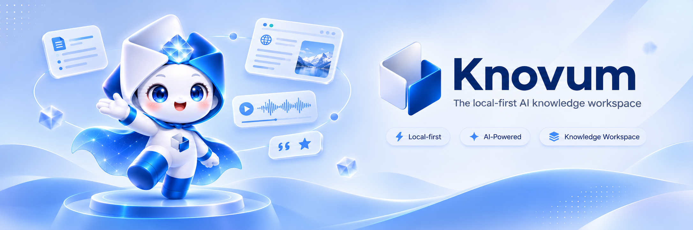
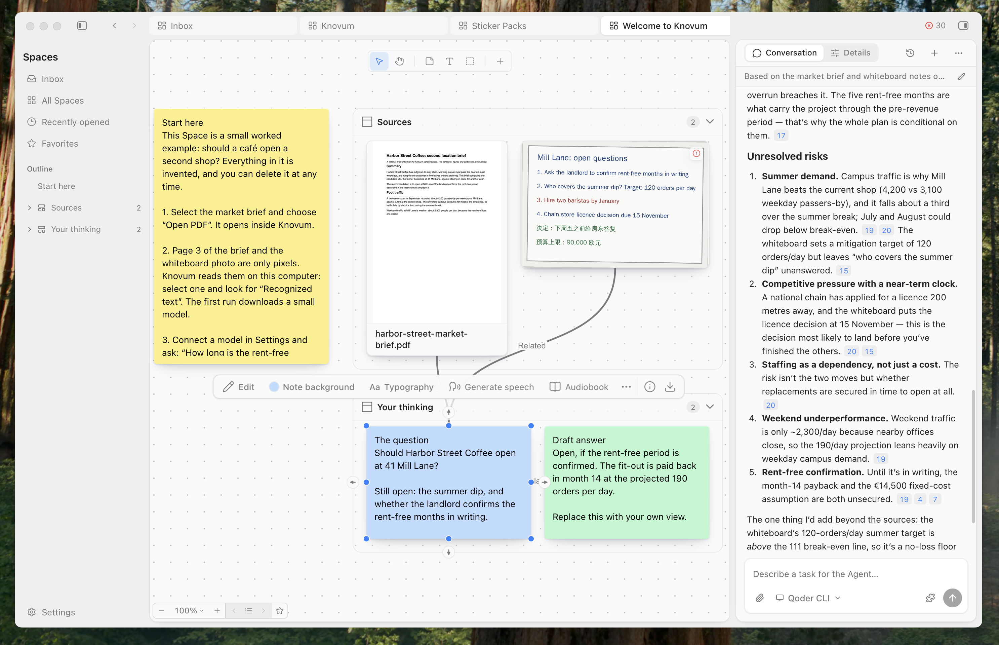
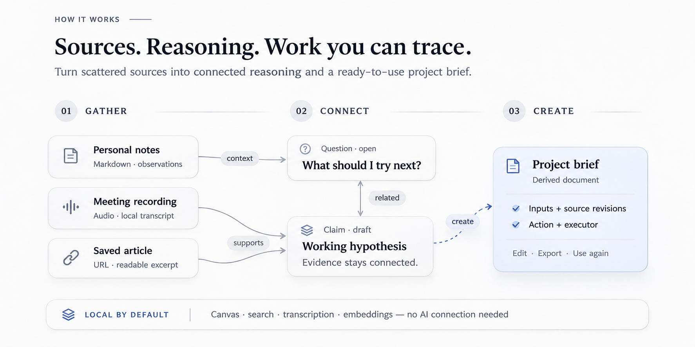

<div align="center">
  <a href="https://github.com/madebyzan/knovum/releases/latest">
    
  </a>

  <p>
    <strong>The local-first AI knowledge workspace — an infinite canvas where your notes, web pages,<br />
    recordings and documents become cited answers and finished work.</strong>
  </p>

  <p>
    <a href="https://github.com/madebyzan/knovum/releases/latest"></a>
    <a href="https://github.com/madebyzan/knovum/actions/workflows/quality.yml"></a>
    <a href="https://github.com/madebyzan/knovum/stargazers"></a>
    
    
    <a href="LICENSE"></a>
  </p>

  <p>
    <a href="https://github.com/madebyzan/knovum/releases/latest"><strong>Download for macOS & Windows</strong></a> ·
    <a href="#features">Features</a> ·
    <a href="#on-device-ai">On-device AI</a> ·
    <a href="#faq">FAQ</a> ·
    <a href="#build-from-source">Build from source</a> ·
    <a href="README.zh-CN.md">简体中文</a>
  </p>
</div>



---

**Knovum** is a desktop knowledge workspace for research, learning and creation. Put everything a
piece of work depends on — notes, saved web pages and videos, meeting recordings, PDFs and Office
documents, images, code — on one infinite canvas called a **Space**. Ask questions and get answers
whose citations point at the exact passage, timestamp or page. Turn what you selected into a
document, an image, a video or a voice track, and keep a recorded trail from every result back to the
inputs that made it.

Your library lives on your machine in SQLite and a local vector index. Transcription, speaker
recognition, text recognition (OCR), embeddings, semantic search and image tools run on-device. Cloud models are optional,
bring-your-own-key, and only receive the context an action needs.

## Why Knovum

- **Local-first and private.** Spaces, files, extracted text, search indexes and backups stay on your
  disk. No account, no Knovum cloud, no telemetry of your content.
- **A canvas that understands its contents.** Not just cards on a whiteboard: notes, captures and
  recordings are indexed, searchable by meaning, and connected by typed relations such as _supports_
  and _contradicts_.
- **Answers you can check.** Every citation keeps its location — a time range in a recording, a page
  in a PDF, a heading in a note — and stays tied to the revision it quoted. A PDF citation opens the
  original in the built-in reader, at that page with the passage highlighted.
- **Results that remember where they came from.** Generated documents and media record their inputs,
  revisions, action and model. When a source changes later, Knovum tells you; it never rewrites your
  work behind your back.
- **A real on-device AI studio.** Whisper transcription, speaker diarization, text-to-speech and voice
  cloning, background removal, upscaling, inpainting and depth estimation — no model server required.
- **Desktop-native.** Built with Tauri 2 and Rust: native menus, a command palette, keyboard-first
  editing, system-wide push-to-talk dictation, signature-verified updates and 11 interface languages.

## How it works

<div align="center">
  
  <sub>An example knowledge flow, shown schematically.</sub>
</div>

1. **Collect.** Paste a link to clip a web page or a YouTube, Bilibili, TikTok or Vimeo video; drop
   in recordings, PDFs, Office files, images and code; write notes beside them. Recordings are
   transcribed locally with timestamps and speakers.
2. **Connect.** Arrange material in sections and groups, add claims, evidence, questions and decisions
   as knowledge objects, and link them. Knowledge checks point out unsupported claims, conflicts and
   evidence whose source has changed.
3. **Ask.** Search by keyword or meaning across one Space or all of them. Ask a question and follow
   each citation back to its exact location. Keep a good answer — or just the selected passage — on the
   canvas as a note that remembers its sources.
4. **Create.** Select material and run _Create from selection_: draft a document, generate an image or
   a video, remove a background, split layers or add subtitles. Export to DOCX, PDF, PPTX, HTML or
   Markdown.

## Features

### Spaces: an infinite canvas for mixed media

Rich notes, Markdown, website captures, PDFs and Office documents, images, audio, video, code and
plain files share one spatial canvas. Organize with sections, groups, tags and Saved Views, navigate
with an outline, and undo across the last 100 edits. A system **Inbox** catches things before they
have a home. Exchange canvases with other tools through **JSON Canvas** (`.canvas`), and move a whole
Space — content, assets, relations, derivations and citations — as one `.knovumspace` package.

### Ask with grounded citations

Ask questions against your own material with any connected model. Answers cite the passages they rely
on, and each citation keeps its location in the source. A citation stays _current_ while its source
matches and becomes _detached_ when the source changes. Select part of an answer to save it as a
note, append it to an existing note, drag it onto the canvas or quote it in a follow-up question.

### Local semantic search

Hybrid keyword and vector search runs entirely on your machine with Qwen3 embeddings and LanceDB.
Find within one Space or search across all Spaces at once; related content surfaces next to what you
are reading.

### Structured knowledge, without making you build it first

Six built-in knowledge object types — **Concept, Question, Claim, Evidence, Experiment, Decision** —
plus your own custom types, connected by ten relation kinds (_supports, contradicts, answers,
depends-on, supersedes, derives-from_, …). Use as much or as little structure as the work needs.
**Knowledge checks** report unsupported or contested claims, ungrounded evidence, answered questions and
notes whose sources have been updated since you kept them.

### Create from selection, with a recorded trail

Any selection becomes a new resource without losing its context: **Generate document, Generate
image, Generate video, Remove background, Split layers, Add subtitles.** Each run records the engine,
model, inputs and input revisions it used, so every result can answer “what did this come from?”.

### Documents, media and voice

- **Editors** for rich notes and Markdown with tables, images, find and replace, and inline citations.
- **Export** notes and captures to DOCX, PDF, PPTX, HTML, Markdown and TXT; convert images and audio.
- **Video workbench** with an absolute-time timeline, proxy playback and burned-in subtitles.
- **Speech studio** for audiobooks with roles and a pronunciation lexicon, narration, dubbing,
  vocal/accompaniment separation, voice cloning and voice design.

### System-wide dictation

Hold a global shortcut, speak, release: the text is transcribed locally with Whisper and inserted
into whichever app is in front.

### Agents, MCP and extensions

- **Builtin Agent** — plans with todos, researches your Space read-only and changes it only through
  validated, atomic change sets. It runs in a private local runtime with the model you connect.
- **Desktop Agents** — use coding agents already installed on your machine through the Agent Client
  Protocol (ACP), with their own sign-in and tools.
- **MCP both ways** — Knovum serves your Space to desktop Agents over a loopback-only MCP server, and
  connects outbound MCP servers as Agent extensions.
- **Extensions** — Skills, plugins, connectors and apps managed in one place.

## On-device AI

These capabilities run locally. Each model downloads the first time you use a feature that needs it,
is verified against a pinned SHA-256, and can be removed again from Settings. Progress and
cancellation appear in the Task Center.

| Capability                               | Model                                                  | Runtime      |
| ---------------------------------------- | ------------------------------------------------------ | ------------ |
| Speech transcription                     | Whisper Tiny / Small (default) / Large-v3 + Silero VAD | whisper.cpp  |
| Speaker diarization                      | Pyannote 3.0 + ERes2Net                                | sherpa-onnx  |
| Vocal / accompaniment separation         | Spleeter                                               | sherpa-onnx  |
| Speech synthesis, voice cloning & design | MOSS-TTS-Nano, VoxCPM2                                 | audio.cpp    |
| Word-level transcript alignment          | Qwen3 Forced Aligner                                   | audio.cpp    |
| Semantic-search embeddings               | Qwen3-Embedding-0.6B                                   | Candle       |
| Background removal                       | U²-Net                                                 | ONNX Runtime |
| Image upscaling                          | Real-ESRGAN                                            | ONNX Runtime |
| Inpainting / repair                      | MI-GAN                                                 | ONNX Runtime |
| Smart selection                          | EfficientSAM                                           | ONNX Runtime |
| Relative depth                           | Depth Anything V2                                      | ONNX Runtime |
| Text recognition (scans, screenshots)    | PP-OCRv6 small                                         | ONNX Runtime |

Embeddings and transcription use Metal on Apple Silicon. No Ollama or other model server is needed
for any of the above.

## Bring your own model

Canvas editing, keyword and semantic search, transcription and every on-device capability above work
**without any AI account**. For answers and generation, connect the providers you already use:

**OpenAI · Anthropic · Google Gemini · DeepSeek · Qwen · Zhipu · Moonshot · Doubao · MiniMax ·
StepFun · SiliconFlow · Mistral · Groq · Grok · Together · OpenRouter · Kling · Ollama · any
OpenAI-compatible endpoint**

Or hand a task to a desktop Agent that brings its own credentials. Keys live in a dedicated local
secrets database and are never written to logs; each action sends only the selection and context it
needs to the executor you chose.

## Download

| Platform | Requirement                           | File                             |
| -------- | ------------------------------------- | -------------------------------- |
| macOS    | macOS 14 or later, Apple Silicon      | `Knovum_<version>_aarch64.dmg`   |
| macOS    | macOS 14 or later, Intel              | `Knovum_<version>_x64.dmg`       |
| Windows  | Windows 10 version 2004 or later, x64 | `Knovum_<version>_x64-setup.exe` |

**[Get the latest release →](https://github.com/madebyzan/knovum/releases/latest)**

Builds are not yet notarized by Apple or Authenticode-signed, so macOS and Windows ask you to confirm
the first launch. Updates after that are delivered in the app and verified against the release
signature. Linux and Windows on ARM are not supported yet.

**First steps:** create a Space, drop in two or three sources, write one question as a note. Add an
AI connection in Settings when you want cited answers or generated results.

## FAQ

<details>
<summary><strong>Does Knovum work offline?</strong></summary>

Yes. Editing, organizing, keyword and semantic search, transcription, speaker recognition, text
recognition, speech synthesis and the image tools run on your machine once their models are downloaded. Only actions you
route to a cloud model need a connection.

</details>

<details>
<summary><strong>Where is my data stored? Does anything get uploaded?</strong></summary>

Everything lives in local application data: SQLite for structure, a LanceDB index for meaning, managed
files for assets and a separate secrets database for keys. Nothing is uploaded unless you run an
action on a cloud model, and then only that action's context goes to the provider you picked.

</details>

<details>
<summary><strong>How is Knovum different from NotebookLM, Obsidian Canvas or Heptabase?</strong></summary>

Knovum combines the three ideas in one desktop app: answers grounded in your own sources, a spatial
canvas for thinking, and structured knowledge — and keeps all of it local. It also handles audio and
video natively (local transcription, dubbing, subtitles) and records how every generated result was
made.

</details>

<details>
<summary><strong>Can I use local models with Ollama?</strong></summary>

Yes. Ollama and any OpenAI-compatible endpoint can be connected as a model for answers and the
Builtin Agent. The on-device capabilities listed above do not need Ollama at all.

</details>

<details>
<summary><strong>What should I do if local model downloads fail or time out?</strong></summary>

On-device capabilities (such as OCR text recognition, Whisper transcription, and image processing)
automatically download pinned model weights on first use. If your network has restricted access to
`huggingface.co`, you can configure the standard `HF_ENDPOINT` environment variable to use a mirror
(e.g., `https://hf-mirror.com`):

- **Windows**:
  Set a persistent user environment variable (restart Knovum afterwards):
  - **GUI**: Press `Win + R`, enter `sysdm.cpl` → **Advanced** → **Environment Variables**, and under
    **User variables** add `HF_ENDPOINT` with value `https://hf-mirror.com`.
  - **Command Prompt**: Run `setx HF_ENDPOINT "https://hf-mirror.com"` (persistent user variable; avoid
    session-only `set`).
- **macOS / Linux**:
  Add the variable to your shell configuration (e.g., `~/.zshrc` or `~/.bashrc`):
  ```bash
  echo 'export HF_ENDPOINT="https://hf-mirror.com"' >> ~/.zshrc
  source ~/.zshrc
  ```

All downloaded model files are strictly verified against hardcoded SHA-256 digests.

</details>

<details>
<summary><strong>Is Knovum open source? Is it free?</strong></summary>

Yes. Knovum is free and open-source software under the [MIT License](LICENSE). You can use, read,
build, modify and distribute it under the terms of the license.

</details>

<details>
<summary><strong>Can I bring in my existing notes and canvases?</strong></summary>

Import Markdown, documents and media files directly, and canvases through the open JSON Canvas format
(`.canvas`). Spaces export to JSON Canvas and to portable `.knovumspace` packages.

</details>

## Build from source

You need **Node.js 22.13+** with **Corepack**, the Rust toolchain pinned in `rust-toolchain.toml`, and
the native tooling the desktop build compiles against: **uv**, **CMake**, **Protobuf** and
**LLVM/libclang**. See [docs/installation.md](docs/installation.md) for exact versions.

```bash
git clone https://github.com/madebyzan/knovum.git
cd knovum
corepack enable
pnpm install --frozen-lockfile
pnpm desktop:dev
```

The first build compiles the native inference worker and takes a while; later starts are fast.

| Command             | Purpose                                                           |
| ------------------- | ----------------------------------------------------------------- |
| `pnpm desktop:dev`  | Run the desktop app with the Agent environment prepared           |
| `pnpm check`        | Full quality gate: web + Rust + Python                            |
| `pnpm check:web`    | Typecheck, oxlint, dependency-cruiser, Vitest, knip, jscpd, oxfmt |
| `pnpm check:rust`   | cargo fmt, clippy (`-D warnings`), workspace tests                |
| `pnpm check:python` | ruff, mypy (strict), pytest for the Agent runtime                 |
| `pnpm e2e`          | WebdriverIO end-to-end run against a debug build                  |
| `pnpm package`      | Build desktop bundles for the current platform                    |

CI runs the gates on macOS (Apple Silicon and Intel) and Windows. Pushing a `v*` tag builds the
macOS and Windows packages into a draft GitHub Release.

### Architecture

A Rust core owns data, inference and OS integration; a Vue 3 renderer owns interaction; generated
contracts connect the two. Local models run in a separate inference worker, and the Builtin Agent in a
bundled Python runtime.

**Tauri 2 · Rust · Vue 3 · TypeScript · SQLite (sqlx) · LanceDB · Candle · ONNX Runtime ·
whisper.cpp · Konva · Tailwind CSS v4**

Read more in [docs/system-architecture.md](docs/system-architecture.md), the
[documentation map](docs/README.md) and the product design contract in [DESIGN.md](DESIGN.md).

## Contributing

Bug reports, focused feature proposals, translations and documentation fixes are welcome — see
[CONTRIBUTING.md](CONTRIBUTING.md) and the [Code of Conduct](CODE_OF_CONDUCT.md). When
[opening an issue](https://github.com/madebyzan/knovum/issues), include your platform, Knovum version
and steps to reproduce, and remove credentials from any logs. Report security issues privately as
described in [SECURITY.md](SECURITY.md).

If Knovum is useful to you, a ⭐ helps other people find it.

## License

Knovum is released under the [MIT License](LICENSE). Third-party components keep their own licenses.

## Star history

<a href="https://star-history.com/#madebyzan/knovum&Date">
  <picture>
    <source media="(prefers-color-scheme: dark)" srcset="https://api.star-history.com/svg?repos=madebyzan/knovum&type=Date&theme=dark" />
    
  </picture>
</a>
