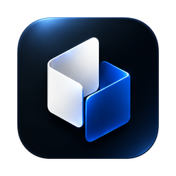
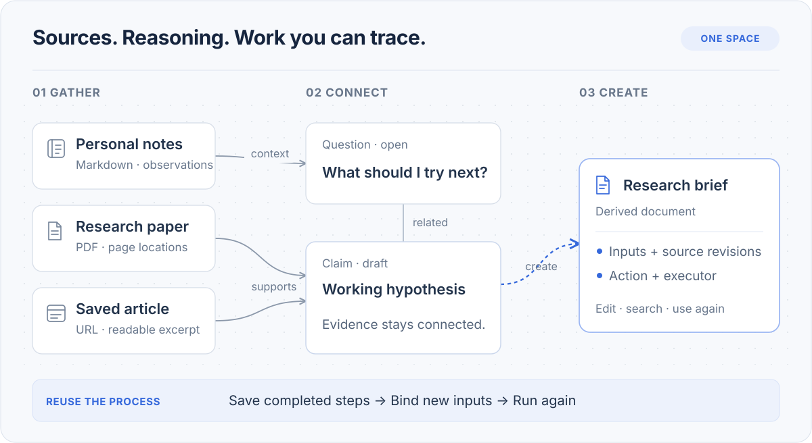

<div align="center">
  

  <h1>Knovum</h1>

  <p>
    <strong>The local-first AI knowledge workspace — an infinite canvas for research, learning, and creation.</strong>
  </p>

  <p>
    Notes, saved pages, recordings, documents, and AI-generated work live side by side in one <em>Space</em>.<br />
    Ask questions with cited answers, transcribe and synthesize speech on-device, produce documents,<br />
    audio, and video from your own sources — and trace every result back to the exact inputs that made it.
  </p>

  <p>
    <a href="https://github.com/madebyzan/knovum/actions/workflows/quality.yml"></a>
    <a href="https://github.com/madebyzan/knovum/releases"></a>
    <a href="LICENSE"></a>
    
    
    
  </p>

  <p>
    <a href="#features">Features</a> ·
    <a href="#on-device-ai">On-device AI</a> ·
    <a href="#from-a-question-to-a-finished-work">Workflow</a> ·
    <a href="#quick-start">Quick start</a> ·
    <a href="#development">Development</a> ·
    <a href="README.zh-CN.md">简体中文</a>
  </p>
</div>

---

Knowledge work rarely stays in one format. A meeting recording sits beside a saved article, a
screenshot, an open question, and a half-finished draft — and the valuable part is how they connect.

**Knovum** is a desktop knowledge workspace that keeps all of it in one place: an infinite canvas of
sources, ideas, and creations, backed by structured knowledge, on-device AI, and a recorded chain of
provenance from every output to its inputs. Your library lives in local SQLite and vector storage.
Cloud models are optional; each action sends only the context it needs.

> **Early access.** Knovum is `v0.0.1` and under active development. Pre-release data formats may
> change; export important Spaces before updating a development checkout.

## Why Knovum

|                                       |                                                                                                                                                                                                                                                      |
| ------------------------------------- | ---------------------------------------------------------------------------------------------------------------------------------------------------------------------------------------------------------------------------------------------------- |
| **Local-first and private by design** | Spaces, files, extracted text, search indexes, and backups stay on your machine. Transcription, embeddings, and semantic search run fully on-device. Credentials live in a dedicated secrets store, and cloud AI is invoked only when you choose it. |
| **Canvas freedom, database rigor**    | An infinite spatial canvas for notes, media, and documents — plus typed knowledge objects (claims, evidence, questions, decisions) with meaningful relations and automated consistency checks.                                                       |
| **Provenance you can audit**          | Every derived resource records which inputs and revisions it used, which action ran, and which engine or model produced it. Sources can change later; your results are never silently rewritten.                                                     |
| **A full on-device AI studio**        | Twelve local capabilities — Whisper transcription, speaker diarization, TTS and voice cloning, background removal, upscaling, inpainting, depth estimation, and more — with Metal acceleration on Apple Silicon.                                     |
| **Desktop-native**                    | Built on Tauri 2: native menus and dialogs, global push-to-talk dictation, command palette, keyboard-first shortcuts, platform-appropriate tray behavior, signed automatic updates, and 11 interface languages.                                      |

## From a question to a finished work

<div align="center">
  
  <sub>An example knowledge flow, shown schematically. Not an application screenshot.</sub>
</div>

1. **Bring the material into view.** Clip a page or a video by URL, drop in recordings, documents,
   images, and code, and write notes beside them. A capture keeps its URL; a recording keeps the
   transcript it produced locally. Organize with groups, sections, tags, and Saved Views.
2. **Make the reasoning explicit.** Add claims, evidence, concepts, experiments, and decisions as typed
   knowledge objects; connect them with relations like _supports_ and _contradicts_. Knowledge Health
   flags unsupported claims, active contradictions, and evidence whose sources changed.
3. **Work from the material you selected.** Search by keyword or meaning with local embeddings. Ask a
   question against your sources and follow the answer's citations back to their exact locations.
   Select material and run _Create from selection_ — draft a document, generate an image or a video,
   remove a background, split layers, or add subtitles.
4. **Keep the trail.** Open any result's derivation to see exactly what made it: the inputs and their
   revisions, the action that ran, and the engine or model that executed it.

## Features

### Spaces — the infinite canvas workspace

Mix Markdown, rich notes, website captures, PDFs and Office documents, images, audio, video, code, and
plain files on one spatial canvas. Organize with groups, sections, tags, and Saved Views; navigate a
structural outline; undo and redo across the last 100 edits. A system **Inbox** captures knowledge
before it has a home. Canvas exchange works both ways through **JSON Canvas** (`.canvas`) import and
export, and a whole Space travels as a `.knovumspace` package — content, managed assets, relations,
derivations, and citations included.

### Knowledge graph with claims, evidence, and checks

Structure an argument instead of just storing it. Six built-in knowledge object types — **Concept,
Question, Claim, Evidence, Experiment, Decision** — plus strict custom object types, connected by ten
relation kinds (_supports, contradicts, depends-on, supersedes, answers, derives-from,_ …). Provenance
and temporal knowledge events are first-class. **Knowledge Health** continuously reports unsupported
claims, contradicted-but-accepted claims, ungrounded evidence, answered open questions, and stale
provenance.

### Ask and search, with citations that track their sources

Global search and per-Space find run locally; semantic search uses on-device Qwen3 embeddings with
hybrid lexical ranking — your index never leaves the machine. **Ask** answers from your sources, and
every citation keeps the location it came from: a time range in a recording, a page in a PDF, a
heading and character span in a note, a line range in code. Citations follow their source — _current_
while it matches, _detached_ when it changes. Global find reaches across all Spaces at once.

### Documents, media, and video production

- **Rich note editing**: tables, images, find-and-replace, smart typography, and inline citations.
- **Export** to DOCX, PDF, PPTX, HTML, Markdown, and TXT; parse DOC/DOCX/XLS/XLSX/PPT/PPTX; OCR
  scanned PDFs; convert images (PNG/JPG/WebP/TIFF) and audio (WAV/MP3/M4A/FLAC).
- **Video editor** with an absolute-time timeline, proxies, and burned-in subtitle derivation.
- **Speech studio**: audiobooks with roles and a pronunciation lexicon, narration, short and video
  dubbing with published-background mixing, vocal/accompaniment separation, and reference-voice
  cloning and voice design.

### Create from selection — derivation with a recorded trail

Any selection of knowledge becomes a new durable resource without losing its source context. Run an
intent — **Generate document, Generate image, Generate video, Remove background, Split layers, Add
subtitles** — against a configured model or a desktop Agent; the **Action Run** records engine and
model identity plus the pinned inputs and revisions it used.

### Dictation — push-to-talk, system-wide

A native overlay turns speech into text in whatever app is frontmost — transcribed locally with
Whisper, inserted through guarded clipboard paste.

### Agents, MCP, and Skills

- **Builtin Agent**: a private, on-device agent that plans with todos, researches read-only, and
  writes to your knowledge only through validated atomic change sets. It draws on the same action
  catalog as the menus — answer a question, summarize a meeting transcript, draft a video script or
  social copy, restructure the canvas.
- **Desktop Agents**: connect external coding agents on your machine through the Agent Client
  Protocol (ACP), with their own authentication and tools.
- **MCP both ways**: Knovum exposes a loopback-only MCP server over your Space, and manages outbound
  MCP connections as Agent extensions.
- **Extensions**: Skills, plugins, connectors, and apps, managed from one surface.

### Portable data, local backups

Your library is plain local data: SQLite for structure, a local vector index for meaning, and a
dedicated secrets database for credentials. Backup and restore produce ordinary local archives, and
a Space exports as a single package you can move between machines.

## On-device AI

Every capability below runs locally after its model downloads on first use — with SHA-256-pinned
weights, progress and cancellation in the Task Center, and Metal acceleration on Apple Silicon.

| Capability                               | Model                                                             | Runtime      |
| ---------------------------------------- | ----------------------------------------------------------------- | ------------ |
| Speech transcription                     | Whisper (Tiny/Small Q8_0 default, Large-v3 optional) + Silero VAD | whisper.cpp  |
| Speaker diarization                      | Pyannote 3.0 + ERes2Net                                           | sherpa-onnx  |
| Vocal / accompaniment separation         | Spleeter                                                          | sherpa-onnx  |
| Speech synthesis, voice cloning & design | MOSS-TTS-Nano, VoxCPM2                                            | audio.cpp    |
| Forced alignment (word-level captions)   | Qwen3 Forced Aligner                                              | audio.cpp    |
| Semantic-search embeddings               | Qwen3-Embedding-0.6B (1024-dim)                                   | Candle       |
| Background removal                       | U²-Net                                                            | ONNX Runtime |
| Image upscaling                          | Real-ESRGAN                                                       | ONNX Runtime |
| Inpainting / repair                      | MI-GAN                                                            | ONNX Runtime |
| Smart selection                          | EfficientSAM                                                      | ONNX Runtime |
| Relative depth estimation                | Depth Anything V2                                                 | ONNX Runtime |
| Layer splitting                          | composed from the capabilities above                              | —            |

Image and video _generation_ are cloud capabilities, routed to whichever connection you configure.

## Local by default, AI by choice

Canvas editing, keyword search, transcription, embeddings, and semantic indexing work
**without any AI connection**. For generative actions, connect any of the supported providers —

**OpenAI · Anthropic · Google Gemini · DeepSeek · Qwen · Zhipu · Moonshot · Doubao · MiniMax ·
StepFun · SiliconFlow · Mistral · Groq · Grok · Together · OpenRouter · Kling · Ollama · any
OpenAI-compatible endpoint**

— or delegate to a desktop Agent with its own credentials. Selected text or media is sent only to the
executor you choose, bounded by the action's context rules. Keys are stored in a dedicated local
secrets database and never written to logs.

## Architecture

Knovum is a single desktop product: a Rust core owns data, inference, and OS integration; a Vue 3
renderer owns interaction; strict generated contracts connect them.

**Tauri 2 · Vue 3 · TypeScript · Rust · SQLite · LanceDB · Konva · Tailwind CSS v4**

## Quick start

| Platform | Target                                               |
| -------- | ---------------------------------------------------- |
| macOS    | macOS 14 or later — Apple Silicon and Intel          |
| Windows  | Windows 10 version 2004 / build 19041 or later — x64 |

Linux and Windows-on-ARM are out of release scope; unsupported targets fail explicitly.

Knovum currently runs from source. You need **Node.js 22.13+**, **Corepack**, the Rust toolchain
pinned in `rust-toolchain.toml`, and the native tooling the desktop build compiles against:
**uv**, **CMake**, **Protobuf**, and **LLVM/libclang**. Then:

```bash
git clone https://github.com/madebyzan/knovum.git
cd knovum
corepack enable
pnpm install --frozen-lockfile
pnpm desktop:dev
```

The first build downloads and compiles native components and takes a while; subsequent starts are
fast. Local models download when you first use a capability that needs them.

Start small: one question, two or three sources, one note. Configure an AI connection when you want
cited answers or generated results.

## Development

| Command             | Purpose                                                           |
| ------------------- | ----------------------------------------------------------------- |
| `pnpm desktop:dev`  | Run the desktop app with the Agent environment prepared           |
| `pnpm check`        | Full quality gate: web + Rust + Python                            |
| `pnpm check:web`    | Typecheck, oxlint, dependency-cruiser, Vitest, knip, jscpd, oxfmt |
| `pnpm check:rust`   | cargo fmt, clippy (`-D warnings`), workspace tests                |
| `pnpm check:python` | ruff, mypy (strict), pytest for the Agent runtime                 |
| `pnpm e2e`          | WebdriverIO end-to-end run against a debug build                  |
| `pnpm package`      | Produce signed desktop bundles                                    |

CI runs the same gates on every push (macOS arm64, macOS Intel, Windows), and `v*` tags build signed
DMG/NSIS packages with updater metadata.

## Contributing

Bug reports, focused feature proposals, translations, and documentation improvements are welcome —
see [CONTRIBUTING.md](CONTRIBUTING.md) and the [Code of Conduct](CODE_OF_CONDUCT.md). For
[issue reports](https://github.com/madebyzan/knovum/issues), include your platform, version or
commit, and reproduction steps, and remove credentials from any attached logs. Security reports go
through [SECURITY.md](SECURITY.md).

## License

Knovum is **source-available for personal noncommercial use** under the
[Knovum Personal Noncommercial License 1.0](LICENSE). Individuals may use, modify, and share it
noncommercially under its terms. Organizational use, professional or client work, and
commercialization require separate prior written authorization. Third-party components retain their
own licenses.

## Star history

<a href="https://star-history.com/#madebyzan/knovum&Date">
  <picture>
    <source media="(prefers-color-scheme: dark)" srcset="https://api.star-history.com/svg?repos=madebyzan/knovum&type=Date&theme=dark" />
    
  </picture>
</a>

---

<div align="center">
  <sub>Built with Tauri 2, Vue 3, TypeScript, and Rust.</sub>
</div>
