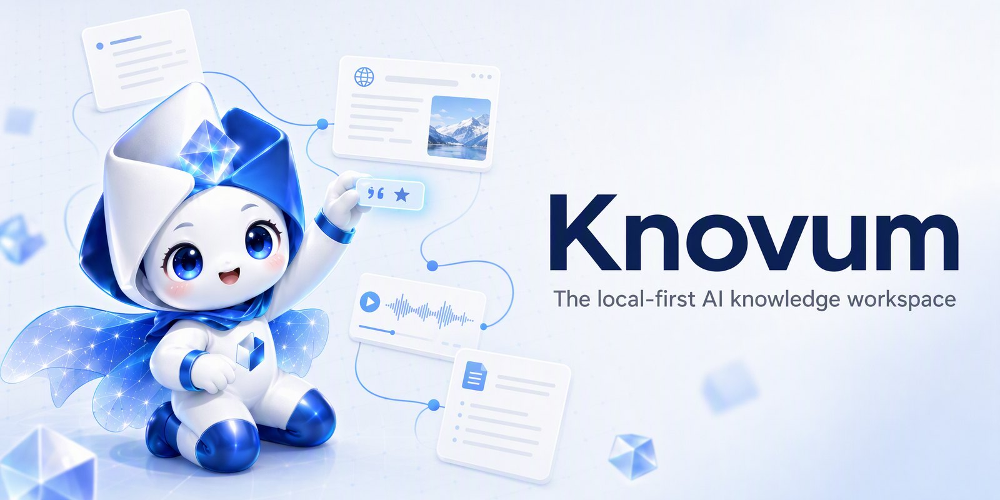
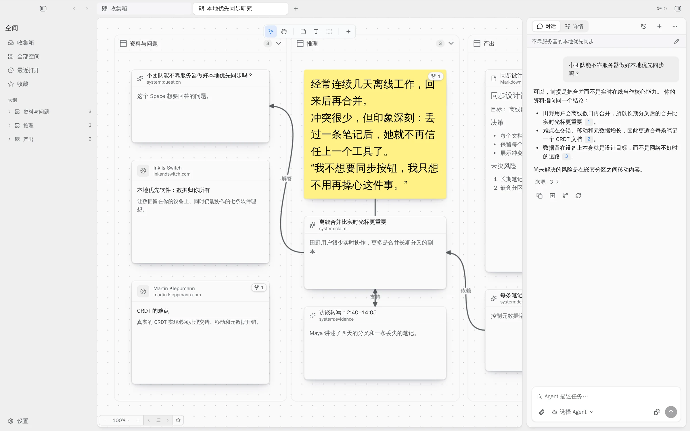
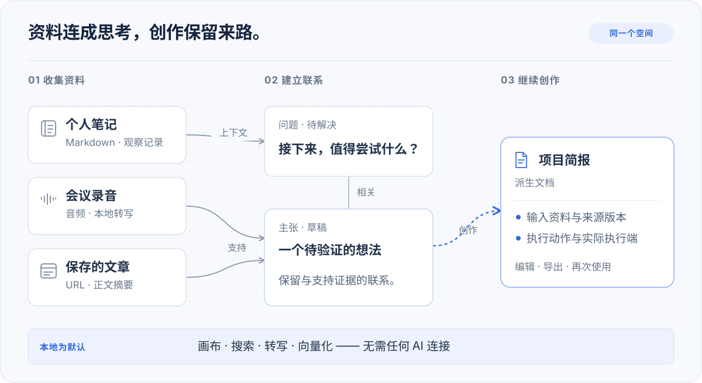

<div align="center">
  <a href="https://github.com/madebyzan/knovum/releases/latest">
    
  </a>

  <p>
    <strong>本地优先的 AI 知识工作台 —— 一张无限画布，把笔记、网页、录音和文档<br />
    变成带出处的回答和完成的作品。</strong>
  </p>

  <p>
    <a href="https://github.com/madebyzan/knovum/releases/latest"></a>
    <a href="https://github.com/madebyzan/knovum/actions/workflows/quality.yml"></a>
    <a href="https://github.com/madebyzan/knovum/stargazers"></a>
    
    
    <a href="LICENSE"></a>
  </p>

  <p>
    <a href="https://github.com/madebyzan/knovum/releases/latest"><strong>下载 macOS / Windows 版</strong></a> ·
    <a href="#功能">功能</a> ·
    <a href="#本地-ai-能力">本地 AI</a> ·
    <a href="#常见问题">常见问题</a> ·
    <a href="#从源码构建">从源码构建</a> ·
    <a href="README.md">English</a>
  </p>
</div>

<picture>
  <source media="(prefers-color-scheme: dark)" srcset="docs/assets/readme/screenshot-zh-dark.webp" />
  
</picture>

---

**Knovum** 是一款面向研究、学习与创作的桌面知识工作台。把一项工作依赖的一切 —— 笔记、收藏的网页和视频、
会议录音、PDF 与 Office 文档、图片、代码 —— 放到同一张无限画布（**Space**）上。向自己的资料提问，
回答里的每条引用都能定位到原文的具体段落、时间点或页码。把选中的素材生成文档、图片、视频或配音，
每一个结果都保留着回溯到原始输入的完整记录。

你的资料库存放在本机的 SQLite 与本地向量索引中。转写、说话人识别、文字识别（OCR）、向量化、语义搜索和图像工具都在
本地运行。云端模型可选、自带密钥，并且只会收到该操作所需的上下文。

## 为什么选择 Knovum

- **本地优先，隐私自主。** Space、文件、提取的文本、搜索索引和备份都留在你的磁盘上。无需注册账号，
  没有 Knovum 云端，不收集你的内容。
- **画布真正理解它承载的内容。** 不只是白板上的卡片：笔记、网页摘录和录音都会被索引、可按语义搜索，
  并通过“支持”“反驳”等有类型的关系连接起来。
- **回答可以核对。** 每条引用都保留其位置 —— 录音的时间段、PDF 的页码、笔记的标题 —— 并绑定到被引用时的版本。PDF 引用会在内置阅读器中打开原文，直接定位到该页并高亮引用段落。
- **结果记得自己从哪里来。** 生成的文档和媒体会记录输入、版本、执行的操作和模型。来源之后发生变化时，
  Knovum 会提醒你，但绝不会在背后改写你的成果。
- **完整的本地 AI 工作室。** Whisper 转写、说话人分离、语音合成与声音克隆、抠图、超分辨率、修复和
  深度估计 —— 不需要任何模型服务器。
- **原生桌面体验。** 基于 Tauri 2 与 Rust：原生菜单、命令面板、键盘优先的编辑、全局按键说话听写、
  经签名校验的应用内更新，支持 11 种界面语言。

## 工作方式

<div align="center">
  
  <sub>知识流转示意图。</sub>
</div>

1. **收集。** 粘贴链接即可摘录网页，或保存 YouTube、Bilibili、抖音、Vimeo 等平台的视频；拖入录音、
   PDF、Office 文件、图片和代码；在旁边写下笔记。录音会在本地转写，并带上时间戳和说话人。
2. **连接。** 用分区和分组整理素材，把主张、证据、问题和决策作为知识对象加入画布并互相关联。
   知识检查会指出缺乏支持的主张、相互冲突的内容，以及来源已变化的证据。
3. **提问。** 在一个或全部 Space 中按关键词或语义搜索。提出问题，顺着每条引用回到原文的确切位置。
   把好的回答 —— 或其中选中的一段 —— 保存到画布上，成为一条记得自己来源的笔记。
4. **创作。** 选中素材后使用“基于所选内容创作”：起草文档、生成图片或视频、去除背景、拆分图层、添加字幕。
   可导出为 DOCX、PDF、PPTX、HTML 或 Markdown。

## 功能

### Space：承载多种媒体的无限画布

富文本笔记、Markdown、网页摘录、PDF 与 Office 文档、图片、音频、视频、代码和普通文件共享同一张空间画布。
用分区、分组、标签和保存的视图组织内容，用大纲导航，可撤销最近 100 步编辑。系统**收集箱**用来暂存还没
归处的内容。通过开放的 **JSON Canvas**（`.canvas`）格式与其他工具交换画布，也可以把整个 Space ——
内容、资源、关系、派生记录与引用 —— 打包为一个 `.knovumspace` 文件迁移。

### 有据可查的问答

用任意已连接的模型，针对自己的资料提问。回答会引用所依据的段落，每条引用都保留在原文中的位置。
来源未变时引用保持“当前”，来源改动后变为“已脱离”。选中回答中的一段，可以保存为笔记、追加到已有笔记、
拖到画布上，或引用到追问里。

### 本地语义搜索

关键词与向量混合检索完全在本机运行，基于 Qwen3 向量模型和 LanceDB。可以在单个 Space 内查找，也可以一次
搜索全部 Space；相关内容会出现在你正在阅读的内容旁边。

### 结构化知识，但不强迫你先搭结构

内置六种知识对象 —— **概念、问题、主张、证据、实验、决策** —— 也可以自定义类型，并用十种关系
（支持、反驳、回答、依赖、取代、派生自……）连接。需要多少结构就用多少。**知识检查**会报告缺乏支持或
存在争议的主张、缺少出处的证据、已被回答的问题，以及保存后来源发生更新的笔记。

### 基于所选内容创作，全程留痕

任何选中的内容都能变成新的资源，同时不丢失上下文：**生成文档、生成图片、生成视频、去除背景、拆分图层、
添加字幕。** 每次运行都会记录所用的引擎、模型、输入及其版本，让每个结果都能回答“它从哪里来”。

### 文档、媒体与声音

- **编辑器**：富文本笔记与 Markdown，支持表格、图片、查找替换和行内引用。
- **导出**：把笔记和网页摘录导出为 DOCX、PDF、PPTX、HTML、Markdown 和 TXT；转换图片与音频格式。
- **视频工作台**：绝对时间轴、代理播放和烧录字幕。
- **语音工作室**：多角色有声书与发音词典、旁白、配音、人声与伴奏分离、声音克隆和声音设计。

### 全局语音听写

按住全局快捷键说话，松开即可：文字由 Whisper 在本地转写，并输入到当前最前面的应用中。

### Agent、MCP 与扩展

- **内置 Agent** —— 用待办规划任务，只读地研究你的 Space，只通过经过校验的原子变更集修改内容。
  它在本地私有运行时中运行，使用你连接的模型。
- **桌面 Agent** —— 通过 Agent Client Protocol（ACP）使用本机已安装的编程 Agent，沿用它们自己的登录与工具。
- **双向 MCP** —— Knovum 通过仅限本机回环的 MCP 服务器向桌面 Agent 提供你的 Space，同时可以把外部 MCP
  服务器作为 Agent 扩展接入。
- **扩展** —— 在同一处管理技能、插件、连接器和应用。

## 本地 AI 能力

以下能力都在本地运行。首次使用需要某个模型的功能时才会下载该模型，下载后按固定的 SHA-256 校验，
也可以在设置中删除。下载进度和取消操作都在任务中心里。

| 能力                     | 模型                                                | 运行时       |
| ------------------------ | --------------------------------------------------- | ------------ |
| 语音转写                 | Whisper Tiny / Small（默认）/ Large-v3 + Silero VAD | whisper.cpp  |
| 说话人分离               | Pyannote 3.0 + ERes2Net                             | sherpa-onnx  |
| 人声 / 伴奏分离          | Spleeter                                            | sherpa-onnx  |
| 语音合成、声音克隆与设计 | MOSS-TTS-Nano、VoxCPM2                              | audio.cpp    |
| 逐词字幕对齐             | Qwen3 Forced Aligner                                | audio.cpp    |
| 语义搜索向量             | Qwen3-Embedding-0.6B                                | Candle       |
| 去除背景                 | U²-Net                                              | ONNX Runtime |
| 图像超分辨率             | Real-ESRGAN                                         | ONNX Runtime |
| 局部修复                 | MI-GAN                                              | ONNX Runtime |
| 智能选区                 | EfficientSAM                                        | ONNX Runtime |
| 相对深度估计             | Depth Anything V2                                   | ONNX Runtime |
| 文字识别（扫描件、截图） | PP-OCRv6 small                                      | ONNX Runtime |

在 Apple 芯片上，向量化与转写使用 Metal 加速。以上能力都不需要 Ollama 或其他模型服务器。

## 自带模型

画布编辑、关键词与语义搜索、转写以及上面所有本地能力，**无需任何 AI 账号**即可使用。需要问答和生成时，
连接你已经在用的服务即可：

**OpenAI · Anthropic · Google Gemini · DeepSeek · 通义千问 · 智谱 · 月之暗面 · 豆包 · MiniMax ·
阶跃星辰 · 硅基流动 · Mistral · Groq · Grok · Together · OpenRouter · 可灵 · Ollama · 任意
OpenAI 兼容接口**

也可以把任务交给自带凭据的桌面 Agent。密钥保存在独立的本地密钥数据库中，从不写入日志；每个操作只把所需的
选中内容和上下文发送给你选择的执行方。

## 下载

| 平台    | 系统要求                    | 文件                          |
| ------- | --------------------------- | ----------------------------- |
| macOS   | macOS 14 及以上，Apple 芯片 | `Knovum_<版本>_aarch64.dmg`   |
| macOS   | macOS 14 及以上，Intel      | `Knovum_<版本>_x64.dmg`       |
| Windows | Windows 10 2004 及以上，x64 | `Knovum_<版本>_x64-setup.exe` |

**[获取最新版本 →](https://github.com/madebyzan/knovum/releases/latest)**

目前安装包尚未经过 Apple 公证或 Authenticode 签名，首次启动时 macOS 和 Windows 会请你确认。之后的更新在
应用内完成，并按发布签名校验。暂不支持 Linux 和 Windows on ARM。

**上手建议：** 新建一个 Space，拖入两三份资料，用一条笔记写下你的问题。需要带引用的回答或生成内容时，
再到设置中添加 AI 连接。

## 常见问题

<details>
<summary><strong>Knovum 可以离线使用吗？</strong></summary>

可以。模型下载完成后，编辑、整理、关键词与语义搜索、转写、说话人识别、文字识别、语音合成和图像工具都在本机运行。
只有你交给云端模型执行的操作才需要联网。

</details>

<details>
<summary><strong>数据存在哪里？会上传吗？</strong></summary>

所有内容都在本地应用数据目录中：SQLite 保存结构，LanceDB 保存语义索引，托管文件保存资源，独立的密钥
数据库保存密钥。除非你让云端模型执行某个操作，否则不会上传任何内容；即便如此，也只会把该操作的上下文
发送给你选择的服务商。

</details>

<details>
<summary><strong>它和 NotebookLM、Obsidian Canvas、Heptabase 有什么不同？</strong></summary>

Knovum 把三种思路放进同一个桌面应用：基于自己资料、带出处的回答，用于思考的空间画布，以及结构化知识 ——
并且全部保存在本地。它还原生支持音视频（本地转写、配音、字幕），并记录每个生成结果是如何产生的。

</details>

<details>
<summary><strong>可以通过 Ollama 使用本地大模型吗？</strong></summary>

可以。Ollama 和任意 OpenAI 兼容接口都可以作为问答和内置 Agent 的模型。上面列出的本地 AI 能力完全不依赖 Ollama。

</details>

<details>
<summary><strong>Knovum 开源吗？免费吗？</strong></summary>

是的。Knovum 是基于 [MIT 许可证](LICENSE) 发布的免费开源软件，你可以在许可证条款下自由使用、阅读、构建、修改和分发。

</details>

<details>
<summary><strong>能导入我已有的笔记和画布吗？</strong></summary>

可以直接导入 Markdown、文档和媒体文件，画布则通过开放的 JSON Canvas 格式（`.canvas`）导入。Space 可以导出为
JSON Canvas，也可以导出为便于迁移的 `.knovumspace` 包。

</details>

## 从源码构建

需要 **Node.js 22.13+** 与 **Corepack**、`rust-toolchain.toml` 中固定的 Rust 工具链，以及桌面构建依赖的本地
工具：**uv**、**CMake**、**Protobuf** 和 **LLVM/libclang**。具体版本见 [docs/installation.md](docs/installation.md)。

```bash
git clone https://github.com/madebyzan/knovum.git
cd knovum
corepack enable
pnpm install --frozen-lockfile
pnpm desktop:dev
```

首次构建会编译本地推理组件，耗时较长；之后启动会很快。

| 命令                | 用途                                                             |
| ------------------- | ---------------------------------------------------------------- |
| `pnpm desktop:dev`  | 启动桌面应用，并准备好 Agent 环境                                |
| `pnpm check`        | 完整质量门禁：Web + Rust + Python                                |
| `pnpm check:web`    | 类型检查、oxlint、dependency-cruiser、Vitest、knip、jscpd、oxfmt |
| `pnpm check:rust`   | cargo fmt、clippy（`-D warnings`）、工作区测试                   |
| `pnpm check:python` | Agent 运行时的 ruff、mypy（strict）与 pytest                     |
| `pnpm e2e`          | 基于调试构建运行 WebdriverIO 端到端测试                          |
| `pnpm package`      | 为当前平台构建桌面安装包                                         |

CI 会在 macOS（Apple 芯片与 Intel）和 Windows 上运行这些检查。推送 `v*` 标签会构建 macOS 与 Windows 安装包，
并生成一个草稿 GitHub Release。

### 架构

Rust 核心负责数据、推理和系统集成，Vue 3 渲染层负责交互，两者之间通过生成的契约连接。本地模型运行在独立的
推理进程中，内置 Agent 运行在随应用打包的 Python 运行时里。

**Tauri 2 · Rust · Vue 3 · TypeScript · SQLite (sqlx) · LanceDB · Candle · ONNX Runtime ·
whisper.cpp · Konva · Tailwind CSS v4**

更多内容见 [docs/system-architecture.md](docs/system-architecture.md)、[文档地图](docs/README.md) 和产品设计约定
[DESIGN.md](DESIGN.md)。

## 参与贡献

欢迎提交问题报告、聚焦的功能建议、翻译和文档改进 —— 请先阅读 [CONTRIBUTING.md](CONTRIBUTING.md) 和
[行为准则](CODE_OF_CONDUCT.md)。[提交 issue](https://github.com/madebyzan/knovum/issues) 时，请附上平台、
Knovum 版本和复现步骤，并删除日志中的凭据。安全问题请按 [SECURITY.md](SECURITY.md) 私下报告。

如果 Knovum 对你有帮助，点一个 ⭐ 能让更多人发现它。

## 许可

Knovum 基于 [MIT 许可证](LICENSE) 发布。第三方组件保留其各自的许可。

## Star 历史

<a href="https://star-history.com/#madebyzan/knovum&Date">
  <picture>
    <source media="(prefers-color-scheme: dark)" srcset="https://api.star-history.com/svg?repos=madebyzan/knovum&type=Date&theme=dark" />
    
  </picture>
</a>
