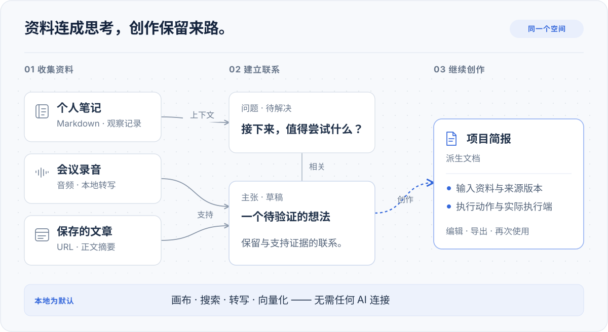

<div align="center">
  

  <h1>Knovum</h1>

  <p>
    <strong>本地优先的 AI 知识工作台 —— 一张承载研究、学习与创作的无限画布。</strong>
  </p>

  <p>
    笔记、收藏的网页、录音、文档与 AI 产物，共同生活在同一个 <em>Space</em> 里。<br />
    向自己的资料提问并获得带引用的回答，在本地完成转写与语音合成，<br />
    用你的素材产出文档、音频与视频 —— 每一个结果都能追溯到它的确切输入。
  </p>

  <p>
    <a href="https://github.com/madebyzan/knovum/actions/workflows/quality.yml"></a>
    <a href="https://github.com/madebyzan/knovum/releases"></a>
    <a href="LICENSE"></a>
    
    
    
  </p>

  <p>
    <a href="#功能特性">功能特性</a> ·
    <a href="#端侧-ai">端侧 AI</a> ·
    <a href="#从一个问题到一件成品">工作流</a> ·
    <a href="#快速开始">快速开始</a> ·
    <a href="#开发">开发</a> ·
    <a href="README.md">English</a>
  </p>
</div>

---

知识工作很少只围绕一种资料展开。一段会议录音、几篇收藏的文章、一张截图、一个尚未解决的问题，
加上写到一半的草稿，往往属于同一件事 —— 真正有价值的，是它们之间的联系。

**Knovum** 是一个桌面知识工作台，把这一切收进同一个地方：由来源、想法与作品组成的无限画布，
底下是结构化知识、端侧 AI，以及从每个产出回溯到其输入的完整溯源链。你的资料库保存在本机的
SQLite 与向量存储中；云端模型按操作可选接入，每次只发送该操作所需的上下文。

> **早期访问阶段。** Knovum 目前是 `v0.0.1`，处于活跃开发中。发布前的数据格式可能变化，
> 更新开发检出前请先导出重要的 Space。

## 为什么选择 Knovum

|                              |                                                                                                                                                                   |
| ---------------------------- | ----------------------------------------------------------------------------------------------------------------------------------------------------------------- |
| **本地优先，隐私内建**       | Space、文件、抽取文本、搜索索引与备份全部留在本机。转写、向量化与语义搜索完全在端侧运行。凭据存放在独立的 secrets 数据库中，只有你主动选择的操作才会调用云端 AI。 |
| **画布的自由，数据库的严谨** | 承载笔记、媒体与文档的无限空间画布 —— 加上类型化知识对象（主张、证据、问题、决策）、有意义的关系，以及自动一致性检查。                                            |
| **可审计的溯源**             | 每个派生资源都记录了它使用的输入与修订、执行的动作、产生它的引擎或模型。来源日后变化，结果绝不会被悄悄改写。                                                      |
| **完整的端侧 AI 工作室**     | 十二项本地能力 —— Whisper 转写、说话人分离、TTS 与声音克隆、背景移除、超分辨率、图像修复、深度估计等 —— 在 Apple Silicon 上使用 Metal 加速。                      |
| **桌面原生**                 | 基于 Tauri 2：原生菜单与对话框、全局按键说话听写、命令面板、键盘优先的快捷键、按平台区分的托盘行为、签名自动更新，以及 11 种界面语言。                            |

## 从一个问题到一件成品

<div align="center">
  
  <sub>知识流示意图，并非应用截图。</sub>
</div>

1. **把素材收进视野。** 通过 URL 收藏网页或视频，导入录音、文档、图片与代码，
   在旁边写下自己的笔记。抓取保留原始 URL，录音保留本地生成的转写文本。
   用分组、区段、标签与保存视图组织画布。
2. **让推理显式化。** 把主张、证据、概念、实验与决策作为类型化知识对象加入画布，用
   _支持_、_反驳_ 等关系连接它们。「知识健康」会标记无支撑的主张、被接受却存在矛盾的主张，
   以及来源已变化的证据。
3. **从选中的素材出发工作。** 关键词或语义搜索均在本地完成（端侧 Qwen3 向量化 + 混合排序）。
   向资料提问，沿着回答的引用回到确切位置。选中素材后执行「从选中创建」——
   生成文档、生成图片、生成视频、去背景、拆分图层，或添加字幕。
4. **留下足迹。** 打开任何结果的派生记录，看清它由什么产生：输入及其修订、执行的动作、
   实际的引擎或模型。

## 功能特性

### Space —— 无限画布工作台

在同一张空间画布上混排 Markdown、富文本笔记、网页抓取、PDF 与 Office 文档、图片、音频、视频、
代码与普通文件。用分组、区段、标签与保存视图组织内容，通过结构大纲导航，最近 100 次编辑可
撤销/重做。系统 **Inbox** 先接住还没来得及归置的知识。画布可通过 **JSON Canvas**（`.canvas`）
双向交换；整个 Space 可以打包为 `.knovumspace` —— 内容、托管资产、关系、派生与引用全部包含。

### 主张、证据与检查构成的知识图谱

不只是存储，而是把论证结构化。六种内建知识对象类型 —— **概念、问题、主张、证据、实验、
决策** —— 加上严格的自定义对象类型，由十种关系（_支持、反驳、依赖、取代、回答、派生自_……）
连接。溯源与时间性知识事件是一等公民。「知识健康」持续报告：无支撑的主张、被接受但存在矛盾
的主张、无出处的证据、已被回答的开放问题，以及过期的溯源。

### 提问与搜索，引用跟随来源

全局搜索与 Space 内查找完全本地运行；语义搜索使用端侧 Qwen3 向量与混合词法排序 —— 索引永不
离开你的机器。**Ask** 基于你的资料作答，每条引用都保留它来自的确切位置：录音中的时间段、
PDF 的页码、笔记的标题与字符范围、代码的行号。引用跟随其来源 —— 来源一致时为「current」，
来源变化后变为「detached」。全局查找可一次覆盖全部 Space。

### 文档、媒体与视频制作

- **富文本笔记编辑**：表格、图片、查找替换、排版优化与行内引用。
- **导出** DOCX、PDF、PPTX、HTML、Markdown、TXT；解析 DOC/DOCX/XLS/XLSX/PPT/PPTX；对扫描版
  PDF 进行 OCR；转换图片（PNG/JPG/WebP/TIFF）与音频（WAV/MP3/M4A/FLAC）。
- **视频编辑器**：绝对时间线、代理与一键烧录字幕。
- **语音工作室**：带角色与发音词典的有声书、旁白、短视频与视频配音（含背景音混合）、
  人声/伴奏分离，以及参考声音克隆与声音设计。

### 从选中创建 —— 带记录的派生

任意选中的知识都可以变成新的持久资源，且不丢失来源上下文。执行一个意图 ——
**生成文档、生成图片、生成视频、去背景、拆分图层、添加字幕** —— 交给已配置的模型或桌面
Agent；**Action Run** 会记录引擎与模型身份，以及所使用的固定输入与修订。

### 听写 —— 全局按键说话

一个原生浮层把语音变成文字，输入到当前最前台的任意应用 —— 由本地 Whisper 转写，经由受保护的
剪贴板粘贴写入。

### Agent、MCP 与 Skills

- **内建 Agent**：私有本地 Agent，用 todo 规划、只读地研究，
  写入知识时只通过校验过的原子变更集。它与菜单共用同一套动作目录 ——
  回答问题、整理会议摘要、编写视频脚本或社交文案、调整画布结构。
- **桌面 Agent**：连接你机器上的外部编码 Agent（Agent Client Protocol / ACP），使用它们自己的
  认证与工具。
- **MCP 双向**：Knovum 以仅回环地址的 MCP 服务器暴露你的 Space，同时把出站 MCP 连接作为
  Agent 扩展管理。
- **扩展体系**：Skills、插件、连接器与应用，在同一个界面管理。

### 数据可携带，备份在本地

你的资料库就是普通的本地数据：结构存于 SQLite，语义存于本地向量索引，凭据独立存放于专用
secrets 数据库。备份与恢复产出普通的本地归档；Space 可以整包导出，在设备之间迁移。

## 端侧 AI

下表所有能力均在首次使用时下载模型、完全本地运行 —— 权重经 SHA-256 固定，任务中心提供进度与
取消，Apple Silicon 上启用 Metal 加速。

| 能力                     | 模型                                                       | 运行时       |
| ------------------------ | ---------------------------------------------------------- | ------------ |
| 语音转写                 | Whisper（默认 Tiny/Small Q8_0，可选 Large-v3）+ Silero VAD | whisper.cpp  |
| 说话人分离               | Pyannote 3.0 + ERes2Net                                    | sherpa-onnx  |
| 人声/伴奏分离            | Spleeter                                                   | sherpa-onnx  |
| 语音合成、声音克隆与设计 | MOSS-TTS-Nano、VoxCPM2                                     | audio.cpp    |
| 强制对齐（逐词字幕）     | Qwen3 Forced Aligner                                       | audio.cpp    |
| 语义搜索向量化           | Qwen3-Embedding-0.6B（1024 维）                            | Candle       |
| 背景移除                 | U²-Net                                                     | ONNX Runtime |
| 图片超分辨率             | Real-ESRGAN                                                | ONNX Runtime |
| 图像修复                 | MI-GAN                                                     | ONNX Runtime |
| 智能选择                 | EfficientSAM                                               | ONNX Runtime |
| 相对深度估计             | Depth Anything V2                                          | ONNX Runtime |
| 图层拆分                 | 由以上能力组合而成                                         | —            |

图片与视频*生成*属于云端能力，路由到你配置的任意连接。

## 本地为默认，AI 凭选择

画布编辑、关键词搜索、转写、向量化与语义索引**不依赖任何 AI 连接**。生成类操作可以接入任意
受支持的服务商 ——

**OpenAI · Anthropic · Google Gemini · DeepSeek · Qwen · Zhipu · Moonshot · Doubao · MiniMax ·
StepFun · SiliconFlow · Mistral · Groq · Grok · Together · OpenRouter · Kling · Ollama · 任意
OpenAI 兼容端点**

—— 或者交给自带凭据的桌面 Agent。选中的文本或媒体只会发送给你选择的执行器，并受操作上下文
规则约束。密钥保存在本地专用 secrets 数据库中，不会写入日志。

## 架构

Knovum 是单一桌面产品：Rust 核心负责数据、推理与系统集成，Vue 3 渲染层负责交互，两者之间由
生成的严格契约连接。

**Tauri 2 · Vue 3 · TypeScript · Rust · SQLite · LanceDB · Konva · Tailwind CSS v4**

## 快速开始

| 平台    | 目标                                             |
| ------- | ------------------------------------------------ |
| macOS   | macOS 14 及以上 —— Apple Silicon 与 Intel        |
| Windows | Windows 10 版本 2004 / build 19041 及以上 —— x64 |

Linux 与 Windows on ARM 不在发布范围内；不受支持的目标会显式失败。

Knovum 目前从源码运行。需要 **Node.js 22.13+**、**Corepack**、`rust-toolchain.toml` 中固定的
Rust 工具链，以及桌面构建编译所需的原生工具：**uv**、**CMake**、**Protobuf** 与
**LLVM/libclang**。然后执行：

```bash
git clone https://github.com/madebyzan/knovum.git
cd knovum
corepack enable
pnpm install --frozen-lockfile
pnpm desktop:dev
```

首次构建需要下载并编译原生组件，耗时较长；之后的启动会很快。本地模型在首次使用相应能力时
下载。

建议从小处开始：一个问题、两三个来源、一条笔记。当你需要带引用的回答或生成结果时，再配置
AI 连接。

## 开发

| 命令                | 用途                                                             |
| ------------------- | ---------------------------------------------------------------- |
| `pnpm desktop:dev`  | 运行桌面应用（自动准备 Agent 环境）                              |
| `pnpm check`        | 完整质量门禁：web + Rust + Python                                |
| `pnpm check:web`    | 类型检查、oxlint、dependency-cruiser、Vitest、knip、jscpd、oxfmt |
| `pnpm check:rust`   | cargo fmt、clippy（`-D warnings`）、工作区测试                   |
| `pnpm check:python` | Agent 运行时的 ruff、mypy（strict）、pytest                      |
| `pnpm e2e`          | 基于 debug 构建的 WebdriverIO 端到端测试                         |
| `pnpm package`      | 产出签名桌面包                                                   |

CI 在每次推送时运行相同门禁（macOS arm64、macOS Intel、Windows）；`v*` 标签构建带更新器元数据
的签名 DMG/NSIS 包。

## 参与贡献

欢迎缺陷报告、聚焦的功能提案、翻译与文档改进 —— 见 [CONTRIBUTING.md](CONTRIBUTING.md) 与
[行为准则](CODE_OF_CONDUCT.md)。[提交 issue](https://github.com/madebyzan/knovum/issues) 时请
附上平台、版本或提交号与复现步骤，并从日志中移除凭据。安全问题请通过
[SECURITY.md](SECURITY.md) 报告。

## 许可

Knovum 以 [Knovum Personal Noncommercial License 1.0](LICENSE) **源码可得（source-available），
供个人非商业使用**。个人可在其条款内非商业地使用、修改与分享。组织使用、职业/客户工作与商业化
需要另行事先书面授权。第三方组件保留其各自的许可。

## Star 历史

<a href="https://star-history.com/#madebyzan/knovum&Date">
  <picture>
    <source media="(prefers-color-scheme: dark)" srcset="https://api.star-history.com/svg?repos=madebyzan/knovum&type=Date&theme=dark" />
    
  </picture>
</a>

---

<div align="center">
  <sub>基于 Tauri 2、Vue 3、TypeScript 与 Rust 构建。</sub>
</div>
