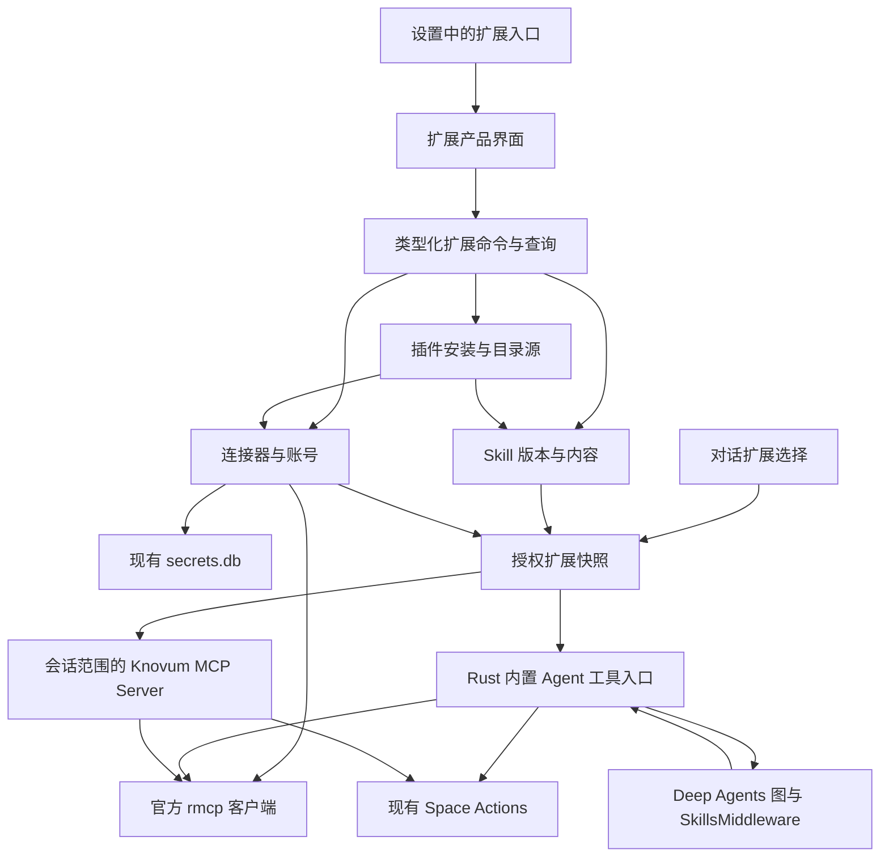

# Knovum Agent 扩展体系整改方案

日期：2026-10-06  
状态：代码整改及普通代码检查完成；完整原生集成与发布验收待完成  
适用平台：macOS ARM64、Windows x64  
实施方式：单 agent；全部开发与清理完成后集中进行测试、类型检查和格式检查。

## 1. 目标与完成定义

为 Knovum 建立完整的 Agent 扩展体系：用户能够发现、导入、安装、配置、授权、启停、更新和卸载插件，独立管理 Skills 和 MCP 连接，并在内置及外部 Agent 的对话中实际使用已选择的能力。

这里的插件是类似 ChatGPT / Codex 的可安装能力包，组织 Skills、MCP 声明、连接要求和静态资源。插件安装本身不执行代码，不提供第三方 Python/Rust/JavaScript 模块加载、安装脚本、生命周期脚本或任意界面注入。

本方案描述一个统一的最终交付范围。下文的实施顺序仅表示代码依赖关系，不表示分期发布；不得将管理页面、示例工具或“预留接口”当作功能完成。

完成必须同时满足：

1. 插件生命周期与来源管理完整，安装内容和执行内容具有可追溯的身份与版本。
2. Skills 支持创建、导入、编辑、查看、启停、导出和删除；插件提供的 Skills 保持安装版本不可变。
3. MCP 支持 Streamable HTTP 和显式配置的本地 stdio 服务，工具、资源、提示模板和授权流程具有实际调用链。
4. 连接器支持账号连接、重新授权、断开、多账号选择和连接诊断；认证不由插件包承载。
5. 内置 Agent 和 ACP 外部 Agent 均可使用用户选择的扩展；不能通过 ACP 传递的能力必须准确显示可用性。
6. 调用接入已有 Run、预算、授权、取消、历史和 Task Center，外部写操作结果不确定时不会自动重放。
7. 不新增另一个 harness、业务 Action 系统、秘密存储、通用数据库、任务框架或供应商配置兼容层。
8. 依赖有真实调用者；职责、命名、源文件大小和测试目录符合当前仓库规范。

“完整”限定于上述产品能力。长期云端资料同步、任意代码插件宿主、第三方 UI 宿主和公开插件商店运营是不同产品，不以空接口或伪实现塞入本次整改。

## 2. 实施前实现与缺口

以下是制定方案时的代码基线，用于说明整改原因；本节不代表整改后的当前实现。

| 当前事实                                                                                        | 证据                                                                                                                                        | 整改含义                                                            |
| ----------------------------------------------------------------------------------------------- | ------------------------------------------------------------------------------------------------------------------------------------------- | ------------------------------------------------------------------- |
| 设置只配置模型连接、桌面 Agent 和执行默认值，没有 Skills/MCP 注册信息                           | [AI 设置契约](src-tauri/src/ai/settings/contracts/mod.rs)，`AiSettings`、`DesktopAgent`                                                     | 新增独立扩展数据归属，不将扩展列表塞入 `ai.models`                  |
| 外部 Agent 页面只检测安装并启用 Agent                                                           | [DesktopAgentsSettingsPane](src/features/settings/components/panes/DesktopAgentsSettingsPane.vue)                                           | 扩展管理必须提供真实入口，修正当前描述的含义                        |
| 内置 Skills 只有固定的 `knowledge-v1/SKILL.md`，其 frontmatter 名称实际为 `knovum-knowledge-v1` | 原 `spaces/conversations/skills/mod.rs`、`skills/knowledge-v1/SKILL.md`（实施时已删除）                                                     | 纳入统一版本模型，并修正当前目录与标准名称不一致的问题              |
| Deep Agents 已从只读 StoreBackend 加载 Skills，工作区和 Space memory 分离                       | [Python composition](python/src/knovum_agent_runtime/composition.py)，`create_agent_graph`                                                  | 保留 SDK SkillsMiddleware 与只读资源边界，不手写 Skill 路由器       |
| Python 工具已经使用 StructuredTool，并通过 Rust 调用业务能力                                    | [host_tools.py](python/src/knovum_agent_runtime/host_tools.py)，`create_tool`                                                               | 复用现有桥接，MCP 不在 Python 建第二套客户端                        |
| Rust 工具目录目前只投影 Space Actions                                                           | [ToolCatalog](src-tauri/src/spaces/conversations/tools/mod.rs)                                                                              | 扩展目录需明确区分本地 Action 与外部 MCP 能力                       |
| 工具操作表要求 `action_id`，只有未完成/已完成结果表示                                           | [Spaces v1 SQL](src-tauri/migrations/spaces/0001_spaces.sql)，`spaces_builtin_agent_tool_operations`                                        | 不能将 MCP 工具冒充 SpaceAction；补齐工具来源和结果未知状态         |
| graph 执行段已有模型、工具目录、图版本绑定及复用规则                                            | [execution/session.rs](src-tauri/src/spaces/conversations/execution/session.rs)                                                             | 增加扩展快照指纹，防止不同插件版本复用同一 checkpoint               |
| Python RPC 单帧上限为 32 MiB                                                                    | [Rust framing](src-tauri/src/agent_runtime/process/framing.rs)、[Python transport](python/src/knovum_agent_runtime/transport.py)            | Skills 资源与 MCP 大结果必须有有界传输，不能无限扩充 `AgentExecute` |
| 外部 ACP 会话接入一个私有、带授权的 Knovum MCP Server                                           | [external runtime](src-tauri/src/spaces/external_conversations/runtime/mod.rs)、[agent_server.rs](src-tauri/src/spaces/mcp/agent_server.rs) | 复用该会话入口暴露授权扩展，不把上游凭据交给外部 Agent              |
| 已使用官方 `rmcp = 3.1.3`，当前启用 HTTP Server 功能                                            | [Cargo.toml](src-tauri/Cargo.toml)                                                                                                          | 开启同一 SDK 的客户端与认证功能，避免重复协议实现                   |
| 产品凭据归专用 `secrets.db`，没有应用加密                                                       | [secrets.md](docs/secrets.md)、[Rust secrets](src-tauri/src/secrets/mod.rs)                                                                 | 使用现有存储；补齐 SDK CredentialStore 适配，不另建 token 文件      |
| Settings 与 Spaces 是隔离 feature，app 已通过 props 注入跨 feature 数据                         | [router.ts](src/app/router.ts)、[SettingsView.vue](src/features/settings/SettingsView.vue)、[依赖规则](.dependency-cruiser.cjs)             | 新扩展页面由 app 组装，禁止 Settings 直接导入另一个 feature         |

制定方案时，权威文档约定“内置 Agent 不维护外部 MCP 连接目录”，见 [system-architecture.md](docs/system-architecture.md) 的知识工作执行与 Agent 运行时部分。实施时必须直接修改这一决策，不在其旁边添加例外说明保留两种架构。

## 3. 术语、职责和命名

| 术语                           | 唯一含义                                 | 核心类型                                   |
| ------------------------------ | ---------------------------------------- | ------------------------------------------ |
| Plugin / 插件                  | 有来源和身份的可安装能力包               | `PluginInstallation`、`PluginInspection`   |
| Skill / 技能                   | 标准 `SKILL.md` 与其静态参考资源         | `SkillRevision`、`AgentExtensionSelection` |
| MCP Server                     | 外部服务的协议端点/本地协议进程          | 保留 SDK 的 `ServerInfo` 等名称            |
| MCP Connection / MCP 连接      | 一个可配置的 MCP 接入实例                | `McpConnection`（含 `revision`）           |
| Connector / 连接器             | 面向服务的连接定义，描述端点、认证与展示 | `ConnectorDefinition`                      |
| Connector Account / 连接账号   | 用户与一个连接器之间的授权绑定           | `ConnectorAccount`                         |
| Marketplace / 插件目录源       | 提供插件发现与版本发布信息的来源         | `PluginMarketplace`                        |
| Extension Selection / 扩展选择 | 当前对话请求使用哪些 Skills、连接与工具  | `AgentExtensionSelection`                  |
| Extension Snapshot / 扩展快照  | 已冻结、获授权的执行输入                 | `AgentExtensionSnapshot`                   |
| Tool Binding / 工具绑定        | 模型工具名称到真实能力的映射             | `AgentToolBinding`                         |

命名约束遵循 [naming-conventions.md](docs/naming-conventions.md)：

- `SpaceAction` 仍是 Knovum 本地业务能力的唯一名称；外部 MCP 工具不造假 Action ID。
- `Invocation`、`Receipt` 保留现有语义；不能用 `Job` 或 `Task` 替代 durable Run。
- 不新增 `PluginManager`、`IntegrationService`、`ExtensionProvider`、`CapabilityRegistry` 等掩盖职责的万能对象。
- Rust 文件使用 `snake_case`，TS 文件使用 `kebab-case`，Vue 组件使用 `PascalCase`。
- Python 保留 `knovum_agent_runtime`，内部按具体责任命名，不新增 `knovum_plugins` 空包。
- 公共 IPC DTO 使用 Rust 生成的同一名称，不在 TS/Python 再起一套别名。
- 标准协议字段、SDK 类型和第三方包名字保留原名；`assistant` 消息角色不改。
- 用户侧叫“插件、Skills、连接”；代码中的连接账号与 MCP 连接分别命名，不都叫 `Connection`。
- 路径和类型中的 `extensions` 只表示本节这一组 Agent 扩展，不成为任意未来功能的收容目录。

## 4. 架构决策

### 4.1 总体结构



该图表示组合与调用关系，不允许扩展持久化模块依赖 Spaces。任务授权、当前 Space 和对话历史仍由 Spaces 决定。

### 4.2 Rust 负责扩展管理与 MCP

选择在 Rust 使用已有官方 `rmcp`：

- 插件来源、内容安装、持久化、账号认证、连接生命周期均为桌面宿主职责。
- 内置工具继续通过 `agentRuntime.invokeTool` 进入 Rust，再按冻结绑定分发到 SpaceAction 或 MCP。
- Python 不获得 MCP URL、账号凭据、本地可执行路径或插件安装目录。
- SDK 接管 MCP 协议、分页、传输、握手、认证状态与取消消息；Knovum 只写配置政策、授权、资源生命周期和业务投影。
- 不新增 Python MCP 服务进程、Python 连接池或另一个 FastAPI 服务。

已有 `create_tool` 是带 durable intent、工具回执和 graph interrupt 的业务桥接，有真实责任；保留并扩展。禁止为了“直接使用库”绕过这条授权与账本边界。

### 4.3 插件负责安装组合

插件安装将其 Skills 和 MCP 声明登记到同一套能力模型，保留插件来源。单独导入 Skill、手动配置 MCP 和插件提供同类能力，共用内容验证、连接配置和任务快照实现。

插件不是第二个执行入口，也不持有自己的凭据、对话、工具账本或 Run scheduler。

### 4.4 连接器与 MCP 连接的关系

本次连接器提供服务入口、认证方式、账号选择与 MCP 接入。一个定义可以有多个账号；一个账号可以被明确绑定到多个同资源域的 MCP 连接。不会因为显示名称或 URL 相似而自动合并账号。

连接器可来自插件，也可由用户手动创建。无需为每个服务写继承类；标准 MCP 服务由配置描述，只有服务确有官方协议之外的认证要求时才实现具体、命名明确的适配，并记录上游证据。

“连接账号”不等于“已同步全部云端资料”。本次允许搜索、读取、选择资料并通过现有 Space 导入能力保存。后台增量同步须另有来源身份、删除与修订契约，不能凭资源订阅伪装成已实现同步。

### 4.5 取舍记录

| 选择                      | 采用理由                                            | 放弃的方案与理由                                                          |
| ------------------------- | --------------------------------------------------- | ------------------------------------------------------------------------- |
| Rust `rmcp` 客户端        | 现有依赖、凭据和授权已经在宿主                      | Python MCP 客户端会拆分连接/授权/账本；JS 客户端会扩大 WebView 权限       |
| 标准能力包加本地安装状态  | 复用公开格式，用户能独立管理组件                    | 自造 Skill 格式或私有工具协议会阻断生态复用                               |
| 按任务建立 MCP 会话       | Server 状态与调用身份隔离，释放清楚                 | 应用全局共享可变 MCP 会话容易跨对话污染，不需要后台连接守护进程           |
| 一个扩展数据库            | 插件、Skill、连接定义的归属与更新可在本地事务内完成 | 每类组件一个数据库会人为制造安装事务与引用一致性问题                      |
| 现有 Run 工具账本扩展来源 | 保留唯一运行历史和恢复责任                          | 新建插件任务系统、把 MCP 伪装成本地 Action 均破坏边界                     |
| app 组装扩展设置页        | 尊重现有 feature 隔离和注入方式                     | Settings 直接导入扩展 feature，或把全部业务放 foundation 均不符合当前规则 |

## 5. 开源能力复用与依赖选择

核对日期为 2026-10-06。下表的版本是本次已查询到的基线，不是未经验证的升级命令。实施时先确认锁文件、Rust MSRV、两目标编译与许可证，按包管理器冻结依赖；不编辑第三方元数据，不加入浮动 Git 依赖。

| 责任                         | 选定实现                                         | Knovum 必要定制                                    | 不采用                                           |
| ---------------------------- | ------------------------------------------------ | -------------------------------------------------- | ------------------------------------------------ |
| Agent graph、Skills 按需加载 | 现有 Deep Agents 0.7.22 / LangGraph              | 选择、快照、权限与结果投影                         | 自写 Skill 激活判断、prompt 拼装 harness         |
| MCP Client/Server、认证      | 现有官方 rmcp 3.1.3，按实际调用开启 feature      | CredentialStore/StateStore 适配、任务授权、UI 回调 | 手写 JSON-RPC/MCP；第二个 MCP SDK                |
| 插件格式                     | Agent Plugins 1.0.0                              | 安装、来源、可用性和任务选择                       | 同时支持旧 Codex/Claude 私有清单并猜测转换       |
| JSON Schema                  | 现有 jsonschema 0.56.0、Serde/Schemars           | 标准规定的错误边界及产品约束                       | 自写 JSON Schema 解释器或读取网络 schema         |
| YAML frontmatter             | yaml-rust2 0.13.0，关闭无用 feature              | frontmatter 边界、标准字段及名称验证               | 自写 YAML parser；归档 parser；复制 SDK 私有函数 |
| Git 来源读取                 | gix 0.88.0 的 HTTPS fetch、对象读取与指定子树    | 来源选择、commit 固定、路径与大小约束              | 外部 `git` 依赖、执行 hook/filter、自己实现 Git  |
| HTTP / ZIP / 哈希            | 现有 reqwest、zip、sha2、Tokio                   | 允许来源、摘要、内容提交                           | 另建下载框架或压缩格式                           |
| 语义版本比较                 | 成熟 semver crate，使用锁中可复用的稳定版本      | 非 SemVer 版本按来源修订展示和检查                 | 自写版本比较、将非法版本猜成 SemVer              |
| 状态与界面                   | 现有 Vue Query、Pinia、Reka、Tauri dialog/opener | 产品操作与紧凑设置界面                             | 第二套 store、表单框架、浏览器 OAuth 回调        |

关键事实与来源：

- [rmcp 3.1.3 API](https://docs.rs/rmcp/3.1.3/rmcp/) 已提供客户端传输；[CredentialStore](https://docs.rs/rmcp/3.1.3/rmcp/transport/auth/trait.CredentialStore.html) 和 [StateStore](https://docs.rs/rmcp/3.1.3/rmcp/transport/auth/trait.StateStore.html) 可接现有存储。认证细节以锁定版本 API 为准，不照抄 `main` 分支样例。
- [Deep Agents Skills](https://docs.langchain.com/oss/python/deepagents/skills) 提供按需读取与存储 backend；现有 0.7.22 的 `StoreBackend.upload_files` 接受字节并支持二进制资源。
- [Agent Plugins 规范](https://agent-plugins.org/specification) 与 [OpenAI 插件打包文档](https://developers.openai.com/plugins/build/plugins) 提供公开包结构。采用公开核心格式，不继承 OpenAI 账号体系和私有 app 映射。
- [yaml-rust2](https://github.com/Ethiraric/yaml-rust2) 明确进入稳定 API 基础维护；frontmatter 只需要成熟 YAML 解析，不需要追求更多语言特性。
- [gix 文档](https://docs.rs/gix/0.88.0/gix/) 提供对象、网络与信任控制。仅抓取并读取对象树，不走工作树 checkout，避免执行仓库 filter。
- [skills-ref](https://github.com/agentskills/agentskills/blob/main/skills-ref/README.md) 上游明确声明仅用于演示，不能因“官方参考实现”就作为生产验证依赖。使用成熟 parser 加有限标准验证，SDK 负责运行时 Skills 行为。
- [langchain-mcp-adapters](https://github.com/langchain-ai/langchain-mcp-adapters) 已归档；新 `langchain.mcp` 目前为 beta。两者均不加入本项目，因为已有 Rust 协议边界可以完成需求。

本次预计新增直接依赖仅为必要的 YAML 解析、Git 对象读取和版本比较；不新增 harness、MCP Python 依赖或 JS 运行环境。每个新增依赖在 [oss-first.md](docs/oss-first.md) 记录选型、许可证、依赖树和实际调用者，在 [dependency-policy.md](docs/dependency-policy.md) 记录最终锁定版本。

## 6. 插件格式、来源与安装生命周期

### 6.1 唯一公开包格式

```text
research-workflows/
  plugin.json
  skills/
    literature-review/
      SKILL.md
      references/
        review-method.md
      assets/
        report-template.md
  mcp.json
  LICENSE
```

使用公开 `plugin.json` / `mcp.json` schema，固定位置发现组件。schema 随代码固定版本和摘要，不在安装时下载或执行 schema 中的远程引用。

标准核心字段由标准定义。Knovum 自有可执行政策、安装身份、连接账号和用户授权不写回发布者清单；它们归安装数据库。确需额外声明 Skill 对 MCP 组件的依赖时，使用 `extensions.com.zand.knovum` 命名空间，与当前应用标识一致，不占用未经确认归属的域名。

该命名空间只允许两个当前有消费者的声明：

- `skillRequirements`：Skill 名称对应的本插件 MCP 组件名称集合，用于检测依赖是否可用。
- `connectors`：本插件 MCP 组件的显示信息和公开认证设置描述，用于生成连接表单。

其他客户端扩展保持未实现状态；不得解析 `.codex-plugin/plugin.json`、`.app.json`、`.mcp.json` 或供应商全局配置作为替代来源。

### 6.2 标准解析与严格产品政策

公开标准容许忽略未知扩展，并定义组件错误的隔离方式。实现应按规范报告未知字段、失效组件和不支持的能力，不将其当作有效配置执行。合法组件可独立显示，但一个要求失效组件的工作流程不能标记为可用。

“无兼容兜底”体现在：只接收明确支持的 schema；不猜测清单位置、运输方式、字段含义或供应商配置。按公开标准处理未知扩展不意味着增加旧格式 reader。

标准包可能包含脚本或其他客户端扩展。Knovum 只加载本方案支持的内容，明确展示未支持项，不宣称任意 ChatGPT/Codex 插件原样可用。`scripts/` 可保留为发布包内容，但不进入可执行权限；涉及脚本的必需工作流程须声明能力要求并显示不可用。无法机器判断自由文本所有运行要求，不能承诺自动证明 Skill 能执行。

### 6.3 来源与目录发现

交付以下来源：

- 用户选择的本地插件目录或 ZIP。
- HTTPS ZIP 发布地址。
- HTTPS Git 仓库、明确 ref 和插件子目录。
- 可添加、刷新和删除的本地、HTTPS 或 HTTPS Git 插件目录源。

不支持 SSH helper、Git 子模块、Git LFS 下载、安装 hook、联网执行安装脚本或系统包管理器。缺少普通文件的包显示来源错误，不尝试换另一种方式拼出内容。

插件目录源使用 Knovum 拥有的严格 v1 `marketplace.json`：`schemaVersion`、`name`、`displayName` 和发布项集合。发布项至少有稳定发布者 ID、插件名、显示说明，以及明确的 ZIP URL+SHA-256 或 Git URL+ref+子目录；本地来源使用受目录根约束的相对路径。发布者 ID 是来源声明，不等于已验证身份，UI 必须显示信任来源。

这是目录发现契约，不能声称它是 Agent Plugins 的标准组成部分。目录页支持来源筛选、名称/描述搜索、已安装状态、更新检查和安装预览。无需新建账号服务器、商店后端、评分系统或支付系统；静态目录即能完成发现与分发。

内置目录包含当前知识工作插件，源内容唯一，随应用资源发布；不能为了“市场有内容”内置一批未经测试的第三方插件或不可访问的虚构服务。

### 6.4 身份与修订

- 安装 ID 用 UUID；插件名仅作为发布包名称，不作为全局唯一身份。
- 目录发布身份为 `(marketplaceId, publisherId, pluginName)`；本地/独立来源保留来源身份与安装 ID。
- 一个目录发布身份只能有一个活动安装；同名不同发布者可并存，界面必须展示来源。
- `PluginRevision` 固定 Git commit 或发布摘要，再记录规范化普通文件内容摘要。包内 `version` 是展示与更新提示，不能替代内容身份。
- Git ref、目录变化与 ZIP 地址都不会悄悄修改已安装内容。
- 无版本或非 SemVer 包仍可本地安装；更新按来源修订检查，不强制伪造版本。

### 6.5 安装、更新、卸载

安装顺序：读取来源 → 有界暂存 → 路径/清单/组件检查 → 展示内容、连接和能力要求 → 提交不可变修订 → 数据库登记 → 用户启用和授权。

安装期间不连接服务、不运行 stdio、不启动 OAuth。用户明确选择“连接”才进入认证或启动流程。

更新创建新修订并展示组件、端点、认证域和权限差异。只在完整提交后切换活动修订；失败保留旧活动修订并显示更新失败。这是原子更新责任，不是自动运行旧实现兜底。新增授权不继承到不同端点或不同工具。

修改插件内容必须“复制为个人 Skill/连接”，形成独立来源；禁止修改已安装修订、在包旁存 `patches/` 或用覆盖层掩盖更新。

卸载立即撤销该安装对新任务的可用性，撤销其任务授权并终止相关会话；仍被执行回执或短期租约引用的文件延后物理回收。其他插件或独立配置仍引用的账号不删除。插件私有账号无引用时清除凭据；用户主动保留的独立账号明确列出，不成为隐藏残留。

### 6.6 文件事务和恢复

SQLite 与文件系统不假设存在跨资源事务。先将验证后的内容写入同卷不可变 revision 目录，再由一个数据库事务登记内容与活动指针；数据库提交前的内容不可被任务发现。

中断后清除没有数据库引用的暂存内容；数据库存在而文件丢失则标记损坏并禁止使用，不能从网络静默补装。使用独占安装操作与修订租约处理更新/卸载竞争，不新建通用事务协调器。

对 ZIP/Git/本地目录统一检查实际文件路径、符号链接、Windows 路径别名与大小；ZIP 库负责解析，Knovum 负责包根约束。为避免平台差异，托管修订只接收普通文件和目录，不保留 symlink、设备文件或硬链接。

初始有界限制：单个 ZIP 下载 64 MiB、解包总量 128 MiB、最多 4096 文件、单文件 16 MiB、frontmatter 64 KiB。限制集中在包内容归属模块并生成 UI 文案；超限明确拒绝，不截断或拆包猜测。Git fetch 同样限制接收量和超时，不能把小插件变成无限仓库克隆。

## 7. Skills 内容与运行时接入

### 7.1 一套内容模型

内置、个人、插件提供的 Skill 共用版本模型，区别仅为来源与可编辑性：

| 来源     | 内容政策                           | 用户操作                                       |
| -------- | ---------------------------------- | ---------------------------------------------- |
| Builtin  | 随应用提供的不可变包内容           | 查看、展示来源、启停；宿主安全政策独立于 Skill |
| Personal | 用户拥有的内容；每次保存创建新修订 | 创建、编辑、导入、导出、启停、删除             |
| Plugin   | 当前安装修订中的不可变内容         | 查看、组件启停、复制为个人 Skill               |

将现有文件移动到 `src-tauri/resources/agent-plugins/knowledge-workflows/skills/knovum-knowledge-v1/SKILL.md`，保留其标准名称，补齐同包的根清单，移除固定 `snapshots()` 实现。内置包经过同一解析器；不在 Rust 和包目录各保留一份内容。应用资源通过既有 Tauri 打包配置发布，开发与安装态均使用 resource resolver，禁止从当前工作目录猜路径。

内置知识工作插件默认启用，用户可以关闭；Skill 里的方法指导不承担唯一安全控制。Space 授权、发布规则、凭据保护和 Ask/Plan 限制始终由宿主政策强制，关闭 Skill 不会解除这些规则。

名称、description、frontmatter 类型和目录关系在导入/保存边界验证。现有 Deep Agents 对某些违规名称会警告后继续，不能把这种 SDK 宽松行为当作 Knovum 的内容验收；先保证输入合规，再复用 SDK。生产代码不调用 `_parse_skill_metadata` 等私有函数。

Skill 的 `allowed-tools`、正文和 `metadata.include_tools` 不授予权限。只对当前用户选择、授权且存在的工具绑定进行解析。声明了工具依赖而无法绑定时显示缺失项；自由文本无法证明的依赖不做模糊工具名匹配。

### 7.2 同名与选择

产品身份使用来源 ID 加标准 Skill 名称，可在设置中并存同名 Skill。单个执行快照不能包含相同的 SDK Skill 名称：发现冲突时让用户明确选择来源，不采用“后安装覆盖前安装”或 last-wins。

保留原 Skill 的名称、路径和内容，不为规避冲突重写 frontmatter。选择完成后挂载 `/skills/<name>/SKILL.md`；相关参考路径保持相对关系。

Skills 默认在任务启动时只向模型提供 SDK 所需描述，正文按需读取。对话界面允许显式选择和调用已安装 Skill，结构化选择与 prompt 一并提交，不自行分析文本前缀决定授权。

### 7.3 文件与大小

将 `AgentExecute.skills: Map<string,string>` 替换为明确的 `AgentSkillFile` 集合，含相对路径、编码和内容摘要；支持 UTF-8 文本与二进制参考资源，不把全部文件强制 decode 为字符串。

使用 SDK `upload_files(bytes)` 与只读 StoreBackend，保持 `/workspace` 和 `/memory` 原有职责。静态二进制内容只有模型/SDK能读取的类型才作为运行时资源；其他文件允许查看、导出或由显式 Action 使用，不能显示成 Agent 已理解内容。

一个任务的 Skill 文件序列化总量不超过 8 MiB，包含 base64 编码开销，留出 RPC 32 MiB 单帧的消息空间。使用现有 `AgentExecute` 一次传递这一有界集合，不增加分块上传协议、ACK 消息或文件读取服务。

完整序列化 `AgentExecute` 在发送前检查既有帧上限，超限给出哪个输入需缩小；不增大帧上限，不传任意磁盘路径，不在 Rust/Python 各自截断。需要作为大型知识材料使用的文档应通过已有 Space 导入和检索能力处理，不塞入 Skill 包的运行时快照。

### 7.4 引用和脚本边界

相对引用只能解析到当前 Skill 根内；`../` 越界、host filesystem、秘密库和可执行 backend 不挂载。Skills 中可提到业务工具，但不能通过引用一个脚本得到 shell 能力。

设置展示描述的执行前提；有明确不支持的前提时，任务开始前拒绝选用该 Skill。自定义 Skill 内容与 MCP 工具说明均为外部输入，不提升为系统政策，也不能修改 Knovum 的授权和发布规则。

## 8. MCP 连接与协议能力

### 8.1 支持范围

| 能力                   | 最终交付行为                                                               |
| ---------------------- | -------------------------------------------------------------------------- |
| Streamable HTTP        | HTTPS 远程服务、显式选择的 localhost 服务，含认证                          |
| stdio                  | 用户明确配置并信任的已安装协议服务，独立进程参数和生命周期                 |
| Tools                  | 分页发现、schema 校验、选择、调用、结构化/多模态输出、错误与取消           |
| Resources / Templates  | 浏览、参数选择、读取与受控导入，记录来源                                   |
| Prompts                | 列出、填写参数、取得消息并由用户显式加入当前任务                           |
| 目录变化通知           | 刷新管理页目录；运行中发现已选工具定义变化则阻止继续调用并要求重新建立快照 |
| Progress / Elicitation | 接现有 Task Center；显式用户表单或 SDK支持的认证交互                       |
| Sampling / Roots       | 不宣告通用 Sampling 或任意文件 Roots；不授予额外模型计费与宿主文件访问     |
| 旧 HTTP+SSE transport  | 显示不支持，不试探降级；Streamable HTTP 内的 SSE 不受此限制                |

协议版本协商由锁定 SDK 的明确支持范围负责。连接运输方式由配置决定，不用 HTTP 失败后试 stdio/SSE，不换服务器、不重放未知写操作。

### 8.2 本地 stdio 的边界

本地 stdio 是用户配置的外部 MCP 服务进程，不是插件执行任意安装代码的入口。

- 原生界面显示可执行文件、参数、工作目录和所需环境字段，取得用户明确的启动授权。
- 用户配置可以绑定明确的已安装可执行文件；插件提供裸 command 时仅解析用户指定的系统安装，解析结果保存为实际路径供确认。
- 包内 `./script.py`、安装脚本、`npx -y`、`uvx`/`pip install`、自动下载 binary 不因安装插件获得执行许可；组件标记为需要外部部署，用户可以显式绑定已部署 MCP 服务。
- 不使用 shell 字符串拼接；参数独立传递。Windows 原生进程启动规则单独处理，不添加 shell 通用兜底。
- 不使用受控 Agent Python runtime 执行用户 MCP 脚本，不污染其 frozen dependencies。
- 只提供明确的系统必要环境及配置字段；`PLUGIN_ROOT`/`PLUGIN_DATA` 的语义遵守所采用包规范；插件字段不存秘密。
- 复用现有 ProcessTree / Windows Job 生命周期，与 rmcp async read/write transport 组合；关闭会话终止进程树。不能因为 SDK 自带 child-process transport 就丢掉现有 Windows 清理责任。

不承诺任意已经安装的 MCP 服务都能启动；缺少可执行程序、错误参数、缺少权限或握手失败直接展示诊断。

### 8.3 会话与状态

配置状态与运行状态分离：持久化启用状态、连接修订、账号绑定和工具授权；连接中、已连接、失联等观察状态仅来自实际会话，不持久化一个虚假的 `connected=true`。

每个任务按 `(connectionId, accountId, connectionRevision, snapshotId)` 建独立 MCP 会话，任务结束释放。管理页“检查连接”使用短会话，不常驻后台轮询。认证 token refresh 以同账号锁串行，避免并发覆盖 refresh token；不同任务不共享服务器可变 session。

缺少必选连接时，任务预检查失败，不能悄悄把它从工具列表删掉继续。用户明确只选了独立有效组件时允许执行该选择。

### 8.4 工具目录与输出

服务器原始工具名与 schema 原样保存在连接目录。模型 wire name 由有界、确定的命名规则投影，生成后存入快照映射；不能通过字符串猜测反向找服务器。名称长度遵守已支持模型协议的共同约束，冲突检测明确失败。

保留 MCP 的 `structuredContent`、`isError` 与内容块语义；不能把错误内容当成功回执。RPC 内容契约扩展为所需文本、图片、音频和资源引用，映射至现有 SDK消息和 Space导入入口；模型不支持的模态按能力显式拒绝。

外部图片、资源 URI 与二进制返回值不自动成为 Space 节点、不授予文件访问，也不自动联网下载。用户/Agent 通过明确的现有导入或发布 Action 获得受控本地资源，记录外部来源。

单个工具回应上限初值为 8 MiB，包含文本与编码后内容；资源独立读取按资产导入限制执行。超限产生明确失败，不静默切掉引用或将完整结果宣称已读取。大结果若需进入 graph workspace，复用受控内容文件及引用，不建立第二套 blob store。

## 9. 连接器、账号与认证

### 9.1 账号是授权单位

UI提供服务名称、端点、认证模式、账号显示信息、可用工具、最近检查和重新授权。多账号明确选择，不能让 Agent 按名称猜账号。

每个 `ConnectorAccount` 的认证绑定至少包含连接器身份、资源端点、授权服务器身份、所授 scopes 和 credential reference。SDK token/registration state 进入 secrets.db；extensions.db 只保存非秘密描述与引用。

手动 MCP 可创建一个用户拥有的 ConnectorDefinition。插件只声明公开连接要求；用户所填写 API token、OAuth token、敏感 header、秘密环境字段均由账号拥有，不嵌入发布包。

### 9.2 OAuth

复用 rmcp 的 auth API 与公开 metadata discovery，使用 Authorization Code + PKCE。桌面宿主使用 OS opener 打开浏览器、短期 loopback callback 收取一次授权回调；state、PKCE、resource binding 和 token刷新由 SDK处理，Knovum负责生命周期与存储适配。

实现 SDK CredentialStore/StateStore 适配并使用现有 Rust secret读写边界；必要时新增Rust内部写/删除函数，而不是模拟WebView command。临时state默认只存内存，浏览器关闭、超时或取消后失效；持久token不得进入图checkpoint、Run快照或日志。

根据服务明确声明选择预注册公共 client 或标准注册流程；不虚构 client_id、不提供未上线的 metadata URL、不内置 confidential client secret。端点/issuer变化必须重新授权，旧token不能自动转发。

不需要支持每种企业SSO或供应商私有授权，但必须完整实现本方案支持的标准OAuth与手动token流程。认证失败显示原因与操作，不切换到另一种身份或凭据。

### 9.3 撤销和数据清理

断开账号立即阻止新调用，取消该账号活动会话并清除SDK持久凭据。服务明确支持远程revoke时调用其官方操作；本地清除和远程revoke状态分别显示，不能声称未知服务已撤销云端授权。

secrets.db 与 extensions.db 是独立数据库。删除秘密不能假设与配置删除原子完成：先使账号失效，再幂等清理凭据，记录待清理状态并在启动时继续。失败保持不可用且可见，不恢复成假连接或隐藏残留。只为这一真实跨库清理写有限协调，不引入通用Saga框架。

## 10. 执行授权、冻结与恢复

### 10.1 任务快照

`SubmitConversationTaskRequest` 增加结构化 `AgentExtensionSelection`。Rust根据安装状态、组件开关、当前Space授权、对话模式、账号和连接状态生成唯一不可变 `AgentExtensionSnapshot`。

快照至少包含：

- 精确Plugin/Skill修订及内容摘要。
- MCP连接配置修订、选定账号ID、Server能力和工具schema目录摘要。
- 被允许的工具集合、真实来源绑定、内容读取范围。
- 明确的授权政策版本与任务授权身份。

凭据不进入快照。活动配置的启用/授权状态每次调用再检查；冻结保证身份与内容一致，不能让旧快照延续已撤销权限。

读取扩展数据库并取得内容租约后，Spaces在自己的事务中创建Run并保存完整快照内容。两个数据库不做跨库JOIN或“统一事务”；任务开始和每次调用验证修订/撤销状态。删除竞争只能导致明确不可用，不能绑定到另一账号或新修订。

扩展指纹纳入现有catalog digest/执行段绑定。更新Skill、工具schema、连接端点、账号或授权政策均产生新执行段；旧图不原地换工具。

### 10.2 一个工具入口，两种明确来源

将当前只含Action的目录提升为任务内的 `AgentToolBinding` 有限枚举：

- `SpaceAction { actionId, actionVersion }`：保持已有Action invocation和发布事务。
- `McpTool { connectionId, accountId, toolName, schemaDigest }`：调用授权MCP会话。

资源读取和prompt获取使用命名明确的MCP操作，不能塞进“万能invoke字符串”；它们共享MCP授权与回执责任，在快照中有自己的操作身份。

Python只接收模型需要的定义；具体来源映射留在Rust。`admitTool`、预算、graph namespace、checkpoint证明和toolCallId仍沿用现有协议，`invokeTool`按绑定分发。不要增加与之并列的 `invokePluginTool` RPC。

只读research只能得到明确被宿主批准为只读的外部操作；MCP的readOnlyHint是服务器声明，不能直接视为授权证据。Ask/Plan禁止外部写入，Execute按用户配置的授权范围执行。缺少效果分类时不作为只读工具自动提供给research。

### 10.3 工具账本

当前表只支持 `action_id`。将其替换为 Conversation Run 拥有的统一工具操作表，内置图证明使用所属操作的附属字段/子表，外部会话使用自己的协议身份。来源相关字段使用闭合enum序列化，Action与MCP各自保持实际身份。不能用“mcp-xxx”填充假action_id，不并行保留一套插件调用账本。

通用工具操作具有 `prepared`、`dispatching`、`completed`、`failed`、`outcome_unknown`；外部写入在发出请求前提交intent与参数摘要，返回后提交实际回执。SDK JSON-RPC request ID不等于业务幂等键，不将MCP可调用当作exactly-once。

对于同一durable工具intent：

| 状态           | 处理                                            |
| -------------- | ----------------------------------------------- |
| 尚未发送       | 检查授权后允许发送一次                          |
| 已有完整回执   | 返回原回执，不再次调用服务器                    |
| 明确服务错误   | 向图提供真实失败；后续重试需新attempt与政策许可 |
| 已发送但无结果 | 标记结果未知，停在可见干预点；禁止自动重放      |

提供“查看原调用、检查外部状态、终止、明确发起新尝试”。只有外部服务明确支持且可证明使用了幂等契约时才能按该服务契约恢复，不能设计一套假通用幂等协议。

外部副作用不能与Space事务原子提交。Agent取消撤销后续调用/发布权，无法宣称已经撤回发出的外部写入。迟到回应可记录事实，但不能复活已取消Run或自动发布资产。

### 10.4 权限与用户交互

用户可以按账号/连接选择工具并设置allow、confirm或deny；安装插件不等于批准所有工具。已有明确allow范围内不重复确认；新增、变化或不在范围内的写操作在真正调用前显示确认。

确认、elicitation与认证交互接现有Run intervention/waiting机制，Python使用typed interrupt，外部Agent使用MCP标准回调。不要为插件再造审批workflow。

MCP工具读到的内容和提示模板不能授予自身权限。凭据、Secret节点内容、所有Space历史和绝对文件路径不会因为一个插件启用而作为全局上下文发送。

### 10.5 暂停、取消与预算

所有外部调用计入当前Run的工具数、时长和结果载荷限制；Sampling不启用，不产生另一条模型计费路径。工具收费不可测时展示“外部服务计费由该服务决定”，不伪造token用量。

暂停停止新admission；已发送调用等待有界收尾，无法确认状态时保留结果未知。取消发送SDK取消消息、释放连接/进程租约并保留实际回执。SDK支持的长任务状态与progress映射到现有Task Center，不新增轮询型Agent工具。

## 11. 内置 Agent 与外部 Agent 对齐

### 11.1 内置 Agent

Rust准备选定Skills字节快照及授权工具目录，Python通过现有 `create_tool` 构建SDK工具。SkillsMiddleware负责Skills发现和正文读取，ToolRuntime/ControlMiddleware继续负责durable intent与图控制。

对Skill声明的工具名称建立显式binding关系。可以复用0.7.22公开的SkillsMiddleware工具解析能力，但解析输入来自宿主已批准的快照；工具可发现性与授权是两个责任。未经选择的工具不能因读取Skill而启用。

### 11.2 外部 ACP Agent

复用当前私有Knovum MCP Server，在本次会话授权范围内增加：

- 选定Skills的描述和只读内容读取。
- 选定外部MCP工具的受控代理。
- 资源读取/提示模板的标准映射。

外部Agent只得到本地会话端点和短期session授权，不得到上游服务token或账号配置。proxy也经过相同授权、调用账本与未知结果规则；任务记录归当前external conversation的Run，不能记入builtin专属表。

公共工具操作记录按Conversation Run归属提取到 `spaces/conversations/tool_operations/`，供内置与外部会话共享。内置graph admission保持自己的checkpoint字段与模型预算；外部ACP调用使用其Run/session与请求身份，不伪造graph checkpoint。

ACP 请求身份由本次会话、当前 turn 和 MCP request ID 共同界定，只能识别已观察到的同一请求，不声称它是服务业务幂等键。某次外部写入进入 `outcome_unknown` 后，阻止该 Run 发出新的外部写请求；外部 Agent 换 request ID 重试也不能绕过。由用户查看事实、终止或授权新 attempt 后再继续。完整本地回执可查询，不能把整个 ACP Run 启动重放当作恢复。

ACP没有通用“在所有供应商原生安装Skill”的保证。因此本产品提供会话级Skill描述和读取工具，不修改用户的 `~/.codex`、`.claude` 或供应商配置。外部Agent保留自己的Skills/MCP；Knovum只保证自己提供的工具实际可调用，不能保证外部模型一定选择它。

会话开始验证HTTP MCP协商能力；不支持的外部Agent显示“不支持Knovum扩展接入”。不从头Prompt塞完整Skill冒充等价接入。工具能力变化不在已建立ACP会话中静默换目录。

### 11.3 现有对话行为

模型服务商、外部Agent和扩展是三个独立概念：执行目标决定谁推理；扩展选择决定可用方法与工具；账号决定外部访问身份。不得将插件新增为 `AiProvider` 或伪模型。

保留现有API模型/外部Agent目标选择、附件、分支、历史、预算和Task Center行为。修正 [driver.rs](src-tauri/src/spaces/conversations/builtin_agent/driver.rs) 中系统提示的 `knowledge agentRuntime` 文案为职责准确的 `knowledge agent`，不再把进程名写进产品角色描述。

## 12. 数据、文件与模块归属

### 12.1 数据库

新增扩展所有者的 `extensions.db` 与 `src-tauri/migrations/extensions/0001_extensions.sql`，使用现有SQLite连接配置与SQLx；不新增SQL客户端或全局DatabaseService。

主要持久对象：

| 对象                                     | 所有者                               | 内容                                   |
| ---------------------------------------- | ------------------------------------ | -------------------------------------- |
| plugin installations / revisions         | extensions/plugins                   | 来源、活动修订、内容摘要、启用状态     |
| plugin marketplaces / releases           | extensions/plugins/marketplaces      | 目录源配置与已验证发布信息             |
| skill revisions / selections             | extensions/skills                    | 内容身份、来源与个人编辑修订           |
| connector definitions / accounts         | extensions/connectors                | 服务定义、账号描述、凭据引用与授权范围 |
| MCP connection revisions / policies      | extensions/mcp                       | 明确传输配置、账号绑定、工具选择       |
| task extension snapshot                  | spaces/conversations                 | Run启动时的冻结输入与修订引用          |
| conversation tool invocations / receipts | spaces/conversations/tool_operations | 本地/外部调用事实及恢复状态            |
| credentials / OAuth持久state             | secrets                              | SDK所需秘密，原有安全政策              |

缓存的工具目录只用于设置展示，不是实时授权来源；schema变化会重建目录修订。SDK会话对象不序列化到SQLite。

数据库切换按现有未发布v1政策：直接修订所属基线并明确拒绝旧开发数据；不增加迁移链、旧表reader或自动删除旧数据。应保留显式备份/重置入口。扩展不存在的旧数据不能被读成默认空列表掩盖损坏。

### 12.2 托管文件

```text
<app-data>/agent-extensions/
  plugins/<installation-id>/revisions/<content-digest>/
  skills/<skill-id>/revisions/<content-digest>/
  plugin-data/<installation-id>/
  staging/<operation-id>/
```

`plugin-data` 仅保存明确授权的本地协议服务所需非秘密工作数据，不作为包内容覆盖层。Git抓取缓存放app-cache，有界清理；不存在保留整个工作树以便执行脚本的理由。

默认个人Skill通过原生编辑/导入操作生成新修订；运行中的快照不直接绑定用户可随意改写的外部目录。导出只包括内容和公开声明，不包括账号、授权、token或执行历史。

### 12.3 Rust 结构

下列是责任目标，不是要求预建每个空目录。存在多个实际子模块时才使用目录与 `mod.rs`。

```text
src-tauri/src/extensions/
  mod.rs                     # Tauri注册、生命周期组合
  contracts/                 # 仅跨所有者IPC契约
  database.rs                # extensions.db连接与基线
  plugins/
    mod.rs
    packages/                # 标准包内容检查
    sources/                 # 本地、ZIP、Git来源
    installation/            # 安装、更新、卸载提交
    marketplaces/            # 目录源发现、刷新、发布查询
    tests/
  skills/
    mod.rs
    content.rs               # frontmatter与内容边界
    revisions.rs             # 个人修订与来源
    tests/
  connectors/
    mod.rs
    accounts/                # 账号绑定、断开与清理
    authorization/           # SDK认证、callback、秘密存储适配
    tests/
  mcp/
    mod.rs
    connections/             # 传输配置与会话生命周期
    catalog.rs               # 工具/资源/prompt目录
    invocation.rs            # 已授权协议调用
    tests/
  snapshots.rs               # 无Space依赖的内容/配置快照
  availability.rs            # 组件依赖与诊断

src-tauri/src/spaces/conversations/
  extensions/                # 当前Space/模式/Run的选择与授权组合
  tool_operations/           # 两类Agent共用的调用账本
  builtin_agent/tool_execution/
  execution/                 # 既有graph admission、projection、retention

src-tauri/src/spaces/mcp/
  extensions/                # 当前ACP会话的扩展暴露
```

依赖方向：`spaces`可以消费`extensions`的明确接口；`extensions`不导入`spaces`、AI模型、对话仓库或Run scheduler。传入执行授权与取消上下文后，MCP模块只执行已批准请求，不自己查Space数据库。

新增trait仅限现有SDK要求的CredentialStore/StateStore和真实跨所有者契约。单一数据库实现不套通用Repository层；简单纯函数不建class/factory；不增加依赖注入容器。

### 12.4 Renderer 结构

```text
src/features/extensions/
  AgentExtensionsSettings.vue
  plugins/                   # 发现、安装预览、版本与组件操作
  skills/                    # 内容编辑、导入、查看与启停
  connections/               # 账号授权、工具选择和诊断
  __tests__/

src/foundation/extensions/
  plugin-operations.ts       # 共享类型化IPC操作
  skill-operations.ts
  connection-operations.ts
  extension-query.ts         # Vue Query catalog与失效
  schema/                    # 仅独立外部输入的验证
  __tests__/

src/features/spaces/conversation/
  extension-selection.ts
  use-conversation-extensions.ts
```

`foundation/extensions`只承担被Settings/Spaces共享的IPC与查询基础设施，不持有插件UI、安装政策或产品状态机。Settings页需要的界面放扩展feature；[app/router.ts](src/app/router.ts) 将组件通过明确prop注入Settings，同现有generation actions注入方式一致，不发明可让第三方注册界面的通用插件平台。

组件使用准确名称，例如 `PluginInstallationPreview`、`PluginRevisionChanges`、`SkillContentEditor`、`ConnectorAuthorization`、`McpToolSelection`、`AgentExtensionPicker`。禁用 `PluginManager`、`PluginDetails`、`PluginRow` 和为绕过规则添加的万能 `Panel` 后缀。

### 12.5 Python 结构

在 `knovum_agent_runtime` 内增加有实际内容的 `skills.py` 或 `skills/`，负责接收文件快照与SDK backend组装；composition只组合图，host_tools只组合工具。只有超出单模块职责才拆目录。

既有生成契约增加扩展快照需要的文件/内容类型，Rust负责schema，现有 `pnpm contracts:generate` 生成。Python不解析发布包、不读extensions.db、不保存MCP凭据，也不增加插件加载包。

## 13. 产品界面与交互闭环

Settings新增“扩展”入口，内部三个明确视图：插件、Skills、连接。目录源管理属于插件发现界面，不成为顶层另一个App。

### 13.1 插件

支持发现搜索、来源筛选、本地/URL/Git导入、安装预览、组件与依赖查看、启停、更新差异、卸载和错误定位。安装预览显示包中支持与不支持内容；来源未验证不能用发布者自填名称显示“官方”。

安装、下载、验证的长操作进入现有Task Center，取消有实际宿主处理。安装成功与“所有连接已授权”分别展示，不能让一个绿色状态掩盖未完成认证。

### 13.2 Skills

支持个人创建、完整内容导入/导出、编辑保存为修订、资源查看、启停、删除和来源查看。插件Skill的编辑操作明确是复制为个人版本，不弹一个编辑器修改托管安装内容。

### 13.3 连接

展示连接器/账号与所属MCP连接，支持标准OAuth或秘密字段设置、多账号绑定、检查连接、浏览工具/资源/prompt、授权范围、重新授权和断开。MCP协议术语只在高级配置里出现；普通用户看到服务、账号、能力和状态。

管理页不提供直接执行生产写工具的“测试”按钮。连接检查使用握手和目录读取；需要写操作的测试由用户发起真实任务，并显示其实际效果。

### 13.4 对话

发送前可选插件、具体Skills、连接账号和工具范围，显示缺失依赖和执行目标支持情况。插件选择展开为确定组件集合，不等于授权全部安装内容。

发送后活动记录能够指出使用了哪个Skill修订、哪个连接/账号和哪个工具。用户可以在当前对话关闭扩展、撤销连接、取消任务；权限变化即时阻止后续调用。

显式调用Skill使用结构化选择；文本中的名字只是指令内容，不是权限来源。原有对话历史继续拥有唯一用户可见事实；SDK的临时工具发现不写成虚构消息。

错误使用具体状态：清单无效、组件不支持、依赖未连接、需要授权、工具已变化、服务不可用、调用结果未知。不要以“插件不可用”覆盖所有原因，也不要加载默认工具继续冒充成功。

## 14. 公共接口与权限

IPC按单一意图命名，例如：

| 归属   | 操作                                                                                                              |
| ------ | ----------------------------------------------------------------------------------------------------------------- |
| 插件   | `inspect_plugin_source`、`install_plugin`、`update_plugin`、`uninstall_plugin`、`enable_plugin`、`disable_plugin` |
| 目录源 | `add_plugin_marketplace`、`refresh_plugin_marketplace`、`remove_plugin_marketplace`、`search_plugins`             |
| Skills | `create_skill`、`save_skill_revision`、`import_skill`、`export_skill`、`delete_skill`                             |
| 连接   | `create_mcp_connection`、`update_mcp_connection`、`check_mcp_connection`、`delete_mcp_connection`                 |
| 账号   | `authorize_connector_account`、`disconnect_connector_account`                                                     |
| 查询   | `list_plugin_installations`、`list_skills`、`list_connector_accounts`、`get_agent_extension_availability`         |

这里只列公共意图，实施时删除没有界面调用者的命令。秘密值提交接口只写入，查询返回configured状态和必要显示描述；不通过通用配置JSON读取秘密。

新增Tauri `extensions` capability和Rust plugin permissions，只授权主窗口需要的操作；不开放WebView wildcard HTTP、Shell、SQL或插件根目录fs。插件包资源通过明确内容查询或原生导出读取，不扩展asset协议到所有安装文件。

网络由Rust处理。用户显式选择的localhost/LAN服务与远程HTTPS来源是不同允许范围；源URL/重定向/认证issuer来自外部输入必须验证。认证header不能跟随跨origin重定向，不能将网页提供的MCP URL视为用户已授权访问内网。

这些检查针对磁盘、网络、IPC和第三方内容边界；仓库内部静态定义与已经验证的快照不逐层重复验证。不加“万一字段不对”式多重兜底。

## 15. 实施清单与替换点

以下工作必须全部完成；每项完成后可以继续开发下一依赖项，不在每个工作项交付一个缩水版本。

| 工作项                  | 主要文件/归属                                                                        | 交付与删除                                                           |
| ----------------------- | ------------------------------------------------------------------------------------ | -------------------------------------------------------------------- |
| 定义契约和最终命名      | naming、architecture、Rust extensions/contracts、Spaces conversation contract        | 冻结身份/来源/选择/状态词汇，无同义DTO                               |
| 核定SDK feature与新依赖 | Cargo.toml/lock、oss-first、dependency-policy                                        | rmcp客户端/认证、YAML、Git、SemVer具体版本与许可；不新增Python MCP库 |
| 扩展数据与内容安装      | 新extensions模块、v1 SQL、应用resource目录                                           | 完整插件/Skill/连接归属，原子revision提交与崩溃清理                  |
| 包来源和目录发现        | extensions/plugins                                                                   | 本地/ZIP/Git/目录源完整发现、安装、更新、卸载                        |
| 连接与认证              | extensions/connectors、extensions/mcp、secrets                                       | 标准OAuth/token、实际连接、账号解绑与清理                            |
| 运行时Skills            | 移动现有knowledge-v1，driver、Python composition与生成协议                           | 删除固定快照；接标准内容及大小规则                                   |
| 工具和执行快照          | Spaces tools、execution/session、gateway、tool_execution、v1 SQL                     | 两来源绑定、扩展指纹、durable外部调用、未知状态及撤销                |
| ACP对齐                 | external runtime、spaces/mcp                                                         | 共用工具账本、会话代理、Skill读取，保留vendor自身配置                |
| 完整UI                  | 新extensions feature、foundation IPC/query、app/router、Settings、Space conversation | 插件/Skills/连接操作与对话选择全链路，中英文文案                     |
| 清理与文档              | 旧skills模块、重复包内容、失效文案、系统/架构/安全/发布文档                          | 删除被替代实现，无旧入口、空目录、无人调用接口                       |
| 集中验证                | 现有Web/Rust/Python/契约/布局门槛与新增业务回归                                      | 所有验收行为有代码证据，缺失真机证据单独标明                         |

执行时先写应保留行为及测试清单。遵循用户“开发完再测”的要求，在所有业务开发和旧路径清理结束后集中运行测试与format；新增测试代码放测试目录，不在业务文件中嵌入。

## 16. 验收矩阵

### 16.1 包、Skills与生命周期

| 编号 | 必须证明的行为                                                                     |
| ---- | ---------------------------------------------------------------------------------- |
| P01  | 标准Skill-only、MCP-only和组合包均能安装、查看来源、启停并卸载                     |
| P02  | 本地目录/ZIP、HTTPS ZIP、HTTPS Git子目录和三类目录源均走同一内容验证与revision提交 |
| P03  | 非法根清单拒绝；组件错误准确定位，不把依赖失败的Skill显示成可用                    |
| P04  | 未知扩展按标准处理并显示未支持能力；旧私有清单不作为替代根清单                     |
| P05  | ZIP路径穿越、大小超限、Windows重名路径、symlink和Git过滤器不能越过包边界           |
| P06  | 安装/更新中断没有半安装可见；更新失败不改变原活动revision                          |
| P07  | 同名不同来源可管理；一个任务的Skill名称冲突明确拒绝，不覆盖                        |
| P08  | 个人编辑产生新revision；插件内容不可原地改写，复制后有独立来源                     |
| P09  | 选定Skill正文与支持的资源可按需读取；二进制传输不损坏，不越过RPC/快照预算          |
| P10  | Skill脚本、allowed-tools或include_tools不能授予新的执行权限                        |
| P11  | 卸载后新调用被拒绝；仍被引用账号与租约内容不被误删，最终回收可证明                 |
| P12  | Git tag/branch移动可检测，已安装内容不会随来源变化；非SemVer版本不做错误排序       |

### 16.2 MCP与认证

| 编号 | 必须证明的行为                                                                     |
| ---- | ---------------------------------------------------------------------------------- |
| M01  | Streamable HTTP和用户配置stdio分别握手成功；不尝试运输降级                         |
| M02  | 连接检查仅握手/读取目录；无需启动Agent也可诊断连接                                 |
| M03  | 多页工具/资源/prompt目录完整读取；不漏掉游标后的项目                               |
| M04  | 工具参数/返回schema与isError正确处理；内容块按模态映射，不伪造成功                 |
| M05  | 标准OAuth：成功、取消、错误state、失效callback、refresh及端点变更重新授权有fixture |
| M06  | token、敏感header和秘密env不出现在配置查询、日志、包导出或checkpoint               |
| M07  | 多账号实际使用选择的身份，不跨账号复用session或token                               |
| M08  | 断开账号立即阻止调用，秘密删除失败可恢复清理但不恢复授权                           |
| M09  | 超时、失联、认证失败、结果超限显示明确状态，不换端点或重放写入                     |
| M10  | MCP资源选择与导入保留来源；未授权URI不自动读取，任意文件Roots未开放                |
| M11  | prompt由用户显式选入，服务instructions不替换宿主system政策                         |
| M12  | progress/elicitation进入现有交互；未宣告能力不被服务绕过使用                       |

### 16.3 任务、恢复与Agent对齐

| 编号 | 必须证明的行为                                                                  |
| ---- | ------------------------------------------------------------------------------- |
| E01  | 内置任务经过现有Rust入口调用真实fixture MCP工具并投影到唯一对话历史             |
| E02  | ACP fixture通过会话Knovum MCP读取Skill、调用同一外部工具；上游token从未传给ACP  |
| E03  | Ask/Plan和research禁止外部写入；不信任服务器自报readOnlyHint作为唯一依据        |
| E04  | 配置选择、Skill/MCP内容和授权变化产生正确新segment，旧checkpoint不换身份        |
| E05  | 已有receipt重放只返回原内容；发送后崩溃的外部写入转unknown，不二次请求          |
| E06  | 明确新尝试使用新attempt，历史保留原unknown事实；不存在假exactly-once            |
| E07  | 暂停/取消/卸载/账号断开阻止新admission，迟到返回不能发布或复活Run               |
| E08  | MCP工具调用受工具数、时长和载荷预算限制；未计量外部费用不冒充零费用             |
| E09  | 内置SpaceAction既有幂等、发布和child Run恢复回归不退化                          |
| E10  | 不支持HTTP MCP的外部Agent在发送前准确显示能力，不静默删扩展继续                 |
| E11  | 同时运行的两个对话不会交换Server session状态、Skill选择和账号身份               |
| E12  | 删除/更新与任务启动竞争最多产生明确失效，不绑定其他revision；启动恢复不泄露租约 |

### 16.4 界面与工程

| 编号 | 必须证明的行为                                                      |
| ---- | ------------------------------------------------------------------- |
| U01  | 发现→预览→安装→授权→对话调用→更新→卸载完整链路通过fixture E2E       |
| U02  | 个人Skill创建/编辑/导出、MCP手动配置、多账号和撤销均有实际UI调用者  |
| U03  | 中英文语义一致，键盘可操作，E2E selector不依赖翻译字符串            |
| U04  | Settings/Spaces不互相导入扩展feature，foundation不含扩展业务UI      |
| Q01  | TS/Vue≤180行门槛、Rust/Python≤350非空行、既有复杂度与重复度门槛通过 |
| Q02  | 同级文件/目录不同名；测试只在tests/**tests**/e2e；无业务测试内嵌    |
| Q03  | 全部生成契约可重复生成且零漂移，无手改生成文件                      |
| Q04  | 无旧Skill快照入口、无双份包内容、无兼容reader、无多余新增脚本       |
| Q05  | 每个新增依赖有真实调用者，锁文件/许可/SBOM变化与所选目标相符        |

## 17. 验证方式与交付证据

本文件原为设计方案，现按批准范围实施。业务开发完成后按以下顺序集中验证；没有验证证据的项目不宣称验收通过：

1. 运行新增包、内容、认证和调用生命周期的集中回归，定位实际失败。
2. 执行 `pnpm contracts:generate`，再次生成并确认零diff。
3. 执行 `pnpm check:web`、`pnpm check:rust`、`pnpm check:python`；修复本次引入的失败，再记录最终完整结果。
4. 使用现有E2E框架与本地MCP/OAuth/ACP fixture验证完整产品链路。服务fixture实现使用官方rmcp，放在测试目录；不发布测试服务为生产工具。
5. 对故障点进行明确注入：文件提交前后、数据库提交前后、MCP发送前后、回执保存前后、token清理失败。验证状态与外部请求次数。
6. 检查新增Rust dependency feature、Tauri权限、退出进程清理和源文件布局，记录安装包体积变化；新增纯Rust依赖不意味着可以不测体积。

维护者负责真实服务商OAuth与工具效果、两目标真机、签名、打包和安装验收。代码交付包含可复现fixture、命令和需要外部账号的验收清单，不要求维护者代做普通代码检查，也不把fixture结果称为所有第三方服务已认证。

## 18. 风险、限制与具体处理

| 实际风险                              | 处理和证明                                                                     |
| ------------------------------------- | ------------------------------------------------------------------------------ |
| 宣称完整插件兼容但运行能力不同        | 安装预览按组件显示支持范围，ACP显示协商结果；标准包不等于私有账号兼容          |
| 插件更新改变工具/端点                 | 不可变revision、显式差异、重新授权、扩展指纹切段                               |
| 外部写入断线后重复执行                | 发送前durable intent，unknown不重放，用户明确新attempt                         |
| SDK内部宽松Skill解析                  | 导入/保存边界严格验证；不修改SDK源码或借私有函数                               |
| Git带来额外执行与包体积               | 限定HTTPS对象读取，无checkout/filter/helper；最小feature、两目标编译与体积证据 |
| OAuth缺少服务注册资格                 | 配置明确公共client信息，不伪造ID；fixture证明客户端行为，真实服务条件准确显示  |
| secrets配置删除不在同一事务           | 先失效、后幂等清理、可见状态与重启恢复                                         |
| 新功能把Settings/foundation做成大模块 | 扩展feature拥有UI，app注入，共享层只存IPC/query；门槛检查和职责审查            |
| 第三方返回指令混入授权                | 说明/Skill内容作为外部资料；Rust每次调用用结构化选择与授权判断                 |

不为这些边界建立通用容错框架。检查和恢复仅针对真实外部输入、资源提交与副作用状态。

## 19. 权威文档更新与代码清理

本文件是实施方案。执行后的长期契约分别归以下现有文档，不保留两份互相矛盾的架构规范：

| 文档                                                                                 | 必须更新的责任                                               |
| ------------------------------------------------------------------------------------ | ------------------------------------------------------------ |
| [system-architecture.md](docs/system-architecture.md)                                | 扩展管理、MCP Client/Server方向、图输入和外部Agent能力       |
| [architecture.md](docs/architecture.md)                                              | 新模块归属、依赖方向、数据与源文件边界                       |
| [naming-conventions.md](docs/naming-conventions.md)                                  | 插件/Skill/连接器/账号/快照的统一术语                        |
| [dependency-policy.md](docs/dependency-policy.md)、[oss-first.md](docs/oss-first.md) | SDK和必要新依赖的选择、许可与锁定证据                        |
| [secrets.md](docs/secrets.md)                                                        | SDK凭据适配、账号断开和失败清理；继续准确描述未加密SQLite    |
| [packaging.md](docs/packaging.md)、[release.md](docs/release.md)                     | 内置静态包资源、MCP进程范围、目标编译与发布验收              |
| [ui-system.md](docs/ui-system.md)                                                    | 仅在新增重复视觉角色时扩充token/交互规范，不创建平行设计系统 |

删除当前固定Skills快照、被替代的工具目录结构、假Action映射和误导性设置文案；更新相关测试、权限和生成contract。保留旧功能时修改其真实所有者，不留deprecated文件、转发别名、空目录或无人调用的“以后扩展点”。

## 20. 最终审查标准

交付前按以下问题逐项用代码或验证证据回答：

- 同一配置、内容、秘密、授权和回执是否只有一个所有者？
- 插件是否只组织能力，执行是否进入既有Agent/Run/Actions链路？
- 内置和外部Agent是否共享实际业务规则，是否准确承认其协议能力差异？
- 是否把一个库方法重新包装成无政策的同名方法，或复制了SDK已经具备的能力？
- 是否为一个实际实现添加了接口工厂/容器/多层转发，是否存在未调用依赖和预建目录？
- 是否存在旧格式reader、自动换身份/端点/transport、静默删除缺失能力、未知写入重试？
- 一个文件是否能用一句具体职责说明，名称是否符合项目词汇，规模是否通过门槛？
- 是否只在外部边界验证，内部类型是否被重复防御？
- 所有验收矩阵项目是否已有真实调用链和测试证据，是否仍有占位TODO？

通过上述检查和全部代码门槛后，本次代码整改才完成。第三方服务条件与维护者真机验收单独列出；不得将代码完成、真实账号授权成功和两平台发布完成混为一个结论。

## 21. 实施记录与验收边界

本次采用单 agent 完成业务开发，再集中运行代码检查和回归；检查发现的 OAuth 重复状态转换、授权/配置写入竞争、目录源与安装提交竞争、Task Center 取消竞争及退出清理问题已经修正。此记录说明已交付代码和现有证据，不将第 16 节整张验收矩阵标为通过。

### 21.1 已落地代码

- Rust 的 `extensions/` 拥有插件来源、不可变内容、个人 Skills、MCP 连接和连接账号；秘密继续由 `secrets.db` 拥有。根清单采用 Agent Plugins 1.0.0，目录发现采用明确的 Knovum v1 契约。
- SDK 凭据读、写和清除在账号锁内校验捕获的账号修订；授权中客户端仅使用本次授权流程的取消令牌。旧客户端不能借用后续授权流程，也不能操作重新授权后的凭据。
- 内置 Agent 与 ACP 使用同一 `spaces_conversation_tool_operations` 账本、Run 预算与干预入口；外部工具保持 MCP 来源，发送后结果未知不会自动重放。
- Deep Agents 使用 SDK SkillsMiddleware、StoreBackend 和工具解析能力；MCP 客户端、OAuth、分页目录和协议对象使用官方 rmcp。Rust 保留 SDK 资源/prompt 类型，前端仅接收需要解释的字段。
- Settings 管理插件、Skills、连接及多账号；对话保存显式扩展选择，支持资源、URI 模板、prompt 和原有资产导入流程中的来源记录。app 组装跨 feature 页面，业务 feature 不互相导入。
- 插件检查、安装、更新和目录读取进入已有 Task Center。JobRegistry 管理操作身份，Tauri Channel 传递阶段；取消与提交入口互斥，界面等待宿主终态。
- 扩展所有者的退出信号传递给源码读取、OAuth 和 SDK MCP 会话；退出时显式撤销会话、终止所拥有的 stdio 进程树并清空 OAuth 客户端缓存。使用 SDK `serve_with_ct`，没有另写会话观察框架。
- 已删除原固定 Skill 快照入口；测试位于独立测试目录，生成契约由现有导出 CLI 生成，无手改生成文件、旧格式读取器或转发别名。

### 21.2 集中验证证据

| 检查                                     | 结果                                                                                                                |
| ---------------------------------------- | ------------------------------------------------------------------------------------------------------------------- |
| `VITEST_MAX_WORKERS=4 pnpm check:web`    | 通过；189 个测试文件、721 项测试；4 组类型检查、Oxc lint、5 项检查器测试、依赖边界、Knip、重复度与格式检查通过      |
| `pnpm check:python`                      | 通过；177 项 foundation 测试、27 项 Agent 测试；Ruff、格式检查及两组 mypy 通过                                      |
| `pnpm check:rust`                        | 通过；568 项单元测试通过、0 失败、6 项既有 fixture 忽略；Clippy `--all-targets -- -D warnings` 与 Rust 格式检查通过 |
| `pnpm contracts:generate` 重复执行       | 通过；406 个生成文件 SHA-256 无变化；新增阶段契约只影响 TypeScript，Python 生成文件未变化                           |
| `pnpm build`                             | 通过；前端生产构建成功，保留现有大 chunk 提示，不以调大阈值隐藏提示                                                 |
| 源码布局、Tauri 权限、`git diff --check` | 通过；源码大小、测试位置、同级命名与权限规则满足仓库门槛                                                            |

协议 fixture 实际运行官方 MCP HTTP JSON/SSE、多页目录、资源/prompt、elicitation、progress 和 `isError`；OAuth fixture 覆盖 PKCE、state、resource、refresh、错误 state 和重复 callback。数据库回归覆盖授权修订、未知结果、明确新尝试、撤销、预算和唯一历史回执。上述证据属于代码与分层集成回归。

### 21.3 明确未取得的证据

- 新增 `tests/e2e/agent-extensions.e2e.ts` 覆盖发现、预览、安装、禁用、更新和卸载，已通过 E2E TypeScript 检查，但未运行原生 WebDriver 场景。它尚未覆盖授权与对话调用，不能作为 U01 完整链路已通过的证据。
- E01/E02 的内置与 ACP 全链路仍缺少完整原生 fixture 运行证据；现有 SDK、权限快照、Python 工具桥接与账本测试分别证明其负责的层，不能替代完整链路验收。
- 本机为 macOS x64；代码检查不证明 macOS ARM64、Windows x64 的目标运行效果。真实服务商 OAuth/工具、模型执行、签名、打包、安装和发布包体积由维护者在目标环境验收。
- Rust 既有 FFmpeg/native fixture 的 ignore 条目，以及未启用 `KNOVUM_BUNDLED_RUNTIME_SMOKE=1` 的条件 smoke，不作为原生运行或模型成功的证据。

完成代码门槛与取得所有产品/发布验收证据是两个不同结论。真实服务商和原生验收结果应继续附在对应版本的发布记录中，不能用本节的单元测试数量代替。

## 22. 架构审查后的局部清理

本轮单 agent 清理范围为五项已确认问题：

1. Spaces 查询 Run 的扩展快照身份，再调用扩展回收入口；扩展模块不查询 Spaces 表，也不依赖 Spaces 数据库错误处理。
2. 连接选择仅保留 `connections`，删除冗余 `connectionIds`；身份、工具、资源和 prompt 选择由同一结构拥有。
3. 冻结的资源与 prompt 绑定保留明确选择，MCP 目录投影不反向解析工具输入 Schema。
4. 包来源一次解析并校验 DNS，HTTP 与 Git 复用同一次校验的目的地址，继续固定地址、拒绝重定向。
5. 提交输入的深复制使用现有 es-toolkit，删除逐字段复制与只有一次转发的复制模块。

现有回归覆盖工具权限、资源/prompt Schema 和 Vue 响应式选择复制。开发前补充选择隔离覆盖，目录投影增加不依赖 Schema 形状的回归；全部代码开发完成后集中生成契约、运行检查并格式化。本轮不新增依赖、旧契约读取器或兼容迁移。

五项清理已完成。草稿隔离回归改为覆盖实际 Pinia 保存和读取路径；新增来源地址、旧选择契约拒绝和目录投影回归均通过。`pnpm check:web` 通过 721 项测试及全部类型、Lint、布局、依赖、Knip、重复度和格式检查；`pnpm check:rust` 通过 568 项单元测试、Clippy 与格式检查，6 项既有原生 fixture 保持忽略。重复 token 比例为 0.48%，前端依赖图为 1657 个模块、5106 条依赖，无违规。

契约生成仅改变 `AgentExtensionSelection.ts` 和 `AgentToolBinding.ts`；其余生成文件，包括 Python 契约，均未变化。再次生成后 406 个文件 SHA-256 无漂移。第 21.3 节的原生与发布验收边界保持有效。
