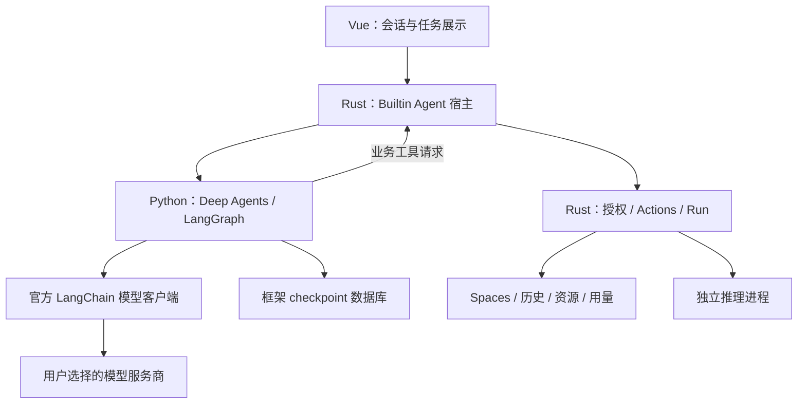

# Knovum 内置 Agent：Deep Agents 整改方案

日期：2026-10-06。代码基线：`49051ade973cdb67d56f884adfc20751c20f8413`。

状态：**代码整改与 A7 代码验证已完成；真实服务商及原生发布资格尚待验收。** 本文件是实施清单；实施时将长期契约更新到各自的 `docs/` 权威文档，避免形成两套架构规范。

## 1. 目标与范围

将内置 Agent 的执行框架整体切换为 **Python Deep Agents + LangGraph**，删除 Rig 执行循环和对应状态恢复实现。复用框架的上下文管理、工作区、Skills、子 Agent 和 checkpoint 能力；Knovum 保留模型选择、授权、业务 Actions、Run、历史和资源发布的产品职责。

本次按单 agent 顺序实施。先完成各阶段开发及必要的接口证明，再统一执行完整测试、格式和静态检查。真机验收、签名、打包、安装和发行由维护者完成；开发者负责代码、可重复验证用例和交付证据。

必须满足：

- 一个内置 harness，一条执行路径；没有 Rig 开关、旧 checkpoint 读取器、自动换模型或协议降级。
- 保留现有用户配置的服务商、模型、凭据和 External Agent 能力；Agent 可用性按实际模型能力判定。
- Rust 是业务事实与权限的唯一写入者；Python 是框架执行状态的唯一写入者。
- 图像输入、Ask / Plan / Execute、分支历史、流式回答、工具执行、取消、恢复和 Task Center 行为均有明确验收项。
- Agent 与推理引擎采用独立进程、独立依赖环境；Agent 不依赖 Torch，不竞争推理进程的计算准入锁。
- 发布范围为 **macOS ARM64、Windows x64**；不扩展为四平台，不依赖系统 Python。

本次不新增托管模型订阅、计费后端、任意代码执行、Shell、浏览器自动化、插件市场、远程 Agent Server 或自建通用 Agent 框架。

## 2. 当前代码与需要修复的边界

| 已确认事实                                         | 当前入口                                                                                                                                      | 整改方向                                                             |
| -------------------------------------------------- | --------------------------------------------------------------------------------------------------------------------------------------------- | -------------------------------------------------------------------- |
| 内置 Agent 使用 Rig 的控制指令和序列化状态         | [agent_runtime/mod.rs](src-tauri/src/agent_runtime/mod.rs)、[rig/mod.rs](src-tauri/src/agent_runtime/rig/mod.rs)                              | 用 Deep Agents 替换，删除旧控制指令和状态机                          |
| Rust 驱动模型回合、保存响应、执行工具，再推进框架  | [task/driver.rs](src-tauri/src/spaces/conversations/task/driver.rs)                                                                           | Rust 变为执行宿主，Python 直接调用已配置的官方模型客户端             |
| 当前模型由用户的连接和模型选择解析                 | [task/mod.rs](src-tauri/src/spaces/conversations/task/mod.rs)、[ai/settings/mod.rs](src-tauri/src/ai/settings/mod.rs)                         | 保留唯一配置来源，补充 Agent 能力资格                                |
| 恢复逻辑依赖当前 Rig checkpoint 和 profile version | [task/recovery.rs](src-tauri/src/spaces/conversations/task/recovery.rs)、[agent_runtime/contract.rs](src-tauri/src/agent_runtime/contract.rs) | 以图版本、thread 和 checkpoint 身份恢复                              |
| 历史上下文有固定条数、字符截断和摘录摘要           | [repository/context/mod.rs](src-tauri/src/spaces/conversations/repository/context/mod.rs)                                                     | 内置 Agent 的上下文由框架管理；External Agent 仍保留其必要的提示构造 |
| 业务工具已有授权、幂等与持久化执行入口             | [actions/invocation/execute/mod.rs](src-tauri/src/spaces/actions/invocation/execute/mod.rs)                                                   | 复用此入口，补齐稳定操作身份和取消提交屏障                           |
| Rust 已持有业务 Run、会话历史及模型调用记录        | [0001_spaces.sql](src-tauri/migrations/spaces/0001_spaces.sql)                                                                                | 保留产品事实，移除重复的框架状态                                     |
| External Agent 是独立产品能力                      | [external_agents](src-tauri/src/external_agents)                                                                                              | 保持独立，不用作内置 Agent 失败后的替代路径                          |
| Python 按能力组织，包之间禁止依赖内部实现          | [python/pyproject.toml](python/pyproject.toml)、[test_architecture.py](python/tests/test_architecture.py)                                     | 新增 `knovum_agent_runtime`，沿用能力边界                            |
| 运行时下载、校验和构建已有归属                     | [local_resources/runtimes/python](src-tauri/src/local_resources/runtimes/python)、[scripts/runtime](scripts/runtime)                          | 扩展现有发布配置，不另建安装器和打包系统                             |

以上是仓库事实。下文的目录、协议和执行约束是项目设计；标记为 A0 的项目必须通过锁定版本的运行实验才能视为成立。

## 3. 架构决定

### 3.1 唯一执行框架

Python 通过官方 `create_deep_agent` 创建内置 Agent，直接使用 LangGraph 执行及恢复接口。组合点只配置模型、业务工具、工作区、checkpoint 和必要的产品策略；不再实现 Planner、AgentRunner、消息 reducer、压缩算法或通用模型路由器。

官方 API 已提供模型实例、工具、backend、middleware、state/context schema 与 checkpointer 的组合入口；具体参数以 A0 锁定版本为准。[Deep Agents 定制接口](https://docs.langchain.com/oss/python/deepagents/customization)



### 3.2 责任归属

| 所有者                   | 负责                                                                           | 明确边界                                                         |
| ------------------------ | ------------------------------------------------------------------------------ | ---------------------------------------------------------------- |
| Vue                      | 输入、模型选择、历史分支、流式展示、控制操作和 Run 观察                        | 不启动 Python，不提交业务副作用，不读取图内部状态                |
| `spaces/conversations`   | 会话与执行段绑定、上下文资源授权、工具准入、消息投影、任务结算                 | 不推进模型回合，不实现框架压缩与子 Agent 调度                    |
| `agent_runtime`          | Agent 进程生命周期、双向协议、控制及断线报告                                   | 不连接模型服务商，不拥有 Spaces SQL，不复制 inference supervisor |
| `knovum_agent_runtime`   | Deep Agents 组合、模型客户端、SDK 执行、checkpoint、工作区、流到产品事件的转换 | 不访问业务数据库、凭据数据库，不自行发布资产                     |
| Rust Actions / Runs      | 授权、稳定操作身份、业务事务、子任务、用量和提交屏障                           | 不解释 LangGraph 内部表结构                                      |
| 既有模型与运行时资源能力 | 下载、验证、安装、锁定版本及资源租约                                           | 不管理 Agent 会话，不接受任意 pip 安装                           |

不增加跨上述所有者的万能 Service、Manager 或公共数据库。只有真实重复并具有同一语义的基础逻辑才提取共享模块。

## 4. 模型与服务商设计

### 4.1 配置与绑定

继续使用现有 AI Settings。每个执行段冻结 `connectionId`、`provider`、`modelId`、协议、地址、模型参数和资格版本；凭据引用由 Rust 保存。Python 在内存中接收本次执行需要的凭据并构造官方模型实例，随后传给 `create_deep_agent(model=...)`。

必须显式提供模型，禁止触发框架默认服务商。主 Agent 和摘要默认使用同一绑定；研究子 Agent 默认继承，只有用户显式配置并已通过资格验证时才使用不同绑定。执行中不因错误切换服务商、模型或 API 协议。

Deep Agents 要求聊天模型支持 tool calling；OpenAI 的模型字符串入口会默认开启 Responses API。Knovum 使用显式实例及协议参数，OpenAI-compatible 配置只走所声明并验证的协议。[Deep Agents 模型配置](https://docs.langchain.com/oss/python/deepagents/models)

### 4.2 接入原则与资格矩阵

| 协议族                        | SDK 选择方向                                                                | 必须证明                                               |
| ----------------------------- | --------------------------------------------------------------------------- | ------------------------------------------------------ |
| OpenAI                        | `langchain-openai`，明确 Chat Completions 或 Responses                      | 对应协议的工具、流式、图像、usage 和恢复语义           |
| Anthropic                     | `langchain-anthropic` 原生客户端                                            | 工具结果、图像块、usage 和取消                         |
| Gemini                        | `langchain-google-genai` 原生客户端                                         | 工具 schema、图像、流式和 usage                        |
| Ollama                        | `langchain-ollama`                                                          | 实际模型的工具能力和本地服务连接策略                   |
| 其他现有文本服务商            | 维护中的原生 integration；服务商明确提供 OpenAI-compatible 接口时使用该协议 | 官方接口、实际端点和模型级行为，不能按名称猜测         |
| 自定义 OpenAI-compatible 连接 | `langchain-openai` 加用户声明的地址和协议                                   | 可重复的工具调用及图片输入测试；未验证的不显示为已认证 |
| 仅图像 / 视频生成服务商       | 继续作为 Rust 业务 Action 的执行目标                                        | 不列为主 Agent 聊天模型                                |

SDK 构造差异集中在一个模型绑定模块，直接导入 vendor API；不为每个 SDK 建立同名包装类。依赖以实际需要的协议族为单位加入，先审查维护、许可证、Python 约束及依赖体积，再冻结精确版本。

资格清单逐一覆盖当前 `ProviderKind` 的文本提供者：OpenAI、OpenAI-compatible、OpenRouter、Anthropic、Gemini、DashScope、DeepSeek、Zhipu、SiliconFlow、Grok、Groq、Mistral、Together、StepFun、Moonshot、Doubao、MiniMax、Ollama；Kling 的生成能力保留为 Action。此清单不代表这些 provider 的所有模型均支持 Agent。

资格按 `provider × protocol × model × SDK版本` 记录工具调用、流式、视觉、usage、上下文限制和参数支持。国内外使用相同规则，分别验证所声明的端点；不加入静默镜像切换。原有文字或图片能力不能因为迁移而无说明消失；明确缺少工具能力的模型保留原有直接调用用途，并显示 Agent 不可用原因。

Agent 的 HTTP 请求由 Python 官方客户端发出，但必须保持现有地址准入、代理、证书、超时和凭据发送范围的产品策略；逐项对照 [ai/transport/security.rs](src-tauri/src/ai/transport/security.rs)。客户端参数能满足时直接配置；不能满足的协议族不取得发布资格，不再通过 Rust 转发模型请求制造第二条执行路径。

### 4.3 内置模型与托管服务

Deep Agents 提供 harness，不提供模型额度。现阶段继续采用现有用户连接与默认路由；默认模型是配置策略，不能硬编码在 Python。未来 Knovum 提供自有托管模型时，以正式服务端鉴权和额度契约增加一种连接，复用绑定入口；本次不提前编写订阅、余额、计费或备用模型代码。

## 5. 目录与命名

拟新增的能力包如下。目录表示职责，不要求一次性创建所有文件；每个文件必须有实际调用者和独立责任。

```text
python/
  src/
    knovum_agent_runtime/
      __init__.py
      __main__.py
      server.py           # 进程入口与请求分派
      transport.py        # 双向 JSON-RPC 帧与请求关联
      contracts.py        # Rust schema 生成的边界类型
      composition.py      # 唯一 create_deep_agent 组合点
      execution.py        # SDK 调用、恢复与安全控制边界
      model_binding.py    # 已验证配置到官方模型实例
      host_tools.py       # Action schema 到 SDK 工具及宿主调用
      projection.py       # 原生状态到产品消息与活动
      budget.py           # 请求准入、用量回报及 SDK 策略扩展
      workspace.py        # 受控 backend、快照和导出
      subagents.py        # 已授权研究子 Agent 的具体配置
  schemas/
    agent_runtime.schema.json
  tests/
    agent_runtime/
```

Rust 保留 `agent_runtime/` 作为 Agent 进程控制能力，内部按真实需要设置 `protocol`、`process`、`control`；`spaces/conversations/` 保留业务宿主、会话和 Action 映射。测试放在独立测试目录，Rust 不把测试实现嵌入业务文件。

不创建 `python/agent_runtime` 第二项目、不创建空 `knovum_runtime`、通用 `framework`、`services`、`utils` 或 `helpers`。包之间不导入 peer capability 内部实现。命名遵循 [naming-conventions.md](docs/naming-conventions.md)，不得出现同一目录下同名文件与目录。

执行时扩展 [test_architecture.py](python/tests/test_architecture.py) 和现有 source-layout gate。TS / Vue 文件上限 180 个非空行，Rust / Python 上限沿用当前 350 行门槛，复杂度沿用现有规则；拆分依据职责，不以行数制造转发文件。

## 6. 依赖与运行时发布

采用 `python/runtimes/agent` 的独立项目与 `uv.lock`，入口为 `knovum_agent_runtime`。分别导出、安装 Agent Runtime 与 inference 的明确依赖集合，形成两个不可变 runtime 包。每个 profile 使用独立的锁、安装目录和解释器搜索路径；Agent 包不包含 inference 的第三方包。

A0 检查当前 CPython 3.11.17 与 SDK 组合、两平台 wheel、许可证和全部传递依赖。若存在真实不可调和的 Python / 依赖约束，按现有架构规范建立独立锁定项目及经过资格验证的 runtime；先记录约束证据，不强迫推理引擎升级来迁就 Agent，也不预先复制整套项目。

扩展现有 [build_python.py](scripts/runtime/build_python.py)、inventory、manifest、安装租约和 provisioning，使其选择具体能力的依赖集合。沿用现有 `runtime:build` / `runtime:provision` 命令，以明确参数选择能力；不按 provider、阶段和平台新增一组顶层 scripts。

应用自有 Python 源码继续随应用发布，CPython 与第三方依赖通过已验证的 runtime 资源按需安装。首用前完成校验，之后离线可启动已安装环境；模型接口仍按其服务要求联网。缺少运行时显示可恢复安装错误，不调用系统 Python、不运行现场 pip、不改用 Rig。

Agent 包只安装需要的 SDK、checkpointer 及结构校验依赖，清单中不得出现推理栈的 Torch、模型权重或未使用的 integrations。若实际 SDK 引入新的基础依赖，应按依赖树审查，不能仅凭包名随意删文件。

记录两个平台的安装包增量、runtime 下载压缩体积、展开体积、首次启动耗时和空闲 / 运行内存；以实测建立回归预算，不照搬原方案未经测量的固定阈值。初版允许两个不可变 runtime 各持有解释器，暂不增加共享可变 venv 或复杂文件去重器。

## 7. 状态、会话与消息投影

### 7.1 唯一状态来源

| 数据                                                              | 持久化所有者                                            |
| ----------------------------------------------------------------- | ------------------------------------------------------- |
| 用户可见会话、分支、消息、附件、Run、授权、Action 收据和用量      | Rust 的现有 Spaces 数据库                               |
| 框架消息、压缩结果、计划、工作区文件、interrupt 和执行 checkpoint | Python 的 LangGraph checkpointer                        |
| thread 绑定、图版本、产品消息投影 cursor、待接受输入身份          | Rust 的 Builtin Agent 执行段记录                        |
| API Key / token                                                   | Rust 的既有 secrets 数据库；Python 仅持有执行期内存副本 |

使用官方 `AsyncSqliteSaver`，独立文件建议为应用数据目录中的 `agent-runtime/checkpoints.sqlite`。官方将 SQLite saver 定位于轻量本地用途；本项目选择它的前提是单写入进程和有限并发，A0 必须证明当前负载下的持久化与恢复，而不能仅凭有 SQLite API 就宣称可发布。

采用 `durability="sync"`，通过公开 `aget_state` / `aget_state_history` 和 saver 接口读写。LangGraph 的 checkpoint 在 super-step 边界保存，另有 pending writes；恢复判断必须涵盖这两类事实。[LangGraph checkpointers](https://docs.langchain.com/oss/python/langgraph/checkpointers)

### 7.2 执行段与历史分支

一个执行段绑定一个 `threadId`、一个会话分支、图版本和冻结的模型 / 工具目录版本。同段连续输入沿用 graph 状态；一次提交对应一个产品 Run，thread 可承载该段的连续 Run。初版全局只允许一个活跃内置 Agent Run，其余输入由 Rust 有序接纳，不建设第二个调度平台。

切换模型、协议、外部 Agent 或历史分支时关闭当前段，创建新段；不能在一个 graph 中途替换身份。新的内置段从已提交的分支历史、已授权附件和工具收据构造结构化 SDK 消息，再交给框架管理上下文；不向新图灌入旧 Rig JSON 或固定字符截断摘要。

恢复只针对同图版本、同绑定且未终结的执行段。外部 Agent 的历史导入保留已有需求，但不因此让内置 Agent 继续使用旧上下文压缩实现。

### 7.3 用 checkpoint 历史恢复投影

**选择 checkpoint 历史作为框架侧恢复来源，不新增 Python outbox、输入去重数据库或第二套消息日志。** Rust 在一个业务事务中提交消息投影及对应 cursor。消息按 `threadId + graph namespace + messageId` 唯一标识，checkpoint 身份只用于投影进度，不进入消息去重键：同一消息会出现在多个 checkpoint 快照中。流式更新沿用同一消息身份，不增加重复消息。

流式 delta 仅用于即时展示。完整回答、工具收据和最终状态以已持久化图状态及 Rust 业务事实为准。断线后 Python 根据 SDK 公开历史接口重新导出尚未确认的主 Agent 消息，Rust 幂等接收；摘要、内部 reasoning 和研究子 Agent 的内部消息不能误投影为用户回答。

这消除了“checkpoint → 自建 outbox → Rust ACK”跨库原子事务要求。代价是必须保留未完成投影所需的 checkpoint 历史，并验证压缩后仍能恢复之前的完整可见消息。A0 不通过时阻止切换，不能补一个私有 SDK hook 或手写日志系统绕过证明。

清理采用公开接口：保留活跃 thread 及未确认投影；关闭段完成投影、输入和子 Run 结算后，按明确保留期删除其框架状态。首版不直接修改 SDK 私有 SQL 表，也不实现未经验证的细粒度 checkpoint 裁剪。产品历史与已发布资产不依赖 checkpoint 永久存在。

## 8. 双向进程协议与输入控制

采用 UTF-8 JSONL 承载 JSON-RPC 2.0，Rust 启动私有 Agent 进程。stdout 只输出协议，stderr 走脱敏诊断；不增加本地 HTTP 服务和 WebView 直连端口。

| 方向               | 请求 / 通知职责                                                                  |
| ------------------ | -------------------------------------------------------------------------------- |
| Rust → Python      | 初始化资格握手；提交输入；恢复；请求暂停；取消；导出持久化投影；关闭             |
| Python → Rust      | Action 调用；模型请求预算准入；用量结算；等待子 Run / 审批；流式和持久化状态通知 |
| Rust → Python 回调 | Action 结果、预算许可、已有子 Run 结果或明确拒绝                                 |

协议只携带产品需要的身份：`protocolVersion`、`runId`、`threadId`、`executionRevision`、`controlEpoch`、`inputId`、请求 ID 和必要 checkpoint 引用。字段的必选 / 条件关系由 Rust 的 serde / schemars 定义并生成 TS / Pydantic；不在三种语言手写三份 wire schema。

扩展 [contract_codegen](src-tauri/src/contract_codegen) 与 [generate_python_contracts.py](scripts/generate_python_contracts.py)。内置 SDK 的复杂消息对象留在 Python，IPC 只暴露主回答、工具活动、计划、等待原因和诊断所需的稳定投影。

读循环、响应关联和控制通知必须在模型流式 / 工具等待时继续工作；双向请求不能阻塞读循环。采用现有有界进程和 JSON 解析能力，明确帧大小、请求超时、输出背压和进程退出处理，不抽象成通用 RPC 平台。复用基础原语前先比较现有 [subprocess](src-tauri/src/subprocess) 与 inference transport 的实际职责。

`inputId` 在 Rust 提交时持久化，并作为该输入的稳定消息身份传给 SDK，重复提交返回同一接纳结果。Python 只在输入已进入持久化 graph 状态后确认接纳；ACK 丢失时由公开图状态及输入身份核对，不能直接再次追加消息。用户追加输入排队到安全边界，不能直接修改正在运行的 graph；其 checkpoint 保留策略必须覆盖尚未核对的输入。

凭据通过管道进入执行期 context / 模型实例，不写入 state、checkpoint config、工具参数、日志、命令行或环境变量。模型对象及敏感 context 不参与持久化。退出后释放持有者；不声称 Python 字符串可以可靠擦除。默认关闭外部 tracing，启用诊断不能泄露原始请求、附件和密钥。

## 9. Actions、幂等和长期任务

### 9.1 复用唯一业务入口

由 Rust 向 Python 提供本次授权可见的 Action 目录和 JSON Schema；SDK 工具仅做 schema 绑定、请求关联及结果转换。Rust 每次调用仍校验目录版本、授权范围、输入和资源版本；模型生成的参数是外部输入，不能因为代码由我们编写就跳过此边界。

Ask 只开放读取；Plan 可维护框架计划并使用获准读取工具；Execute 才开放本次授权的写入 Actions。模式语义由 Rust 目录准入保证，不靠 prompt 自觉遵守。规划用官方可选 TodoList 能力，不另建计划执行 DSL。

写入操作的幂等身份来自 `executionRevision + graph namespace + durable AIMessage ID + toolCallId + Action版本`，由 Rust 构造并持久化；首次请求必须能关联到已持久化工具意图。恢复重放沿用原身份，attempt、进程 PID、随机请求 ID 和 control epoch 不参与幂等键。

同一身份但不同参数必须拒绝；相同身份返回既有收据或正在执行的子 Run，不重复写入 / 创建任务。Action 提交前原子验证当前执行 revision、授权及取消 fence，避免“检查时没取消、提交时已取消”的竞态。A0 证明原生工具消息身份在恢复和 interrupt 重放中的稳定性。

### 9.2 长期 Action

生成、转录、索引等长任务返回已有产品 `childRunId`。图用官方 interrupt / resume 在安全边界等待，Rust 观察并返回该子 Run 的最终结果；不让模型反复调用“查询进度”消耗预算。

恢复时绑定既有子 Run，不重新提交同一个业务工作。interrupt 之前的代码可能重放，因此此前操作必须幂等；不得吞掉框架的 interrupt 异常或假设 Python 协程暂停即已持久化。

子 Run 的取消传播和根 Run 的结算沿用既有 Run 契约。所有相关子 Run 与消息投影完成前，根 Run 不能记为成功。写入与资产发布只走 Rust Action 事务，Python 返回的路径与 manifest 是待验证输入。

## 10. 预算、暂停、取消和故障恢复

### 10.1 预算统一

模型准入及实际用量由 Rust 的 Run / 用量所有者管理。至少区分 `main`、`research`、`context_summary`；框架自动摘要同样计费、计数。研究子 Agent 和拥有的生成类 Action 计入根 Run 的预算，汇总引用子 Run 事实，不能重复累加。工具次数限制覆盖业务 Action 和框架的计划、文件、委派工具；这些内部工具不因此成为 Rust 的业务 Action。

用 SDK 公开 middleware / callback 扩展接入策略，覆盖每个实际使用的模型实例及后台摘要请求；只有 after-response callback 不足以阻止预算外请求。A0 必须证明每条模型 HTTP 请求之前可以获得宿主许可，以及失败、流式、取消和嵌套调用均能结算。

SDK 默认重试显式关闭；首次版本对可能已经发送的模型请求不自动重发。请求数、工具数、墙钟时间和并发由宿主硬限制；token 限制只有在输入上界、最大输出及 usage 已经过资格验证时才能声明为硬限制。复用官方计数能力，不自写 tokenizer 或通用 token 猜测器。无可靠上界的模型不得宣称满足硬 token 预算资格。

模型调用账本只保存准入身份、归属、状态和计量事实，改造现有 Builtin Agent 模型调用表即可；不再保存一份 SDK 原始响应并自行注入恢复。每次请求 ID 标识实际计费 attempt，不冒充跨恢复稳定的 graph / 工具身份。恢复前 Rust 核对账本与已提交图状态，任何无法证明已纳入恢复状态的已发送请求，都进入第 10.3 节的等待分类，不能通过创建新请求 ID 绕过。

`usage` 缺失记为未知，保留未结算预算并停止进一步计费请求，不能当作零。无需凭据的 Ollama 仍须记录消耗和请求次数。

### 10.2 控制语义

| 操作     | 必须成立的结果                                                                 |
| -------- | ------------------------------------------------------------------------------ |
| 暂停     | 请求接纳与 `paused` 分开；到达持久化安全边界才显示已暂停，期间禁止新增受限请求 |
| 恢复     | 在同一图 / 绑定的已提交 checkpoint 上继续，不重复既有业务副作用                |
| 取消     | Rust 先撤销执行 epoch 的提交权并取消所拥有的 Run，再通知 Python 停止           |
| 迟到结果 | 不得让已取消根 Run 成功，不得提交失效授权下的资源；已发生费用如实记账          |
| 进程停止 | 在明确宽限期内退出；超时终止进程，仍保持 Rust fence 有效                       |

初版停止宽限期采用 5 秒，进入取消状态后业务提交权立即失效；此值是产品设计和验收要求，不是已测得的 SDK 保证。进程被终止不代表服务商停止计费。

### 10.3 恢复分类

1. 模型节点结果已在 checkpoint 或可证明的 pending writes 中持久化：由 LangGraph 恢复，不再次调用该已完成节点。
2. Action 已创建或完成，但图尚未记录结果：按稳定操作身份查 Rust 收据 / 子 Run，返回同一事实。
3. 模型请求已发出，但无法证明可恢复的节点结果：进入可见等待状态。服务商有已验证的结果查询接口时查询；否则用户显式发起新 attempt，不能静默重试导致重复计费。
4. 已知模型响应 / 用量，但 graph 提交未完成：明确标记“响应已知，执行未提交”，与服务商结果未知分开；不拼接手写响应缓存继续推进图。
5. checkpoint 图版本或目录版本不受支持：结束该执行段，保留产品历史和已提交成果；用户的新输入创建新段，不读旧内部格式。

恢复分类以持久化事实为依据，不能把所有断线一概重试或一概失败。运行状态、未知结果及等待原因由 Rust 产品契约定义，Python SDK 的内部异常不能直接成为前端协议。

## 11. 上下文、工作区、Skills 和研究子 Agent

### 11.1 使用框架已有能力

上下文压缩、工具大结果卸载与工作区采用 Deep Agents 原生能力，触发条件根据已验证的模型上下文限制配置。主图保存正常消息；公开历史用于恢复产品投影，当前压缩状态用于后续模型请求，两者职责不同。[Deep Agents 上下文管理](https://docs.langchain.com/oss/python/deepagents/context-engineering)

工作区使用 thread 私有 StateBackend；需要只读 Skills / memory 时按公开 CompositeBackend 接入 Rust 提供的版本化快照。允许路径和操作明确列出，末尾拒绝其他访问。不得挂载 Spaces、secrets 数据库或完整用户目录，也不借工作区获得跨 Space 权限。

附件由 Rust 解析并授权，冻结来源 revision、MIME、大小和资源身份；Python 只消费获准内容，利用官方多模态消息结构传给模型。图像不默认退化为文字描述，供应商上传及临时资源生命周期必须单独验证。

工作区草稿可由 Agent 编辑，真正资产发布必须导出到受控暂存位置，由 Rust 校验类型、大小、来源和 manifest 后提交 Action。线程 / 子 Run 的资源租约未释放前不得清理相关文件。

### 11.2 Skills 与长期 memory

初版只加载随产品审查的版本化 Skills，不从任意仓库动态安装执行代码。Skills 描述操作知识，业务权限仍由 Rust 控制。长期 memory 使用显式、可查看和可删除的 Rust 业务记录，在执行开始时提供最小只读快照；Agent 的记忆更新提议必须走独立业务 Action，不直接写长期 store。

不创建第二个知识库、向量数据库、万能 MemoryService 或自动收集私密数据机制。既有 Spaces 检索通过已授权 Actions 提供。

### 11.3 有限研究子 Agent

初版只配置一个 `research` 子 Agent 类型，最多两个并行实例，最大委派深度为 1；仅给予明确的只读工具，不能继承主 Agent 的写权限或再次委派。默认 general-purpose 子 Agent 通过锁定版本的公开配置关闭。

使用 SDK 同步子 Agent；不引入需要 Agent Server 的异步协议部署。子 Agent 最终结果进入主图，内部即时活动可展示但不承诺逐节点恢复；整个研究任务的重放只包含读取与明确计量的模型调用，账本中未结算请求仍阻止静默重发。[Deep Agents 子 Agent 配置](https://docs.langchain.com/oss/python/deepagents/subagents)

主 Agent 不在研究阶段并行写同一业务资源；一切写入留在主图经 Rust Actions 执行。安全控制、预算和工具准入分别附到每个已配置子 Agent，不能假设父 middleware 自动继承。

## 12. 旧实现与数据处理

### 12.1 必须删除

- `src-tauri/src/agent_runtime/rig/` 及旧 `ControlCheckpoint` / `ControlDirective`、转码和 Rig 专属测试。
- `rig-agent` Cargo 依赖及只为它服务的锁定依赖。
- `task/driver.rs` 的模型 / 工具手写循环，旧 Rig 恢复和 checkpoint envelope 持久化。
- 旧 `spaces_assistant_checkpoints` 表；旧 `spaces_assistant_model_turns` 的请求 / 响应重放结构由新调用计量结构替换。
- 旧 `spaces_assistant_tool_calls` 对 model turn 的强耦合，改为稳定 graph 工具身份关联既有 Action invocation。
- 只供内置 Agent 使用的固定截断与摘录摘要逻辑；`spaces_assistant_context_segments` 是否保留以 External Agent 的真实读写引用为准，无消费者即删除。
- 新实现通过后，删除只验证上述旧机制的测试和文档，不留 legacy 目录、engine flag 或双写实现。

### 12.2 必须保留并修正接口

保留 AI Settings、凭据存储、外部 Agent、业务 Actions、Run、Task Center、授权、附件和资源发布。`genai` 仍服务现有直接模型调用，不能因删除 Rig 一并移除；[ai/tasks/completion](src-tauri/src/ai/tasks/completion) 不是 Agent harness。

保留会话、分支、公开消息、已发布资产、Action 收据和用量；这些不是框架内部状态。UI 继续消费产品契约，新增等待原因、计划活动、确定的消息边界及恢复状态，不展示 checkpoint JSON。

### 12.3 数据切换策略

项目尚未发布的数据库按既有单一 v1 baseline 规则更新；旧结构必须明确拒绝或重置，不能启动时探测并兼容读取。需要保留开发数据时，先导出业务历史和资源，再用一次性离线工具转换为新业务结构；转换器不进入应用运行路径，且只在确有数据保留需求时编写。

旧 Rig 活跃任务不得转换成 LangGraph checkpoint：标记为迁移中断，结算已有子 Run 和收据，保留公开历史，后续显式输入创建新执行段。正式发布之后的升级策略按产品数据库契约另行制定，不能把当前未发布基线处理方式推广为删除用户数据。

## 13. 实施顺序与阶段出口

### A0：锁定 SDK 并证明关键公共接口

在独立实验环境选择维护中的 Deep Agents、LangGraph、SQLite saver 和模型 integrations 组合，冻结版本与源码引用；记录 Python 约束、两平台 wheel、许可证与依赖树。实验代码最终收敛为 `python/tests/agent_runtime/` 的有效契约用例，不遗留无人调用的 demo 工程。

| 必证项            | 最小证据                                                                       | 未通过的处理                               |
| ----------------- | ------------------------------------------------------------------------------ | ------------------------------------------ |
| 图提交与工具意图  | 工具回调前已有可持久化恢复的 AIMessage / toolCall 身份；interrupt 重放身份稳定 | 阻止写入工具切换，不用 epoch 代替身份      |
| 投影恢复          | 丢 delta / ACK 后从公开 checkpoint 历史重建；跨压缩后主回答完整且唯一          | 阻止切换，不追加自建 outbox 或私有 hook    |
| 输入接纳          | checkpoint 已保存输入但 ACK 丢失时，再次接纳不会重复追加                       | 修正公开状态和 Rust 接纳契约，不能盲目重发 |
| 预算覆盖          | 主图、研究和摘要的每次请求前准入；失败和取消均有调用记录                       | 选择受支持的公开扩展；无接口则阻止发布     |
| 持久化恢复        | 进程中断、节点失败和 pending writes 的恢复结果可观察且业务副作用不重复         | 不宣称无损恢复，不 fork SDK 私有实现       |
| 控制与长期 Action | 模型流式时控制可到达；子 Run 等待 / resume 不重复提交；取消 fence 生效         | 修正宿主控制边界，不能以杀进程代替业务取消 |
| 模型资格          | 至少覆盖原生三协议、国内声明端点及自定义 compatible；图像与工具可组合          | 明确未取得资格的模型，不静默改变协议       |

出口：所有关键公共接口项有具体锁定版本、命令、输入与结果。缺少真实服务商凭据或目标硬件时，相应项目标记为待验证，不伪造通过；这些发布资格缺口不阻止已有本地证据支持的代码开发与旧实现删除，但阻止宣称该模型 / 平台具备发布资格。公共接口实验失败属于架构阻断，不能与外部环境待验收混为一谈。

### A1：运行时与协议

新增 `knovum_agent_runtime`、独立 runtime 依赖选择和双向协议；扩展生成 schema、Python 架构规则和 runtime inventory。Rust supervisor 能启动、握手、报告异常并关闭 Agent。Agent 启动不加载推理库，inference 既有依赖和执行行为不变。

### A2：最小业务闭环

连接 AI Settings 和内存凭据，创建唯一 Deep Agent；接入一个真实读取 Action 和一个现有幂等写入 Action。验证 Ask / Plan / Execute 权限、图片附件、流式回答及已有 Action 收据。组合点直接调用 SDK，不加入自建模型回合循环。

### A3：持久化与历史投影

接入 AsyncSqliteSaver、执行段绑定、输入接纳身份及 Rust 投影事务。完成分支切换、目标切换、压缩后的消息恢复、断线重连和终态结算。按第 7 节删除重复日志需求，不先建 outbox 再尝试精简。

### A4：控制、用量与恢复

覆盖主图 / 摘要 / 研究请求预算，完成暂停、取消 fence、未知结果处理和长期 Action 的 interrupt / resume。改造模型调用与工具关联结构，使运行事实可追溯；保留正在执行的既有子 Run，不能重复生成或计量。

### A5：框架能力与产品表现

接入受控工作区、版本化 Skills、只读 memory 快照和有限 research；完善计划、工具、等待及恢复状态的产品事件。Rust 保留唯一业务写入口，Vue 不引入 SDK 类型。完成现有所有业务工具的目录映射，不以仅接通两个示例工具宣称功能对齐。

### A6：一次切换与删除

A1–A5 开发完成、A0 必要公共接口证明通过后，内置入口一次切换到 Deep Agents；在同一交付中删除第 12 节旧实现、依赖、表结构和无消费者代码。开发期间新入口仅用于隔离验证，不向用户暴露两种内置引擎。按数据策略处理开发数据库并更新权威文档；后续 A7 失败必须修复后才能交付为代码整改完成。

### A7：完整代码验证与交付

开发完成后统一执行测试、格式、类型、静态检查及实际业务回归；整理两个支持平台的可重复原生验收用例。交付代码与证据，明确待维护者完成的真机、签名、包安装和发行项目；不把这些外部项目算为代码整改已验证。

## 14. 验收标准

### 14.1 必须通过的代码和集成行为

| 场景            | 判定标准                                                                           |
| --------------- | ---------------------------------------------------------------------------------- |
| 模型与协议      | 所选连接、模型和协议与冻结绑定一致；错误不触发自动路由                             |
| 文字 / 图片     | 原有输入可用；合格模型正确收到图片；不支持时提交前提示具体原因                     |
| 三种模式        | Ask / Plan 无写权限；Execute 只执行已授权目录内的 Actions                          |
| 历史与分支      | 切分支 / 模型建立新段；历史不被压缩或恢复覆盖                                      |
| 流与消息投影    | 断流和丢 ACK 后完整回答恰好一条；内部摘要不成为公开回答                            |
| 工具幂等        | 在 Action 提交前后终止进程，恢复均只保留一次业务结果                               |
| 长期 Action     | 等待与恢复绑定同一 childRunId；取消按原 Run 契约传播                               |
| 暂停 / 取消     | 状态与实际安全边界一致；取消后迟到写入被拒绝，进程在宽限期内退出或被终止           |
| 模型未知结果    | 不自动重发；状态与费用已知程度清楚；显式新 attempt 有独立记录                      |
| 预算            | 主图、摘要、研究及子 Run 的消费全部归属根 Run，缺失 usage 不记零，不重复汇总       |
| 权限与资源      | 越权 Action、路径逃逸和失效 revision 在边界被拒绝；静态内部配置不重复 runtime 校验 |
| checkpoint 版本 | 不支持的图状态显式结束执行段，公开历史仍可读，不启用旧解析器                       |
| 依赖隔离        | Agent 环境不能导入 inference 的第三方栈；同一能力的包与测试归属通过架构检查        |
| 旧实现删除      | 生产源码和依赖中不存在 Rig 执行路径及旧 checkpoint 类型，无双写和兼容入口          |

先建立与上述风险直接相关的最小回归用例，SDK 自己的 reducer、工具绑定或构造器不重复写镜像测试。集成测试用可控模型端点与真实 SQLite saver 做故障注入；真实服务商测试按资格矩阵执行，不能用 mock 证明 provider 原生能力。

### 14.2 行为质量与工程检查

迁移前选取至少 30 个当前实际业务任务，覆盖文本、视觉、检索、写入、长任务、历史与恢复，并记录成功标准。关键任务在相同模型、参数、输入和工具集合下分别运行至少 3 次。授权违规和重复业务副作用为零；核心任务无功能缺失，质量下降必须查明并修复。

记录根 Run 总 token、请求数、耗时和模型调用目的。新框架规划 / 压缩可能增加成本：同任务中位成本或耗时增加超过 20% 时必须有证据解释、策略调整及重新验证，不能为了迁移而默认接受退化。该比例是回归审查线，不是未经实测的性能承诺。

最终代码检查：`pnpm contracts:generate` 后确认生成结果无漂移；`pnpm check:web`、`pnpm check:rust`、`pnpm check:python` 全部通过。Python 检查命令需在独立锁定的 Builtin Agent dependency project 中执行其类型和集成检查；不新增一套平行 quality 工具链。检查残留依赖、无用源码、重复逻辑、大文件和非法目录关系。

### 14.3 维护者负责的原生验收

macOS ARM64 与 Windows x64 分别验证：干净安装、首次 runtime 下载、离线重启、代理 / 证书环境、已有 runtime 升级、应用退出与重启恢复、Task Center 控制及资源发布。验证 runtime 库加载、进程终止和安装权限；完成签名、完整软件打包及安装测试。

开发交付必须提供命令、预期状态和结果记录位置。当前宿主为 macOS x64，不能据此宣布两个目标平台原生通过；没有真实服务商凭据的资格项同样保留明确缺口。

## 15. 风险与设计取舍

| 风险                                | 采用的措施                                          | 剩余约束                                         |
| ----------------------------------- | --------------------------------------------------- | ------------------------------------------------ |
| SDK 公共接口无法支持必要恢复 / 准入 | A0 在业务迁移前证明；锁定版本并保留契约用例         | 框架选择已确定，但未经证明的接口不进入发布       |
| 服务商协议与模型行为差异            | 原生 integration 或明确 compatible 协议，模型级资格 | 通用配置能力不等于所有模型均支持 tool calling    |
| 跨进程造成消息与业务状态不一致      | checkpoint 历史重建、Rust 投影事务、Action 幂等     | 不承诺跨数据库原子事务或服务商 exactly-once 计费 |
| checkpoint 历史增长                 | 已完成段的公开接口清理、资源租约、体积测量          | 初版优先正确保留，不手写 SDK 表裁剪器            |
| 框架默认能力突破授权 / 预算         | 明确工具目录、路径权限、有限子 Agent、全模型准入    | SDK backend 权限不是 OS 沙箱，不执行不可信代码   |
| 迁移后复杂度反而增大                | 删除 Rust 回合循环、Python outbox 和响应重放需求    | 保留必要宿主控制成本，不再造通用 harness         |

关键决定：采用 Deep Agents SDK，而非在 Rig 上继续开发上下文、子 Agent 和持久化执行体系；不采用完整 Agent Server，避免引入桌面产品不需要的部署和服务生命周期。Rust 继续拥有业务与权限，Python 直接拥有模型和图执行，这个跨进程边界带来一定控制成本，但不会迫使 Spaces 迁往 Python。

## 16. 权威文档更新与完成定义

| 契约变化                                   | 实施时更新                                                                                                      |
| ------------------------------------------ | --------------------------------------------------------------------------------------------------------------- |
| Python / Rust 拓扑及故障恢复               | [system-architecture.md](docs/system-architecture.md)                                                           |
| 能力依赖、目录和唯一执行入口               | [architecture.md](docs/architecture.md)                                                                         |
| thread、产品历史、Run、Action 与数据库归属 | [data-ownership.md](docs/data-ownership.md)、[spaces.md](docs/spaces.md)                                        |
| SDK 选择、版本、许可及公共接口约束         | [oss-first.md](docs/oss-first.md)、[dependency-policy.md](docs/dependency-policy.md)                            |
| Agent runtime 与源码发布、体积及原生资格   | [packaging.md](docs/packaging.md)、[release.md](docs/release.md)、[platform-matrix.md](docs/platform-matrix.md) |

**代码整改完成**：A0 的必要接口证明、A1–A6 实现与删除、A7 代码验证及权威文档均完成，现有功能对齐有证据；真实服务商或硬件验证缺口逐项注明。

**具备发布资格**：在代码整改完成之外，两目标平台的真实服务商、runtime、原生行为、签名与安装验收均通过。代码整改与代码验证已完成；尚未完成的发布资格项目见 `docs/release.md`。

## 17. 实施记录（2026-10-06，代码整改完成）

- A0：公共 SDK 接口证明已通过，覆盖 durable intent、interrupt、预算回调、HTTP 流与跨进程崩溃恢复。生产组合的流式投影、丢 ACK、摘要/研究收据和业务子任务重放均已通过回归；SDK 与独立依赖环境保持精确锁定。
- A1–A6：已切换入口，实现双向 stdio、冻结执行段、Actions 映射、公开投影、计费账本、暂停/取消/显式新 attempt、计划活动、只读 Skills/Space memory 与有限 research；已删除 Rig 路径、依赖和旧表结构。开发、删除和代码检查已完成；真实服务商效果不以 mock 回归代替。
- 依赖隔离调整：Google GenAI 所需 Pydantic 与 inference 锁定版本不一致，因此 Builtin Agent 使用 `python/runtimes/agent` 独立 dependency project，源代码仍归 `python/src/knovum_agent_runtime`。复用现有 producer/installer/quality 入口，不运行一个混合环境。
- memory 复用可见 Space 记录的最小只读索引快照，具体内容通过授权 Actions 读取，记忆更新以正常 Space 笔记 Actions 完成；没有新增第二个 memory 数据库。
- A7：正式执行 `pnpm contracts:generate`，366 个 Rust/TypeScript/schema/Pydantic 生成文件再生成前后 SHA-256 全部一致；`pnpm check:web`、`pnpm check:rust`、`pnpm check:python` 全部通过。前端 185 个测试文件共 711 项回归、基础 Python 177 项及 Builtin Agent 24 项回归通过，两套 Python 环境分别完成 80/22 个源文件的类型检查；Rust 525 项单元测试和 1 项集成 smoke 通过，严格 Clippy 无警告。
- 检查范围：运行时脚本 39 项通过、2 项因宿主非发布目标跳过；目录、文件大小、测试放置、能力权限、依赖边界、死代码、重复代码和格式门槛通过。全项目重复行比例 0.38%，低于现有 1% 门槛。Rust 默认忽略的 7 项包括 5 项要求指定 FFmpeg 二进制的测试、1 项供其他回归启动的子进程夹具和 1 项契约导出入口；导出入口已通过正式生成命令单独运行，不把其余忽略项算作通过。
- 收尾修正：统一父 Run 消费汇总，保留取消/超限后的付费事实；超限或未授权的未知消费阻止新工具和模型请求，最终结算不能误标成功。已覆盖 SDK Plan 投影、丢 ACK、摘要/研究收据、暂停恢复状态及 Action 子任务重放。崩溃恢复进程用例因并行 Rust 编译下的 SDK 冷导入超时，将测试时限调整为 60 秒；采集堆栈确认处于导入阶段，业务断言和生产恢复行为未放宽。
- 发布资格：生产 Builtin Agent 依赖的二进制 wheel 可用性已分别检查 macOS ARM64 / Windows x64；这不证明目标平台运行或真实模型效果。真实服务商质量对比、地域访问、双目标平台真机、签名、打包与安装由维护者按 `docs/release.md` 的资格矩阵完成；目前均未宣称通过。

## 18. 开发收尾架构审查

本轮由同一 agent 在实现后独立进行审查，范围为 Builtin Agent 迁移、关联的 Run/Actions/模型配置、Python 资源发布及前端消费边界；同时使用全项目现有静态门槛检查目录、文件大小、依赖、死代码和重复代码。结论是当前职责划分可以支持后续 Python 能力扩展，不需要为 agent 新建通用服务层或第二套运行框架。该结论不等于任意未来需求已被预先实现，也不替代真实模型效果和原生验收。

| 审查项         | 代码依据与结论                                                                                                                                                                                                                                                                                                |
| -------------- | ------------------------------------------------------------------------------------------------------------------------------------------------------------------------------------------------------------------------------------------------------------------------------------------------------------- |
| 框架复用       | `knovum_agent_runtime/composition.py` 直接组合 Deep Agents、LangGraph、官方模型 integrations、SQLite saver、State/Store/Composite backend、Skills、memory 和 Todo middleware；没有自行实现模型回合循环、摘要算法或 checkpoint SQL。                                                                           |
| 业务边界       | Rust Actions 仍是业务写入和授权入口；Python 只通过 `host_tools.py` 翻译已授权工具调用，不能直接写 Spaces 数据库或发布文件。research 为只读且禁止递归。                                                                                                                                                        |
| 持久化归属     | SDK checkpoint 属于 Python saver；产品历史、Action 收据、Run 和付费账本属于 Rust。公开投影采用稳定 AI ID 去重和事务 cursor，不增加 outbox、响应重放缓存或跨库原子事务假设。                                                                                                                                   |
| DRY            | 收尾时发现并移除两套父 Run token 汇总 SQL；Builtin Agent 账本与普通模型任务共同使用 `runs/budget` 的事务函数。删除 child Run 状态字符串映射，直接使用既有 Serde 枚举。工具与模型准入均拒绝已知超限和未获显式新 attempt 授权的未知消费，避免工具启动新的付费子任务。主图和 research 复用同一 middleware 配置。 |
| SOLID 与复杂度 | SDK 对接按 composition、model binding、host tools、budget、projection、execution、transport 分责；Rust process 依赖窄 Host 接口，业务 Gateway 保留在 Spaces。没有为每个 vendor 增加同名转发层、通用 manager 或猜测性插件机制。                                                                                |
| 运行时体系     | Agent Runtime 与 inference 有独立 lock/profile/process，避免 Pydantic 冲突和 Torch 耦合；共享既有构建、下载、校验、租约、进程树和质量入口。没有为两个环境复制 installer 或新增平行 CLI。                                                                                                                      |
| 兼容与兜底     | 已删除 Rig 源码、依赖和旧表；不支持的 graph/profile 显式结束执行段。协议与模型由配置明确指定，模型故障不自动重发付费请求，缺失 usage 不记零。边界校验用于 IPC、网络、数据库和授权；静态内部配置没有增加通用容错解析器。                                                                                       |
| 代码组织与命名 | handwritten 源码和独立测试接受现有大小/布局检查；新增局部命名按任务、操作、响应、帧和内容表达职责。内部 Rust 库只输出桌面程序实际消费的 rlib，删除没有消费者的 staticlib/cdylib 构建产物。                                                                                                                    |

保留的自有代码均承担产品规则或跨进程翻译：授权、预算准入、稳定 Action 身份、控制 epoch、公开历史投影和资源生命周期。SDK 无法拥有 Knovum 的这些业务事实，因此不采用仅为减少源码行数而覆盖业务规则的外部 harness/服务。服务商原生能力、效果、地域访问、启动时限和两目标平台运行行为仍须按 `docs/release.md` 完成资格记录。

## 19. Agent 命名整改计划

本轮保持现有行为，按实际职责统一名称，直接替换旧入口，不增加别名、迁移或兼容读取。

- Conversation：内置与外部 Agent 共享的会话、历史、上传、异步任务及 IPC。
- Builtin Agent：内置执行者、授权主体、Run、模型配置和执行事件。
- Agent Runtime：Python 图执行与宿主协议；包为 `knovum_agent_runtime`，发布 profile 为 `agent`。
- External Agent：外部 ACP 控制器的种类、描述、安装和接入方式。
- 保留模型消息的标准 `assistant` 角色及第三方 API 名称。

现有回归已覆盖会话、持久化、外部执行、图恢复和运行时资源发布。本轮先完成源码与文档变更，再重新生成 Rust 所有契约，执行 Python、Web、Rust 和发布脚本回归，检查旧名称残留及契约生成漂移。真机、签名、打包安装由用户负责。

### 19.1 已完成的命名与边界修改

- Python 源码和测试归 `knovum_agent_runtime` / `tests/agent_runtime`，依赖项目归 `runtimes/agent`，Rust schema 为 `agent_runtime.schema.json`。
- Rust 共享能力归 `spaces/conversations`，内置执行归 `builtin_agent`，外部提交归 `external_agent.rs`。附件上下文移到共享的 `conversations/context`，两个执行者直接使用同一个实现。
- 公共会话、消息、上传与任务使用 Conversation 契约和 IPC；模型配置使用 `BuiltinAgentModelSettings` / `builtinAgent`，运行时 RPC 使用 `agentRuntime.*`。
- 外部控制器类型、描述、安装和连接方式使用 ExternalAgent，相关 IPC、Tauri 权限、前端 schema 和组件一起改名。
- 授权主体、Run、用量和知识 actor 区分 `builtin_agent` / `external_agent`；公共历史表与内置执行表按真实所有者命名。标准消息角色 `assistant` 和第三方固定 `assistants` 参数保留。
- 发布 profile、环境变量、CI、许可证策略、资源状态与文档同步更新。没有旧名称别名或兼容入口，没有新增依赖、转发包装或抽象层。第三方依赖锁的 78 个包保持完全一致。

### 19.2 独立复核与回归

实现完成后单独复核模块消费者、SQL 外键、外部会话与共享历史的不同 ID、授权 actor、IPC 权限和翻译键。知识 provenance 复用已有生成的 actor 枚举，移除重复字面量类型。新增一项外部会话历史关联回归；它验证真实关联和事务更新，不测试名称拼写。

Rust 契约导出已通过，366 个生成文件再次生成没有漂移。Python 最终检查通过 Ruff、两套 Mypy（80 / 22 个源文件）和 177 / 24 项测试；运行时脚本 39 项通过、2 项限支持平台跳过。Web 最终总检查已通过 711 项测试、类型检查、Oxc、依赖边界、Knip、重复率和格式检查。Rust 最终总检查通过 source-layout、权限检查、cargo fmt、Clippy 全 targets 且 warnings 为错误，以及 526 项单元测试和 1 项本地资源 smoke 测试。7 项忽略项中，契约导出已单独运行；5 项需要显式 FFmpeg 测试程序，1 项是由父回归启动的子进程测试夹具。

本轮命名整改的源码、生成契约、配置和文档工作已完成。新旧名称残留检查仅保留标准消息角色与第三方固定字段；旧源码目录和旧入口已移除。`git diff --check` 通过。真实服务商资格、macOS ARM64 / Windows x64 真机、签名、软件打包与安装由用户按约定完成，本轮未执行。
