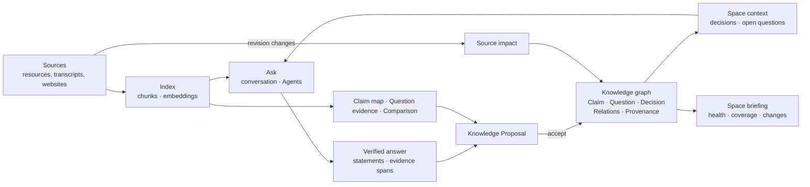
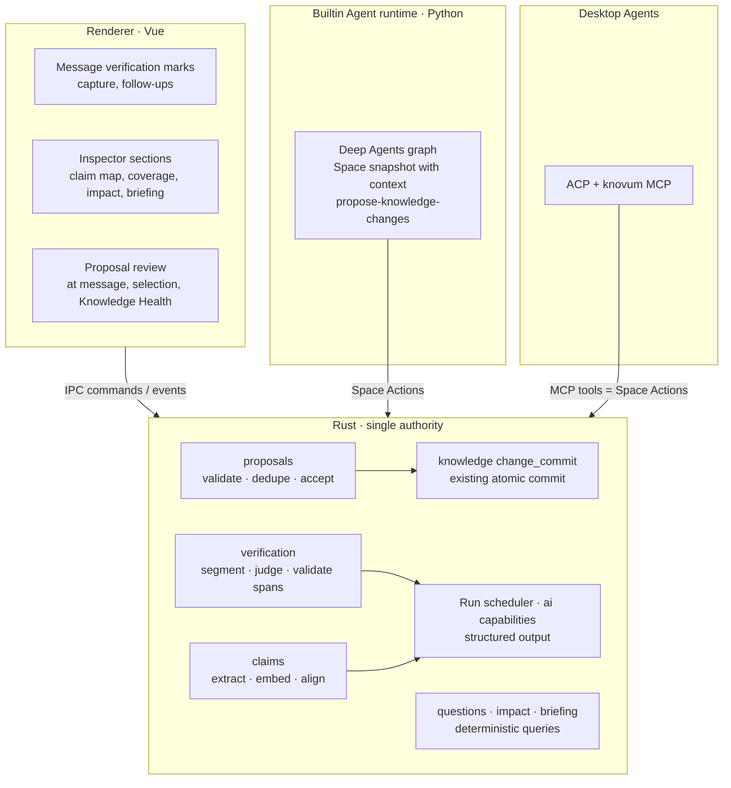
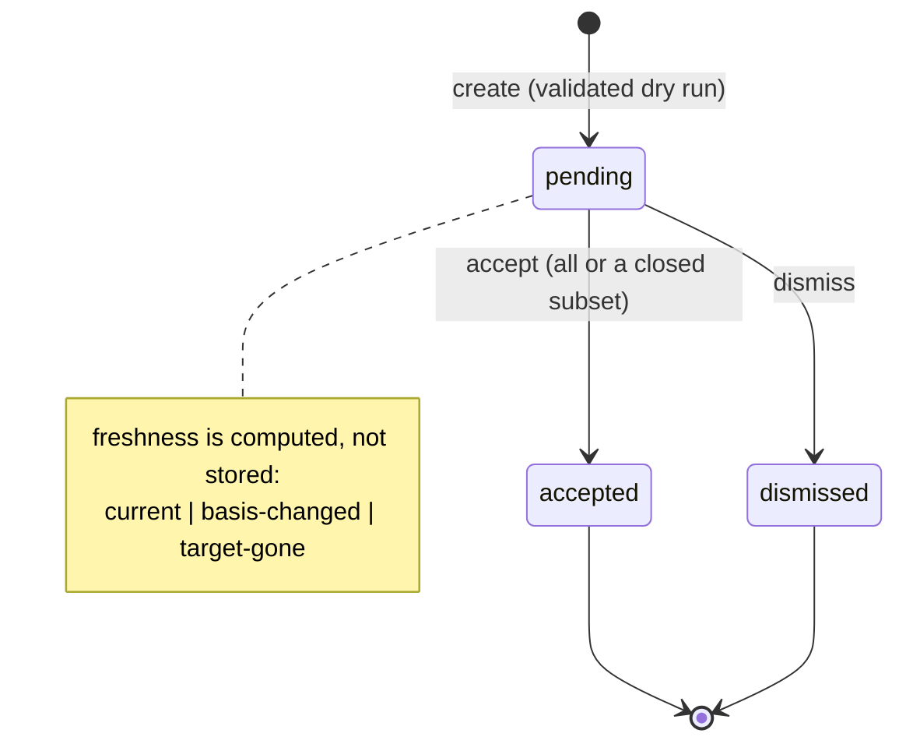
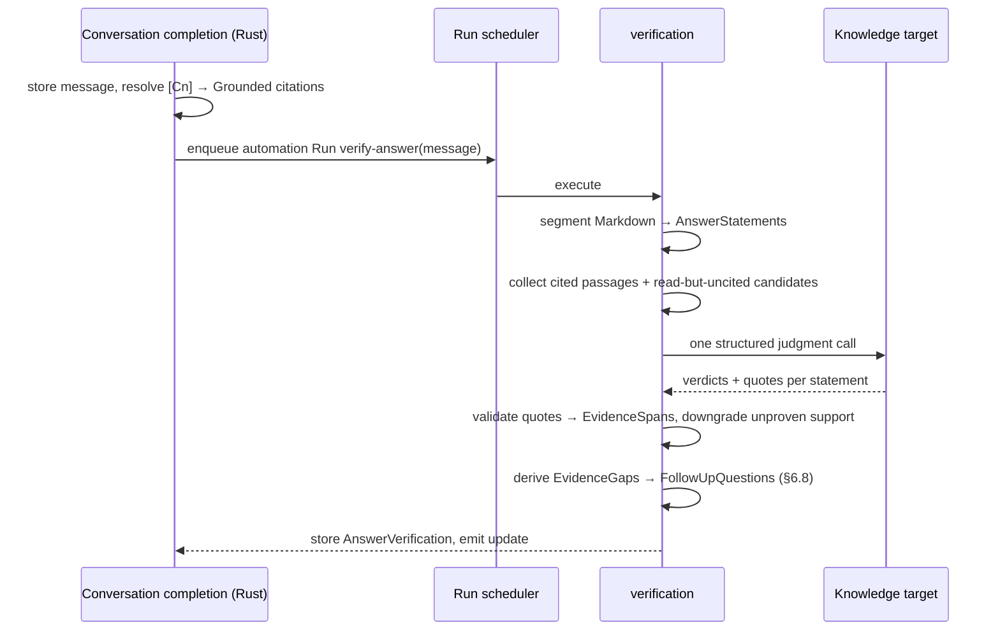

# Knowledge intelligence

- Status: **Phase 1 shipped; phases 2–4 proposed.** Evidence spans, Knowledge Proposals, verified
  answers and capture are implemented; their contracts live in [knowledge.md](knowledge.md)
  §Verified answers and §Knowledge Proposals, which win where this document differs. The sections
  below remain the design for the later phases.
- Scope: verified answers, conversation-to-knowledge capture, claim mapping (consensus and conflict),
  research questions, comparison matrices, source impact, Space briefings, evidence-gap follow-ups
  and Space decisions as standing context.
- Owning contracts this design builds on: [knowledge.md](knowledge.md) (revision, citation,
  derivation and change-set contracts), [spaces.md](spaces.md) (product model, Runs, conversation),
  [../DESIGN.md](../DESIGN.md) (product principles), [naming-conventions.md](naming-conventions.md).

## 1. Thesis

Knovum already owns a complete epistemic model, and almost nothing fills it.

| Already shipped                                                                                                    | How it is used today                         |
| ------------------------------------------------------------------------------------------------------------------ | -------------------------------------------- |
| System Knowledge Types `Claim`, `Evidence`, `Question`, `Decision`, `Concept`, `Experiment` with status lifecycles | Created by hand from the Add menu            |
| Relations `supports`, `contradicts`, `answers`, `supersedes`, `derives-from` with `contested` / `invalidated`      | Mostly `derives-from`, written by Derivation |
| Provenance pinned to `source_revision`, locator and quote                                                          | Rare: only explicit Change Sets write it     |
| Knowledge Health: unsupported, contradicted, ungrounded, stale provenance, answered-open-question                  | Fires on a graph that is usually empty       |
| Run citations (`spaces_run_citations`): every passage an Agent read, numbered `C1…`, pinned to its revision        | Rendered as a source list under an answer    |
| Derivation records with pinned input revisions                                                                     | Shown in the Inspector                       |
| Chunk index, local embeddings, LanceDB retrieval, Related Content                                                  | Search and retrieval                         |

Every day the conversation produces exactly the material the graph needs: questions people
actually ask, statements grounded in exact passages, decisions they reach. It is shown once and
then buried in history. Meanwhile the graph that could make a Space smarter over time stays empty
because filling it is manual labour.

**Knowledge intelligence closes the loop between reading and knowing.** Asking produces verifiable
statements; verifiable statements become proposed knowledge; accepted knowledge shapes the next
answer, tracks its sources, and tells the person what changed and what is still unknown.



## 2. Principles

These refine the product principles in `DESIGN.md` for this layer. Every capability below must
satisfy all of them.

1. **Every judgment carries its evidence.** A verdict, a consensus, a conflict, a matched answer or
   a comparison cell is shown with the exact passage and revision it rests on. A judgment without an
   evidence span is presented as unsupported, never as fact.
2. **AI proposes; people accept knowledge.** Analysis never writes the Knowledge graph. It produces a
   _Knowledge Proposal_, a validated KnowledgeChangeSet waiting for acceptance. Accepting one runs the
   existing atomic commit use case. This is the existing rule ("Agent output enters long-term state
   only through a validated atomic KnowledgeChangeSet") applied consistently, not a new ceremony.
3. **Artifacts are not gated.** A comparison matrix, a captured note or a re-derived document is a
   resource and is usable at once, like every derivation. Only writes to the Knowledge graph
   (Claims, Questions, Decisions, Relations, Provenance) go through proposals.
4. **In context, never a new destination.** Results appear at the message, the selection, the
   Inspector and Knowledge Health. There is no Insights page, no dashboard and no proposal inbox
   route (DESIGN.md: "There is no separate Run Center or Automation destination").
5. **Unknown is a first-class answer.** "No source supports this", "the sources do not mention it"
   and "the sources disagree" are explicit states with their own presentation, never hidden or
   smoothed into prose.
6. **Projections are rebuildable; knowledge is durable.** Verification results, extracted source
   claims, claim maps, coverage and briefings are maintained projections keyed by the revisions
   they read. They are never exported as knowledge and never silently rebound to new revisions.
7. **Model work is attributable and bounded.** Every model call runs inside a Run that is visible
   in Task Center, cancellable, budgeted and pinned to its inputs. Background analysis runs only
   for a trigger the person enabled and shows its cost estimate before large work.
8. **One evidence contract, one proposal pipeline.** Every capability uses the same `EvidenceSpan`,
   the same `KnowledgeProposal`, the same Run scheduler and the same structured-output validation.
   A capability that needs its own variant of any of them is a design error.

## 3. Vocabulary

Terms are chosen against [naming-conventions.md](naming-conventions.md). They are the only names for
these concepts in Rust, TypeScript, IPC, i18n keys and documentation.

| Term                 | Meaning                                                                                                                                              |
| -------------------- | ---------------------------------------------------------------------------------------------------------------------------------------------------- |
| `EvidenceSpan`       | An exact quote inside one indexed chunk at one `source_revision`: chunk id, node id, revision, locator and byte range. Validated against chunk text. |
| `AnswerStatement`    | One checkable sentence of a stored answer, with its byte range in the answer Markdown and the citation markers it carries.                           |
| `StatementSupport`   | The verdict for one statement: `supported`, `partial`, `unsupported`, `uncited`, `not-checkable`.                                                    |
| `AnswerVerification` | The verification projection of one assistant message: its statements, supports, suggested citations and follow-ups.                                  |
| `KnowledgeProposal`  | A pending KnowledgeChangeSet with its origin, rationale and evidence basis. Accepted, dismissed or still pending.                                    |
| `ProposalBasis`      | The evidence spans a proposal rests on; its freshness is the freshness of their revisions.                                                           |
| `SourceClaim`        | An atomic assertion extracted from one chunk revision, with its evidence span. A projection, not a `Claim` object.                                   |
| `ClaimMap`           | Topics across a scope of sources, each with positions and their relations: consensus, conflict, single-source.                                       |
| `ClaimPosition`      | One stance inside a topic: a normalized statement and the source claims that hold it.                                                                |
| `QuestionCoverage`   | For one `Question` object: answered, partial or unanswered, with its evidence.                                                                       |
| `ComparisonMatrix`   | A derived document comparing sources along named dimensions; every cell cites its evidence or states that the sources do not mention it.             |
| `SourceImpact`       | What depends on a source revision that is no longer current: derived outputs, provenance, claims, citations.                                         |
| `SpaceBriefing`      | What changed in a Space since the person last acknowledged it, and what needs their attention.                                                       |
| `EvidenceGap`        | A reason the knowledge is incomplete: an unsupported statement, an unanswered question, an unresolved conflict, an unread source in scope.           |
| `FollowUpQuestion`   | A suggested next question that names the `EvidenceGap` it addresses.                                                                                 |
| Space context        | The accepted Decisions and open Questions the host injects into every turn's Space snapshot.                                                         |

Rejected names: `Insight` (vague), `Fact` (overclaims), `Memory` (collides with Agent memory, which
the Space snapshot deliberately replaces), `Suggestion` for proposals (a proposal is a typed change
set, not text), `*Result`, `*Data`, `*Details`, `*Manager`.

## 4. System model

### 4.1 State classes

Every new piece of state belongs to exactly one class. The class decides storage, export, erasure
and freshness.

| Class                  | Examples                                                                     | Storage                      | Exported in `.knovumspace` | Freshness                                  |
| ---------------------- | ---------------------------------------------------------------------------- | ---------------------------- | -------------------------- | ------------------------------------------ |
| Durable knowledge      | Claim/Question/Decision objects, Relations, Provenance created by acceptance | Existing tables              | Yes, unchanged contract    | Existing stale-provenance and health rules |
| Durable artifacts      | Comparison matrix, captured answer document, re-derived outputs              | Existing nodes + Derivations | Yes, unchanged contract    | Existing derivation lineage                |
| Pending proposals      | `KnowledgeProposal`                                                          | New table                    | No: pending work is local  | Computed from `ProposalBasis` revisions    |
| Maintained projections | `AnswerVerification`, `SourceClaim`, `ClaimMap`, scan watermarks             | New tables                   | No: rebuilt on demand      | Keyed by the revisions they read           |
| Computed views         | `QuestionCoverage`, `SourceImpact`, `SpaceBriefing`                          | None (queries)               | No                         | Always current                             |
| Operational            | Runs, attempts, model calls of analysis                                      | Existing Run tables          | Existing Run export policy | Existing                                   |

The package contract does not change, so the package version does not change. Imported Spaces get
verification and claim maps again on demand.

### 4.2 Ownership



- **Rust owns every decision and every write.** Segmentation, evidence validation, model calls,
  proposal validation, acceptance, coverage, impact and briefing are Rust. Model calls use the
  existing `ai::capabilities` text path with structured output, like `media_knowledge::insights`.
- **Vue renders and requests.** It never computes a verdict, a coverage state or an impact; it
  renders the projection Rust returns and sends intents.
- **The Builtin Agent runtime stays thin.** It gains one Space Action (`propose-knowledge-changes`)
  and a richer Space snapshot. Verification is host-side, so it works identically for API models,
  the Builtin Agent and desktop Agents: all of them cite through `spaces_run_citations`.
- **Desktop Agents** see the same capabilities through the `knovum` MCP server, because MCP tools are
  Space Actions.

## 5. Shared foundations

These four pieces are built once, in phase 1, and every capability depends on them.

### 5.1 Evidence spans

```rust
// spaces/knowledge/grounding/evidence_span.rs
pub(crate) struct EvidenceSpan {
    pub chunk_id: String,
    pub node_id: String,
    pub source_revision: String,
    pub locator: Value,      // the chunk's locator, copied from the chunk row
    pub quote_start: usize,  // UTF-8 byte offsets into the chunk text
    pub quote_end: usize,
    pub quote: String,       // chunk_text[quote_start..quote_end], ≤ 2 000 bytes
}
```

- **Construction is validation.** A model returns a quote string and a passage id. Rust finds the
  quote in that chunk's text at the pinned revision: exact match first, then a whitespace- and
  punctuation-normalized match mapped back to original byte offsets. No match, no span. The model's
  claim of support is then discarded, and the verdict downgrades. Models are never trusted to cite.
- Text and locator always come from the chunk row (`spaces_current_knowledge_chunks` or the Run's
  `spaces_run_citations` snapshot), never from model output, as the Run-citation contract already
  requires.
- An `EvidenceSpan` converts losslessly into an `add-provenance` change: `source_node_id`, `locator`,
  `source_revision`, `quote`. This is the only way analysis creates Provenance.
- Freshness: a span is `current` while its chunk exists at that revision and `detached` otherwise,
  reusing the citation states readers already know.

### 5.2 Knowledge Proposals

A proposal is the single path from analysis to the Knowledge graph.

```rust
// spaces/knowledge/proposals/contracts.rs
pub(crate) struct KnowledgeProposal {
    pub id: String,
    pub space_id: String,
    pub origin: ProposalOrigin,          // where it came from, for display and navigation
    pub title: String,                   // ≤ 200 chars, shown in review
    pub rationale: String,               // ≤ 2 000 chars, why the change is proposed
    pub changes: Vec<KnowledgeChange>,   // the existing change-set contract, unchanged
    pub basis: Vec<EvidenceSpan>,        // every span any change rests on
    pub fingerprint: String,             // digest of the normalized semantic content
    pub state: ProposalState,            // pending | accepted | dismissed
    pub proposer: KnowledgeActor,        // builtin_agent | external_agent | system | human
}

pub(crate) enum ProposalOrigin {
    Answer { conversation_id: String, message_id: String },
    ClaimMap { claim_map_id: String },
    QuestionEvidence { question_id: String },
    SourceImpact { node_id: String, source_revision: String },
    Agent { run_id: String },
}
```



Rules:

- **Validated at creation.** Creation runs the KnowledgeChangeSet validation as a dry run inside a
  rolled-back transaction: types, statuses, fields, endpoints and provenance locators. An invalid
  proposal is never stored, so review never shows something that cannot be accepted.
- **Accepted through the existing commit use case.** `accept_knowledge_proposal` re-validates against
  current state, commits the change set atomically, and records the knowledge-change receipt id on
  the proposal in the same transaction. Knowledge events written by the commit carry
  `{"proposalId": …}` in their payload, so history shows where each piece of knowledge came from.
  The acting principal of the commit is the person who accepted; the proposer is kept on the
  proposal and in the event payload.
- **Partial acceptance keeps closure.** The person may deselect changes. Rust computes the closure:
  a relation or provenance whose `temp_id` endpoint was deselected is dropped with it, and the
  subset is validated again. The UI can only offer subsets that are closed.
- **Freshness is computed.** A proposal whose basis spans are no longer current shows
  `basis-changed`. A proposal whose target nodes are gone shows `target-gone`. Accepting a
  `basis-changed` proposal is refused with a reason, and the person can ask for it to be re-checked.
  There is no stored `outdated` state to keep in sync.
- **Deduplication and memory.** The fingerprint is a digest of normalized statements, endpoints and
  relation kinds, independent of ids and wording noise. A pending or dismissed proposal with the
  same fingerprint in the Space suppresses a new one. Dismissal is remembered, so the same
  suggestion does not come back.
- **Placement.** Objects created by acceptance are placed through the existing derivation-field
  layout beside their basis sources, so accepting never scatters nodes or moves existing content.
- **Retention.** Accepted and dismissed proposals keep only id, fingerprint, state, origin and
  receipt after 30 days. The fingerprint must survive to remember dismissal; the payload need not.
  Pending proposals stay until decided or their origin is erased.
- **Erasure.** Permanent erasure of a node removes pending proposals that target it, in the same
  transaction that already removes its relations, provenance and grounding references.

### 5.3 Analysis runs

All model work in this design runs as Action Runs of registered Space Actions through the Rust Run
scheduler, the only execution authority:

- **Explicit analysis** (map claims, compare sources, verify on demand) is an ordinary Action Run
  started by `start_space_action`, with pinned inputs and a frozen execution target.
- **Triggered analysis** (verifying a just-stored answer, matching newly indexed passages against open
  questions) is a Run of kind `automation`, with `parent_run_id` set to the triggering Run when there
  is one. It is visible in Task Center as a quiet, cancellable task attributed to its trigger. It
  never blocks the conversation or the canvas.
- **Execution target.** Analysis uses `RoutingPurpose::Knowledge` and `TextGeneration`, so Settings
  already decides who runs it. A missing or failed target makes the analysis visibly `skipped` with
  its reason. It never silently switches accounts, as for every other task.
- **Budget.** Each Action declares a ceiling on model calls and input tokens. Larger work, such as a
  claim map over many sources, first returns an estimate that the person confirms.

### 5.4 Structured model output

Every analysis call asks for JSON that matches a schema derived from a Rust type with `schemars`,
the same mechanism the KnowledgeChangeSet schema uses for Agents.

- The response is parsed strictly (`deny_unknown_fields`). A malformed response is retried once with
  the validation error; a second failure fails that unit of work (one batch, one cluster), not the
  whole Run.
- Every identifier in a response (`S3`, `C7`, `P2`) must be one the prompt issued. Unknown
  identifiers are dropped.
- Source text inside prompts is delimited and labelled untrusted evidence, as the grounding prompt
  already does. Analysis calls have no tools, so injected instructions inside a source can at worst
  produce a wrong verdict. Span validation (§5.1) then refuses any support that is not a real quote.

## 6. Capabilities

Each capability lists what the person gets, how it behaves, and what it needs beyond §5.

### 6.1 Verified answers

**Value.** Each sentence of an answer shows whether the sources actually say it. Trust is the
threshold for a knowledge product, and sentence-level verification against exact passages is what
makes an answer safe to reuse.

**Experience.**

- Supported sentences look normal. A calm answer stays calm.
- `partial` gets a dotted amber underline; `unsupported` (cited but the passage does not say it) and
  `uncited` (a factual sentence with no citation) get a dotted danger or neutral underline. Hover or
  focus shows the verdict, the evidence quote, and the source title.
- Clicking evidence opens the exact chunk and locator through the existing citation link path, and
  locates the source node on the canvas.
- One summary line under the answer: _"9 of 11 statements supported by the sources · 1 partial ·
  1 without a source"_. While verification runs it reads _"Checking against sources…"_.
- For an `uncited` statement whose passage the Run did read, the hover offers _"Possible source"_ with
  that span. Nothing is inserted into the stored answer.
- Answers that read no sources (pure conversation) show nothing and record `skipped: no-sources`.

**Behavior.**



1. **Segmentation** (deterministic, Rust). `pulldown-cmark` walks the stored answer Markdown; prose in
   paragraphs, list items and table cells is split with `unicode-segmentation` sentence bounds. Code
   blocks, headings, block quotes of the question and link-only lines are not statements. A
   citation marker belongs to the sentence it ends; a marker at the end of a list item or table cell
   covers that item. Each statement keeps its byte range in the answer source, which is what the
   renderer marks.
2. **Candidate passages.** Cited passages come from `spaces_run_citations` of the answer's Run, the
   same snapshot the reader opens. For uncited statements, the local embedding worker ranks the
   passages the Run read (never the whole Space, which would turn verification into new research);
   the top 2 above a similarity threshold become candidates.
3. **Judgment.** One call per answer: statements with ids, passages with ids, the instruction to judge
   entailment strictly (support means the passage states it, not that it is plausible), and to
   return an exact supporting quote. Statements are classified `factual`, `framing` (transitions,
   restatements of the question) or `inference` (the answer's own reasoning). Only `factual`
   statements receive support verdicts; `inference` is shown as such when it has no support.
4. **Validation.** §5.1 turns quotes into spans. A `supported` verdict without a valid span becomes
   `unsupported`; a candidate that validates becomes a possible source.
5. **Freshness.** Verification is pinned to its citations. When a cited source changes, its citation
   is already shown `detached`; the verdict stays, labelled _"verified against an earlier
   version"_. Re-verification is an explicit action.

**Limits.** Answers up to 6 000 words; beyond that only the first 6 000 words are verified, and the
summary says so. At most 24 000 input tokens per call: passages are trimmed around their best
matching window. Target: verification visible within 6 s (p50) of the answer for a 1 500-word answer.

**Setting.** _Settings › AI › Check answers against sources_: automatic (default when a Knowledge
target is configured) or on request. The on-request mode shows a _Check against sources_ action on
the message.

**Calibration feedback.** A person can mark a verdict wrong (_"This is supported"_ / _"This is not
supported"_). The correction is stored with the verification and wins on display. It also feeds the
evaluation set (§10), never a silent prompt change.

### 6.2 Capturing an answer as knowledge

**Value.** A good answer stops being a dead end in history; it becomes part of the Space, tied to its
evidence, and it warns when that evidence changes.

**Experience.** On an assistant message:

- **Save as note.** Creates a Markdown resource with the answer and its citations rendered as source
  links, placed beside the cited sources, `derives-from` every cited node. It is an artifact, so it is
  created immediately (principle 3). This reuses the grounded-document output path.
- **Record claims…** Proposes one `Claim` per `supported` or `partial` statement (merging adjacent
  statements that state one assertion), each with:
  - `add-provenance` from every evidence span of the statement;
  - a `supports` relation from each cited source node to the claim;
  - an `answers` relation to the conversation's research Question when the conversation is attached
    to one (§6.4);
  - status `accepted` when every included statement is `supported`, otherwise `draft`.
    `unsupported` and `uncited` statements are listed but deselected by default, and accepting one
    creates a `draft` claim without provenance, which Knowledge Health already reports as
    unsupported.
- **Per statement.** The statement hover offers _Record as claim_ for a single sentence.

The proposal review appears inline under the message (§7.3). Accepting places the claims beside
their sources and shows a quiet _"3 claims recorded"_ with a locate action.

**Behavior.** Capture requires a completed `AnswerVerification`, because the spans are what make a
claim's provenance exact. On a message that is not yet verified, _Record claims_ verifies first. The
proposal origin is `Answer`, so each claim's Inspector shows _"From conversation · <title>"_ and
navigates to the message. Later edits to a source revision make the claim's provenance stale through
the existing health rule; nothing new is needed for that half of the loop.

### 6.3 Claim map: consensus, conflict and single-source claims

**Value.** Across several sources, what do they agree on, where do they disagree, and what rests on
one source alone. This is the core job of research, reading papers and comparing proposals, and
search cannot answer it.

**Experience.**

- Entry: _Map claims_ on a selection of two or more sources, a Section, or the Space (bounded, see
  limits). Also offered by the selection bar's _Compare_ intent family.
- Before running, the estimate: _"18 sources · about 40 model calls · uses <target>"_ with _Run_.
  Sources already analyzed at their current revision cost nothing and are shown as such.
- The result opens as an Inspector section for that scope, with three groups:
  - **Consensus** — positions held by two or more independent sources;
  - **Conflicts** — positions that contradict each other, each side with its sources and quotes;
  - **Single source** — positions only one source holds, sorted by how central they are.
- Each position shows its normalized statement, source chips and, on expansion, the quotes. Actions:
  - _Record_ proposes the knowledge: one `Claim` per position, `supports` relations from its sources
    with provenance; for a conflict, both claims plus a `contradicts` relation, and both claims
    `contested`. Knowledge Health then tracks the conflict.
  - _Ask about this_ opens a conversation turn with the involved sources attached and the conflict
    stated, for example _"Source A says X, source B says Y. Which is better supported?"_
  - _Locate_ highlights the sources on the canvas.
- The map is stored. Reopening the scope shows it instantly, marked _"sources changed since"_ when any
  input revision changed, with _Update_ that re-runs only what changed.

**Behavior.** Three stages, each cached by the revisions it read, so updates are incremental.

1. **Extraction → `SourceClaim`** (model, batched). Per chunk revision: atomic, self-contained
   assertions (pronouns resolved, the subject named), each with an exact quote, a kind (`finding`,
   `number`, `definition`, `recommendation`, `opinion`) and the entities it is about. Batches of up to
   8 chunks per call. Cached by `(chunk_id, source_revision, extractor_version)`; a source at an
   analyzed revision is never extracted again. Chunks of kind `node` (metadata), `code` and
   `video_cover` are skipped.
2. **Grouping** (deterministic). Source claims are embedded with the local embedding worker into a
   LanceDB table beside passage vectors. They are clustered within the scope by cosine similarity
   (agglomerative, average linkage, threshold tuned on the evaluation set, cluster size capped at
   24). Clusters that contain claims from only one source become single-source positions without
   further model work. Number claims about the same entity and measure are grouped even below the
   similarity threshold, so "revenue grew 12%" and "revenue grew 3%" meet.
3. **Alignment** (model, one call per multi-source cluster). The cluster's claims with their quotes
   and source labels: merge into positions, name the topic, and relate positions as `agrees`,
   `contradicts`, `refines` (one is a narrower or conditional form of the other) or `independent`.
   Contradiction requires both sides to be about the same subject, scope and time; the instruction
   and the evaluation set both test that, because false conflicts are the most damaging error.
   Positions keep only source claims, so every position's evidence is a set of validated spans.

Classification: a topic is _consensus_ when one position has two or more distinct source nodes and
none contradict it; _conflict_ when any `contradicts` pair exists; _single source_ otherwise.
Independence counts source nodes, not chunks; sources that derive from one another
(`derives-from`) count once.

**Limits.** At most 60 sources and 3 000 chunks per scope. Larger scopes ask the person to narrow to
Sections. Alignment calls are capped at 120 per Run.

### 6.4 Research questions and coverage

**Value.** A Space with explicit questions is a project with a goal. Knovum tracks which questions
are answered, by what, and notices when a new source answers one.

**Experience.**

- Questions are the existing `Question` objects. New entries create them where the question arises:
  _Make this a research question_ on a user message, and _Add question_ in the Space overview (§6.7).
- The Space overview lists open questions with a coverage state:
  - **Answered** — an accepted `Claim` `answers` it, or a person resolved it;
  - **Partial** — evidence is attached (an `answers` relation from a source, or pending proposals) but
    no accepted claim answers it;
  - **Unanswered** — nothing yet.
- A Question node on the canvas shows the same state as a quiet glyph. Its Inspector lists the
  evidence and the claims that answer it, with _Ask_ (start a turn attached to this question) and
  _Find evidence_ (search the Space now).
- **New source matches.** When indexing publishes passages and the Space has open questions, Knovum
  checks them. A match appears as a proposal on the question (_"'Market report Q3' may answer this"_)
  with the quote, and the question's glyph shows a pending dot. Accepting adds an `answers` relation
  from the source to the question with provenance; recording a claim from it is one more click.
- A conversation started from a question carries it: answers can be captured straight into
  `answers` relations, and the question stays in the Space context (§6.9).

**Behavior.**

- `QuestionCoverage` is a query over Question objects, `answers` relations, accepted claims and
  pending proposals with `QuestionEvidence` origin. Nothing is stored.
- **Matching** is an `automation` Run triggered after a retrieval generation publishes, debounced per
  Space (30 s):
  1. embedding prefilter: each open question's text against the newly published chunks only, top 5
     above threshold;
  2. one judgment call per question with candidates: `answers`, `partially-answers`, `unrelated`, with
     an exact quote;
  3. validated spans become `QuestionEvidence` proposals, deduplicated by fingerprint.
- A watermark per question (`question_id`, its `knowledgeRevision`, the last matched retrieval
  generation) guarantees each passage is judged once per question revision. Editing a question
  re-matches the whole Space once.
- Budget: at most 20 judgment calls per Space per indexing batch. The Space overview can switch
  matching off per Space. Switching it off stops new Runs and keeps existing proposals.

### 6.5 Comparison matrix

**Value.** Selecting two to eight items and asking to compare them should produce a table, not an
essay. Rows are the items, columns are dimensions, and each cell cites its evidence. It is the most
canvas-native synthesis there is.

**Experience.**

- Entry: _Compare_ on the selection bar for two to eight sources or Knowledge Objects.
- The composer proposes dimensions within a second (for example _Price · Deployment · Licensing ·
  Limitations_) as editable chips. The person can add, remove or rename them, or type a perspective
  (_"for a team of five"_).
- The output is a document resource beside the selection: a Markdown table whose cells carry `[Cn]`
  citations, a short summary of the differences, and _"Not mentioned in the source"_ in cells without
  evidence. It is editable, searchable and exportable like any document, and it `derives-from` every
  compared item.
- Cells reuse verification marks: a cell whose citation does not support it is marked like an
  unsupported statement.

**Behavior.** A new Space Action `compare-sources`, `CreatesResource`, `Durable`, Knowledge purpose,
inputs `Knowledge` (2–8):

1. **Dimensions** (when not given). One call over item titles and their first passages returns 3–7
   dimensions. The composer shows them before the Run is started, so the Run's pinned parameters
   include the final dimensions.
2. **Cells.** For each item × dimension, retrieval restricted to that item's chunks (top 4), then one
   call per item fills all its cells with values and exact quotes. Missing evidence is an explicit
   `not-mentioned` value, never a guess.
3. **Validation and rendering.** Quotes become spans and then Run citations (`C` ids), so the
   document uses the existing grounded-citation renderer. Cells whose span fails validation become
   `not-mentioned`.
4. **Publication** through the existing grounded-document derivation path: Derivation record (dimensions
   and perspective are the bounded parameters), `derives-from` relations, derivation-field placement.

Re-running with other dimensions is a new derivation (§6.6 _Derive again_), not an in-place rewrite.

### 6.6 Source impact and deriving again

**Value.** When a source changes (a saved website refreshed, a file replaced, a note edited), the
person sees what depended on it and updates it deliberately. Lineage stops being a record and
becomes a working tool.

**Experience.**

- A changed source shows _"Affects 6 items"_ in its Inspector, grouped:
  - **Derived outputs** made from an earlier revision: documents, images, videos, comparison matrices;
  - **Claims** whose provenance quotes the earlier revision;
  - **Answers** whose citations are now detached (count, with navigation to the conversations).
- Derived outputs offer **Derive again**: the same Action and parameters, with current inputs, through
  the current execution target (shown, changeable). The new output is placed beside the old one, a
  `supersedes` relation points from new to old, and the old output is marked historical. For
  documents, _Compare versions_ shows a text diff of the two outputs.
- Claims offer **Re-check**: the claim's quotes are judged against the source's current passages. The
  result is a `SourceImpact` proposal: move the provenance to the new span when the claim still holds;
  otherwise set the claim `contested`, or `invalidated` when the source now states the opposite.
- Knowledge Health's existing `stale-provenance` issue links here instead of only naming the source.

**Behavior.**

- `SourceImpact` is a deterministic query: derivation inputs (`spaces_knowledge_derivation_inputs`)
  whose `node_id` matches and whose pinned revision differs from the current one; active provenance
  whose `source_revision` differs; run citations with the node and an old revision, grouped by
  conversation. No new table. Target: under 50 ms for a source with 1 000 dependents.
- **Derive again** is a new command, `derive_again(derivation_id)`. It reads the Derivation record and
  starts a new Action Run through `start_space_action` with the recorded action, version and
  parameters and freshly pinned inputs. An action version that no longer exists is refused with its
  reason. This is the reuse the derivation contract already prescribes ("Reuse comes from the
  derivation record a result already carries"), made a first-class command.
- **Re-check** is the `verify-answer` judgment applied to one claim's quotes against the current
  chunks of its source nodes, producing a `SourceImpact` proposal.

### 6.7 Space briefing

**Value.** Opening a Space answers _"Where was I, what changed, what needs me?"_ in a glance.

**Experience.** The Inspector with nothing selected becomes the **Space overview**. There is no
modal, card wall or separate page.

- **Since you were last here** — new sources, newly recorded or contested claims, resolved
  questions, each a locatable line.
- **Needs attention** — pending proposals (count, with review), conflicts, sources with impact,
  health issues by severity.
- **Research questions** — open questions with coverage (§6.4).
- _Mark as read_ acknowledges the briefing; the Space tab shows a quiet dot only when attention items
  exist.
- _Summarize changes_ writes a short narrative of the period on request. It is never automatic.

**Behavior.** `SpaceBriefing` is a query over `spaces_knowledge_events`, node creation times, pending
proposals, health issues and coverage since the Space's acknowledgement cursor. The only stored state
is the cursor (`spaces_briefing_acknowledgements`). Target: under 50 ms. The narrative is a
`durable_query_action` (`summarize-space-changes`) over the same projection; its output is shown,
not stored as a resource.

### 6.8 Evidence-gap follow-ups

**Value.** The next question should come from what the knowledge actually lacks, not from generic
"you might also ask" filler.

**Experience.** Under a verified answer, at most three follow-ups, each naming its reason:

- _"No source supports 'the API is rate-limited per key' — find one?"_ (unsupported or uncited
  statement);
- _"'Vendor review' and 'Pricing page' disagree about the free tier."_ (a conflict in the claim map
  touching a cited source);
- _"Research question 'Can it run offline?' is still unanswered."_ (open question related to the
  answer);
- _"3 sources in this Section were not read for this answer."_ (unread sources in the conversation's
  scope).

Clicking sends the question with the relevant sources attached.

**Behavior.** `EvidenceGap`s are derived deterministically from the verification, the latest claim
map of the scope, question coverage and the conversation scope. The verification call (§6.1) phrases
at most three of them as `FollowUpQuestion`s in the same response, so there is no extra call. Gaps are
ranked: conflicts, then unsupported statements, then unanswered questions, then unread sources.

### 6.9 Space decisions as standing context

**Value.** Decisions the team reached stay binding. Every later answer and Agent action respects them,
without anyone restating them and without opaque chat "memory".

**Experience.**

- _Record as decision_ on a message, or the Agent proposing a `Decision` object when the person
  states one (_"We'll use Postgres, not Mongo"_). Accepted Decisions are ordinary knowledge on the
  canvas.
- The conversation header shows _"Space context: 4 decisions · 3 open questions"_. The popover lists
  them and links to each; switching a Decision to superseded removes it from context.
- A new decision that replaces an old one is recorded with `supersedes`, and the old one becomes
  `superseded`.

**Behavior.**

- The Space snapshot already lives in the system prompt, regenerated by the host every turn, and it
  is deliberately not Agent memory (spaces.md). It gains two bounded sections:
  - **Decisions**: accepted, not superseded `Decision` objects, newest first, at most 30, each ≤ 300
    characters with its node id;
  - **Open research questions**: at most 10, each with its node id.
- The same composition feeds desktop Agents through `prompt_policy::desktop_agent` and the MCP
  server instructions, so every executor sees the same context.
- The policy text tells Agents to follow decisions, to say so when a request conflicts with one, and to
  propose a superseding Decision rather than ignoring an old one.

## 7. Interfaces

### 7.1 Space Actions (Agents, MCP and canvas)

| Action id                   | Impact            | Mode      | Inputs           | Output                      | Purpose                                                                            |
| --------------------------- | ----------------- | --------- | ---------------- | --------------------------- | ---------------------------------------------------------------------------------- |
| `propose-knowledge-changes` | `ReadOnly`        | Immediate | —                | `KnowledgeProposalReceipt`  | Agents propose knowledge; the person accepts. Same parameter schema as commit.     |
| `verify-answer`             | `ReadOnly`        | Durable   | —                | `AnswerVerification`        | Verify one stored assistant message (automation or on request).                    |
| `map-claims`                | `ReadOnly`        | Durable   | `Knowledge` 2–60 | `ClaimMap`                  | Build or update the claim map of a scope.                                          |
| `compare-sources`           | `CreatesResource` | Durable   | `Knowledge` 2–8  | `Document`                  | Comparison matrix.                                                                 |
| `match-question-evidence`   | `ReadOnly`        | Durable   | —                | `KnowledgeProposalReceipts` | Match new passages against open questions (automation) or one question on request. |
| `summarize-space-changes`   | `ReadOnly`        | Durable   | —                | `Answer`                    | Narrative of the briefing period.                                                  |

`commit-knowledge-changes` remains. The Builtin Agent policy and the MCP instructions direct Agents to
`propose-knowledge-changes` by default, and to commit directly only when the person explicitly asks
to record something now. Host authorization, not wording, enforces it: a turn grant without the
person's explicit commit intent does not include `commit-knowledge-changes`.

### 7.2 IPC commands (Renderer)

Named under the IPC verb rules: `load_*` assembles durable state, `list_*` returns a collection,
single intents carry one verb.

| Command                                          | Intent                                                            |
| ------------------------------------------------ | ----------------------------------------------------------------- |
| `load_answer_verification(message_id)`           | Verification projection of one message, with live citation states |
| `correct_statement_support(...)`                 | Store a person's correction of one verdict                        |
| `list_knowledge_proposals(space_id, filter)`     | Pending proposals by origin, target node or scope                 |
| `accept_knowledge_proposal(id, change_indexes?)` | Accept all or a closed subset                                     |
| `dismiss_knowledge_proposal(id)`                 | Dismiss and remember                                              |
| `load_claim_map(space_id, scope)`                | Latest map of a scope, with freshness                             |
| `load_question_coverage(space_id)`               | Coverage of every open question                                   |
| `load_source_impact(node_id)`                    | Dependents of a source's earlier revisions                        |
| `derive_again(derivation_id, target?)`           | Start a new Run from a Derivation record                          |
| `load_space_briefing(space_id)`                  | Briefing projection since the cursor                              |
| `acknowledge_space_briefing(space_id)`           | Move the cursor                                                   |

Updates use the existing event pattern: `space-answer-verification-update` and
`space-knowledge-proposals-update`, carrying ids and revision counters. The Renderer refetches
through Vue Query; events never carry the projection itself.

### 7.3 Presentation surfaces

| Surface                       | Shows                                                                                                         |
| ----------------------------- | ------------------------------------------------------------------------------------------------------------- |
| Conversation message          | Verification marks, summary line, follow-ups, _Save as note_, _Record claims_, inline proposal review         |
| Selection Inspector           | Claim map of the selection, source impact, question coverage of a Question, proposals targeting the selection |
| Space overview (no selection) | Briefing, needs-attention list, research questions                                                            |
| Knowledge Health              | Existing issues, plus pending proposals as a review group                                                     |
| Canvas                        | Quiet glyphs only: question coverage, pending-proposal dot, historical output marker                          |
| Composer (Compare)            | Editable dimension chips                                                                                      |

One review component, `SpaceKnowledgeProposalReview`, renders every proposal wherever it appears:
title, rationale, the changes as human sentences (_"New claim: …"_, _"'Report A' supports …"_), their
quotes, freshness, and per-change checkboxes that only allow closed subsets.

## 8. Data model

One forward migration, `0004_knowledge_intelligence.sql`. Existing tables do not change.

```sql
CREATE TABLE spaces_knowledge_proposals (
  id TEXT PRIMARY KEY NOT NULL,
  space_id TEXT NOT NULL,
  origin_kind TEXT NOT NULL CHECK (origin_kind IN ('answer','claim-map','question-evidence','source-impact','agent')),
  origin TEXT NOT NULL CHECK (json_valid(origin)),
  title TEXT NOT NULL CHECK (length(title) BETWEEN 1 AND 200),
  rationale TEXT NOT NULL DEFAULT '',
  changes TEXT CHECK (changes IS NULL OR json_valid(changes)),   -- NULL once retained past 30 days
  basis TEXT CHECK (basis IS NULL OR json_valid(basis)),
  fingerprint TEXT NOT NULL,
  state TEXT NOT NULL CHECK (state IN ('pending','accepted','dismissed')),
  receipt_id TEXT,
  proposer_kind TEXT NOT NULL CHECK (proposer_kind IN ('human','builtin_agent','external_agent','system')),
  proposer_id TEXT,
  run_id TEXT,
  created_at INTEGER NOT NULL,
  decided_at INTEGER,
  FOREIGN KEY (space_id) REFERENCES spaces(id) ON DELETE CASCADE,
  FOREIGN KEY (run_id) REFERENCES spaces_runs(id) ON DELETE SET NULL,
  CHECK ((state = 'pending' AND decided_at IS NULL AND changes IS NOT NULL) OR (state <> 'pending' AND decided_at IS NOT NULL)),
  CHECK ((state = 'accepted') = (receipt_id IS NOT NULL))
);
CREATE UNIQUE INDEX spaces_knowledge_proposals_fingerprint ON spaces_knowledge_proposals(space_id, fingerprint);
CREATE INDEX spaces_knowledge_proposals_pending ON spaces_knowledge_proposals(space_id, state, created_at);
-- Proposal target nodes, for "proposals about this node" and erasure.
CREATE TABLE spaces_knowledge_proposal_targets (
  proposal_id TEXT NOT NULL,
  node_id TEXT NOT NULL,
  PRIMARY KEY (proposal_id, node_id),
  FOREIGN KEY (proposal_id) REFERENCES spaces_knowledge_proposals(id) ON DELETE CASCADE,
  FOREIGN KEY (node_id) REFERENCES spaces_nodes(id) ON DELETE CASCADE
);

CREATE TABLE spaces_answer_verifications (
  message_id TEXT PRIMARY KEY NOT NULL,
  run_id TEXT NOT NULL,                       -- the answer's Run, whose citations were judged
  verification_run_id TEXT,
  answer_digest TEXT NOT NULL,
  state TEXT NOT NULL CHECK (state IN ('pending','running','completed','failed','skipped')),
  skip_reason TEXT CHECK (skip_reason IN ('no-sources','no-target','disabled','too-long')),
  engine TEXT NOT NULL DEFAULT '',
  statements TEXT NOT NULL DEFAULT '[]' CHECK (json_valid(statements)),
  follow_ups TEXT NOT NULL DEFAULT '[]' CHECK (json_valid(follow_ups)),
  corrections TEXT NOT NULL DEFAULT '{}' CHECK (json_valid(corrections)),
  error TEXT NOT NULL DEFAULT '',
  created_at INTEGER NOT NULL,
  completed_at INTEGER,
  FOREIGN KEY (message_id) REFERENCES spaces_conversation_messages(id) ON DELETE CASCADE,
  FOREIGN KEY (verification_run_id) REFERENCES spaces_runs(id) ON DELETE SET NULL
);

CREATE TABLE spaces_source_claims (
  id TEXT PRIMARY KEY NOT NULL,
  space_id TEXT NOT NULL,
  node_id TEXT NOT NULL,
  chunk_id TEXT NOT NULL,
  source_revision TEXT NOT NULL,
  extractor_version INTEGER NOT NULL,
  ordinal INTEGER NOT NULL,
  statement TEXT NOT NULL CHECK (length(statement) BETWEEN 1 AND 1000),
  claim_kind TEXT NOT NULL CHECK (claim_kind IN ('finding','number','definition','recommendation','opinion')),
  quote_start INTEGER NOT NULL,
  quote_end INTEGER NOT NULL CHECK (quote_end > quote_start),
  entities TEXT NOT NULL DEFAULT '[]' CHECK (json_valid(entities)),
  created_at INTEGER NOT NULL,
  UNIQUE (chunk_id, source_revision, extractor_version, ordinal),
  FOREIGN KEY (space_id) REFERENCES spaces(id) ON DELETE CASCADE,
  FOREIGN KEY (node_id) REFERENCES spaces_nodes(id) ON DELETE CASCADE
);
-- A chunk revision analyzed with no claims is still analyzed.
CREATE TABLE spaces_source_claim_extractions (
  chunk_id TEXT NOT NULL,
  source_revision TEXT NOT NULL,
  extractor_version INTEGER NOT NULL,
  node_id TEXT NOT NULL,
  extracted_at INTEGER NOT NULL,
  PRIMARY KEY (chunk_id, source_revision, extractor_version),
  FOREIGN KEY (node_id) REFERENCES spaces_nodes(id) ON DELETE CASCADE
);

CREATE TABLE spaces_claim_maps (
  id TEXT PRIMARY KEY NOT NULL,
  space_id TEXT NOT NULL,
  scope_digest TEXT NOT NULL,                 -- digest of the scope definition
  scope TEXT NOT NULL CHECK (json_valid(scope)),
  input_revisions TEXT NOT NULL CHECK (json_valid(input_revisions)),
  run_id TEXT,
  map TEXT NOT NULL CHECK (json_valid(map)),
  created_at INTEGER NOT NULL,
  UNIQUE (space_id, scope_digest),
  FOREIGN KEY (space_id) REFERENCES spaces(id) ON DELETE CASCADE,
  FOREIGN KEY (run_id) REFERENCES spaces_runs(id) ON DELETE SET NULL
);

CREATE TABLE spaces_question_evidence_watermarks (
  question_id TEXT PRIMARY KEY NOT NULL,
  question_revision TEXT NOT NULL,
  retrieval_generation_id TEXT NOT NULL,
  FOREIGN KEY (question_id) REFERENCES spaces_nodes(id) ON DELETE CASCADE
);

CREATE TABLE spaces_briefing_acknowledgements (
  space_id TEXT PRIMARY KEY NOT NULL,
  acknowledged_at INTEGER NOT NULL,
  FOREIGN KEY (space_id) REFERENCES spaces(id) ON DELETE CASCADE
);
```

- Source-claim vectors live in a LanceDB table `source_claims` keyed by claim id and embedding spec,
  rebuilt like passage vectors when the embedding spec changes.
- The startup erasure of soft-deleted content adds `spaces_knowledge_proposal_targets` (and pending
  proposals left without targets) and `spaces_source_claims` to the same transaction that already
  removes relations, provenance and grounding references.
- `spaces_claim_maps` keeps the latest map per scope; `map` is a typed `ClaimMap` (§3) serialized
  through one Rust type with a generated TS contract.

## 9. Source layout

Following [architecture.md](architecture.md) ownership and [naming-conventions.md](naming-conventions.md):

```text
src-tauri/src/spaces/knowledge/
├── grounding/evidence_span.rs        EvidenceSpan + quote validation
├── proposals/                        contracts · repository · fingerprint · closure · acceptance · commands
├── verification/                     segmentation · candidates · judgment · repository · commands
├── claims/                           extraction · grouping · alignment · claim_map · repository
├── questions/                        coverage · evidence_matching · watermarks
├── impact/                           source_impact
└── briefing/                         briefing · acknowledgement
src-tauri/src/spaces/actions/catalog/ the six Actions of §7.1
src-tauri/src/spaces/derivation/      compare_sources handler · derive_again
src-tauri/src/spaces/conversations/   Space context sections in the snapshot and prompt_policy

src/features/spaces/knowledge/
├── proposals/                        review component, queries, change sentences
├── claims/                           Inspector claim map section
├── questions/                        coverage glyph, question Inspector section
├── impact/                           source impact section, derive again
└── briefing/                         Space overview
src/features/spaces/conversation/verification/   statement marks, summary, follow-ups, capture

python/src/knovum_agent_runtime/      policy text: propose by default, follow Space decisions
```

Every Rust contract that crosses IPC is exported with `ts-rs` into `contracts/generated`; no
TypeScript mirror types.

## 10. Quality and evaluation

Trust is the product here, so quality is engineered, not hoped for.

- **Deterministic parts are unit-tested in Rust**: segmentation (Markdown structures, CJK and Latin
  sentence bounds, markers at item ends), quote validation (exact, normalized, refusal), fingerprint
  stability, subset closure, coverage, impact and briefing queries, proposal lifecycle and erasure.
- **Contract tests** in the pattern of `grounding::evidence::tests`: the policy that teaches Agents
  citation markers and the verifier that reads them are tested against each other.
- **An evaluation set** under `tests/knowledge-intelligence/` (not part of CI because it calls models):
  - about 300 labelled answer statements across Chinese and English, with `supported`, `partial`,
    `unsupported` and `uncited` cases, including paraphrase and number traps;
  - about 60 claim pairs labelled `agrees`, `contradicts`, `refines` and `independent`, including
    different-time and different-scope non-conflicts;
  - about 40 question/passage pairs.
    A script reports precision and recall per label and per configured model, and is run before
    changing a prompt, an extractor version or a threshold.
- **Targets before a capability ships**:
  - precision of `unsupported` ≥ 0.9, because false alarms destroy trust faster than misses;
  - precision of `contradicts` ≥ 0.85;
  - proposal acceptance rate is tracked locally per origin, with no telemetry;
  - an origin whose proposals are mostly dismissed is tuned or turned off.
- **Corrections** from §6.1 can be exported by the person into the evaluation format. Nothing is
  collected automatically.

## 11. Cost, latency and limits

| Capability        | Model calls                                     | Latency target                                    |
| ----------------- | ----------------------------------------------- | ------------------------------------------------- |
| Verify answer     | 1 per answer                                    | p50 ≤ 6 s after the answer                        |
| Record claims     | 0 (reuses verification)                         | Immediate                                         |
| Map claims        | ⌈new chunks / 8⌉ + multi-source clusters        | Estimate shown first; streams topics as they land |
| Question matching | ≤ 1 per open question per batch, ≤ 20 per batch | Background                                        |
| Compare sources   | 1 + items                                       | p50 ≤ 20 s for 4 items × 5 dimensions             |
| Source impact     | 0                                               | ≤ 50 ms                                           |
| Re-check claim    | 1                                               | p50 ≤ 5 s                                         |
| Briefing          | 0 (narrative: 1, on request)                    | ≤ 50 ms                                           |
| Follow-ups        | 0 (inside verification)                         | With verification                                 |

Every analysis honours Run cancellation at batch boundaries and keeps completed batches: a cancelled
claim map keeps the extractions it finished, so the next run continues from there.

## 12. Privacy and safety

- Everything stays local: projections and proposals live in the Space database; model calls go only
  to the target the person configured, as for every task.
- Secret values never reach analysis: they live only in the separate credential database
  (spaces.md, _Sensitive information_), and Spaces SQLite, and therefore every chunk, holds only
  their non-secret metadata. Analysis scopes additionally skip `credential` nodes, so even that
  metadata is not sent to a model.
- Source content is untrusted evidence (§5.4). Analysis calls have no tools and every output is
  structurally validated; the worst a hostile source can do is earn a wrong verdict, which span
  validation and the person's acceptance then catch.
- "Generated does not mean true" (DESIGN.md): AI-produced verdicts and proposals are always labelled
  as such. Acceptance is the person's act, and history records who proposed and who accepted.

## 13. Delivery phases

Each phase ships on its own, with docs moved into the owning contracts and this file trimmed.

| Phase                    | Contents                                                                                               | Exit criteria                                                                                                                                                                        |
| ------------------------ | ------------------------------------------------------------------------------------------------------ | ------------------------------------------------------------------------------------------------------------------------------------------------------------------------------------ |
| **1 · Trust**            | Evidence spans · proposal pipeline and review · verified answers · capture (§6.1, §6.2)                | Every grounded answer verified within target · `unsupported` precision ≥ 0.9 on the evaluation set · recorded claims carry exact provenance and become stale through existing health |
| **2 · Direction**        | Space decisions as context · research questions, coverage and matching · follow-ups (§6.9, §6.4, §6.8) | Decisions appear in every executor's context · new sources produce question matches without duplicate proposals · follow-ups always name their gap                                   |
| **3 · Synthesis**        | Claim map · comparison matrix (§6.3, §6.5)                                                             | Incremental re-mapping costs only changed sources · `contradicts` precision ≥ 0.85 · every matrix cell cites or says not mentioned                                                   |
| **4 · Living knowledge** | Source impact · derive again · re-check · Space briefing (§6.6, §6.7)                                  | A source change shows its dependents in under 50 ms · derive again preserves lineage with `supersedes` · briefing opens with the Space at no model cost                              |

Phase 1 is the critical path: proposals and evidence spans are the foundation every later phase
reuses, and verified answers are what people will notice first.

## 14. Risks

| Risk                                           | Mitigation                                                                                                                                                      |
| ---------------------------------------------- | --------------------------------------------------------------------------------------------------------------------------------------------------------------- |
| Proposal fatigue: too many low-value proposals | Explicit triggers except question matching · fingerprint dedupe and remembered dismissal · batch review · per-origin acceptance tracking · per-Space off switch |
| False verdicts erode trust                     | Strict entailment instruction · span validation · calibrated thresholds · soft `partial` styling · person's corrections win · precision gate before shipping    |
| Cost surprises                                 | Estimates before large Runs · caching by revision · bounded budgets per Action · Task Center visibility                                                         |
| Provider variance in structured output         | Schema-derived prompts · strict parsing with one corrective retry · failure isolated to one batch · visible `skipped` instead of a wrong result                 |
| Canvas clutter from accepted knowledge         | Derivation-field placement beside sources · claims start collapsed · Sections receive them only by explicit move                                                |
| A second, competing knowledge path             | All writes through `KnowledgeChangeSet` commit · no new Knowledge tables · proposals are pre-commit state only                                                  |

## 15. Decisions for review

These defaults are recommended; each is reversible without data migration.

1. **Automatic verification** is on by default when a Knowledge target exists. It costs one call per
   grounded answer, and verification is the most visible trust feature.
2. **Agents propose by default.** `commit-knowledge-changes` needs explicit commit intent in the turn
   grant. This changes current Builtin Agent behavior, deliberately.
3. **No dedicated routing purpose for analysis** in phase 1. Analysis follows the Knowledge route. A
   cheaper "Analysis" route can be added later as a Settings change, without touching contracts.
4. **Claim maps are persisted per scope**, so reopening is instant and updates are incremental.
5. **Proposals are not exported** in Space packages. Pending work is local; accepted knowledge travels
   as ordinary knowledge.

## 16. Non-goals

- Flashcards, spaced repetition and quiz modes. They belong to learning products and pull Knovum off
  its positioning.
- Persona, role-play or prompt-template features in conversation. Model vendors cover them and they
  do not use the knowledge model.
- Automatic background rewriting of knowledge. Nothing in this design changes knowledge without a
  person accepting it.
- Cross-Space knowledge mutation. All-Spaces Ask stays read-only, and proposals belong to one Space.
- A knowledge-graph visualization page. The canvas is the knowledge surface.
