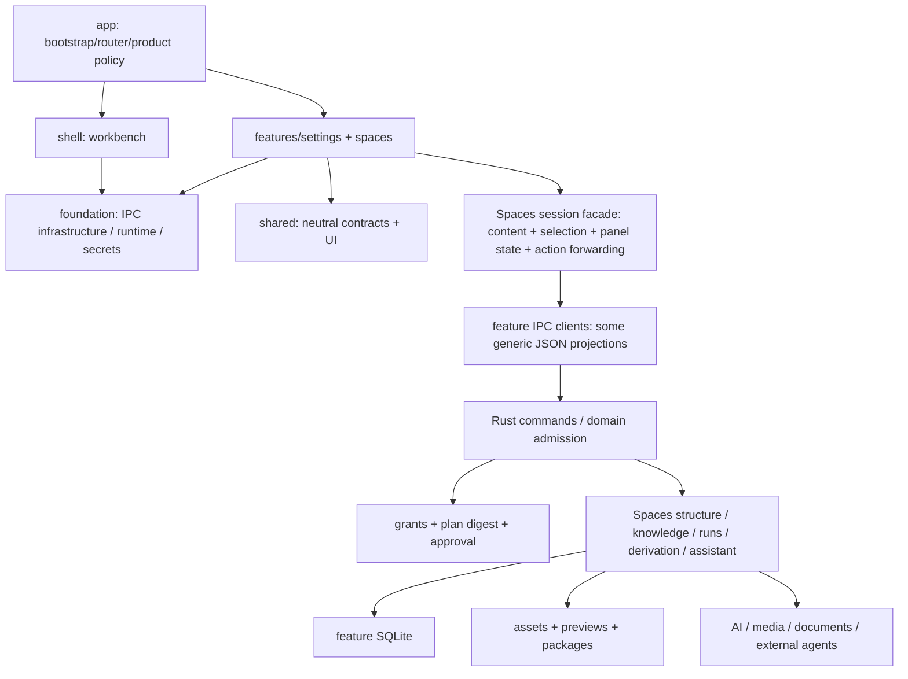

# Knovum 全项目代码与架构审查及整改方案

审查日期：2026-09-26。审查对象：`e67c36f`，工作目录 `/Users/zand/Downloads/bubu-foundation-v1.0-beta5`。执行方式：单 agent。**审查阶段未修改项目源代码、配置、数据库或依赖。** 本文件保存原始审查证据；用户授权整改后归档于本目录。

当前实施结果见[整改执行记录](remediation-progress.md)，Rust入口迁移对应关系见[module-moves.json](module-moves.json)。以下位置、检查结果和问题描述对应审查时的提交，不应当作整改后的现状。

## 审查范围、证据与限制

覆盖 Web/Rust 文件清单、目录与模块组织、架构规则、关键数据流、授权、任务取消、资产生命周期、持久化、导入/导出、模型/provider、配置、直接依赖、测试/抑制与静态质量门。Web 1104个TS/Vue文件约73006原始行，Rust 868个`.rs`约70501原始行；另检查tools、测试、配置、CI与权威文档。没有声称逐行人工阅读全部14万行；采用全局清单/模式/依赖扫描与核心链路逐文件深入审查。无引用的动态入口、Windows运行时、Rust完整编译结果是明确验证缺口。

用户要求不运行打包。该要求后没有再执行build、Tauri打包或Rust编译。此前一次Web Vite编译已完成，相关体积仅作为既有证据，不把“编译成功”当架构结论。Rust clippy此前遇构建锁并中断，无结果；不能推断Rust无warning或全部测试通过。

问题分为：**确认问题**（直接源代码/检查结果）；**需针对验证的风险**（已找到结构缺口，但不声称发生损坏）；**条件优化**（已知复杂度，需测量后决定）。每项写明置信度；空泛最佳实践不进入必改清单。工作量Small约半日至2日，Medium约2–5日，Large约1–3周，均是单名熟悉栈工程师的规划量级，不是交付承诺；涉及产品数据政策的等待时间不计。

## A. 总体审查结论

### A1. 整体状态

项目已有可用的能力架构，主要技术选型与产品边界合理。Web采用app/foundation/shell/features/shared，Rust按能力组织。独立运行的dependency-cruiser对1107模块、3681依赖未发现违规；Knip无报告；重复代码0.41%，Vue重复扫描为0。**没有证据支持重建成多crate、增加service/repository/adapter层或全局事件总线。**

最大问题是跨边界的语义与生命周期没有完全统一：审批的身份约束、流的成功终态、数据库提交与文件回收的成功界限，以及重构后的生产协议与测试/质量门不同步。主要历史债是Spaces多轮迁移、旧路径守卫/配置、宽泛出口和少量空转发；主要维护复杂度来自Spaces集中会话facade、全量JSON投影和多领域状态穿透，远大于重复小函数。

Rust的问题特点：稳定业务数据经String/Value/动态行转换丢失合同；异步取消语义分叉；资产与DB双资源生命周期；部分read使用write事务；合法但与本次要求冲突的foo.rs+foo/组织。Arc、trait、生命周期与锁不是数量问题，需要按实际共享所有权判断；没有理由全面改写为“领域驱动架构”。

Web的问题特点：组合式组件与现有第三方工具基本合理，未发现需全局清理memo/useCallback的React式问题；问题集中在Spaces store公开面、跨视图session寿命、IPC错误模型、fixture漂移与可选功能装载。文件较小并不自动意味着清晰，180行门也不能成为制造转发层的理由。

### A2. 应保持的实现

- app负责组装，features不跨feature，foundation不依赖业务，shared leaf；保持当前目录大分区。
- Rust持有feature SQLite，Web无SQL插件访问；保留这条权限边界。secrets.db未应用加密是文档明确事实，不能谎称安全加密，也不把新加密系统作为本轮强制重构。
- MCP localhost/token中间件、路径canonicalization/资产引用保护、包restore的入口/路径/体积/符号链接约束、DOMPurify画布富文本净化，属于实际边界防护，保留。
- Tauri Channels与现有Task Center，事务/revision/idempotency receipt，预期cancel/permission denial分支，属于必要机制。
- Reka原语、TanStack Query、VueUse、Pinia、Oxc和ts-rs；Konva/vue-konva的精确锁版本有已有benchmark理由，不随清理升级。
- provider多实现媒体trait、跨平台原生桥、SQL schema约束、CJK全文检索必要fallback、外部旧Office文件解析，不能仅因“trait/fallback/legacy”词出现就删。
- confirmed mutation/receipt回查用于IPC结果不确定时确认已提交，删除会破坏幂等；可以改善错误上下文，不能直接重试写入。
- FNV的跨端revision用途与SHA安全/内容digest不同；Candle与Tract、HTML预览与PPTX token parsing也有不同职责，不强行合并。

### A3. 当前质量证据

| 项目                     | 本次结果             | 解释                                                             |
| ------------------------ | -------------------- | ---------------------------------------------------------------- |
| check:web                | 失败，停在authority  | 测试模板前缀误报，后续门未由该命令执行                           |
| check:rust               | 失败，停在Rust结构门 | messages.rs221有效行；不是Rust编译报错                           |
| Web typecheck            | 失败                 | ShallowRef未导入，明确单点错误                                   |
| lint                     | 失败                 | 附件181行、两处vi.fn类型                                         |
| architecture入口         | 失败                 | 先被同一Web行数门截断                                            |
| 独立dependency-cruiser   | 通过                 | 1107模块3681依赖，不能证明Rust全图无环                           |
| Knip                     | 通过                 | 没有Web死代码报告；动态入口与手动entry仍需语义判断               |
| typecheck:e2e            | 通过                 | 不等于运行了desktop e2e                                          |
| Vitest                   | 失败                 | 131文件122通过9失败；446案例431通过15失败；3 unhandled rejection |
| duplicates               | 通过                 | 56 clones，763行，0.41%；Rust49/654行，TS6/83行；不是零重复      |
| Web format:check         | 失败                 | 7文件，见附录                                                    |
| cargo fmt --check        | 失败                 | 文档生成/导出Rust格式差异；未修改文件                            |
| cargo check / cargo test | 没有完成证据         | 本轮不得写为通过或失败                                           |
| cargo clippy             | 无结果               | 等待构建目录锁，后中断；不能认定无warning                        |
| Web生产依赖audit         | 3high+1moderate      | 官方registry；可达性另判，见H                                    |
| 真实桌面/Windows/打包    | 未执行               | 本次架构审查无需，以后改生命周期/平台功能再验收                  |

## B. 问题总表

摘要表用于排序；B2逐项包含位置、原因、方案、影响、风险、优先级、工作量、验证与置信度，交付工程师无需重新定位问题。

| 编号 | 层级     | 类型                | 问题摘要                                                                                                                    | 优先级 | 改动风险 | 工作量 |
| ---- | -------- | ------------------- | --------------------------------------------------------------------------------------------------------------------------- | ------ | -------- | ------ |
| R01  | Rust     | 授权边界            | 审批创建保存 grant_id、space_id，消费只读取 action_id、plan_digest、过期/决策/已消费状态                                    | P0     | High     | Medium |
| R02  | Rust     | 取消/终态           | stream_text 在 cancellation 与底层 EOF 分支直接 break                                                                       | P0     | High     | Medium |
| R03  | Web      | 静态检查            | typecheck 找不到 ShallowRef                                                                                                 | P0     | Low      | Small  |
| R04  | Web      | 测试/协议漂移       | 446测试中15失败，9文件                                                                                                      | P0     | Medium   | Medium |
| R05  | Shared   | 质量门误报          | check:authority 将模板字符串中的 allocate_document_、export_document_as_ 前缀当成完整 IPC command                           | P0     | Low      | Small  |
| R06  | Shared   | 依赖安全            | 官方 npm audit 返回3 high、1 moderate：valibot0.40.0 与 image-size1.2.1 的已知 advisory。尚未证明本项目能触达所有漏洞输入。 | P1     | Medium   | Medium |
| R07  | Rust     | 历史兼容/数据库     | 保留旧 assistant 数据搬迁与旧 workflow/automation 表清理迁移，与项目发布前每库一个当前 v1 baseline 的明确约定冲突。         | P1     | High     | Large  |
| R08  | Web      | 提交/清理边界       | saveBinding 已成功后，旧资源清理仍处于同一 try                                                                              | P1     | Medium   | Small  |
| R09  | Rust/Web | 资源回收/重复扫描   | Web 对每条路径逐个 IPC                                                                                                      | P2     | Medium   | Medium |
| R10  | Rust     | 资源更新原子性      | refresh_asset 先 remove_generated 再 inspect/enrich/extract                                                                 | P1     | Medium   | Medium |
| R11  | Rust     | 错误吞没/panic      | locator JSON parse 使用 unwrap_or(Value::Null)，把存储损坏变成无 locator                                                    | P1     | Medium   | Medium |
| R12  | Rust     | 锁/事务             | 只读 grant 校验使用 begin_write（BEGIN IMMEDIATE），会提前申请 SQLite 写锁。                                                | P2     | Low      | Small  |
| R13  | Shared   | 错误协议            | AI 有 code/message，Spaces 多为 String，部分 code 埋在句子前缀                                                              | P1     | Medium   | Large  |
| R14  | Rust     | 并发/生命周期       | 一处 expect("permission broker poisoned") 与其余 map_err 不一致                                                             | P1     | Medium   | Medium |
| R15  | Shared   | DTO/边界            | session nodes/scenes/relations 使用 Vec<Value>，Web 对部分 projection 直接宣称具体类型                                      | P1     | Medium   | Large  |
| R16  | Rust     | 职责/质量门         | 234原始行、221有效行                                                                                                        | P1     | Medium   | Medium |
| R17  | Web      | God store/数据流    | central store 暴露大量内容、导航、canvas请求、编辑器/媒体UI状态                                                             | P1     | Medium   | Large  |
| R18  | Web      | 状态身份/缓存寿命   | 图片编辑会话用 nodeId，未携 spaceId                                                                                         | P1     | Medium   | Medium |
| R19  | Web      | 错误可见性          | 路由离开 flush/commit 出错 catch 返回 false，无用户反馈                                                                     | P1     | Low      | Small  |
| R20  | Web      | 重复异步桥          | conversation 与 workflows 分别维护 run observer Map、Channel、释放和 task映射。                                             | P2     | Medium   | Medium |
| R21  | Rust     | 写放大/性能         | 局部结构修改仍批量 tombstone/upsert节点与layout、重建styles                                                                 | P2     | Medium   | Medium |
| R22  | Rust     | 空实现/工厂         | 这些 provider 仅空unit struct/new/default/空 AiProvider impl                                                                | P2     | Low      | Small  |
| R23  | Rust     | re-export/重复映射  | contracts/mod.rs 6个 unused_imports allow 包裹宽泛re-export                                                                 | P2     | Low      | Small  |
| R24  | Rust     | 转发包装            | 三个短文件仅给 execute::export 传格式配置，无独立验证/策略。                                                                | P2     | Low      | Small  |
| R25  | Shared   | 同名文件目录        | 65处实际文件与同stem目录并存（64Rust、1Web），完整清单见附录。Rust gate只识别同名目录含mod.rs，不满足用户物理命名要求。     | P2     | Medium   | Medium |
| R26  | Shared   | 失效质量规则        | Rust规则仍引用不存在的 bundled_runtime.rs、knowledge_derivations 旧路径                                                     | P1     | Low      | Small  |
| R27  | Shared   | 无效配置/CI         | SQLplugin已经不在依赖与权限中，配置仍preload spaces.db                                                                      | P1     | Low      | Small  |
| R28  | Rust     | 未用直接依赖        | source/build未发现async_openai、外部rig、futures_util使用                                                                   | P2     | Low      | Small  |
| R29  | Web      | 测试目录命名        | 被其他测试import的fixture文件以.test.ts命名以符合目录门                                                                     | P2     | Low      | Small  |
| R30  | Web      | 日志/注释           | Vue已捕获error直接console.error，window diagnostics未必捕获                                                                 | P3     | Low      | Small  |
| R31  | Shared   | 命名/别名           | ProviderKind serde snake_case与as_str/parse canonical ID不同（OpenAi/openai、DashScope/qwen等）                             | P2     | Low      | Small  |
| R32  | Rust     | 资源边界/背压       | unbounded delta/frame通道                                                                                                   | P1     | Medium   | Medium |
| R33  | Rust     | 配置默认值          | 显式环境覆盖路径无效时过滤后继续用bundle，用户指定值与实际运行工具/模型不同。                                               | P2     | Low      | Small  |
| R34  | Shared   | 两套渲染/重复造轮子 | Web使用已安装pptxgenjs，Rust手工ZIP/XML生成演示文档，能力/排版并不相同                                                      | P2     | Medium   | Medium |
| R35  | Web      | 加载边界            | 视图静态导入多个可选重型panel                                                                                               | P2     | Low      | Small  |
| R36  | Shared   | 版本/描述/文档漂移  | Web package0.0.1与Rust/Tauri1.0.0-beta4不一致                                                                               | P3     | Low      | Small  |
| R37  | Rust/Web | 关键回归覆盖        | invocation tests 目前仅digest key-order单元案例，不覆盖授权身份绑定、单次消费、事务幂等/并发                                | P1     | Low      | Medium |

### B2. 可实施问题详情

#### R01 — 授权边界

| 字段        | 内容                                                                                                                                                                                               |
| ----------- | -------------------------------------------------------------------------------------------------------------------------------------------------------------------------------------------------- |
| 层级        | Rust                                                                                                                                                                                               |
| 位置        | src-tauri/src/spaces/authorization/approval.rs:consume；spaces/actions/invocation/execute/approval.rs；spaces/actions/invocation/digest.rs                                                         |
| 当前问题    | 审批创建保存 grant_id、space_id，消费只读取 action_id、plan_digest、过期/决策/已消费状态；调用不传当前 grant。digest 包含 space，但不包含 grant。                                                  |
| 形成原因    | 审批计划校验与授权身份校验分离后，消费端丢失审批所属身份；还构造 grant/space 为空、plan 为 null 的 ApprovalRequest 复用 matches。                                                                  |
| 整改方案    | consume 接受当前授权上下文的 grant_id、space_id；SELECT/校验/条件 UPDATE 在原事务内匹配它们。用实际消费条件校验，删除伪造完整请求。保持 action、digest、时效、单次消费、权限校验。无需新权限框架。 |
| 影响范围    | 审批、MCP/assistant/workflow 的 action invoke；审批拒绝码                                                                                                                                          |
| 风险        | High                                                                                                                                                                                               |
| 优先级      | P0                                                                                                                                                                                                 |
| 工作量      | Medium                                                                                                                                                                                             |
| 验证方式    | 同 space 两 grant、同 plan：A 的审批不能被 B 消费；跨 space 拒绝；过期、拒绝、revision 改变拒绝；并发只有一次成功。注意这是授权绑定缺口，不宣称已证明任意外部攻击。                                |
| 证据/置信度 | 高；静态代码证据                                                                                                                                                                                   |

#### R02 — 取消/终态

| 字段        | 内容                                                                                                                                                                                                                                                         |
| ----------- | ------------------------------------------------------------------------------------------------------------------------------------------------------------------------------------------------------------------------------------------------------------ |
| 层级        | Rust                                                                                                                                                                                                                                                         |
| 位置        | src-tauri/src/ai/model_turn/stream.rs:stream_text/map_event；ai/capabilities/chat/mod.rs；ai/capabilities/translation                                                                                                                                        |
| 当前问题    | stream_text 在 cancellation 与底层 EOF 分支直接 break；End 仅转为可选 Usage，流没有成功终态。上层收集到非空文本后可能返回 Ok，把取消或截断结果当完成。stream_turn 已正确区分取消、End、异常 EOF。                                                            |
| 形成原因    | 两套流消费语义不一致，以通道关闭代替模型完成。                                                                                                                                                                                                               |
| 整改方案    | 先复用 stream_turn 的终态规则：取消发 AiError::cancelled，非 End 的 EOF 发 InvalidResponse；仅真实 End 可成功，End 无 usage 也成功。初始 exec_chat_stream await 也受 CancellationToken 控制。根据当前消费者是否需要显式 Completed frame 决定，避免新协议层。 |
| 影响范围    | 聊天、翻译、文本派生、usage 记录、任务中心                                                                                                                                                                                                                   |
| 风险        | High                                                                                                                                                                                                                                                         |
| 优先级      | P0                                                                                                                                                                                                                                                           |
| 工作量      | Medium                                                                                                                                                                                                                                                       |
| 验证方式    | 模拟 partial→cancel、partial→EOF 均失败；partial→End 无 usage 成功；取消初始请求及时返回；失败文本不作为完整派生产物落库。                                                                                                                                   |
| 证据/置信度 | 高；静态代码证据                                                                                                                                                                                                                                             |

#### R03 — 静态检查

| 字段        | 内容                                                                                                                                     |
| ----------- | ---------------------------------------------------------------------------------------------------------------------------------------- |
| 层级        | Web                                                                                                                                      |
| 位置        | src/features/spaces/conversation/use-conversation-task.ts:26；use-conversation-attachments.ts；**tests**/document-export.test.ts         |
| 当前问题    | typecheck 找不到 ShallowRef；attachments 文件181有效行超过180；document-export 两处 vi.fn 未按 lint 规则提供类型。                       |
| 形成原因    | 代码与导入/质量门未同步。                                                                                                                |
| 整改方案    | 补 type ShallowRef 导入；将附件选择/发送中独立职责移到已有附件模块，禁止仅为减行制造转发文件；给 mock 当前函数签名；格式化本次涉及文件。 |
| 影响范围    | conversation、Web 类型检查和 lint                                                                                                        |
| 风险        | Low                                                                                                                                      |
| 优先级      | P0                                                                                                                                       |
| 工作量      | Small                                                                                                                                    |
| 验证方式    | pnpm typecheck、lint 通过；附件选择、移除、提交行为测试保持。                                                                            |
| 证据/置信度 | 高；静态代码证据                                                                                                                         |

#### R04 — 测试/协议漂移

| 字段        | 内容                                                                                                                                                                                                                                                     |
| ----------- | -------------------------------------------------------------------------------------------------------------------------------------------------------------------------------------------------------------------------------------------------------- |
| 层级        | Web                                                                                                                                                                                                                                                      |
| 位置        | src/features/spaces/**tests**；src/locales；shell.commandUnavailable / spaces.creation.workflowStates                                                                                                                                                    |
| 当前问题    | 446测试中15失败，9文件；3个未处理 rejection。多个夹具仍使用旧 session 加载、旧写入签名、旧 manifest 和派生结构；另有6个 snake_case 翻译键违反现有规则。                                                                                                  |
| 形成原因    | 重构生产协议后未同步测试边界，部分测试从纯 mock 意外进入真实 Tauri IPC。                                                                                                                                                                                 |
| 整改方案    | 按附录失败逐条处理：typed mock 原子 projection API，四参数写入；更新完整合法 v5 fixture；先判定 video 时间线和 derivation 前置条件再调整断言；组件装载 Pinia。协议 snake_case 保留，通过显式映射转换 lowerCamel i18n key。禁止批量改 expected 让测试绿。 |
| 影响范围    | session、website、manifest、derivation、canvas、i18n                                                                                                                                                                                                     |
| 风险        | Medium                                                                                                                                                                                                                                                   |
| 优先级      | P0                                                                                                                                                                                                                                                       |
| 工作量      | Medium                                                                                                                                                                                                                                                   |
| 验证方式    | 全部现有测试通过且0 unhandled rejection；切空间竞态、乐观写冲突、manifest 失败原因断言仍验证原业务；每个 changed expectation 有契约依据。                                                                                                                |
| 证据/置信度 | 高；静态代码证据                                                                                                                                                                                                                                         |

#### R05 — 质量门误报

| 字段        | 内容                                                                                                                                                                              |
| ----------- | --------------------------------------------------------------------------------------------------------------------------------------------------------------------------------- |
| 层级        | Shared                                                                                                                                                                            |
| 位置        | tools/check-tauri-command-coverage.mjs；src/features/spaces/**tests**/document-export.test.ts:47–48                                                                               |
| 当前问题    | check:authority 将模板字符串中的 allocate_document_、export_document_as_ 前缀当成完整 IPC command；实际生产调用有完整 literal 映射。                                              |
| 形成原因    | 扫描器匹配所有 TS/Vue 字符片段，未要求完整字面量；测试也构造动态 command。                                                                                                        |
| 整改方案    | 测试 expected 使用完整命令映射；扫描器仅登记完整字符串字面量，动态拼接单独列为需审查调用，不登记前缀。用几个小 fixture 锁住 literal/template/注释边界；不引入完整自制 TS parser。 |
| 影响范围    | 所有自定义 Tauri command 覆盖门                                                                                                                                                   |
| 风险        | Low                                                                                                                                                                               |
| 优先级      | P0                                                                                                                                                                                |
| 工作量      | Small                                                                                                                                                                             |
| 验证方式    | check:authority 通过；人为删一条真实权限/handler 仍失败；含 command 前缀的模板 fixture 不产生不存在命令。                                                                         |
| 证据/置信度 | 高；静态代码证据                                                                                                                                                                  |

#### R06 — 依赖安全

| 字段        | 内容                                                                                                                                                                                                                                               |
| ----------- | -------------------------------------------------------------------------------------------------------------------------------------------------------------------------------------------------------------------------------------------------- |
| 层级        | Shared                                                                                                                                                                                                                                             |
| 位置        | pnpm-lock.yaml：tauri-plugin-clipboard-api→valibot；pptxgenjs→image-size                                                                                                                                                                           |
| 当前问题    | 官方 npm audit 返回3 high、1 moderate：valibot0.40.0 与 image-size1.2.1 的已知 advisory。尚未证明本项目能触达所有漏洞输入。                                                                                                                        |
| 形成原因    | 父依赖锁定旧传递版本；审计默认 npmmirror endpoint 不支持也容易遮蔽结果。                                                                                                                                                                           |
| 整改方案    | 以官方 registry 输出为依据，先确认 clipboard 对 emoji/flatten 的调用与 PPTX 图片格式路径；优先父包兼容升级。若 override，验证父包 API 与 ESM 兼容，禁止直接跨 major 强压版本。无法兼容时在实际边界拒绝受影响输入并记录临时期限，不建通用安全包装。 |
| 影响范围    | 剪贴板、PPTX worker、锁文件                                                                                                                                                                                                                        |
| 风险        | Medium                                                                                                                                                                                                                                             |
| 优先级      | P1                                                                                                                                                                                                                                                 |
| 工作量      | Medium                                                                                                                                                                                                                                             |
| 验证方式    | 重新 audit 不含这4项，或有明确不可达证明/临时输入限制；剪贴板读写/HTML+text/URL 与 PPTX 文本图片回归。若证实不可信输入可触达死循环，提升 P0。                                                                                                      |
| 证据/置信度 | 高：版本/advisory；中：本项目可达性                                                                                                                                                                                                                |

#### R07 — 历史兼容/数据库

| 字段        | 内容                                                                                                                                                                                                                                            |
| ----------- | ----------------------------------------------------------------------------------------------------------------------------------------------------------------------------------------------------------------------------------------------- |
| 层级        | Rust                                                                                                                                                                                                                                            |
| 位置        | src-tauri/migrations/spaces/0001_spaces.sql、0002_assistant_redesign.sql、0003_builtin_workflow_cleanup.sql                                                                                                                                     |
| 当前问题    | 保留旧 assistant 数据搬迁与旧 workflow/automation 表清理迁移，与项目发布前每库一个当前 v1 baseline 的明确约定冲突。                                                                                                                             |
| 形成原因    | 旧迭代 schema 被累积进产品，而非构建当前初始 schema。                                                                                                                                                                                           |
| 整改方案    | 以执行完0001–0003后的 schema 为目标，形成一个当前0001 baseline；移除0002/0003；同步种子、约束、测试。旧开发 DB 明确报 obsolete 并提供备份/用户主动重置流程，绝不静默删库。先确定数据保留政策；package v5 与 media knowledge 版本不要机械改成1。 |
| 影响范围    | Spaces 全部持久化、旧安装 DB、导入/恢复、schema checksum                                                                                                                                                                                        |
| 风险        | High                                                                                                                                                                                                                                            |
| 优先级      | P1                                                                                                                                                                                                                                              |
| 工作量      | Large                                                                                                                                                                                                                                           |
| 验证方式    | 空库建 schema 与目标约束/索引一致；旧库明确被拒绝且文件不变；备份可恢复；包格式及正常创建/读写/授权/assistant 集成回归。该项单独数据变更批次。                                                                                                  |
| 证据/置信度 | 高；静态代码证据                                                                                                                                                                                                                                |

#### R08 — 提交/清理边界

| 字段        | 内容                                                                                                                                                                                  |
| ----------- | ------------------------------------------------------------------------------------------------------------------------------------------------------------------------------------- |
| 层级        | Web                                                                                                                                                                                   |
| 位置        | src/features/spaces/website/capture.ts:persistWebsite/hydrateSavedWebsite                                                                                                             |
| 当前问题    | saveBinding 已成功后，旧资源清理仍处于同一 try；清理失败会进入清理新资源及标记 failed 的分支，混淆“保存失败”和“清理失败”。Rust 对已引用资源的删除保护避免了简单推断的新图片被删结论。 |
| 形成原因    | 跨数据库提交与文件回收没有分开定义成功边界。                                                                                                                                          |
| 整改方案    | 保存前失败才回收未绑定新资源；保存成功即业务成功，旧资源回收失败单独告警并保留待回收项，采用现有回收机制，不重新标记 metadata failed。保持 expectedData 乐观校验和 Rust 引用保护。    |
| 影响范围    | 网站保存/刷新、资源回收、元数据状态                                                                                                                                                   |
| 风险        | Medium                                                                                                                                                                                |
| 优先级      | P1                                                                                                                                                                                    |
| 工作量      | Small                                                                                                                                                                                 |
| 验证方式    | 提交成功+旧资源清理失败仍 ready，新资源未被请求清理；提交冲突只清理新资源；重新刷新不覆盖并发编辑。                                                                                   |
| 证据/置信度 | 高；静态代码证据                                                                                                                                                                      |

#### R09 — 资源回收/重复扫描

| 字段        | 内容                                                                                                                                                                                            |
| ----------- | ----------------------------------------------------------------------------------------------------------------------------------------------------------------------------------------------- |
| 层级        | Rust/Web                                                                                                                                                                                        |
| 位置        | src/features/spaces/assets/asset-operations.ts:removeSpaceAssets；src-tauri/src/spaces/assets/commands.rs；assets/reclamation/reference_graph                                                   |
| 当前问题    | Web 对每条路径逐个 IPC；Rust 每次删除候选读取/解析全量节点引用。k 个候选导致 k 次全量扫描。引用检查与实际文件删除分开，还需明确引用创建期间的串行约束。                                         |
| 形成原因    | 单资源 API 被用作批量回收，检查与执行跨存储边界。                                                                                                                                               |
| 整改方案    | 新增 feature-owned 批量删除未引用候选的具体 command，单次构建引用图；保留路径校验、已引用拒绝和根目录拒绝。检查现有写入/删除串行机制；若不足，以同一资产操作协调保护“检查→删除”，无需全局缓存。 |
| 影响范围    | 网站刷新、导入回滚、派生清理、资产绑定                                                                                                                                                          |
| 风险        | Medium                                                                                                                                                                                          |
| 优先级      | P2                                                                                                                                                                                              |
| 工作量      | Medium                                                                                                                                                                                          |
| 验证方式    | k候选仅1次引用扫描；候选包含引用资源/根/越界均不可删；并发绑定与回收不会形成悬空引用。仅扫描复杂度已证实，未测得真实延迟。                                                                      |
| 证据/置信度 | 高：扫描；中：并发失效风险需集成验证                                                                                                                                                            |

#### R10 — 资源更新原子性

| 字段        | 内容                                                                                                                                                          |
| ----------- | ------------------------------------------------------------------------------------------------------------------------------------------------------------- |
| 层级        | Rust                                                                                                                                                          |
| 位置        | src-tauri/src/spaces/assets/files.rs:refresh_asset；assets/previews                                                                                           |
| 当前问题    | refresh_asset 先 remove_generated 再 inspect/enrich/extract；后续失败可能仍保留指向已清理预览的旧记录。                                                       |
| 形成原因    | 先破坏旧产物再生成替代，没有发布成功界限。                                                                                                                    |
| 整改方案    | 先生成临时/新预览，完成元数据更新后再清理旧版本；沿用现有资产目录和发布工具。失败保留旧可用预览，返回实际错误。明确同名输出覆盖规则，避免以缓存兜底掩盖失败。 |
| 影响范围    | 文件刷新、缩略图、索引/知识更新                                                                                                                               |
| 风险        | Medium                                                                                                                                                        |
| 优先级      | P1                                                                                                                                                            |
| 工作量      | Medium                                                                                                                                                        |
| 验证方式    | 在解析、预览生成、数据库保存分别注入失败，旧预览仍可读取；成功后只保留当前资源；无孤儿临时文件。                                                              |
| 证据/置信度 | 高；静态代码证据                                                                                                                                              |

#### R11 — 错误吞没/panic

| 字段        | 内容                                                                                                                                                                                          |
| ----------- | --------------------------------------------------------------------------------------------------------------------------------------------------------------------------------------------- |
| 层级        | Rust                                                                                                                                                                                          |
| 位置        | src-tauri/src/spaces/knowledge/action.rs:locator 解析；spaces/queries/external/{node,search,provenance,relations,history,spaces}.rs                                                           |
| 当前问题    | locator JSON parse 使用 unwrap_or(Value::Null)，把存储损坏变成无 locator；若干动态 query 结果使用 Row::get，类型不符可 panic。                                                                |
| 形成原因    | 将可信程度不同的存储读取当成内部不变量；Result 被默认值覆盖。                                                                                                                                 |
| 整改方案    | locator 使用 try_get 和 serde_json::from_str?；确需 null 只接受实际 JSON null。静态查询优先已有 sqlx query_as+具体 DTO，否则 try_get 传播带表/记录上下文的错误。不可用空对象/空列表替代损坏。 |
| 影响范围    | 知识检索、MCP read、provenance/grounding                                                                                                                                                      |
| 风险        | Medium                                                                                                                                                                                        |
| 优先级      | P1                                                                                                                                                                                            |
| 工作量      | Medium                                                                                                                                                                                        |
| 验证方式    | 破损 locator、错误列类型、缺列均返回可诊断错误且进程不 panic；合法空 locator 的契约明确；关键检索集成测试。                                                                                   |
| 证据/置信度 | 高；静态代码证据                                                                                                                                                                              |

#### R12 — 锁/事务

| 字段        | 内容                                                                                                                    |
| ----------- | ----------------------------------------------------------------------------------------------------------------------- |
| 层级        | Rust                                                                                                                    |
| 位置        | src-tauri/src/spaces/authorization/mod.rs:require_read/require_run_control                                              |
| 当前问题    | 只读 grant 校验使用 begin_write（BEGIN IMMEDIATE），会提前申请 SQLite 写锁。                                            |
| 形成原因    | 重用写事务入口代替明确读取场景。                                                                                        |
| 整改方案    | 需要一致快照时用 deferred read transaction；不需快照时直接只读查询；涉及修改的授权仍留原写事务。不可拆散原子授权+写入。 |
| 影响范围    | MCP read、run observation/control admission、SQLite writer                                                              |
| 风险        | Low                                                                                                                     |
| 优先级      | P2                                                                                                                      |
| 工作量      | Small                                                                                                                   |
| 验证方式    | 并行只读授权不抢占写锁；授权撤销/过期结果一致；实际授权+业务写入仍同事务。                                              |
| 证据/置信度 | 高；静态代码证据                                                                                                        |

#### R13 — 错误协议

| 字段        | 内容                                                                                                                                                                                                                                                                                     |
| ----------- | ---------------------------------------------------------------------------------------------------------------------------------------------------------------------------------------------------------------------------------------------------------------------------------------- |
| 层级        | Shared                                                                                                                                                                                                                                                                                   |
| 位置        | src-tauri/src/ai/error.rs；spaces/db.rs；spaces/* 的 code: message 错误；src/features/spaces/conversation/use-conversation-attachments.ts                                                                                                                                                |
| 当前问题    | AI 有 code/message，Spaces 多为 String，部分 code 埋在句子前缀；Web 通过 includes 英文句子/错误码判断，String(object) 可能变 [object Object]。                                                                                                                                           |
| 形成原因    | 领域错误、IPC展示错误与日志错误混为一个字符串。                                                                                                                                                                                                                                          |
| 整改方案    | 沿用 AI 已有 envelope 思路，定义最小稳定 IPC {code,message}；各能力保留自己的 code，明确 cancel/conflict/notFound/unavailable/invalidInput。不创建通用异常继承体系。Rust 内部保留 cause，IPC 不暴露 token/路径细节；Web按 code分支，展示层统一格式化。分能力纵向迁移，最后删字符串匹配。 |
| 影响范围    | 全部 IPC、通知、表单、任务状态                                                                                                                                                                                                                                                           |
| 风险        | Medium                                                                                                                                                                                                                                                                                   |
| 优先级      | P1                                                                                                                                                                                                                                                                                       |
| 工作量      | Large                                                                                                                                                                                                                                                                                    |
| 验证方式    | 已有错误情形保留语义；同 code 不受语言/消息改动影响；cancel 不报失败；每个错误只由处理边界日志一次；无 secret 进入 message。                                                                                                                                                             |
| 证据/置信度 | 高；静态代码证据                                                                                                                                                                                                                                                                         |

#### R14 — 并发/生命周期

| 字段        | 内容                                                                                                                                                                 |
| ----------- | -------------------------------------------------------------------------------------------------------------------------------------------------------------------- |
| 层级        | Rust                                                                                                                                                                 |
| 位置        | src-tauri/src/external_agents/permissions.rs:request_decision/pending lock                                                                                           |
| 当前问题    | 一处 expect("permission broker poisoned") 与其余 map_err 不一致；pending 插入→await→remove 依赖 future 正常走到清理，需覆盖外部 future 被 drop 的路径。              |
| 形成原因    | 异步请求资源释放依赖控制流，锁错误被视为不可发生。                                                                                                                   |
| 整改方案    | poison 转成拒绝/取消协议并记录一次内部错误，不自动信任恢复状态；给 pending 注册建立局部 RAII lease，drop/cancel/success 都移除。沿用已有取消机制，不建全局 manager。 |
| 影响范围    | 外部 agent 权限询问、会话取消                                                                                                                                        |
| 风险        | Medium                                                                                                                                                               |
| 优先级      | P1                                                                                                                                                                   |
| 工作量      | Medium                                                                                                                                                               |
| 验证方式    | drop等待future后 pending为空；取消/超时/正常决定只消费一次；poison 不进程 panic、不自动批准。                                                                        |
| 证据/置信度 | 高：expect；中：drop 残留需单元验证                                                                                                                                  |

#### R15 — DTO/边界

| 字段        | 内容                                                                                                                                                                                                                               |
| ----------- | ---------------------------------------------------------------------------------------------------------------------------------------------------------------------------------------------------------------------------------- |
| 层级        | Shared                                                                                                                                                                                                                             |
| 位置        | src-tauri/src/spaces/queries/session.rs；src-tauri/src/sqlite.rs:rows_to_json；src/features/spaces/session 的 projection reader                                                                                                    |
| 当前问题    | session nodes/scenes/relations 使用 Vec<Value>，Web 对部分 projection 直接宣称具体类型；全局 sqlite 动态列→JSON 把业务字段表达藏进运行时映射。                                                                                     |
| 形成原因    | 为通用行转换牺牲静态数据合同；已有 ts-rs 未覆盖这些稳定返回值。                                                                                                                                                                    |
| 整改方案    | 为稳定 session projections 引入具体 Rust DTO 并沿用 ts-rs 生成 TS；Rust-owned结构从单源生成。节点多态 payload 保留必要 JSON 并在 owning parser 校验；archive 扩展数据可保留 Value。根 sqlite 只保连接/事务策略，业务投影归各能力。 |
| 影响范围    | session bootstrap、scene/relation 数据、IPC、数据库读取                                                                                                                                                                            |
| 风险        | Medium                                                                                                                                                                                                                             |
| 优先级      | P1                                                                                                                                                                                                                                 |
| 工作量      | Large                                                                                                                                                                                                                              |
| 验证方式    | 生成类型可重复且无手改；null/optional/enum 与 Rust一致；损坏 DB 在读边界报错；一次加载projection保持原子快照；不增通用 repository trait。                                                                                          |
| 证据/置信度 | 高；静态代码证据                                                                                                                                                                                                                   |

#### R16 — 职责/质量门

| 字段        | 内容                                                                                                                                                                                                               |
| ----------- | ------------------------------------------------------------------------------------------------------------------------------------------------------------------------------------------------------------------ |
| 层级        | Rust                                                                                                                                                                                                               |
| 位置        | src-tauri/src/spaces/assistant/repository/messages.rs                                                                                                                                                              |
| 当前问题    | 234原始行、221有效行；DTO、附件 manifest 校验、分页、分支创建、消息写入挤在一个文件。                                                                                                                              |
| 形成原因    | 按“消息”名聚合多个独立变更原因，拆分没有跟随现有助手重构。                                                                                                                                                         |
| 整改方案    | message DTO/role 放 assistant owning contracts；manifest校验留附件合同入口；branch创建归 message_branches；分页/消息查询留 messages。单事务写入入口不拆成层层调用。共用 INSERT 仅抽具体函数，不加 repository接口。 |
| 影响范围    | assistant历史、分支、附件、契约导出                                                                                                                                                                                |
| 风险        | Medium                                                                                                                                                                                                             |
| 优先级      | P1                                                                                                                                                                                                                 |
| 工作量      | Medium                                                                                                                                                                                                             |
| 验证方式    | 180行门通过；分页/分支/附件校验及失败回滚集成测试；role封闭集合与 SQL约束一致。                                                                                                                                    |
| 证据/置信度 | 高；静态代码证据                                                                                                                                                                                                   |

#### R17 — God store/数据流

| 字段        | 内容                                                                                                                                                                                                                                                                                                       |
| ----------- | ---------------------------------------------------------------------------------------------------------------------------------------------------------------------------------------------------------------------------------------------------------------------------------------------------------- |
| 层级        | Web                                                                                                                                                                                                                                                                                                        |
| 位置        | src/features/spaces/session/space-store.ts、session-state.ts、session/actions/create-space-actions.ts                                                                                                                                                                                                      |
| 当前问题    | central store 暴露大量内容、导航、canvas请求、编辑器/媒体UI状态；create-space-actions 将大上下文映射给多个 controller，再 spread 合并返回。                                                                                                                                                                |
| 形成原因    | 从统一 session owner 演化成所有功能入口，公开状态和 action surface 缺少职责边界。                                                                                                                                                                                                                          |
| 整改方案    | 保留唯一 committed session projection、activeSpaceId 和加载切换责任；组件仅用的开合/hover/error留组件；跨 canvas/toolbar 编辑会话由现有能力session拥有并明确reset。公开按 content/selection/navigation/edits等已有职责成组 API，删纯透传 publicSpaceState；不机械拆成几十 Pinia stores、不新增 event bus。 |
| 影响范围    | Spaces几乎所有画布/侧栏/编辑器调用者                                                                                                                                                                                                                                                                       |
| 风险        | Medium                                                                                                                                                                                                                                                                                                     |
| 优先级      | P1                                                                                                                                                                                                                                                                                                         |
| 工作量      | Large                                                                                                                                                                                                                                                                                                      |
| 验证方式    | 每个状态有owner/生命周期表；切space旧任务不得覆盖新projection；没有两份节点快照；无新增横向feature依赖；分组迁移一组调用后再收窄API。                                                                                                                                                                      |
| 证据/置信度 | 高；静态代码证据                                                                                                                                                                                                                                                                                           |

#### R18 — 状态身份/缓存寿命

| 字段        | 内容                                                                                                                                                                                                    |
| ----------- | ------------------------------------------------------------------------------------------------------------------------------------------------------------------------------------------------------- |
| 层级        | Web                                                                                                                                                                                                     |
| 位置        | src/features/spaces/image-editing/image-edit-session.ts；comments/image-comment-session.ts；workspace session lifecycle                                                                                 |
| 当前问题    | 图片编辑会话用 nodeId，未携 spaceId；尺寸 map 没有对应空间卸载清理；node-operation-gate 阻止多数节点操作，但本身不拥有或重置 workspace 切换状态。                                                       |
| 形成原因    | 跨视图会话生命周期没有显式绑定其所属 space。                                                                                                                                                            |
| 整改方案    | 核对所有space切换、路由离开、节点删除入口；编辑active携spaceId并在apply验证；现有sessiontransition集中commit/cancel/reset，清理旧空间尺寸cache；comment相同。保持跨canvas/toolbar Pinia，不错误本地化。 |
| 影响范围    | 切空间、图片工具、评论、删除节点                                                                                                                                                                        |
| 风险        | Medium                                                                                                                                                                                                  |
| 优先级      | P1                                                                                                                                                                                                      |
| 工作量      | Medium                                                                                                                                                                                                  |
| 验证方式    | 编辑中切空间按既定规则提交/阻止/取消；即便调用绕过UI也不能写新space同ID节点；节点删后状态/cache清空。当前报告判定生命周期缺口，不声称已复现跨空间写坏。                                                 |
| 证据/置信度 | 中：结构证据明确，实际入口覆盖需回归                                                                                                                                                                    |

#### R19 — 错误可见性

| 字段        | 内容                                                                                               |
| ----------- | -------------------------------------------------------------------------------------------------- |
| 层级        | Web                                                                                                |
| 位置        | src/features/spaces/workspace/use-space-session-lifecycle.ts                                       |
| 当前问题    | 路由离开 flush/commit 出错 catch 返回 false，无用户反馈；用户只看到导航没有发生。                  |
| 形成原因    | 保护保存的路由guard未承担可恢复错误展示。                                                          |
| 整改方案    | 保留阻止离开的数据保护；由该用户操作边界报告保存失败、重试入口，日志一次；不要悄悄放行或默认成功。 |
| 影响范围    | 导航、未保存编辑、用户反馈                                                                         |
| 风险        | Low                                                                                                |
| 优先级      | P1                                                                                                 |
| 工作量      | Small                                                                                              |
| 验证方式    | 保存失败留当前页面且可读提示/重试；成功离开；预期用户取消不显示异常。                              |
| 证据/置信度 | 高；静态代码证据                                                                                   |

#### R20 — 重复异步桥

| 字段        | 内容                                                                                                                                                                                 |
| ----------- | ------------------------------------------------------------------------------------------------------------------------------------------------------------------------------------ |
| 层级        | Web                                                                                                                                                                                  |
| 位置        | src/features/spaces/conversation 的 run observation；workflows/workflow-run-observation.ts；features/spaces/runs                                                                     |
| 当前问题    | conversation 与 workflows 分别维护 run observer Map、Channel、释放和 task映射。                                                                                                      |
| 形成原因    | 两个展示入口分别实现相同传输/订阅寿命机制。                                                                                                                                          |
| 整改方案    | 把 observe_run Channel 与订阅释放放现有 runs owning area 一个具体 transport；对话/工作流各自保留业务映射和导航。长期任务传输可长于组件，展示listener组件卸载释放，勿取消仍运行任务。 |
| 影响范围    | conversation、workflow、Task Center                                                                                                                                                  |
| 风险        | Medium                                                                                                                                                                               |
| 优先级      | P2                                                                                                                                                                                   |
| 工作量      | Medium                                                                                                                                                                               |
| 验证方式    | 同run共享单传输、不同订阅互不覆盖；卸载没有旧回调；取消由任务owner执行；恢复运行projection正确。                                                                                     |
| 证据/置信度 | 高；静态代码证据                                                                                                                                                                     |

#### R21 — 写放大/性能

| 字段        | 内容                                                                                                                                                                               |
| ----------- | ---------------------------------------------------------------------------------------------------------------------------------------------------------------------------------- |
| 层级        | Rust                                                                                                                                                                               |
| 位置        | src-tauri/src/spaces/structure/repository/write.rs；structure/history                                                                                                              |
| 当前问题    | 局部结构修改仍批量 tombstone/upsert节点与layout、重建styles；history before/after是完整结构快照。                                                                                  |
| 形成原因    | 整图保存策略简单可靠，但开销随总图规模而非改动规模增长。                                                                                                                           |
| 整改方案    | 先测1/100/1000+节点单次移动的SQL数/时间与历史体积；只在预算超出时使用现有planner差异集或before/after差异进行增量写。保留一个事务、revision与undo完整性；不用事件溯源或新全局缓存。 |
| 影响范围    | 画布拖动/编辑、SQLite、撤销历史                                                                                                                                                    |
| 风险        | Medium                                                                                                                                                                             |
| 优先级      | P2                                                                                                                                                                                 |
| 工作量      | Medium                                                                                                                                                                             |
| 验证方式    | 增量路径与旧全量模型结果一致；移动1节点SQL不随图线性增长；恢复/撤销/redo冲突测试。没有实测前不是必须重写项。                                                                       |
| 证据/置信度 | 高：复杂度；待测：实际性能收益                                                                                                                                                     |

#### R22 — 空实现/工厂

| 字段        | 内容                                                                                                                                                                        |
| ----------- | --------------------------------------------------------------------------------------------------------------------------------------------------------------------------- |
| 层级        | Rust                                                                                                                                                                        |
| 位置        | src-tauri/src/ai/providers/{anthropic,deepseek,ollama}/mod.rs；providers/mod.rs                                                                                             |
| 当前问题    | 这些 provider 仅空unit struct/new/default/空 AiProvider impl；真实文本请求已由 model_turn处理，resolve_provider 仍为它们分配 OnceLock。                                     |
| 形成原因    | 把不支持额外媒体能力表达成3套对象/工厂。                                                                                                                                    |
| 整改方案    | 不支持媒体返回 None，或保留一个 NoMediaProvider 静态实例；删3空类及工厂/OnceLock。保留provider descriptor和文本adapter；多厂商真正的 image/video/upload trait实现继续保留。 |
| 影响范围    | provider capability discovery、文本/媒体调用                                                                                                                                |
| 风险        | Low                                                                                                                                                                         |
| 优先级      | P2                                                                                                                                                                          |
| 工作量      | Small                                                                                                                                                                       |
| 验证方式    | 3provider 文本能力不变；媒体“不支持”明确；provider目录与descriptor测试全通过。                                                                                              |
| 证据/置信度 | 高；静态代码证据                                                                                                                                                            |

#### R23 — re-export/重复映射

| 字段        | 内容                                                                                                                                                |
| ----------- | --------------------------------------------------------------------------------------------------------------------------------------------------- |
| 层级        | Rust                                                                                                                                                |
| 位置        | src-tauri/src/ai/contracts/mod.rs；ai/model_turn 的 adapter/adapter_kind 映射                                                                       |
| 当前问题    | contracts/mod.rs 6个 unused_imports allow 包裹宽泛re-export；provider adapter与adapter_kind存在重复映射。                                           |
| 形成原因    | 便利门面维持未消费public surface；同一个provider→协议关系多源维护。                                                                                 |
| 整改方案    | 删未消费re-export，必要类型从owner模块导入，内部pub(crate)/pub(super)；单源adapter_kind再取实际adapter。不能因source没有构造点就删serde/ts-rs类型。 |
| 影响范围    | AI内部分模块、provider表                                                                                                                            |
| 风险        | Low                                                                                                                                                 |
| 优先级      | P2                                                                                                                                                  |
| 工作量      | Small                                                                                                                                               |
| 验证方式    | 所有实际导入可用、无unused suppression；全部provider映射表测试；外部IPC contract不改。                                                              |
| 证据/置信度 | 高；静态代码证据                                                                                                                                    |

#### R24 — 转发包装

| 字段        | 内容                                                                                                                                          |
| ----------- | --------------------------------------------------------------------------------------------------------------------------------------------- |
| 层级        | Rust                                                                                                                                          |
| 位置        | src-tauri/src/spaces/derivation/document_export/{pdf,docx,text}.rs                                                                            |
| 当前问题    | 三个短文件仅给 execute::export 传格式配置，无独立验证/策略。                                                                                  |
| 形成原因    | 按格式拆出了无新增职责的调用层。                                                                                                              |
| 整改方案    | commands直接调用既有execute::export与PDF/DOCX/TEXT配置；删除这3个转发模块。保留 documents/generation 的真实格式renderer，不把所有渲染塞一起。 |
| 影响范围    | 文档导出command注册与内部import                                                                                                               |
| 风险        | Low                                                                                                                                           |
| 优先级      | P2                                                                                                                                            |
| 工作量      | Small                                                                                                                                         |
| 验证方式    | IPC命令名/权限/参数/导出格式不变；各格式内容与取消/目标路径验证保持。                                                                         |
| 证据/置信度 | 高；静态代码证据                                                                                                                              |

#### R25 — 同名文件目录

| 字段        | 内容                                                                                                                                                                                             |
| ----------- | ------------------------------------------------------------------------------------------------------------------------------------------------------------------------------------------------ |
| 层级        | Shared                                                                                                                                                                                           |
| 位置        | src 全局；src-tauri/src 全局；tools/rust-source-structure.mjs                                                                                                                                    |
| 当前问题    | 65处实际文件与同stem目录并存（64Rust、1Web），完整清单见附录。Rust gate只识别同名目录含mod.rs，不满足用户物理命名要求。                                                                          |
| 形成原因    | Rust合法foo.rs+foo/组织与本次明确规范不同；检查只覆盖重复模块定义。                                                                                                                              |
| 整改方案    | Rust把foo.rs移动为foo/mod.rs并删除旧文件，保持模块语义；自最深目录向上迁移，修正相对include!/path和文档。Webworkspace.ts重命名workspace-definition.ts。gate检测同stem目录本身，并增加Web同规则。 |
| 影响范围    | 64模块入口、1workspace定义、路径型脚本/文档                                                                                                                                                      |
| 风险        | Medium                                                                                                                                                                                           |
| 优先级      | P2                                                                                                                                                                                               |
| 工作量      | Medium                                                                                                                                                                                           |
| 验证方式    | 全tracked文件扫描0冲突；rust模块声明与资源include路径不变；authority/dependency graph通过。批次不混入业务变更。                                                                                  |
| 证据/置信度 | 高；静态代码证据                                                                                                                                                                                 |

#### R26 — 失效质量规则

| 字段        | 内容                                                                                                                                                                          |
| ----------- | ----------------------------------------------------------------------------------------------------------------------------------------------------------------------------- |
| 层级        | Shared                                                                                                                                                                        |
| 位置        | tools/check-rust-architecture.mjs；tools/rust-source-structure.mjs；docs/engineering 文档与Oxc配置                                                                            |
| 当前问题    | Rust规则仍引用不存在的 bundled_runtime.rs、knowledge_derivations 旧路径；有效行计数策略不一；文档250review与现有180hard gate应明示关系。                                      |
| 形成原因    | 目录重构未更新架构守卫，规则存在但未保护真实路径。                                                                                                                            |
| 整改方案    | 按当前local_resources与spaces/derivation更新规则；给禁止import的小fixture证明规则会失败；统一行数定义与阈值含义。保留现有简单有针对性的静态门，不声称正则能证明全Rust依赖图。 |
| 影响范围    | CI、架构约束、贡献规范                                                                                                                                                        |
| 风险        | Low                                                                                                                                                                           |
| 优先级      | P1                                                                                                                                                                            |
| 工作量      | Small                                                                                                                                                                         |
| 验证方式    | 故意引入每个禁边测试会失败；正常当前边通过；文档准确区分review trigger与hard limit；不得提高阈值掩盖超限。                                                                    |
| 证据/置信度 | 高；静态代码证据                                                                                                                                                              |

#### R27 — 无效配置/CI

| 字段        | 内容                                                                                                                                                        |
| ----------- | ----------------------------------------------------------------------------------------------------------------------------------------------------------- |
| 层级        | Shared                                                                                                                                                      |
| 位置        | src-tauri/tauri.conf.json:plugins.sql.preload；.github/workflows/package.yml                                                                                |
| 当前问题    | SQLplugin已经不在依赖与权限中，配置仍preload spaces.db；package CI cargo test --test bundled_runtime_smoke，实际test文件为local_resources_smoke.rs。        |
| 形成原因    | 旧基础设施重命名/移除后留下配置和调用名。                                                                                                                   |
| 整改方案    | 删plugins.sql段；CI目标改local_resources_smoke并保留明确KNOVUM_BUNDLED_RUNTIME_SMOKE前置资源配置。标准cargo test会跳过此环境相关smoke，应在结果中显式区别。 |
| 影响范围    | desktop启动配置、resource smoke CI                                                                                                                          |
| 风险        | Low                                                                                                                                                         |
| 优先级      | P1                                                                                                                                                          |
| 工作量      | Small                                                                                                                                                       |
| 验证方式    | 配置无无效SQL插件字段；CI目标路径存在且设置环境时实际执行测试，不是静默skip。本轮不运行打包。                                                               |
| 证据/置信度 | 高；静态代码证据                                                                                                                                            |

#### R28 — 未用直接依赖

| 字段        | 内容                                                                                                                 |
| ----------- | -------------------------------------------------------------------------------------------------------------------- |
| 层级        | Rust                                                                                                                 |
| 位置        | src-tauri/Cargo.toml：async-openai、rig-core、futures-util                                                           |
| 当前问题    | source/build未发现async_openai、外部rig、futures_util使用；当前image是reqwest，agent是rig-agent，futures已直接使用。 |
| 形成原因    | 试验/迁移后保留未用dependency；Rust transitive依赖易被误认成direct需要。                                             |
| 整改方案    | 删3个直接声明并更新lock；rig-core可能仍为rig-agent传递依赖，不能承诺整个图移除。暂不为利用已安装SDK而重写image调用。 |
| 影响范围    | 依赖图、lock、compile footprint                                                                                      |
| 风险        | Low                                                                                                                  |
| 优先级      | P2                                                                                                                   |
| 工作量      | Small                                                                                                                |
| 验证方式    | 全source/build/target feature引用复核；正常+e2e Cargo依赖解析和后续cargo check；锁文件变更只对应删除，不夹无关升级。 |
| 证据/置信度 | 高；静态代码证据                                                                                                     |

#### R29 — 测试目录命名

| 字段        | 内容                                                                                                                                           |
| ----------- | ---------------------------------------------------------------------------------------------------------------------------------------------- |
| 层级        | Web                                                                                                                                            |
| 位置        | src/features/spaces/**tests**/test-session-context.test.ts；testing/与test-support/；tools/check-web-source-structure.mjs                      |
| 当前问题    | 被其他测试import的fixture文件以.test.ts命名以符合目录门；testing与test-support并存。                                                           |
| 形成原因    | 文件位置/规则让测试支持代码伪装成测试入口。                                                                                                    |
| 整改方案    | 统一已有test-support，fixtures普通.ts；禁止production import test-support；__tests__仅测试入口。测试先按业务修改就近移动，避免一次搬所有测试。 |
| 影响范围    | 测试收集、fixture import、knip入口                                                                                                             |
| 风险        | Low                                                                                                                                            |
| 优先级      | P2                                                                                                                                             |
| 工作量      | Small                                                                                                                                          |
| 验证方式    | fixture不再独立收集为空测试；所有引用更新；生产图不含test-support；测试数量变化可解释。                                                        |
| 证据/置信度 | 高；静态代码证据                                                                                                                               |

#### R30 — 日志/注释

| 字段        | 内容                                                                                                                                                                                                               |
| ----------- | ------------------------------------------------------------------------------------------------------------------------------------------------------------------------------------------------------------------ |
| 层级        | Web                                                                                                                                                                                                                |
| 位置        | src/main.ts:Vue errorHandler；src/shared/ui/UiDateField.vue；asset/import-session.ts、processing-scheduler.ts suppress                                                                                             |
| 当前问题    | Vue已捕获error直接console.error，window diagnostics未必捕获；DateField解析失败console.warn；max-params suppress理由“scoped-out callers”属于历史任务范围，不是设计理由。                                            |
| 形成原因    | 不同错误入口与临时整改说明固化进代码。                                                                                                                                                                             |
| 整改方案    | Vue errorHandler使用现有Tauri plugin-log并携组件上下文；字段无效作为validation状态处理，shared UI不反向依赖foundation；保留调用层负责日志。两个宽参数函数按真实职责改options对象或记录稳定理由；删除任务历史措辞。 |
| 影响范围    | 诊断、日期表单、import APIs                                                                                                                                                                                        |
| 风险        | Low                                                                                                                                                                                                                |
| 优先级      | P3                                                                                                                                                                                                                 |
| 工作量      | Small                                                                                                                                                                                                              |
| 验证方式    | Vue处理错误在正式日志可见且不重复；无效日期可读反馈；shared仍leaf；suppress有现实理由。                                                                                                                            |
| 证据/置信度 | 高；静态代码证据                                                                                                                                                                                                   |

#### R31 — 命名/别名

| 字段        | 内容                                                                                                                                                                                                                |
| ----------- | ------------------------------------------------------------------------------------------------------------------------------------------------------------------------------------------------------------------- |
| 层级        | Shared                                                                                                                                                                                                              |
| 位置        | src-tauri/src/ai/contracts/provider.rs；src/features/spaces/knowledge-derivations/document/export.ts                                                                                                                |
| 当前问题    | ProviderKind serde snake_case与as_str/parse canonical ID不同（OpenAi/openai、DashScope/qwen等）；isCurrentMarkdown为isKnowledgeMarkdown的未用别名，CurrentMarkdownNode只说明已建立knowledge而非revision freshness。 |
| 形成原因    | enum内部名字与协议标识混用；“current”给出实现未保证的语义。                                                                                                                                                         |
| 整改方案    | 删除未用alias；类型按IndexedMarkdownNode命名。ProviderKind先确认是否实际序列化进入磁盘/IPC：若不需要移除serde派生；需要则显式rename匹配既有canonical ID，不新增双格式reader。                                       |
| 影响范围    | AI provider配置合同、文档派生类型                                                                                                                                                                                   |
| 风险        | Low                                                                                                                                                                                                                 |
| 优先级      | P2                                                                                                                                                                                                                  |
| 工作量      | Small                                                                                                                                                                                                               |
| 验证方式    | provider序列化/parse/as_str roundtrip一致；现有保存ID不改；Indexed语义不宣称fresh；无alias调用遗留。                                                                                                                |
| 证据/置信度 | 高：命名不一致；中：serde实际外部可达性                                                                                                                                                                             |

#### R32 — 资源边界/背压

| 字段        | 内容                                                                                                                                                                                                                          |
| ----------- | ----------------------------------------------------------------------------------------------------------------------------------------------------------------------------------------------------------------------------- |
| 层级        | Rust                                                                                                                                                                                                                          |
| 位置        | src-tauri/src/ai/model_turn/stream.rs；spaces/assistant/task/driver.rs；ai/providers/openai/image.rs 等下载                                                                                                                   |
| 当前问题    | unbounded delta/frame通道；完整文本可能被任务局部与genai捕获重复积累；部分AI下载直接bytes/json无项目输出体积预算。                                                                                                            |
| 形成原因    | 以模型正常输出与前端消费速度为隐含上限。                                                                                                                                                                                      |
| 整改方案    | 按具体任务定义输出字节/图片体积预算；沿用Tokio bounded channel与CancellationToken，发送等待必须可取消。需要失败partial记录的地方保留，删不被消费的重复捕获；下载读取按字节限额/超时。勿增加全局万能rate limiter或未测UI节流。 |
| 影响范围    | AI任务内存、慢consumer、远端异常响应                                                                                                                                                                                          |
| 风险        | Medium                                                                                                                                                                                                                        |
| 优先级      | P1                                                                                                                                                                                                                            |
| 工作量      | Medium                                                                                                                                                                                                                        |
| 验证方式    | 超预算明确失败、不写不完整产物；慢consumer内存有上限；取消不被send/initial request卡住；合法大任务边界可配置并文档化。                                                                                                        |
| 证据/置信度 | 高；静态代码证据                                                                                                                                                                                                              |

#### R33 — 配置默认值

| 字段        | 内容                                                                                                                                                            |
| ----------- | --------------------------------------------------------------------------------------------------------------------------------------------------------------- |
| 层级        | Rust                                                                                                                                                            |
| 位置        | src-tauri/src/local_resources 的 tool/model path resolution                                                                                                     |
| 当前问题    | 显式环境覆盖路径无效时过滤后继续用bundle，用户指定值与实际运行工具/模型不同。                                                                                   |
| 形成原因    | 把“未配置”与“配置错误”合并为fallback。                                                                                                                          |
| 整改方案    | 环境值缺失才选择bundle；环境值存在但不存在/类型不符即报明确configuration错误。保留具有真实下载可用性目的的model endpoint/mirror政策，不能按fallback关键字全删。 |
| 影响范围    | 开发工具覆盖、模型选择、诊断                                                                                                                                    |
| 风险        | Low                                                                                                                                                             |
| 优先级      | P2                                                                                                                                                              |
| 工作量      | Small                                                                                                                                                           |
| 验证方式    | missing override用bundle；invalid override失败并指出变量名；valid override实际使用该路径；不记录token。                                                         |
| 证据/置信度 | 高；静态代码证据                                                                                                                                                |

#### R34 — 两套渲染/重复造轮子

| 字段        | 内容                                                                                                                                                                                                                                                                                                            |
| ----------- | --------------------------------------------------------------------------------------------------------------------------------------------------------------------------------------------------------------------------------------------------------------------------------------------------------------- |
| 层级        | Shared                                                                                                                                                                                                                                                                                                          |
| 位置        | src/features/spaces/knowledge-derivations/slide-deck/pptx-worker.ts；src-tauri/src/spaces/derivation/presentation_renderer.rs                                                                                                                                                                                   |
| 当前问题    | Web使用已安装pptxgenjs，Rust手工ZIP/XML生成演示文档，能力/排版并不相同；Web worker不能直接替代无WebView参与的后台Rust任务。                                                                                                                                                                                     |
| 形成原因    | 不同执行环境分别实现同产物，没有清晰统一的格式能力合同。                                                                                                                                                                                                                                                        |
| 整改方案    | 先列出当前图片/富文本/后台durability需求与两端能力差；共享稳定slide payload/验收样例。若产品只需前台导出，统一到现有pptxgenjs删除手写XML；若后台是硬需求，保留独立renderer直到完成实际可部署、无新增runtime的替代评估，不能用只支持文本实现替代富文档。此项为有停止标准的方案验证，不盲目加新库/Node/Deno服务。 |
| 影响范围    | slide deck动作、后台workflow、PPTX兼容                                                                                                                                                                                                                                                                          |
| 风险        | Medium                                                                                                                                                                                                                                                                                                          |
| 优先级      | P2                                                                                                                                                                                                                                                                                                              |
| 工作量      | Medium                                                                                                                                                                                                                                                                                                          |
| 验证方式    | 同一含标题、列表、中文、图片的黄金输入验证Office打开/内容；明确后台窗口关闭继续执行要求；只有达到当前能力与部署约束才删除任一renderer。                                                                                                                                                                         |
| 证据/置信度 | 高：两实现；替代选择需部署/能力验证                                                                                                                                                                                                                                                                             |

#### R35 — 加载边界

| 字段        | 内容                                                                                                                                                        |
| ----------- | ----------------------------------------------------------------------------------------------------------------------------------------------------------- |
| 层级        | Web                                                                                                                                                         |
| 位置        | src/features/spaces/SpaceView.vue 及其导入的编辑器/视频/库/WorkflowReview                                                                                   |
| 当前问题    | 视图静态导入多个可选重型panel；此前Web编译证据SpaceView约1.529MB（gzip446.53KB）。没有本轮启动时间profile。                                                 |
| 形成原因    | 可选功能随workspace主视图装载，而非按显示需要装载。                                                                                                         |
| 整改方案    | 用Vue现有异步component在可选panel边界按需加载，具备loading/error；核心canvas、同步命令状态保留同步。先测启动/首次打开成本，避免任意manualChunks和新增缓存。 |
| 影响范围    | workspace首次进入、可选编辑器首次打开                                                                                                                       |
| 风险        | Low                                                                                                                                                         |
| 优先级      | P2                                                                                                                                                          |
| 工作量      | Small                                                                                                                                                       |
| 验证方式    | 改前后模块加载与启动profile；panel首次打开有反馈且状态不丢；不以chunk大小单独证明用户变快。本轮不再执行编译/打包。                                          |
| 证据/置信度 | 高：静态import/已有输出；待测：实际收益                                                                                                                     |

#### R36 — 版本/描述/文档漂移

| 字段        | 内容                                                                                                                                                                                                                                          |
| ----------- | --------------------------------------------------------------------------------------------------------------------------------------------------------------------------------------------------------------------------------------------- |
| 层级        | Shared                                                                                                                                                                                                                                        |
| 位置        | package.json；src-tauri/Cargo.toml；src-tauri/tauri.conf.json；权威docs                                                                                                                                                                       |
| 当前问题    | Web package0.0.1与Rust/Tauri1.0.0-beta4不一致；Cargo描述delegated AI work与当前knowledge space产品语义滞后；部分文档版本语义与manifest实际v5混杂。                                                                                            |
| 形成原因    | 迭代改变产品/合同后元数据维护没有owner。                                                                                                                                                                                                      |
| 整改方案    | 指定Tauri/Cargo release version的单一owner，Web private package若独立版本有明确理由则文档，否则统一自动同步；描述使用当前产品一句话。明确DBbaseline版本、archive版本、knowledgepayload版本是不同概念，更新各owner文档，不另写第二份架构契约。 |
| 影响范围    | release元数据、包导入合同、贡献者认知                                                                                                                                                                                                         |
| 风险        | Low                                                                                                                                                                                                                                           |
| 优先级      | P3                                                                                                                                                                                                                                            |
| 工作量      | Small                                                                                                                                                                                                                                         |
| 验证方式    | 版本同步静态校验；文档每个version说明对象与当前实际值；下载目录名beta5不作为release权威。                                                                                                                                                     |
| 证据/置信度 | 高；静态代码证据                                                                                                                                                                                                                              |

#### R37 — 关键回归覆盖

| 字段        | 内容                                                                                                                                                  |
| ----------- | ----------------------------------------------------------------------------------------------------------------------------------------------------- |
| 层级        | Rust/Web                                                                                                                                              |
| 位置        | src-tauri/src/spaces/actions/invocation/tests；授权/资产发布/取消的测试范围                                                                           |
| 当前问题    | invocation tests 目前仅digest key-order单元案例，不覆盖授权身份绑定、单次消费、事务幂等/并发；Web多mock夹具缺失资源提交与终态故障情形。               |
| 形成原因    | 关键边界实现增长快于集成用例，单元测试数量掩盖核心路径空白。                                                                                          |
| 整改方案    | 优先补R01/R02/R08/R10真实SQLite+临时目录/可控provider流集成测试；保持component tests只验证用户行为；不新增全面snapshot，不重复测试Vue/Tauri框架本身。 |
| 影响范围    | 安全、持久化、任务、CI可信度                                                                                                                          |
| 风险        | Low                                                                                                                                                   |
| 优先级      | P1                                                                                                                                                    |
| 工作量      | Medium                                                                                                                                                |
| 验证方式    | 负例先证明原实现失败；整改后通过；DB事务失败不部分提交；无需GUI/打包即可跑核心集成；平台特定后续验收独立。                                            |
| 证据/置信度 | 高；静态代码证据                                                                                                                                      |

## C. 架构整改方案

### C1. 当前依赖与数据流



dependency-cruiser证明的是上半部分Web已配置规则下的依赖合规。主要问题是**允许方向中的职责过宽、数据合同与生命周期不明确**；不能据此声称发现大量反向依赖。Rust正则门只覆盖特定边，不等于全量图证明；需把失效规则修到真实路径。

### C2. 建议依赖方向

保留上述大方向，收窄每个入口的责任：

```mermaid
flowchart TD
  Composition[app组合: router/commands/workspace] --> Capability[feature-owned UI + use cases]
  Composition --> Shell[shell desktop chrome]
  Capability --> Local[组件本地visual state / computed]
  Capability --> Session[唯一session projection +明确编辑会话]
  Capability --> Async[TanStack Query:异步查询缓存]
  Session --> Client[feature-owned typed IPC clients]
  Async --> Client
  Client --> Command[Rust command:输入/权限/错误协议]
  Command --> Operation[具体业务操作:事务/revision/cancel]
  Operation --> Repo[已有能力内query/write函数]
  Operation --> Engine[既有AI/media/documents引擎]
  Repo --> Database[SQLite与稳定DTO]
  Operation --> Publication[资产生成→绑定提交→旧资源回收]
  Shell --> Foundation[foundation]
  Capability --> Foundation
  Capability --> Shared[shared leaf]
```



**不新增**domain/application/infrastructure三层目录、通用Repository接口、跨feature service、全局DatabaseService、万能event bus。具体helper只有多个真实调用且语义一致才提取。

### C3. 重要模块唯一职责与整改

| 模块                     | 一句话职责                                    | 处理                                       |
| ------------------------ | --------------------------------------------- | ------------------------------------------ |
| app                      | 启动并组合产品级路由、能力与应用命令          | 保留；不持有具体知识业务                   |
| shell                    | 桌面workbench chrome、全局任务/命令展示       | 保留；业务实现由feature提供                |
| foundation               | 平台/IPC通用机制、runtime、秘密管理边界       | 保留；不要知道space node                   |
| shared/contracts         | 跨能力稳定中立合同                            | 只放已存在共享需求，feature DTO仍归feature |
| shared/ui                | 持久的产品视觉组合                            | 不包所有Reka/vendor API；不引入业务store   |
| features/settings        | 用户设置编辑与配置入口                        | 保留；配置校验单源                         |
| spaces/session           | 加载切换与当前space唯一投影                   | R17收窄；不继续吸收所有panel行为           |
| spaces/structure         | 节点/scene/relation结构变更及revision/history | 保留planner+事务；R21仅实测后增量          |
| spaces/authorization     | grant、审批的绑定/有效性与admission           | R01/R12，不能把业务mutation挪来            |
| spaces/actions           | 具体action合同、计划与执行协调                | 保留registry；空转发删除                   |
| spaces/runs              | durable run调度/观察/取消协作                 | R20统一观察传输；领域cancel仍engine owner  |
| spaces/knowledge         | 索引、检索、provenance和知识合同              | R11/R15；不反向依赖derivation实现          |
| spaces/derivation        | 产生派生节点/文件并发布结果                   | R02/R08/R10终态+发布语义                   |
| spaces/assets / previews | 受管资源授权、复制/生成、绑定辅助与回收       | 保留安全边界；批量回收R09                  |
| spaces/assistant         | 对话、附件、消息分支与任务交互                | R16，拆责任而非叠repository层              |
| ai/model_turn            | 一次模型调用、协议转换与终态                  | R02/R32；provider kind映射单源             |
| ai/providers             | 确有厂商差异的媒体能力实现                    | R22删空对象；不要重复包vendor              |
| external_agents          | 外部agent协议/权限询问/取消                   | R14；不持有spaces UI状态                   |
| documents                | 文件提取与真实格式生成                        | 保留成熟渲染器，不加通用processor          |
| local_resources          | 工具/模型定位、下载和验证                     | R33显式override错误；路径命名同步CI        |
| sqlite                   | 连接/事务策略等数据库通用机制                 | 移出业务行JSON表达，不变万能数据库service  |

### C4. 唯一数据源与状态表

| 数据                                   | 权威来源                   | Web保存范围                                                | 不应存在的第二份                    |
| -------------------------------------- | -------------------------- | ---------------------------------------------------------- | ----------------------------------- |
| space节点/scene/relation与revision     | Rust feature DB            | 唯一committed session projection；编辑draft有base revision | 多个store独立维护已提交nodes        |
| history/idempotency receipt            | Rust事务结果               | 当前view projection/请求状态                               | Web再次“猜测成功”生成另一本历史     |
| task/run结果与终态                     | Rust durable run/engine    | Task Center读projection；订阅展示                          | Channel关闭推定success              |
| 异步列表/检索                          | Rust/远端查询              | Vue Query keys包含space与真实参数                          | Pinia复制完整查询cache              |
| 选择/跨view编辑会话                    | 明确space session owner    | Pinia，绑定spaceId，切换reset                              | 无owner的全局activeNode             |
| panel开合/hover/输入错误               | 拥有它的组件               | local ref/computed                                         | 全局store中的一次性visual state     |
| 派生值：selected nodes/计数/canExecute | 上述当前值                 | computed                                                   | 双向effect同步的stored副本          |
| 偏好                                   | 当前v1 Store envelope      | 编辑draft与已保存分开                                      | 散落localStorage或多套默认值        |
| 最后workspace路由                      | 可丢弃session localStorage | 仅该约定值                                                 | 存业务内容/秘密                     |
| secret/token                           | foundation secrets.db      | 只保secret reference，不保querycache持久副本               | localStorage/Pinia persistence/logs |

异步写入顺序：输入校验→授权与基准revision→准备产物→事务提交绑定/结果→通知projection→回收旧无引用产物。提交前失败清理新临时产物；提交后回收失败只影响回收，不伪装成业务未提交。

## D. 目录整改方案

### D1. 当前结构（重点区）

```text
src/
  app/ foundation/ shell/ shared/{contracts,ui}/ locales/ styles/
  features/
    settings/
    spaces/
      SpaceView.vue
      workspace.ts        # 与下列workspace同名
      workspace/
      session/{space-store.ts,session-state.ts,actions/}
      structure/ canvas/ editor/ image-editing/ comments/
      assets/ website/ conversation/ workflows/ runs/
      knowledge/ knowledge-derivations/ canvas-exchange/
      contracts/generated/
      __tests__/ testing/ test-support/
src-tauri/
  migrations/{spaces,ai_usage,secrets}/
  src/
    lib.rs
    ai/ agent_runtime/ external_agents/ documents/ media/
    local_resources/ desktop/ ...
    job_registry.rs + job_registry/
    contract_codegen.rs + contract_codegen/
    spaces/
      db.rs + db/
      authorization/ assistant/ actions/ runs/
      structure/repository.rs + repository/
      knowledge/ derivation/ assets/ package/ ...
```

### D2. 推荐结构（保留真实能力，不全量重命名）

```text
src/
  app/ foundation/ shell/ shared/{contracts,ui}/ locales/ styles/
  features/
    settings/
    spaces/
      SpaceView.vue
      workspace-definition.ts
      workspace/                   # 工作空间装配与session生命周期
      session/                     # 已提交projection/切换/必要交叉view状态
      structure/                   # 具体变更client、history调用
      canvas/ editor/ image-editing/ comments/
      assets/                      # asset client、导入与回收，不杂入通用utils
      conversation/ workflows/
      runs/run-observation.ts      # 统一具体Channel观察传输
      knowledge/ knowledge-derivations/
      canvas-exchange/
      contracts/generated/         # ts-rs单源生成，保留大量小文件
      test-support/                # 共享fixture；不取.test后缀
      __tests__/                   # 逐步按能力改动就近组织，不大规模机械搬家
src-tauri/
  migrations/spaces/0001_spaces.sql  # 当前baseline；数据政策批准后独立批次
  migrations/{ai_usage,secrets}/0001_*.sql
  src/
    job_registry/mod.rs
    contract_codegen/mod.rs
    ai/ agent_runtime/ external_agents/ documents/ media/ local_resources/
    spaces/
      db/mod.rs
      authorization/approval/mod.rs
      assistant/
        contracts/                 # 仅确有多个消费者的稳定合同
        repository/messages.rs
        repository/message_branches.rs
      structure/repository/mod.rs
      ...                          # 其余冲突逐个foo.rs→foo/mod.rs
```

迁移顺序：先删确定空包装/别名→再决定真实职责拆分→逐个最深层Rust入口移动→上层入口→Webworkspace改名→最后更新路径型守卫/文档。模块名不变优先，不把“目录迁移”夹带成“API改名”。65处目标清单在附录；没有发现需要新建多crate工程或推平全部九层路径的理由。深层目录若对应真实package/restore/validation职责可保留，不能因深度数字机械合并。

## E. 命名整改清单

| 当前名                                      | 建议名/处理                                                                      | 位置                                          | 原因/约束                                                 |
| ------------------------------------------- | -------------------------------------------------------------------------------- | --------------------------------------------- | --------------------------------------------------------- |
| workspace.ts                                | workspace-definition.ts                                                          | spaces根                                      | 装配WorkspaceDefinition；消除同名目录                     |
| CurrentMarkdownNode                         | IndexedMarkdownNode                                                              | knowledge-derivations/document/export.ts      | 实现保证indexed，不保证revision fresh                     |
| isCurrentMarkdown                           | 删除未用alias；实际guard按indexed语义命名                                        | 同上                                          | 纯别名无消费，不保历史名称                                |
| useKnowledgeTypeManager                     | useKnowledgeTypeEditor                                                           | knowledge/types/use-knowledge-type-manager.ts | 实际是编辑表单/CRUD面板，不是全局管理器                   |
| json-canvas-repository.ts                   | json-canvas-client.ts；必要纯codec另叫json-canvas-codec.ts                       | canvas-exchange                               | IPC调用与encoding不是数据库repository；只在确有两职责时拆 |
| space-edit-repository.ts                    | space-edit-client.ts（随同类统一批次）                                           | structure                                     | renderer只调用Rust，不持有DB；不能只改一个造成两套suffix  |
| asset-operations.ts                         | asset-client.ts；chooser归现有导入owner                                          | assets                                        | IPC与用户dialog/批量cleanup职责混合；先收责任再命名       |
| publicSpaceState                            | 去掉纯转发，或明确sessionProjection                                              | session facade                                | public只说可见性，不说语义                                |
| test-session-context.test.ts                | session-context.ts                                                               | test-support                                  | fixture不应假装测试                                       |
| ProviderKind::DashScope 的serde值dash_scope | 若外部序列化则显式qwen；不需serde则删派生                                        | ai/contracts/provider.rs                      | 保留现有canonical provider ID，不新增双格式解析           |
| OpenAi/OpenAiCompatible serde默认值         | 与openai/openai-compatible canonical ID一致                                      | 同上                                          | Rust标识符与wire ID不同但应显式对应                       |
| commandUnavailable.nothing_to_undo等5键     | nothingToUndo、nothingToRedo、noSelection、notEnoughScenes、selectionNotEligible | locales/shell调用处                           | i18n lowerCamel；wire reason枚举保持原值                  |
| workflowStates.completed_with_errors        | completedWithErrors                                                              | locales/spaces.creation调用处                 | 状态→翻译键显式映射                                       |
| bundled_runtime_smoke CI目标                | local_resources_smoke                                                            | package.yml                                   | 实际文件已重命名                                          |
| Cargo description delegated AI work         | 当前“local-first desktop knowledge space”语义                                    | Cargo.toml                                    | 产品名称变化后描述滞后                                    |
| foo.rs + foo/                               | foo/mod.rs + foo/子模块                                                          | 64Rust入口                                    | 保留专业领域名，消除物理冲突                              |

专业命名不等于更长。函数以动作+对象，查询list/get/search，持久化save/update/delete，转换parse/decode/encode，纯判断is/has/can。`data/item/value`在局部集合转换中有上下文可保留；它们出现在长期公开合同且无法分辨node payload/record/projection时才改。service/repository/manager/handler不是禁词：SQL持久化文件repository合理；HTTP/Tauri回调handler合理；只有名称与实际责任不同的才整改。未找到的名称不虚构为问题。

## F. 重复代码整改清单

| 重复/间接位置                                         | 保留实现                                    | 删除/合并                       | 是否抽象                                         |
| ----------------------------------------------------- | ------------------------------------------- | ------------------------------- | ------------------------------------------------ |
| ai/model_turn adapter与adapter_kind                   | provider→AdapterKind单源映射                | 另一套相同match                 | 一个现有模块内具体函数                           |
| anthropic/deepseek/ollama空媒体provider               | 已有model_turn文本；一个unsupported媒体表达 | 3空struct/new/default/OnceLock  | 不加factory/trait                                |
| document_export pdf/docx/text转发                     | execute::export+现有格式配置                | 3纯转发模块                     | 不抽新接口                                       |
| conversation/workflow run observation                 | runs中的具体Channel订阅实现                 | 重复Map与清理传输               | 已有能力内抽，展示映射分开                       |
| assistant消息pool/transaction重复插入（拆文件时复核） | 一个相同SQL/绑定入口                        | 确认完全相同的SQL拼接           | 必要时具体executor函数；不泛化成CRUD框架         |
| 资源逐候选引用扫描                                    | 现有reference graph规则                     | 重复全图读取                    | 具体batch command；不缓存全局图                  |
| PPTX两renderer                                        | 当前两个执行环境所需能力先保留              | 满足同等后台/丰富内容后才删一个 | 先统一payload，不造万能document引擎              |
| 通用字符串错误判断                                    | 稳定code、现有display formatter             | 句子includes/重复格式包装       | 最小IPC envelope，不异常继承体系                 |
| format/manifest/derivation的旧fixture                 | 现有当前schema与typed fixture builder       | 过期多套结构                    | test-support具体fixture，拒绝万能随机对象builder |

jscpd其余短SQL/匹配/格式构建重复不自动抽象。大量generated contract文件与跨平台实现不是死代码；Rust49 clones的数字不代表49个应改问题。除上述语义重叠外，保留“有独立变更理由的类似代码”。

## G. 删除清单

### G1. 直接删除或在完成本地引用迁移后删除

| 候选                                          | 动作                | 前置/理由                                   |
| --------------------------------------------- | ------------------- | ------------------------------------------- |
| Cargo直接async-openai、rig-core、futures-util | 移除直接声明        | 全feature引用复核；传递rig-core可留下       |
| tauri.conf.json plugins.sql.preload           | 删除配置            | 无SQLplugin，不恢复renderer SQL             |
| isCurrentMarkdown未用alias                    | 删除                | 没有消费者，保留真实guard                   |
| AI6项未消费re-export及对应allow               | 删除/收窄           | 先确认实际import，serde合同不能按构造引用删 |
| 3个空媒体provider工厂                         | 合并后删除          | provider目录descriptor与文本支持保留        |
| 3个document_export转发文件                    | 删除                | commands直接调用原execute；renderer保留     |
| 旧路径架构规则                                | 替换后删除旧规则    | 守卫覆盖真实path，不能只删检查              |
| test-session-context.test.ts旧路径            | 移动后删旧路径      | fixture进入test-support，禁止兼容re-export  |
| 64个foo.rs旧入口、workspace.ts旧名称          | 移动后删旧路径      | 禁止留rename-only旧名转发                   |
| scoped-out caller历史任务注释                 | 删/改为实际设计理由 | 不作为永久suppress理由                      |

### G2. 有独立风险前置条件

- `0002_assistant_redesign.sql`、`0003_builtin_workflow_cleanup.sql`：R07当前baseline建成且旧数据处理有明确策略后删除。禁止直接删除migrations让现存库启动失败而不说明。
- 重复run observer传输：新owner验证订阅/任务生命周期后删除旧实现。
- store公开透传/重复state：完成调用者切换与唯一owner验证后删除；不是先删接口再逐页补丁。
- 任一PPTX renderer：达到真实能力与部署要求后删除；没有证据之前不列成“确定未用”。

### G3. 不进入删除计划的机制

JSON/fenced model输出兼容用于模型真实非结构化返回；FTS/CJK检索alternative用于当前搜索能力；旧Office输入是用户文件支持；native clipboard HTML+text/macOS public.url能力不能假设official plugin完全覆盖；idempotency receipt与秘密写入补偿保护跨资源失败。它们具有可解释的现实存在理由。移除需证明原需求消失，而非按关键字机械删。

## H. 依赖治理清单

### H1. 建议移除/替换

| 依赖                           | 当前实际用途                                            | 建议                            | 删除影响/迁移成本                             |
| ------------------------------ | ------------------------------------------------------- | ------------------------------- | --------------------------------------------- |
| async-openai                   | 未发现直接使用，image手工reqwest                        | 删除direct                      | Small；不能同时重写所有image API              |
| rig-core                       | 未发现external rig直接使用，使用rig-agent               | 删除direct                      | Small；transitive可能仍有，不重复声称节省整包 |
| futures-util                   | 未发现直接使用，使用futures                             | 删除direct                      | Small；保留当前StreamExt来自futures           |
| valibot0.40.0（transitive）    | clipboard plugin依赖                                    | 父包升级/经过兼容验证的解决方案 | Medium；0.x→1.x不是无风险override             |
| image-size1.2.1（transitive）  | pptxgenjs依赖                                           | 父包兼容升级/验证后修补         | Medium；1→2不能盲目override                   |
| clipboard-rs与clipboard plugin | macOS URL等native差异与通用API（plugin也提供HTML+text） | 暂保留，能力矩阵验证后才合并    | 替代成本涉及平台；不可仅因双clipboard名删     |
| pptxgenjs与Rust手写PPTX        | 前台丰富导出与Rust后台产物                              | R34限定能力评估                 | 不增加新runtime解决“看起来重复”               |

官方advisory：[valibot emoji ReDoS](https://github.com/advisories/GHSA-vqpr-j7v3-hqw9)、[valibot flatten record路径](https://github.com/advisories/GHSA-5qjj-4xww-7phc)、[image-size JXL/HEIF](https://github.com/advisories/GHSA-5p2g-fcmc-qvqq)、[image-size ICNS](https://github.com/advisories/GHSA-w3rx-r6r6-pgpr)。audit报告给出的修复阈值分别为valibot≥1.2.0/≥1.4.2与image-size≥2.0.3。阈值是advisory信息，不等于建议绕过父包兼容性直接强制锁此版本。Web worker先createImageBitmap解码，部分输入可能在进入pptx前被拒绝；已进一步检查安装包dist-js/index.js：仅使用object/string/array/number/boolean/parse，未调用emoji、flatten或record；这两个valibot advisory在当前所检查的plugin入口未发现触发点。仍保留依赖卫生整改，不把它报为已可利用的运行时漏洞。

### H2. 必须保留/当前合理的Web能力组

| 能力               | 依赖                                                                                        | 理由                                                                |
| ------------------ | ------------------------------------------------------------------------------------------- | ------------------------------------------------------------------- |
| Vue应用与会话      | vue、pinia、vue-router、vue-i18n                                                            | 现有产品基座；不增加另一状态/路由库                                 |
| 异步查询与虚拟列表 | @tanstack/vue-query、@tanstack/vue-virtual                                                  | 不同能力，不互相替代                                                |
| 行为/反馈/UI       | reka-ui、@lucide/vue、vue-sonner、@internationalized/date、tinykeys                         | 原语、图标、通知、日期、局部快捷键不同职责                          |
| 画布               | konva、vue-konva、rbush                                                                     | benchmark pin与空间索引，有真实需求                                 |
| 富文本             | 全部@tiptap/*、@tiptap/pm                                                                   | 统一3.31.1，保留真实启用extensions；不得单包乱升                    |
| 内容               | markdown-it、dompurify、@mozilla/readability、pptxgenjs                                     | Markdown解析/净化/网页正文/PPTX不同输出                             |
| 小型工具           | es-toolkit、p-limit、fast-fuzzy、pathe、ufo、zod                                            | 集合、并发、模糊匹配、路径、URL、schema；无证据支持用一个库替代全部 |
| 样式组合           | clsx、tailwind-merge                                                                        | class条件与Tailwind冲突消解不同；只保留有消费的组合                 |
| 平台               | @tauri-apps/api、plugin-autostart/dialog/fs/log/opener/os/store、tauri-plugin-clipboard-api | 对应真实桌面能力，需权限而非Web模拟                                 |

H2不构成“所有依赖必须永远留下”。Knip通过证明当前配置下无unused报告；每次功能移除后复核对应扩展即可，不把本次清理变成全面升级。完整逐dependency库存位于附录。

### H3. Rust能力组

serde/serde_json、sqlx、tokio/futures/tokio-util、tauri/plugins为当前边界；reqwest+genai+rig-agent+ACP分别负责HTTP、模型协议、agent运行与外部agent协议；rmcp/axum为MCP服务，不能只因都涉及AI或网络而合并。

image/infer/mime/mime_guess/encoding_rs为不同文件检测与编解码；docx-rs/pulldown-cmark/Typst/fontdb/office_oxide/pdf-inspector为格式生成与提取；zip/tar/flate2为不同容器与压缩；LanceDB/Arrow/Candle/Tract/tokenizers为存储、张量/模型与tokenization。删除需功能证据与重量测量，不能仅凭编译大。ring用于token常量时间相关安全用途，sha2用于digest，fnv为跨端确定性revision，不拿标准库随机hash替代。

macOS objc2/*、Quick Look和Windows绑定按平台配置已有理由。Rust default features为空、e2e插件可选合理；已有开发数值核优化有明确注释，不随cleanup去掉。`linker_messages=allow`必须在合同中说明具体toolchain原因，不能拿它声称“构建干净”。Rust未运行cargo-udeps/全部target编译，本清单依据源码引用与manifest，不宣称完整跨平台链接可达性证明。

## I. Rust专项整改

1. **crate/module/visibility**：单产品单crate保持；能力module明确。R25统一入口，R23收窄re-export/pub；不要把所有public DTO变private破坏command/generated合同。
2. **trait/struct/enum**：保留确有多实现的provider媒体trait、typed request/response；删R22空实现；assistant role和稳定状态使用已有封闭enum并连接DB约束。ID仍用String可接受，只有可混淆spaceId/grantId等边界确实受益时局部newtype，不全项目套ID泛型。
3. **Result/Option/panic**：R11读取失败不降级null；R14外部等待不expect；内部已检验不变量的expect可保留并写理由。Option表示业务缺席，不表示查询失败；Result失败码在IPC稳定，不靠句子分类。
4. **ownership/clone/Arc**：engine共享状态、取消token、app-lifetime DB pool的Arc/OnceCell有明确寿命；跨async owned DTO的clone合理。只改已证实大对象重复捕获R32，不为减少clone写晦涩borrow层。没有发现需要绕过类型系统的大规模包装模式；具体伪ApprovalRequest与空provider已列。
5. **async/并发**：R02保证终态、初始请求取消；R32背压和预算；R12只读锁；R14RAII释放。阻塞解析/推理已需要blocking边界，future取消不等于阻塞任务瞬间停止，应明示可取消检查点。不把所有mutex改rwlock。
6. **serialization/DTO/DB**：R15稳定DTO单源；Node payload JSON多态有现实需求；SQLx try_get/query_as取代可panic读取。R07 baseline是数据行为变更；R21增量写是后续条件优化。
7. **filesystem/network**：保留canonicalpath、授权scope、symlink/ZIP限制；R08/R09/R10修发布/回收边界。网络体积与取消具体边界实现，不造通用代理service。
8. **configuration/logging/build**：R27去无效SQL配置，R33环境override错误可见，R36元数据一致；R23/附录逐suppress；Rustfmt需收尾，clippy/check/test无本轮结果，不能补写成功。
9. **测试**：授权/事务/文件生命周期集成优先于每个helper小测试；providerstream fake用于可控断流/取消；平台FFI测试按平台执行，不在本轮为打包耗时。

## J. Web专项整改

1. **component/hook**：不按文件数认定过度组件化。Konva图层、各node内容和Reka组合有实际行为边界；合并无语义wrapper而非推成巨型SpaceView。useKnowledgeTypeManager准确改名；R17先收public context再抽hook。
2. **状态/effect**：遵循C4。现有Vue组件使用Composition API，不引入React式memo/callback；derived用computed。watch只同步确有外部副作用（订阅、route、保存），不得以双watch维护两个权威nodes。
3. **queries/API**：异步read cache归VueQuery，keys含spaceId；写入结果由session projection/revision统一接收；本地draft不进servercache；长期run订阅R20专用transport。Rust write是实际权威，Web“repository”准确命名client。
4. **表单/error/loading**：无效输入字段级展示，取消无toast，真正异步错误保留retry；R19导航失败不静默。可选asyncpanel R35具备loading/error；空结果与失败不能都返回[]。
5. **TS types/assertions**：优先R15真实IPC合同而非禁止全部unknown；不可信boundary unknown后验证合理，static config不重复运行schema；Pinia/test mock严格当前签名。generated types保留单文件工具输出，不能手改为“减少文件”。
6. **styles/import/export**：保持tokens.css与Tailwind语义role、Reka行为；实例geometry的任意值合理；不增第二套CSS framework。vendor直接import，barrel只因真实稳定公共入口必要才保留，禁止旧路径rename-only barrel。没有证据需要全局重写样式。
7. **安全**：继续DOMPurify与IPC验证；不能看到v-html就直接报XSS。secrets不进入querycache/persistence；capabilities在当前可信主window宽授权不等于已证实漏洞，新window/remote内容才需要具体隔离。
8. **测试**：修15失败及3 rejection；fixture与测试入口分开；按用户行为测canvas，不重复测Pinia/Vue本身。现有E2E类型检查通过不等于desktop生命周期测试通过。

## K. 项目统一规范

| 主题              | 本项目规则                                                                                         | 完成判定                                                      |
| ----------------- | -------------------------------------------------------------------------------------------------- | ------------------------------------------------------------- |
| 目录              | 维持app/foundation/shell/features/shared；feature按能力；同stem file/dir零容忍；Rust目录入口mod.rs | 物理扫描0冲突，dependency gate通过                            |
| 文件              | 一个主变更责任；180有效行门，复杂度10；generated另有明确例外；不要人为转发减行                     | 门与文档一致，超限真实责任拆分                                |
| 命名              | 业务词优先；Vue组件PascalCase、hook use+具体职责；wire保既有稳定ID；i18n lowerCamel映射            | 清单E全部处理，无双名称reader                                 |
| 模块              | 内部pub(crate)/pub(super)，确需IPC/生成合同再pub；无unused re-export/历史alias                     | Rust检查与代码引用可解释                                      |
| API               | Rust command snake_case，TS client动作命名；具名request优于长位置参数；response稳定DTO             | ts-rs可重复生成、IPC覆盖门真实有效                            |
| ID/timestamp      | ID不因美化更改格式；跨端时间统一当前unix毫秒命名*At；UI日期用现有date库                            | 边界文档标单位；不新增秒/毫秒猜测fallback                     |
| nullable/optional | 缺字段代表未提供，null代表明确无值；RustOption序列化策略在DTO明示，不能同时给两解释                | 合同与schema/fixture一致                                      |
| enum/status       | 单一canonical wire值，展示label/i18n显式映射；不用产品文案做逻辑条件                               | roundtrip测试与关键状态用例                                   |
| 分页              | 保当前cursor/limit模型；合法bounds在Rust入口一次校验；别为统一把现有接口全改offset                 | assistant分页连续、无漏/重、越界明确错误                      |
| error             | 稳定code/message；内部cause；cancel与conflict有明确业务语义；处理边界记录一次                      | 无句子includes分类、无静默默认数据                            |
| log               | 正式诊断走现有log链路；含request/run/space ID适度上下文；不写token/credential全文/敏感原文         | 关键失败可追踪；没有多层同错重复日志                          |
| state             | C4 owner表；draft与committed分离；computed不储存；cross-view session携space identity               | 切space/离开/删除/取消测试                                    |
| 资源              | 先准备→绑定提交→旧资源回收；回收只处理无引用候选；commit后不“回滚成功”                             | 故障注入不损坏引用/产物                                       |
| 配置              | 缺值才默认，显式坏值报错；当前v1唯一envelope；env只在owner解析                                     | 坏override测试，无多处独立默认值                              |
| dependency        | OSS-first，使用已装依赖；不增speculative包；Tiptap族/benchmark pins保持统一                        | 无unused直接声明，锁文件变更可解释                            |
| 测试              | 关键协议/事务/取消integration；纯算法unit；UI按用户行为；少量typed mock在真实boundary              | 全部检查通过，无unhandled、无locale字符串selector             |
| 注释              | 保设计原因/外部约束/安全与性能依据；删代码表面翻译/旧任务范围；suppress局部且有现实理由            | 附录逐条决议，真正TODO有owner与完成条件                       |
| 文档              | 变更写回对应权威docs，不另开一份冲突合同                                                           | architecture/system-architecture/desktop/platform等与实际一致 |

这些是最终整改标准。本次审查不把本报告升格为第二份产品架构权威文档；执行时把变更分别合入现有owner文档。

## L. 实施顺序与完成标准

### Phase 0：恢复可相信的质量基线

- 目标：让测试/质量门真实反映当前生产合同，不被失效扫描与fixture遮蔽。
- 范围：R03/R04/R05/R26/R27、Web/Rust格式差异。
- 前置：冻结当前manifest与session API语义；保留失败日志，不改业务逻辑“迎合”旧fixture。
- 任务：ShallowRef；typed current mocks；解决15失败的真实合同；i18n mapping；authority完整字面量；修旧路径/CI test目标；格式修正独立commit。
- 风险：Medium，测试expectation可能错误掩盖行为改变，逐条记录依据。
- 完成：Webtypecheck/lint/test/authority/architecture通过、0rejection；Rust结构门与fmt通过；Rustcheck/clippy/test由整改阶段按需跑，本次没有替它们报绿。

### Phase 1：优先修真实安全/结果终态

- 目标：授权批准不跨身份复用，取消/断流不发布成功产物。
- 范围：R01/R02/R14/R32/R37；R06传递依赖独立子批次。
- 前置：Phase0测试可信；先写能暴露旧行为的负例。
- 任务：审批grant/space绑定；流End/cancel/EOF统一；初始化请求cancel；permission pending lease；最小output budgets/backpressure；依赖advisory可达性与兼容升级。
- 风险：High，改变曾被误标成功的状态/权限结果；不得与目录rename混合。
- 完成：所有负例通过，合法业务不回退，durable终态唯一；当前4advisory解决或可验证受限方案；失败输出不当成功写入。

### Phase 2：修数据库/文件发布边界

- 目标：提交成功与回收失败解耦，保存和预览更新不破坏旧数据。
- 范围：R08/R09/R10/R11/R12。
- 前置：资产引用/路径保护原样锁定回归。
- 任务：website precommit/postcommit分开；预览stage/publish；locator严格错误；read transaction；批量回收及与绑定操作一致性。
- 风险：High涉及用户资源，先做R08/R10故障测试，批量优化单独commit。
- 完成：所有失败点旧数据/预览可用，无引用资源误删；一次batch一次扫描；授权read无不必要写锁。

### Phase 3：数据库baseline与稳定跨端合同（数据变更独立发布）

- 目标：去内部历史迁移，稳定projection与error单源。
- 范围：R07/R13/R15/R16/R36中的合同版本文档。
- 前置：完成当前schema导出对比；**明确现有开发用户数据保留/备份/重置政策**。没有这一证据时，可先做DTO与错误纵向迁移，但不得自动删库或移除旧库路径。
- 任务：当前baseline；测试空库与obsolete；assistant分责；稳定DTO ts-rs；错误envelope按一条能力纵向完成后推广；更新owner docs。
- 风险：High，旧DBchecksum与archive恢复兼容；不能与纯重构共享不可分割commit。
- 完成：baseline只有当前0001、schema一致；旧库可理解拒绝且文件不变；导入/restore明确版本要求；无手工重复核心DTO；错误按code分类。

### Phase 4：收会话职责并删除确定冗余

- 目标：状态唯一来源和寿命可解释；删除空转发/无用直接依赖。
- 范围：R17/R18/R19/R20/R22/R23/R24/R28/R29/R31/R33。
- 前置：Phase0–2稳定、核心projection合同确定；列出现有store调用者与owner表。
- 任务：按导航→编辑→内容分批迁移facade；space编辑身份/reset；run transport；失败导航提示；空provider/导出wrapper/alias/re-export删除；Cargo directdep删除；test-support归并；override错误。
- 风险：Medium，跨view引用与job寿命；每组迁移保持能回退。
- 完成：一个committed projection；无旧名称转发；切space与卸载测试通过；controller context不再无限增长；依赖无unused direct。

### Phase 5：物理目录/命名和文档统一

- 目标：65冲突归零，命名体现当前责任。
- 范围：R25/E/R30/R36余项、suppress附录。
- 前置：应删模块已经删掉，避免先搬后删；行为变更独立完成。
- 任务：最深Rustfoo.rs→foo/mod.rs，小批提交；Webworkspace命名；client/editor命名同步调用者；本地fixtures；日志/注释；权威文档路径。
- 风险：Low–Medium，include!/path/CI路径；这里不得改变数据库/API语义。
- 完成：扫描0冲突，import/resources路径完整，无compat barrel；每个suppress有决议；文档版本含义一致。

### Phase 6：有证据的性能与双渲染决策

- 目标：只处理测量确认的成本，避免“性能代码”增加架构。
- 范围：R21/R34/R35。
- 前置：正确性/生命周期稳定，有真实规模与启动profile。
- 任务：测全图写与history体积；必要时增量SQL；可选panel lazy；PPTX黄金样例与后台执行能力矩阵，达到约束才合并renderer。
- 风险：Medium，对事务/undo/加载反馈敏感。
- 完成：记录改前后数据、行为一致、无增加全局cache/EventBus/runtime；测量无明显收益则明确保留简单实现并关闭优化项。

### Phase 7：最终验收

- 目标：清单关闭与可维护合同一致。
- 前置：各phase自身验证已完成，不用最后一次全测替代中间测试。
- 任务：执行下述验收矩阵，检查源代码/权威docs/lock一致；按改动范围进行平台实际验收。报告清楚未验证平台。
- 风险：Low；不要为收尾加无关升级/重写。
- 完成：P0/P1关闭；P2条件项有测量或保留依据；所有未知项明确owner/理由，不宣称“绝对完美”。

## M. 风险隔离与回滚

| 改动                                    | 行为/API/数据/性能影响                            | 控制                                                                |
| --------------------------------------- | ------------------------------------------------- | ------------------------------------------------------------------- |
| 格式、mod.rs移动、fixture移动、准确命名 | 应为纯整理；路径可能断                            | 小批，0旧名转发，静态检查；可直接revert                             |
| 删除directdep/re-export/空wrapper       | 预期不改业务；构建/feature可能变                  | 全target引用与合同复核；lock单独commit                              |
| 审批身份、取消终态、权限lease           | 明确行为改变，拒绝以前错误允许/成功路径           | 先负例，独立commit；不能“回滚”到有漏洞默认放行                      |
| IPC error/DTO                           | 可能改变前后端协议                                | Rust/TS同commit，ts-rs生成；主window不需维持未支持旧IPC版本         |
| baseline合并                            | 可能改变旧库初始化/升级/restore行为，影响用户数据 | 备份与显式reset政策；绝不自动删除用户库；旧文件保留，数据库批次独立 |
| 资源stage/publish/回收                  | 影响文件/用户资产/空间，潜在数据损失              | 临时目录故障注入、引用保护、恢复演练；回收失败不回滚commit          |
| 批量回收/增量SQL/背压                   | 性能与并发/取消行为可能变                         | 并发测试、真实预算profile、保持事务/revision                        |
| PPTX renderer统一                       | 格式/内容/后台能力可能变                          | 黄金输入+实际打开验收，达到parity才删                               |
| 依赖修复                                | runtime/ESM/API可能变                             | 优先父包兼容路径，禁止盲override major                              |
| secret机制                              | 本轮不改存储方案                                  | 维持既有明确未加密事实；不在本报告偷偷承诺加密                      |

工期按边界逐步落实，禁止将“全面重构”做成一个巨大PR。数据/安全/协议改动与纯rename分开，每批记录行为保持/改变及验证证据。备份回滚针对数据变更，在代码revert之外单独设计；撤销Git提交不等于恢复旧DB schema。

## N. 验收标准与验证矩阵

### N1. 静态与结构

- tracked源文件全扫描同stem目录0项；Web架构图无已定义违规/循环；Rust有实际fixture证明关键禁边守卫有效。
- 每个重要module能一句话描述；没有空provider工厂、无策略转发、历史rename barrel；公开API收窄到实际消费范围。
- 无未用direct dependency；Web Knip通过且手工entry理由清楚；Rustdeadcode/unused检查按当前target/feature实跑，不能仅靠grep声称无deadcode。
- 命名表处理；wire/i18n/API ID有一个canonical源；稳定DTO单源生成；error分类无句子includes。
- 当前v1配置/DB约定与代码一致，所有suppress按附录决议处理。

### N2. 正确性/安全/数据

审批cross-grant、single consumption、rev/expiry；AIpartial cancel/EOF；SQLite transaction rollback；asset binding/cleanup race与path boundary；preview failure旧资源保留；space switch/unload state；manifest/current schema失败原因；secrets不泄漏；当前4advisory处理。每条都用可重复测试，不用“人工觉得没问题”。

### N3. 整改阶段应运行的命令（本阶段不执行打包）

| 门                                                     | 整改时用途                                        |
| ------------------------------------------------------ | ------------------------------------------------- |
| pnpm typecheck、lint、format:check                     | 类型/规范，0错误                                  |
| pnpm check:authority、architecture                     | 真实IPC覆盖与Web边界                              |
| pnpm deadcode、duplicates                              | 死代码与重复基线；重复0并非目标                   |
| pnpm test、typecheck:e2e                               | 业务回归与E2E类型，0unhandled                     |
| cargo fmt --check                                      | Rust格式                                          |
| cargo check、clippy --all-targets -- -D warnings、test | 实际Rust类型/警告/业务验收，当前无结果            |
| 正常与e2e feature的针对检查                            | 可选feature不因删依赖断裂                         |
| official registry audit / Rust对应审计（整改阶段）     | 安全依赖闭环，不把npm审计覆盖误写成Rust审计       |
| 真实桌面生命周期/两OS针对验证                          | 仅涉及相关平台/生命周期改动时；独立于本轮架构审查 |

本次没有执行desktop打包，也不要求以打包证明架构清晰。以后release/native lifecycle改变按项目合同验收，那是实施阶段门，不是本报告已完成的测试。

### N4. 保留项验收

并非所有P2都必须大改：性能预算未超则保留简单全量实现；PPTX两个执行环境约束确需差异则记录职责后保留；合法跨platform和serde-only类型保留。最终“没有多余东西”的含义是每项有当前存在理由，不是把文件/依赖数字降到某个任意值。

## 附录1：全部65处同名文件/目录冲突

检测对象为git tracked的.rs/.ts/.tsx/.js/.vue文件与同stem物理目录，不仅检测目录有无mod.rs。每行当前文件都与其去扩展名目录同时存在。Rust目标路径为同目录mod.rs，模块名保持；这是本次用户明确规范，并非宣称Rust语言不允许foo.rs+foo/。

| 当前文件（同时有同名目录）                                                                                                                                                                    | 目标文件                                                                   | 迁移说明                                 |
| --------------------------------------------------------------------------------------------------------------------------------------------------------------------------------------------- | -------------------------------------------------------------------------- | ---------------------------------------- |
| [src-tauri/src/ai/model_turn/wire.rs](/Users/zand/Downloads/bubu-foundation-v1.0-beta5/src-tauri/src/ai/model_turn/wire.rs)                                                                   | `src-tauri/src/ai/model_turn/wire/mod.rs`                                  | 最深目录优先；检查include/path与docs引用 |
| [src-tauri/src/contract_codegen.rs](/Users/zand/Downloads/bubu-foundation-v1.0-beta5/src-tauri/src/contract_codegen.rs)                                                                       | `src-tauri/src/contract_codegen/mod.rs`                                    | 最深目录优先；检查include/path与docs引用 |
| [src-tauri/src/documents/generation/docx.rs](/Users/zand/Downloads/bubu-foundation-v1.0-beta5/src-tauri/src/documents/generation/docx.rs)                                                     | `src-tauri/src/documents/generation/docx/mod.rs`                           | 最深目录优先；检查include/path与docs引用 |
| [src-tauri/src/documents/generation/pdf.rs](/Users/zand/Downloads/bubu-foundation-v1.0-beta5/src-tauri/src/documents/generation/pdf.rs)                                                       | `src-tauri/src/documents/generation/pdf/mod.rs`                            | 最深目录优先；检查include/path与docs引用 |
| [src-tauri/src/external_agents/conversation.rs](/Users/zand/Downloads/bubu-foundation-v1.0-beta5/src-tauri/src/external_agents/conversation.rs)                                               | `src-tauri/src/external_agents/conversation/mod.rs`                        | 最深目录优先；检查include/path与docs引用 |
| [src-tauri/src/job_registry.rs](/Users/zand/Downloads/bubu-foundation-v1.0-beta5/src-tauri/src/job_registry.rs)                                                                               | `src-tauri/src/job_registry/mod.rs`                                        | 最深目录优先；检查include/path与docs引用 |
| [src-tauri/src/media/acquisition/metadata.rs](/Users/zand/Downloads/bubu-foundation-v1.0-beta5/src-tauri/src/media/acquisition/metadata.rs)                                                   | `src-tauri/src/media/acquisition/metadata/mod.rs`                          | 最深目录优先；检查include/path与docs引用 |
| [src-tauri/src/spaces/actions/catalog/parameters.rs](/Users/zand/Downloads/bubu-foundation-v1.0-beta5/src-tauri/src/spaces/actions/catalog/parameters.rs)                                     | `src-tauri/src/spaces/actions/catalog/parameters/mod.rs`                   | 最深目录优先；检查include/path与docs引用 |
| [src-tauri/src/spaces/actions/invocation/execute.rs](/Users/zand/Downloads/bubu-foundation-v1.0-beta5/src-tauri/src/spaces/actions/invocation/execute.rs)                                     | `src-tauri/src/spaces/actions/invocation/execute/mod.rs`                   | 最深目录优先；检查include/path与docs引用 |
| [src-tauri/src/spaces/assets/canvas_thumbnail.rs](/Users/zand/Downloads/bubu-foundation-v1.0-beta5/src-tauri/src/spaces/assets/canvas_thumbnail.rs)                                           | `src-tauri/src/spaces/assets/canvas_thumbnail/mod.rs`                      | 最深目录优先；检查include/path与docs引用 |
| [src-tauri/src/spaces/assets/enrichment/fields.rs](/Users/zand/Downloads/bubu-foundation-v1.0-beta5/src-tauri/src/spaces/assets/enrichment/fields.rs)                                         | `src-tauri/src/spaces/assets/enrichment/fields/mod.rs`                     | 最深目录优先；检查include/path与docs引用 |
| [src-tauri/src/spaces/assets/enrichment/jobs/intent.rs](/Users/zand/Downloads/bubu-foundation-v1.0-beta5/src-tauri/src/spaces/assets/enrichment/jobs/intent.rs)                               | `src-tauri/src/spaces/assets/enrichment/jobs/intent/mod.rs`                | 最深目录优先；检查include/path与docs引用 |
| [src-tauri/src/spaces/assets/import/copy.rs](/Users/zand/Downloads/bubu-foundation-v1.0-beta5/src-tauri/src/spaces/assets/import/copy.rs)                                                     | `src-tauri/src/spaces/assets/import/copy/mod.rs`                           | 最深目录优先；检查include/path与docs引用 |
| [src-tauri/src/spaces/assets/import/prepare.rs](/Users/zand/Downloads/bubu-foundation-v1.0-beta5/src-tauri/src/spaces/assets/import/prepare.rs)                                               | `src-tauri/src/spaces/assets/import/prepare/mod.rs`                        | 最深目录优先；检查include/path与docs引用 |
| [src-tauri/src/spaces/assets/import/web.rs](/Users/zand/Downloads/bubu-foundation-v1.0-beta5/src-tauri/src/spaces/assets/import/web.rs)                                                       | `src-tauri/src/spaces/assets/import/web/mod.rs`                            | 最深目录优先；检查include/path与docs引用 |
| [src-tauri/src/spaces/assistant/repository/tasks.rs](/Users/zand/Downloads/bubu-foundation-v1.0-beta5/src-tauri/src/spaces/assistant/repository/tasks.rs)                                     | `src-tauri/src/spaces/assistant/repository/tasks/mod.rs`                   | 最深目录优先；检查include/path与docs引用 |
| [src-tauri/src/spaces/assistant/task/context.rs](/Users/zand/Downloads/bubu-foundation-v1.0-beta5/src-tauri/src/spaces/assistant/task/context.rs)                                             | `src-tauri/src/spaces/assistant/task/context/mod.rs`                       | 最深目录优先；检查include/path与docs引用 |
| [src-tauri/src/spaces/assistant/task/tool_execution.rs](/Users/zand/Downloads/bubu-foundation-v1.0-beta5/src-tauri/src/spaces/assistant/task/tool_execution.rs)                               | `src-tauri/src/spaces/assistant/task/tool_execution/mod.rs`                | 最深目录优先；检查include/path与docs引用 |
| [src-tauri/src/spaces/authorization/approval.rs](/Users/zand/Downloads/bubu-foundation-v1.0-beta5/src-tauri/src/spaces/authorization/approval.rs)                                             | `src-tauri/src/spaces/authorization/approval/mod.rs`                       | 最深目录优先；检查include/path与docs引用 |
| [src-tauri/src/spaces/commands/relations.rs](/Users/zand/Downloads/bubu-foundation-v1.0-beta5/src-tauri/src/spaces/commands/relations.rs)                                                     | `src-tauri/src/spaces/commands/relations/mod.rs`                           | 最深目录优先；检查include/path与docs引用 |
| [src-tauri/src/spaces/db.rs](/Users/zand/Downloads/bubu-foundation-v1.0-beta5/src-tauri/src/spaces/db.rs)                                                                                     | `src-tauri/src/spaces/db/mod.rs`                                           | 最深目录优先；检查include/path与docs引用 |
| [src-tauri/src/spaces/derivation/action_request.rs](/Users/zand/Downloads/bubu-foundation-v1.0-beta5/src-tauri/src/spaces/derivation/action_request.rs)                                       | `src-tauri/src/spaces/derivation/action_request/mod.rs`                    | 最深目录优先；检查include/path与docs引用 |
| [src-tauri/src/spaces/derivation/action_request/inputs.rs](/Users/zand/Downloads/bubu-foundation-v1.0-beta5/src-tauri/src/spaces/derivation/action_request/inputs.rs)                         | `src-tauri/src/spaces/derivation/action_request/inputs/mod.rs`             | 最深目录优先；检查include/path与docs引用 |
| [src-tauri/src/spaces/derivation/action_request/output.rs](/Users/zand/Downloads/bubu-foundation-v1.0-beta5/src-tauri/src/spaces/derivation/action_request/output.rs)                         | `src-tauri/src/spaces/derivation/action_request/output/mod.rs`             | 最深目录优先；检查include/path与docs引用 |
| [src-tauri/src/spaces/derivation/document_export/lifecycle.rs](/Users/zand/Downloads/bubu-foundation-v1.0-beta5/src-tauri/src/spaces/derivation/document_export/lifecycle.rs)                 | `src-tauri/src/spaces/derivation/document_export/lifecycle/mod.rs`         | 最深目录优先；检查include/path与docs引用 |
| [src-tauri/src/spaces/derivation/input_revision.rs](/Users/zand/Downloads/bubu-foundation-v1.0-beta5/src-tauri/src/spaces/derivation/input_revision.rs)                                       | `src-tauri/src/spaces/derivation/input_revision/mod.rs`                    | 最深目录优先；检查include/path与docs引用 |
| [src-tauri/src/spaces/external_conversations/repository.rs](/Users/zand/Downloads/bubu-foundation-v1.0-beta5/src-tauri/src/spaces/external_conversations/repository.rs)                       | `src-tauri/src/spaces/external_conversations/repository/mod.rs`            | 最深目录优先；检查include/path与docs引用 |
| [src-tauri/src/spaces/external_conversations/runtime.rs](/Users/zand/Downloads/bubu-foundation-v1.0-beta5/src-tauri/src/spaces/external_conversations/runtime.rs)                             | `src-tauri/src/spaces/external_conversations/runtime/mod.rs`               | 最深目录优先；检查include/path与docs引用 |
| [src-tauri/src/spaces/external_conversations/runtime/lifecycle.rs](/Users/zand/Downloads/bubu-foundation-v1.0-beta5/src-tauri/src/spaces/external_conversations/runtime/lifecycle.rs)         | `src-tauri/src/spaces/external_conversations/runtime/lifecycle/mod.rs`     | 最深目录优先；检查include/path与docs引用 |
| [src-tauri/src/spaces/knowledge/node_contracts/scalars/numbers.rs](/Users/zand/Downloads/bubu-foundation-v1.0-beta5/src-tauri/src/spaces/knowledge/node_contracts/scalars/numbers.rs)         | `src-tauri/src/spaces/knowledge/node_contracts/scalars/numbers/mod.rs`     | 最深目录优先；检查include/path与docs引用 |
| [src-tauri/src/spaces/knowledge/retrieval/invalidation_outbox.rs](/Users/zand/Downloads/bubu-foundation-v1.0-beta5/src-tauri/src/spaces/knowledge/retrieval/invalidation_outbox.rs)           | `src-tauri/src/spaces/knowledge/retrieval/invalidation_outbox/mod.rs`      | 最深目录优先；检查include/path与docs引用 |
| [src-tauri/src/spaces/knowledge/retrieval/related.rs](/Users/zand/Downloads/bubu-foundation-v1.0-beta5/src-tauri/src/spaces/knowledge/retrieval/related.rs)                                   | `src-tauri/src/spaces/knowledge/retrieval/related/mod.rs`                  | 最深目录优先；检查include/path与docs引用 |
| [src-tauri/src/spaces/package/restore/validation.rs](/Users/zand/Downloads/bubu-foundation-v1.0-beta5/src-tauri/src/spaces/package/restore/validation.rs)                                     | `src-tauri/src/spaces/package/restore/validation/mod.rs`                   | 最深目录优先；检查include/path与docs引用 |
| [src-tauri/src/spaces/runs/intervention.rs](/Users/zand/Downloads/bubu-foundation-v1.0-beta5/src-tauri/src/spaces/runs/intervention.rs)                                                       | `src-tauri/src/spaces/runs/intervention/mod.rs`                            | 最深目录优先；检查include/path与docs引用 |
| [src-tauri/src/spaces/runs/observation.rs](/Users/zand/Downloads/bubu-foundation-v1.0-beta5/src-tauri/src/spaces/runs/observation.rs)                                                         | `src-tauri/src/spaces/runs/observation/mod.rs`                             | 最深目录优先；检查include/path与docs引用 |
| [src-tauri/src/spaces/runs/retry.rs](/Users/zand/Downloads/bubu-foundation-v1.0-beta5/src-tauri/src/spaces/runs/retry.rs)                                                                     | `src-tauri/src/spaces/runs/retry/mod.rs`                                   | 最深目录优先；检查include/path与docs引用 |
| [src-tauri/src/spaces/runs/scheduler/claim.rs](/Users/zand/Downloads/bubu-foundation-v1.0-beta5/src-tauri/src/spaces/runs/scheduler/claim.rs)                                                 | `src-tauri/src/spaces/runs/scheduler/claim/mod.rs`                         | 最深目录优先；检查include/path与docs引用 |
| [src-tauri/src/spaces/runs/scheduler/completion.rs](/Users/zand/Downloads/bubu-foundation-v1.0-beta5/src-tauri/src/spaces/runs/scheduler/completion.rs)                                       | `src-tauri/src/spaces/runs/scheduler/completion/mod.rs`                    | 最深目录优先；检查include/path与docs引用 |
| [src-tauri/src/spaces/runs/scheduler/resolution.rs](/Users/zand/Downloads/bubu-foundation-v1.0-beta5/src-tauri/src/spaces/runs/scheduler/resolution.rs)                                       | `src-tauri/src/spaces/runs/scheduler/resolution/mod.rs`                    | 最深目录优先；检查include/path与docs引用 |
| [src-tauri/src/spaces/runs/scheduler/waiting.rs](/Users/zand/Downloads/bubu-foundation-v1.0-beta5/src-tauri/src/spaces/runs/scheduler/waiting.rs)                                             | `src-tauri/src/spaces/runs/scheduler/waiting/mod.rs`                       | 最深目录优先；检查include/path与docs引用 |
| [src-tauri/src/spaces/structure/clipboard.rs](/Users/zand/Downloads/bubu-foundation-v1.0-beta5/src-tauri/src/spaces/structure/clipboard.rs)                                                   | `src-tauri/src/spaces/structure/clipboard/mod.rs`                          | 最深目录优先；检查include/path与docs引用 |
| [src-tauri/src/spaces/structure/clipboard/payload.rs](/Users/zand/Downloads/bubu-foundation-v1.0-beta5/src-tauri/src/spaces/structure/clipboard/payload.rs)                                   | `src-tauri/src/spaces/structure/clipboard/payload/mod.rs`                  | 最深目录优先；检查include/path与docs引用 |
| [src-tauri/src/spaces/structure/clipboard/payload/remap.rs](/Users/zand/Downloads/bubu-foundation-v1.0-beta5/src-tauri/src/spaces/structure/clipboard/payload/remap.rs)                       | `src-tauri/src/spaces/structure/clipboard/payload/remap/mod.rs`            | 最深目录优先；检查include/path与docs引用 |
| [src-tauri/src/spaces/structure/deleted_commands.rs](/Users/zand/Downloads/bubu-foundation-v1.0-beta5/src-tauri/src/spaces/structure/deleted_commands.rs)                                     | `src-tauri/src/spaces/structure/deleted_commands/mod.rs`                   | 最深目录优先；检查include/path与docs引用 |
| [src-tauri/src/spaces/structure/deleted_commands/discard.rs](/Users/zand/Downloads/bubu-foundation-v1.0-beta5/src-tauri/src/spaces/structure/deleted_commands/discard.rs)                     | `src-tauri/src/spaces/structure/deleted_commands/discard/mod.rs`           | 最深目录优先；检查include/path与docs引用 |
| [src-tauri/src/spaces/structure/deleted_commands/permanent.rs](/Users/zand/Downloads/bubu-foundation-v1.0-beta5/src-tauri/src/spaces/structure/deleted_commands/permanent.rs)                 | `src-tauri/src/spaces/structure/deleted_commands/permanent/mod.rs`         | 最深目录优先；检查include/path与docs引用 |
| [src-tauri/src/spaces/structure/deleted_commands/permanent/cleanup.rs](/Users/zand/Downloads/bubu-foundation-v1.0-beta5/src-tauri/src/spaces/structure/deleted_commands/permanent/cleanup.rs) | `src-tauri/src/spaces/structure/deleted_commands/permanent/cleanup/mod.rs` | 最深目录优先；检查include/path与docs引用 |
| [src-tauri/src/spaces/structure/edit_contract.rs](/Users/zand/Downloads/bubu-foundation-v1.0-beta5/src-tauri/src/spaces/structure/edit_contract.rs)                                           | `src-tauri/src/spaces/structure/edit_contract/mod.rs`                      | 最深目录优先；检查include/path与docs引用 |
| [src-tauri/src/spaces/structure/history.rs](/Users/zand/Downloads/bubu-foundation-v1.0-beta5/src-tauri/src/spaces/structure/history.rs)                                                       | `src-tauri/src/spaces/structure/history/mod.rs`                            | 最深目录优先；检查include/path与docs引用 |
| [src-tauri/src/spaces/structure/history/group.rs](/Users/zand/Downloads/bubu-foundation-v1.0-beta5/src-tauri/src/spaces/structure/history/group.rs)                                           | `src-tauri/src/spaces/structure/history/group/mod.rs`                      | 最深目录优先；检查include/path与docs引用 |
| [src-tauri/src/spaces/structure/planner_clone.rs](/Users/zand/Downloads/bubu-foundation-v1.0-beta5/src-tauri/src/spaces/structure/planner_clone.rs)                                           | `src-tauri/src/spaces/structure/planner_clone/mod.rs`                      | 最深目录优先；检查include/path与docs引用 |
| [src-tauri/src/spaces/structure/planner_metadata.rs](/Users/zand/Downloads/bubu-foundation-v1.0-beta5/src-tauri/src/spaces/structure/planner_metadata.rs)                                     | `src-tauri/src/spaces/structure/planner_metadata/mod.rs`                   | 最深目录优先；检查include/path与docs引用 |
| [src-tauri/src/spaces/structure/planner_section.rs](/Users/zand/Downloads/bubu-foundation-v1.0-beta5/src-tauri/src/spaces/structure/planner_section.rs)                                       | `src-tauri/src/spaces/structure/planner_section/mod.rs`                    | 最深目录优先；检查include/path与docs引用 |
| [src-tauri/src/spaces/structure/repository.rs](/Users/zand/Downloads/bubu-foundation-v1.0-beta5/src-tauri/src/spaces/structure/repository.rs)                                                 | `src-tauri/src/spaces/structure/repository/mod.rs`                         | 最深目录优先；检查include/path与docs引用 |
| [src-tauri/src/spaces/structure/repository/deleted.rs](/Users/zand/Downloads/bubu-foundation-v1.0-beta5/src-tauri/src/spaces/structure/repository/deleted.rs)                                 | `src-tauri/src/spaces/structure/repository/deleted/mod.rs`                 | 最深目录优先；检查include/path与docs引用 |
| [src-tauri/src/spaces/structure/repository/deleted/restore.rs](/Users/zand/Downloads/bubu-foundation-v1.0-beta5/src-tauri/src/spaces/structure/repository/deleted/restore.rs)                 | `src-tauri/src/spaces/structure/repository/deleted/restore/mod.rs`         | 最深目录优先；检查include/path与docs引用 |
| [src-tauri/src/spaces/structure/transfer.rs](/Users/zand/Downloads/bubu-foundation-v1.0-beta5/src-tauri/src/spaces/structure/transfer.rs)                                                     | `src-tauri/src/spaces/structure/transfer/mod.rs`                           | 最深目录优先；检查include/path与docs引用 |
| [src-tauri/src/spaces/workflows/capture/candidate.rs](/Users/zand/Downloads/bubu-foundation-v1.0-beta5/src-tauri/src/spaces/workflows/capture/candidate.rs)                                   | `src-tauri/src/spaces/workflows/capture/candidate/mod.rs`                  | 最深目录优先；检查include/path与docs引用 |
| [src-tauri/src/spaces/workflows/capture/run.rs](/Users/zand/Downloads/bubu-foundation-v1.0-beta5/src-tauri/src/spaces/workflows/capture/run.rs)                                               | `src-tauri/src/spaces/workflows/capture/run/mod.rs`                        | 最深目录优先；检查include/path与docs引用 |
| [src-tauri/src/spaces/workflows/compiler/validation.rs](/Users/zand/Downloads/bubu-foundation-v1.0-beta5/src-tauri/src/spaces/workflows/compiler/validation.rs)                               | `src-tauri/src/spaces/workflows/compiler/validation/mod.rs`                | 最深目录优先；检查include/path与docs引用 |
| [src-tauri/src/spaces/workflows/definition/node.rs](/Users/zand/Downloads/bubu-foundation-v1.0-beta5/src-tauri/src/spaces/workflows/definition/node.rs)                                       | `src-tauri/src/spaces/workflows/definition/node/mod.rs`                    | 最深目录优先；检查include/path与docs引用 |
| [src-tauri/src/spaces/workflows/execution.rs](/Users/zand/Downloads/bubu-foundation-v1.0-beta5/src-tauri/src/spaces/workflows/execution.rs)                                                   | `src-tauri/src/spaces/workflows/execution/mod.rs`                          | 最深目录优先；检查include/path与docs引用 |
| [src-tauri/src/spaces/workflows/templates.rs](/Users/zand/Downloads/bubu-foundation-v1.0-beta5/src-tauri/src/spaces/workflows/templates.rs)                                                   | `src-tauri/src/spaces/workflows/templates/mod.rs`                          | 最深目录优先；检查include/path与docs引用 |
| [src-tauri/src/spaces/workflows/templates/recipes.rs](/Users/zand/Downloads/bubu-foundation-v1.0-beta5/src-tauri/src/spaces/workflows/templates/recipes.rs)                                   | `src-tauri/src/spaces/workflows/templates/recipes/mod.rs`                  | 最深目录优先；检查include/path与docs引用 |
| [src/features/spaces/workspace.ts](/Users/zand/Downloads/bubu-foundation-v1.0-beta5/src/features/spaces/workspace.ts)                                                                         | `src/features/spaces/workspace-definition.ts`                              | 更新workspace定义的import，不保旧名转发  |

## 附录2：15个失败测试的逐条处置

| 文件                                                  | 失败数 | 观察到的实际差异                                                                         | 整改与验证                                                                                     |
| ----------------------------------------------------- | ------ | ---------------------------------------------------------------------------------------- | ---------------------------------------------------------------------------------------------- |
| spaces/**tests**/video-edit-project.test.ts           | 1      | overlay开始预期1500，实际1900，duration2000；实现最短100ms，旧测试按500ms                | 确定当前时间线边界规则，补边界断言；不要为旧expected改用户行为                                 |
| spaces/**tests**/website-refresh.test.ts              | 2      | mock旧三参数写入，当前四参数含expectedData；读取lastCall[2]拿到旧snapshot                | typed四参数mock并读[3]；保持CAS/冲突行为断言                                                   |
| spaces/**tests**/space-session-actions.test.ts        | 3      | mock旧listNodes/listScenes/listRelations/edit.load，生产已原子loadSpaceSessionProjection | mock当前projection边界，不让HappyDOM进Tauri invoke；保持切换竞态与加载失败用例；消灭3rejection |
| spaces/**tests**/manifest-parser.test.ts              | 2      | 旧expected4而当前5；derivation fixture缺revisionBasis/inputRevision/inputSnapshot        | 合法v5完整fixture再测试所需invalid-node错误，不能只删校验                                      |
| spaces/**tests**/derivation-action-catalog.test.ts    | 2      | too-many-video-images实际needs-indexed-knowledge；meeting-content-package隐藏            | 按现行prerequisite与action可见性确认测试目标；建立合法前置再测后续错误                         |
| spaces/**tests**/konva-media-node-content.test.ts     | 1      | 新内容组件引用sessionstore，mount无activePinia                                           | 显式test Pinia或正确boundary stub；断言仍看实际render                                          |
| spaces/**tests**/konva-rich-node-content.test.ts      | 1      | 同上                                                                                     | 同上；不全局stub所有组件                                                                       |
| foundation/i18n/**tests**/locale-completeness.test.ts | 1      | 6个snake_case键不符合当前命名门                                                          | 保wire状态，改i18n显式映射，语言集合完整                                                       |
| spaces/**tests**/derivation-schema.test.ts            | 2      | 旧generated video/document export fixture字段不完整                                      | 使用现有schema current fixture，分别测合法/非法结构                                            |

表中spaces路径加前缀`src/features/`；locale-completeness的完整路径是`src/foundation/i18n/__tests__/locale-completeness.test.ts`。上述测试失败不等价于15个生产bug，整改时必须逐条记录“fixture更新/规则改变/真实bug”决议。

Web format:check的7文件：

1. src-tauri/src/documents/generation/tests/common.md
2. src/features/spaces/**tests**/document-export.test.ts
3. src/features/spaces/presentation/conversation/SpaceConversationAttachment.vue
4. src/features/spaces/presentation/conversation/SpaceConversationAttachmentPicker.vue
5. src/features/spaces/presentation/conversation/SpaceConversationComposer.vue
6. src/features/spaces/presentation/conversation/SpaceConversationMessage.vue
7. src/features/spaces/presentation/conversation/SpaceConversationMessages.vue

Rust fmt报告文档生成/导出多处格式差异，含documents/generation/document.rs、docx/inlines.rs及export lifecycle/tests。它只证明格式未齐，不证明函数语义错误。

## 附录3：全部source suppress的逐项决议

扫描`src/`与`src-tauri/src/`；以下列出实际行及分类。禁止机械全部删除或把有效边界例外伪装成技术债。规则名带eslint/是Oxc兼容rule名称，不代表安装ESLint。未发现source中的ts-ignore/ts-expect-error。Cargo linker_messages见表后说明。

| 位置                                                                                  | 抑制                                                                                                                                     | 决定/原因                                                          |
| ------------------------------------------------------------------------------------- | ---------------------------------------------------------------------------------------------------------------------------------------- | ------------------------------------------------------------------ |
| `src/KnovumApp.vue:7`                                                                 | // oxlint-disable-next-line import/no-unassigned-import                                                                                  | 保留：CSS/必要Konva注册副作用；逐import确认非空包装                |
| `src/e2e-bridge.d.ts:9`                                                               | // oxlint-disable-next-line unicorn/require-module-specifiers -- mark file as module for declare global                                  | 保留：declare global须module标记                                   |
| `src/features/spaces/agent-creation/use-agent-artifacts.ts:94`                        | // oxlint-disable-next-line eslint/no-await-in-loop -- Managed Space imports are intentionally serialized.                               | 保留：明确顺序/资源限制/补偿；无注释处补原因，不并发破坏顺序       |
| `src/features/spaces/assets/asset-operations.ts:50`                                   | // oxlint-disable-next-line unicorn/prefer-add-event-listener -- Tauri Channel exposes progress through onmessage, not EventTarget.      | 保留：Tauri Channel非EventTarget；无理由处补具体API约束            |
| `src/features/spaces/assets/asset-operations.ts:66`                                   | // oxlint-disable-next-line unicorn/prefer-add-event-listener -- Tauri Channel exposes progress through onmessage, not EventTarget.      | 保留：Tauri Channel非EventTarget；无理由处补具体API约束            |
| `src/features/spaces/assets/asset-operations.ts:121`                                  | // oxlint-disable-next-line eslint/no-await-in-loop -- Cleanup is intentionally serialized to limit filesystem contention.               | 保留：明确顺序/资源限制/补偿；无注释处补原因，不并发破坏顺序       |
| `src/features/spaces/assets/import-session.ts:25`                                     | // oxlint-disable-next-line eslint/max-params -- Public drop/import API is shared with scoped-out canvas callers; preserve its contract. | R30：删scoped-out历史理由；改具名options或写实际稳定合同理由       |
| `src/features/spaces/assets/managed-assets.ts:43`                                     | // oxlint-disable-next-line eslint/no-await-in-loop -- Copies are sequenced so repeated sources reuse the first completed copy.          | 保留：明确顺序/资源限制/补偿；无注释处补原因，不并发破坏顺序       |
| `src/features/spaces/assets/processing-scheduler.ts:15`                               | // oxlint-disable-next-line eslint/max-params -- Public feature API is shared with scoped-out canvas callers; preserve its contract.     | R30：删scoped-out历史理由；改具名options或写实际稳定合同理由       |
| `src/features/spaces/assets/resource-refresh.ts:20`                                   | // oxlint-disable-next-line eslint/no-await-in-loop -- Refreshes apply in node order and must not burst filesystem work.                 | 保留：明确顺序/资源限制/补偿；无注释处补原因，不并发破坏顺序       |
| `src/features/spaces/canvas/konva/presentation/CanvasConnectionTargetHighlight.vue:3` | // oxlint-disable-next-line import/no-unassigned-import                                                                                  | 保留：CSS/必要Konva注册副作用；逐import确认非空包装                |
| `src/features/spaces/canvas/konva/presentation/CanvasConnectionTargetHighlight.vue:5` | // oxlint-disable-next-line import/no-unassigned-import                                                                                  | 保留：CSS/必要Konva注册副作用；逐import确认非空包装                |
| `src/features/spaces/canvas/konva/presentation/CanvasConnectorControls.vue:5`         | // oxlint-disable-next-line import/no-unassigned-import                                                                                  | 保留：CSS/必要Konva注册副作用；逐import确认非空包装                |
| `src/features/spaces/canvas/konva/presentation/CanvasConnectorControls.vue:7`         | // oxlint-disable-next-line import/no-unassigned-import                                                                                  | 保留：CSS/必要Konva注册副作用；逐import确认非空包装                |
| `src/features/spaces/canvas/konva/presentation/CanvasGridLayer.vue:4`                 | // oxlint-disable-next-line import/no-unassigned-import                                                                                  | 保留：CSS/必要Konva注册副作用；逐import确认非空包装                |
| `src/features/spaces/canvas/konva/presentation/CanvasInteractionFeedback.vue:6`       | // oxlint-disable-next-line import/no-unassigned-import                                                                                  | 保留：CSS/必要Konva注册副作用；逐import确认非空包装                |
| `src/features/spaces/canvas/konva/presentation/CanvasInteractionFeedback.vue:8`       | // oxlint-disable-next-line import/no-unassigned-import                                                                                  | 保留：CSS/必要Konva注册副作用；逐import确认非空包装                |
| `src/features/spaces/canvas/konva/presentation/CanvasInteractionFeedback.vue:10`      | // oxlint-disable-next-line import/no-unassigned-import                                                                                  | 保留：CSS/必要Konva注册副作用；逐import确认非空包装                |
| `src/features/spaces/canvas/konva/presentation/CanvasInteractionFeedback.vue:12`      | // oxlint-disable-next-line import/no-unassigned-import                                                                                  | 保留：CSS/必要Konva注册副作用；逐import确认非空包装                |
| `src/features/spaces/canvas/konva/presentation/CanvasMarquee.vue:3`                   | // oxlint-disable-next-line import/no-unassigned-import                                                                                  | 保留：CSS/必要Konva注册副作用；逐import确认非空包装                |
| `src/features/spaces/canvas/konva/presentation/CanvasNodeShape.vue:5`                 | // oxlint-disable-next-line import/no-unassigned-import                                                                                  | 保留：CSS/必要Konva注册副作用；逐import确认非空包装                |
| `src/features/spaces/canvas/konva/presentation/CanvasRelationShape.vue:6`             | // oxlint-disable-next-line import/no-unassigned-import                                                                                  | 保留：CSS/必要Konva注册副作用；逐import确认非空包装                |
| `src/features/spaces/canvas/konva/presentation/CanvasRelationShape.vue:8`             | // oxlint-disable-next-line import/no-unassigned-import                                                                                  | 保留：CSS/必要Konva注册副作用；逐import确认非空包装                |
| `src/features/spaces/canvas/konva/presentation/CanvasRelationsLayer.vue:3`            | // oxlint-disable-next-line import/no-unassigned-import                                                                                  | 保留：CSS/必要Konva注册副作用；逐import确认非空包装                |
| `src/features/spaces/canvas/konva/presentation/CanvasSelectionTransformer.vue:6`      | // oxlint-disable-next-line import/no-unassigned-import                                                                                  | 保留：CSS/必要Konva注册副作用；逐import确认非空包装                |
| `src/features/spaces/credentials/credential-repository.ts:27`                         | // oxlint-disable-next-line no-await-in-loop                                                                                             | 保留：明确顺序/资源限制/补偿；无注释处补原因，不并发破坏顺序       |
| `src/features/spaces/editor/tiptap-images.ts:44`                                      | // oxlint-disable-next-line eslint/no-await-in-loop -- Imports stay ordered for deterministic editor insertion and rollback.             | 保留：明确顺序/资源限制/补偿；无注释处补原因，不并发破坏顺序       |
| `src/features/spaces/editor/tiptap-images.ts:79`                                      | // oxlint-disable-next-line eslint/no-await-in-loop -- Saves stay ordered for deterministic editor insertion and rollback.               | 保留：明确顺序/资源限制/补偿；无注释处补原因，不并发破坏顺序       |
| `src/features/spaces/editor/tiptap-text-statistics-worker.ts:1`                       | /* oxlint-disable unicorn/require-post-message-target-origin -- DedicatedWorkerGlobalScope.postMessage has no targetOrigin parameter. */ | 保留：worker API没有targetOrigin参数，与跨window不同               |
| `src/features/spaces/editor/tiptap-text-statistics.ts:23`                             | // oxlint-disable-next-line unicorn/require-post-message-target-origin -- Worker.postMessage has no targetOrigin parameter.              | 保留：worker API没有targetOrigin参数，与跨window不同               |
| `src/features/spaces/enrichment/enrichment-jobs.ts:67`                                | // oxlint-disable-next-line unicorn/prefer-add-event-listener                                                                            | 保留：Tauri Channel非EventTarget；无理由处补具体API约束            |
| `src/features/spaces/enrichment/use-node-enrichment-status.ts:67`                     | // oxlint-disable-next-line eslint/no-await-in-loop -- Retries share the node's projection stream.                                       | 保留：明确顺序/资源限制/补偿；无注释处补原因，不并发破坏顺序       |
| `src/features/spaces/history/stack.ts:70`                                             | // oxlint-disable-next-line eslint/no-await-in-loop -- Compound undo must complete strictly in reverse mutation order.                   | 保留：明确顺序/资源限制/补偿；无注释处补原因，不并发破坏顺序       |
| `src/features/spaces/history/stack.ts:76`                                             | // oxlint-disable-next-line eslint/no-await-in-loop -- Compound redo must complete strictly in original mutation order.                  | 保留：明确顺序/资源限制/补偿；无注释处补原因，不并发破坏顺序       |
| `src/features/spaces/knowledge-derivations/grounded-document.ts:63`                   | // oxlint-disable-next-line unicorn/prefer-add-event-listener -- Tauri Channel exposes its events through onmessage.                     | 保留：Tauri Channel非EventTarget；无理由处补具体API约束            |
| `src/features/spaces/knowledge-derivations/slide-deck/pptx-worker.ts:22`              | // oxlint-disable-next-line unicorn/require-post-message-target-origin -- DedicatedWorkerGlobalScope has no targetOrigin parameter.      | 保留：worker API没有targetOrigin参数，与跨window不同               |
| `src/features/spaces/knowledge-derivations/subtitled-video.ts:90`                     | // oxlint-disable-next-line unicorn/prefer-add-event-listener -- Tauri Channel exposes progress through onmessage.                       | 保留：Tauri Channel非EventTarget；无理由处补具体API约束            |
| `src/features/spaces/knowledge-derivations/video/generation.ts:77`                    | // oxlint-disable-next-line unicorn/prefer-add-event-listener -- Tauri Channel exposes its events through onmessage.                     | 保留：Tauri Channel非EventTarget；无理由处补具体API约束            |
| `src/features/spaces/knowledge-derivations/visualization.ts:81`                       | // oxlint-disable-next-line unicorn/prefer-add-event-listener -- Tauri Channel exposes its events through onmessage.                     | 保留：Tauri Channel非EventTarget；无理由处补具体API约束            |
| `src/features/spaces/media/import/ipc.ts:12`                                          | // oxlint-disable-next-line unicorn/prefer-add-event-listener                                                                            | 保留：Tauri Channel非EventTarget；无理由处补具体API约束            |
| `src/features/spaces/media/transcription.ts:24`                                       | // oxlint-disable-next-line unicorn/prefer-add-event-listener -- Tauri Channel exposes progress through onmessage, not EventTarget.      | 保留：Tauri Channel非EventTarget；无理由处补具体API约束            |
| `src/features/spaces/package/transfer.ts:73`                                          | // oxlint-disable-next-line unicorn/prefer-add-event-listener -- Tauri Channel exposes progress through onmessage, not EventTarget.      | 保留：Tauri Channel非EventTarget；无理由处补具体API约束            |
| `src/features/spaces/presentation/canvas/nodes/SpaceCanvasNodeContent.vue:24`         | // oxlint-disable-next-line import/no-unassigned-import                                                                                  | 保留：CSS/必要Konva注册副作用；逐import确认非空包装                |
| `src/features/spaces/presentation/canvas/nodes/space-canvas-node-content.ts:6`        | // oxlint-disable-next-line eslint/complexity                                                                                            | 保留必要穷举dispatch：variant各一分支；不拆纯转发躲complexity      |
| `src/features/spaces/presentation/canvas/nodes/space-canvas-node-content.ts:37`       | // oxlint-disable-next-line eslint/complexity                                                                                            | 保留必要穷举dispatch：variant各一分支；不拆纯转发躲complexity      |
| `src/features/spaces/workflows/workflow-run-observation.ts:48`                        | // oxlint-disable-next-line unicorn/prefer-add-event-listener                                                                            | 保留：Tauri Channel非EventTarget；无理由处补具体API约束            |
| `src/foundation/ai/agents.ts:60`                                                      | // oxlint-disable-next-line unicorn/prefer-add-event-listener                                                                            | 保留：Tauri Channel非EventTarget；无理由处补具体API约束            |
| `src/foundation/ai/editor-transform.ts:35`                                            | // oxlint-disable-next-line unicorn/prefer-add-event-listener -- Tauri Channel exposes events through onmessage.                         | 保留：Tauri Channel非EventTarget；无理由处补具体API约束            |
| `src/foundation/ai/translation.ts:46`                                                 | // oxlint-disable-next-line unicorn/prefer-add-event-listener -- Tauri Channel exposes events through onmessage.                         | 保留：Tauri Channel非EventTarget；无理由处补具体API约束            |
| `src/foundation/runtime/local-resources.ts:50`                                        | // oxlint-disable-next-line unicorn/prefer-add-event-listener                                                                            | 保留：Tauri Channel非EventTarget；无理由处补具体API约束            |
| `src/main.ts:11`                                                                      | // oxlint-disable-next-line import/no-unassigned-import                                                                                  | 保留：CSS/必要Konva注册副作用；逐import确认非空包装                |
| `src-tauri/src/ai/contracts/mod.rs:9`                                                 | #[allow(unused_imports)]                                                                                                                 | R23：删未消费re-export；不保宽泛allow                              |
| `src-tauri/src/ai/contracts/mod.rs:16`                                                | #[allow(unused_imports)]                                                                                                                 | R23：删未消费re-export；不保宽泛allow                              |
| `src-tauri/src/ai/contracts/mod.rs:18`                                                | #[allow(unused_imports)]                                                                                                                 | R23：删未消费re-export；不保宽泛allow                              |
| `src-tauri/src/ai/contracts/mod.rs:20`                                                | #[allow(unused_imports)]                                                                                                                 | R23：删未消费re-export；不保宽泛allow                              |
| `src-tauri/src/ai/contracts/mod.rs:22`                                                | #[allow(unused_imports)]                                                                                                                 | R23：删未消费re-export；不保宽泛allow                              |
| `src-tauri/src/ai/contracts/mod.rs:32`                                                | #[allow(unused_imports)]                                                                                                                 | R23：删未消费re-export；不保宽泛allow                              |
| `src-tauri/src/spaces/actions/catalog/parameters.rs:1`                                | #![allow(dead_code)] // These structs are the source of generated JSON Schemas.                                                          | schema来源字段：保留必要部分，评估缩至类型级，避免整个未来模块豁免 |
| `src-tauri/src/spaces/assets/enrichment/pipeline.rs:22`                               | #[allow(clippy::too_many_arguments)]                                                                                                     | 复核当前签名是否仍超阈值；不超即删；超限则按request对象收职责      |
| `src-tauri/src/spaces/assets/external_open.rs:9`                                      | #[cfg_attr(not(target_os = "windows"), allow(dead_code))]                                                                                | 保留：Windows专属variant，当前平台不构造                           |
| `src-tauri/src/spaces/structure/edit_contract/types.rs:49`                            | #[allow(dead_code)]                                                                                                                      | 保留窄例外：serde构造/协议类型；注明原因，勿删合法合同             |
| `src-tauri/src/spaces/structure/edit_contract/types.rs:66`                            | #[allow(dead_code)]                                                                                                                      | 保留窄例外：serde构造/协议类型；注明原因，勿删合法合同             |
| `src-tauri/src/spaces/structure/edit_contract/types.rs:78`                            | #[allow(dead_code)]                                                                                                                      | 保留窄例外：serde构造/协议类型；注明原因，勿删合法合同             |
| `src-tauri/src/spaces/structure/edit_contract.rs:9`                                   | #[allow(dead_code)]                                                                                                                      | 保留窄例外：serde构造/协议类型；注明原因，勿删合法合同             |

共扫描到64处上述source suppress。`contract_codegen/tests/mod.rs`的ignore用于显式类型生成任务，保留并按专用生成命令调用，不纳入常规业务测试通过数量。Cargo `[lints.rust] linker_messages="allow"`为广泛链接诊断抑制，应写清工具链问题和取消条件；现有dev profile注释有数值核优化/ld64背景，但不能假定它解释所有未来链接warning。

## 附录4：TODO / FIXME / HACK / XXX / TEMP / WORKAROUND 与注释

对全量git tracked文本按大小写不敏感单词边界扫描，命中7项，均非真实任务标记（分类如下），故“可解决/删除/真实遗留/产品决策/外部支持”清单当前为空，不编造TODO。CONTRIBUTING中的TEMPLATE被无边界TEMP扫描匹配属于误报。没有TODO不代表没有遗留问题；R01–R37才是本次真实整改backlog。

| 全局命中位置                                                              | 内容                            | 分类/处置                                  |
| ------------------------------------------------------------------------- | ------------------------------- | ------------------------------------------ |
| .oxlintrc.json:46                                                         | todo/fixme/hack禁用注释词配置   | 检查规则自身；保留                         |
| src-tauri/Cargo.lock:8437、12732、12744                                   | proc-macro-hack依赖名           | 锁文件依赖标识，不是HACK注释；不因名字删除 |
| src-tauri/src/spaces/knowledge/change_commit/contract/structure.rs:84、87 | temp ID required/unique错误消息 | 本批知识变更的临时ID业务合同；保留         |
| src-tauri/src/spaces/knowledge/tests/contracts.rs:43                      | duplicate temp id测试           | 上述合同测试；保留                         |

注释中确认应处理的是max-params两处scoped-out任务语境。序列化、平台FFI、搜索fallback、native窗口、SQL事务与数值kernel的why/constraint注释保留。其余重复描述代码表面行为随对应文件整改就地删除，不发起全仓注释改写大PR。未发现需要单独保留的注释掉旧实现；扫描不能证明所有自然语言注释永久正确。

## 附录5：直接依赖完整库存

以下按manifest列全，避免只讨论少数大包而遗漏。保留类表示本次没有证据足以删除；不会把未测功能替代或平台可达性写成已证明。

### Web运行依赖

| dependency                         | 当前version声明 | 分类/用途                                    |
| ---------------------------------- | --------------- | -------------------------------------------- |
| @internationalized/date            | ^3.12.4         | 保留：日期值与日历规则                       |
| @lucide/vue                        | ^1.40.0         | 保留：图标                                   |
| @mozilla/readability               | 0.6.0           | 保留：网页正文                               |
| @tanstack/vue-query                | ^5.102.8        | 保留：异步查询cache                          |
| @tanstack/vue-virtual              | ^3.13.36        | 保留：虚拟列表                               |
| @tauri-apps/api                    | ^2.11.1         | 保留：对应桌面API/官方plugin，权限按当前用途 |
| @tauri-apps/plugin-autostart       | ^2.5.1          | 保留：对应桌面API/官方plugin，权限按当前用途 |
| @tauri-apps/plugin-dialog          | ^2.7.3          | 保留：对应桌面API/官方plugin，权限按当前用途 |
| @tauri-apps/plugin-fs              | ^2.5.2          | 保留：对应桌面API/官方plugin，权限按当前用途 |
| @tauri-apps/plugin-log             | ^2.9.1          | 保留：对应桌面API/官方plugin，权限按当前用途 |
| @tauri-apps/plugin-opener          | ^2.5.5          | 保留：对应桌面API/官方plugin，权限按当前用途 |
| @tauri-apps/plugin-os              | ^2.3.2          | 保留：对应桌面API/官方plugin，权限按当前用途 |
| @tauri-apps/plugin-store           | ^2.4.4          | 保留：对应桌面API/官方plugin，权限按当前用途 |
| @tiptap/core                       | 3.31.1          | 保留：当前富文本extension/运行时，族版本统一 |
| @tiptap/extension-file-handler     | 3.31.1          | 保留：当前富文本extension/运行时，族版本统一 |
| @tiptap/extension-find-and-replace | 3.31.1          | 保留：当前富文本extension/运行时，族版本统一 |
| @tiptap/extension-highlight        | 3.31.1          | 保留：当前富文本extension/运行时，族版本统一 |
| @tiptap/extension-image            | 3.31.1          | 保留：当前富文本extension/运行时，族版本统一 |
| @tiptap/extension-list             | 3.31.1          | 保留：当前富文本extension/运行时，族版本统一 |
| @tiptap/extension-subscript        | 3.31.1          | 保留：当前富文本extension/运行时，族版本统一 |
| @tiptap/extension-superscript      | 3.31.1          | 保留：当前富文本extension/运行时，族版本统一 |
| @tiptap/extension-table            | 3.31.1          | 保留：当前富文本extension/运行时，族版本统一 |
| @tiptap/extension-text-align       | 3.31.1          | 保留：当前富文本extension/运行时，族版本统一 |
| @tiptap/extension-text-style       | 3.31.1          | 保留：当前富文本extension/运行时，族版本统一 |
| @tiptap/extension-typography       | 3.31.1          | 保留：当前富文本extension/运行时，族版本统一 |
| @tiptap/extensions                 | 3.31.1          | 保留：当前富文本extension/运行时，族版本统一 |
| @tiptap/markdown                   | 3.31.1          | 保留：当前富文本extension/运行时，族版本统一 |
| @tiptap/pm                         | 3.31.1          | 保留：当前富文本extension/运行时，族版本统一 |
| @tiptap/starter-kit                | 3.31.1          | 保留：当前富文本extension/运行时，族版本统一 |
| @tiptap/vue-3                      | 3.31.1          | 保留：当前富文本extension/运行时，族版本统一 |
| @vueuse/core                       | ^14.4.0         | 保留：实际Vue组合原语                        |
| clsx                               | ^2.1.1          | 保留：条件class                              |
| dompurify                          | ^3.4.14         | 保留：不可信HTML净化                         |
| es-toolkit                         | ^1.52.0         | 保留：通用集合操作                           |
| fast-fuzzy                         | ^1.12.0         | 保留：模糊查找                               |
| konva                              | 10.5.0          | 保留精确pin：benchmark画布                   |
| markdown-it                        | ^15.0.1         | 保留：Markdown token/HTML解析                |
| p-limit                            | 4.0.0           | 保留：具体并发限额                           |
| pathe                              | ^2.0.3          | 保留：路径表达                               |
| pinia                              | ^4.0.3          | 保留：跨view session                         |
| pptxgenjs                          | 4.0.1           | 保留：前台PPTX，R06/R34                      |
| rbush                              | 4.0.1           | 保留：画布空间索引                           |
| reka-ui                            | ^2.10.4         | 保留：交互原语                               |
| tailwind-merge                     | ^3.6.0          | 保留：Tailwind class冲突合并                 |
| tauri-plugin-clipboard-api         | ^2.1.11         | 保留：剪贴板；R06传递advisory需治理          |
| tinykeys                           | ^4.0.0          | 保留：局部快捷键                             |
| ufo                                | ^1.6.4          | 保留：URL转换                                |
| vue                                | ^3.5.42         | 保留：Vue runtime                            |
| vue-i18n                           | ^11.4.10        | 保留：本地化                                 |
| vue-konva                          | 4.0.1           | 保留精确pin：Vue画布适配                     |
| vue-router                         | ^5.3.1          | 保留：workspace routing                      |
| vue-sonner                         | ^2.0.9          | 保留：toast呈现                              |
| zod                                | ^4.5.4          | 保留：真实运行时输入/schema                  |

### Web开发依赖

| dependency            | version  | 分类/用途                                           |
| --------------------- | -------- | --------------------------------------------------- |
| @tailwindcss/vite     | ^4.3.3   | 保留：现有Tailwind样式/动画工具                     |
| @tauri-apps/cli       | ^2.11.4  | 保留：Vite/TS/Vue/Tauri现有构建或类型工具           |
| @types/node           | ^26.4.1  | 保留：当前TS声明                                    |
| @types/rbush          | 4.0.0    | 保留：当前TS声明                                    |
| @vitejs/plugin-vue    | ^6.0.8   | 保留：Vite/TS/Vue/Tauri现有构建或类型工具           |
| @vue/test-utils       | ^2.5.0   | 保留：Web unit/component tests                      |
| @wdio/cli             | ^9.31.5  | 保留：真实desktop E2E工具链，类型通过不等于运行通过 |
| @wdio/globals         | ^9.31.3  | 保留：真实desktop E2E工具链，类型通过不等于运行通过 |
| @wdio/local-runner    | ^9.31.5  | 保留：真实desktop E2E工具链，类型通过不等于运行通过 |
| @wdio/mocha-framework | ^9.31.5  | 保留：真实desktop E2E工具链，类型通过不等于运行通过 |
| @wdio/spec-reporter   | ^9.31.2  | 保留：真实desktop E2E工具链，类型通过不等于运行通过 |
| @wdio/tauri-plugin    | ^1.3.0   | 保留：真实desktop E2E工具链，类型通过不等于运行通过 |
| @wdio/tauri-service   | ^1.3.0   | 保留：真实desktop E2E工具链，类型通过不等于运行通过 |
| dependency-cruiser    | ^18.2.0  | 保留：边界/unused/重复不同门                        |
| happy-dom             | ^20.14.0 | 保留：Web unit/component tests                      |
| jscpd                 | ^5.1.2   | 保留：边界/unused/重复不同门                        |
| knip                  | ^6.34.0  | 保留：边界/unused/重复不同门                        |
| oxfmt                 | ^0.66.0  | 保留：唯一formatter/linter；不增ESLint/Prettier     |
| oxlint                | ^1.81.0  | 保留：唯一formatter/linter；不增ESLint/Prettier     |
| tailwindcss           | ^4.3.3   | 保留：现有Tailwind样式/动画工具                     |
| tw-animate-css        | ^1.4.0   | 保留：现有Tailwind样式/动画工具                     |
| typescript            | ~6.0.3   | 保留：Vite/TS/Vue/Tauri现有构建或类型工具           |
| vite                  | ^8.2.2   | 保留：Vite/TS/Vue/Tauri现有构建或类型工具           |
| vitest                | ^4.1.10  | 保留：Web unit/component tests                      |
| vue-tsc               | ^3.3.11  | 保留：Vite/TS/Vue/Tauri现有构建或类型工具           |

### Rust直接依赖（含build/platform）

| dependency                    | 范围                       | 分类/用途                              |
| ----------------------------- | -------------------------- | -------------------------------------- |
| tauri-build                   | build-dependencies         | 保留：Tauri build metadata             |
| tauri                         | dependencies               | 保留：桌面宿主                         |
| tauri-plugin-autostart        | dependencies               | 保留：Tauri当前桌面plugin（e2e项可选） |
| tauri-plugin-clipboard        | dependencies               | 保留：Tauri当前桌面plugin（e2e项可选） |
| clipboard-rs                  | dependencies               | 保留至native clipboard能力验证（H1）   |
| tauri-plugin-dialog           | dependencies               | 保留：Tauri当前桌面plugin（e2e项可选） |
| tauri-plugin-fs               | dependencies               | 保留：Tauri当前桌面plugin（e2e项可选） |
| tauri-plugin-log              | dependencies               | 保留：Tauri当前桌面plugin（e2e项可选） |
| tauri-plugin-updater          | dependencies               | 保留：Tauri当前桌面plugin（e2e项可选） |
| tauri-plugin-opener           | dependencies               | 保留：Tauri当前桌面plugin（e2e项可选） |
| tauri-plugin-os               | dependencies               | 保留：Tauri当前桌面plugin（e2e项可选） |
| tauri-plugin-single-instance  | dependencies               | 保留：Tauri当前桌面plugin（e2e项可选） |
| tauri-plugin-store            | dependencies               | 保留：Tauri当前桌面plugin（e2e项可选） |
| tauri-plugin-window-state     | dependencies               | 保留：Tauri当前桌面plugin（e2e项可选） |
| serde                         | dependencies               | 保留：typed serialization              |
| log                           | dependencies               | 保留：Rust日志                         |
| base64                        | dependencies               | 保留：二进制边界编码                   |
| ring                          | dependencies               | 保留：token安全比较等                  |
| same-file                     | dependencies               | 保留：文件身份比较                     |
| infer                         | dependencies               | 保留：内容magic检测                    |
| mime                          | dependencies               | 保留：MIME类型                         |
| mime_guess                    | dependencies               | 保留：扩展名MIME映射                   |
| tauri-plugin-wdio             | dependencies               | 保留：Tauri当前桌面plugin（e2e项可选） |
| tauri-plugin-wdio-webdriver   | dependencies               | 保留：Tauri当前桌面plugin（e2e项可选） |
| image                         | dependencies               | 保留：图像编解码                       |
| tract-onnx                    | dependencies               | 保留：ONNX推理                         |
| reqwest                       | dependencies               | 保留：HTTP/下载/provider请求           |
| zip                           | dependencies               | 保留：ZIP包与文档容器                  |
| tar                           | dependencies               | 保留：TAR资源                          |
| flate2                        | dependencies               | 保留：压缩                             |
| encoding_rs                   | dependencies               | 保留：文本编码                         |
| genai                         | dependencies               | 保留：model turn protocol              |
| rig-core                      | dependencies               | 删除direct（R28）；可仍transitive      |
| rig-agent                     | dependencies               | 保留：agent runtime                    |
| async-openai                  | dependencies               | 删除direct（R28）；无SDK调用           |
| docx-rs                       | dependencies               | 保留：DOCX生成                         |
| pulldown-cmark                | dependencies               | 保留：Rust Markdown解析                |
| typst-as-lib                  | dependencies               | 保留：PDF排版集成                      |
| typst-layout                  | dependencies               | 保留：Typst布局                        |
| typst-pdf                     | dependencies               | 保留：PDF输出                          |
| fontdb                        | dependencies               | 保留：字体发现                         |
| futures                       | dependencies               | 保留：stream/future组合                |
| office_oxide                  | dependencies               | 保留：Office提取                       |
| pdf-inspector                 | dependencies               | 保留：PDF提取/检查                     |
| serde_json                    | dependencies               | 保留：JSON合同/多态payload             |
| sqlx                          | dependencies               | 保留：feature SQLite/事务/migrate      |
| sha2                          | dependencies               | 保留：内容/安全digest                  |
| tokio                         | dependencies               | 保留：async/process/locks              |
| uuid                          | dependencies               | 保留：实体/操作ID                      |
| fnv                           | dependencies               | 保留：跨端确定性revision               |
| lancedb                       | dependencies               | 保留：向量数据                         |
| arrow-array                   | dependencies               | 保留：向量行数据                       |
| arrow-schema                  | dependencies               | 保留：向量schema                       |
| futures-util                  | dependencies               | 删除direct（R28）；已有futures         |
| candle-core                   | dependencies               | 保留：本地模型计算                     |
| candle-nn                     | dependencies               | 保留：神经网络组件                     |
| tokenizers                    | dependencies               | 保留：模型tokenization                 |
| rmcp                          | dependencies               | 保留：MCP服务                          |
| axum                          | dependencies               | 保留：MCP HTTP transport               |
| tokio-util                    | dependencies               | 保留：CancellationToken                |
| walkdir                       | dependencies               | 保留：目录遍历                         |
| agent-client-protocol         | dependencies               | 保留：外部agent协议                    |
| petgraph                      | dependencies               | 保留：workflow graph                   |
| chrono                        | dependencies               | 保留：当前时间/日期需求                |
| schemars                      | dependencies               | 保留：Rust JsonSchema源                |
| ts-rs                         | dependencies               | 保留：跨端类型生成                     |
| jsonschema                    | dependencies               | 保留：运行时JSON schema validation     |
| block2                        | cfg(target_os = "macos")   | 保留：macOS block bridge               |
| objc2                         | cfg(target_os = "macos")   | 保留：当前macOS按class裁剪native绑定   |
| objc2-core-graphics           | cfg(target_os = "macos")   | 保留：当前macOS按class裁剪native绑定   |
| objc2-core-foundation         | cfg(target_os = "macos")   | 保留：当前macOS按class裁剪native绑定   |
| objc2-foundation              | cfg(target_os = "macos")   | 保留：当前macOS按class裁剪native绑定   |
| objc2-image-io                | cfg(target_os = "macos")   | 保留：当前macOS按class裁剪native绑定   |
| objc2-quick-look-thumbnailing | cfg(target_os = "macos")   | 保留：当前macOS按class裁剪native绑定   |
| quicklook                     | cfg(target_os = "macos")   | 保留：macOS native preview             |
| windows                       | cfg(target_os = "windows") | 保留：Windows native integration       |

## 附录6：可定位证据入口与参考

关键源代码入口（都是本仓库实际文件）：

- [src-tauri/src/spaces/authorization/approval.rs](/Users/zand/Downloads/bubu-foundation-v1.0-beta5/src-tauri/src/spaces/authorization/approval.rs)
- [src-tauri/src/spaces/actions/invocation/execute/approval.rs](/Users/zand/Downloads/bubu-foundation-v1.0-beta5/src-tauri/src/spaces/actions/invocation/execute/approval.rs)
- [src-tauri/src/spaces/actions/invocation/digest.rs](/Users/zand/Downloads/bubu-foundation-v1.0-beta5/src-tauri/src/spaces/actions/invocation/digest.rs)
- [src-tauri/src/ai/model_turn/stream.rs](/Users/zand/Downloads/bubu-foundation-v1.0-beta5/src-tauri/src/ai/model_turn/stream.rs)
- [src-tauri/src/ai/capabilities/chat/mod.rs](/Users/zand/Downloads/bubu-foundation-v1.0-beta5/src-tauri/src/ai/capabilities/chat/mod.rs)
- [src/features/spaces/website/capture.ts](/Users/zand/Downloads/bubu-foundation-v1.0-beta5/src/features/spaces/website/capture.ts)
- [src-tauri/src/spaces/assets/files.rs](/Users/zand/Downloads/bubu-foundation-v1.0-beta5/src-tauri/src/spaces/assets/files.rs)
- [src-tauri/src/spaces/knowledge/action.rs](/Users/zand/Downloads/bubu-foundation-v1.0-beta5/src-tauri/src/spaces/knowledge/action.rs)
- [src/features/spaces/image-editing/image-edit-session.ts](/Users/zand/Downloads/bubu-foundation-v1.0-beta5/src/features/spaces/image-editing/image-edit-session.ts)
- [src/features/spaces/session/space-store.ts](/Users/zand/Downloads/bubu-foundation-v1.0-beta5/src/features/spaces/session/space-store.ts)
- [src-tauri/src/local_resources/tools/mod.rs](/Users/zand/Downloads/bubu-foundation-v1.0-beta5/src-tauri/src/local_resources/tools/mod.rs)
- [src-tauri/src/local_resources/models/mod.rs](/Users/zand/Downloads/bubu-foundation-v1.0-beta5/src-tauri/src/local_resources/models/mod.rs)
- [src-tauri/src/spaces/assistant/task/driver.rs](/Users/zand/Downloads/bubu-foundation-v1.0-beta5/src-tauri/src/spaces/assistant/task/driver.rs)
- [src/features/spaces/SpaceView.vue](/Users/zand/Downloads/bubu-foundation-v1.0-beta5/src/features/spaces/SpaceView.vue)
- [src-tauri/src/spaces/actions/invocation/tests/mod.rs](/Users/zand/Downloads/bubu-foundation-v1.0-beta5/src-tauri/src/spaces/actions/invocation/tests/mod.rs)
- [tools/check-tauri-command-coverage.mjs](/Users/zand/Downloads/bubu-foundation-v1.0-beta5/tools/check-tauri-command-coverage.mjs)
- [tools/check-rust-architecture.mjs](/Users/zand/Downloads/bubu-foundation-v1.0-beta5/tools/check-rust-architecture.mjs)
- [src-tauri/tests/local_resources_smoke.rs](/Users/zand/Downloads/bubu-foundation-v1.0-beta5/src-tauri/tests/local_resources_smoke.rs)
- [.github/workflows/package.yml](/Users/zand/Downloads/bubu-foundation-v1.0-beta5/.github/workflows/package.yml)

本次外部主流实践核对只用于解释已找到的具体实现，不替代本地证据：

- [Vue性能指南](https://vuejs.org/guide/best-practices/performance.html)：先profile，异步component用于实际加载边界，避免无必要component抽象；支持R35条件优化，不要求全仓shallowRef。
- [TanStack Vue Query默认行为](https://tanstack.com/query/latest/docs/framework/vue/guides/important-defaults)：理解异步cache/更新默认值后再配置，不新增第二套cache。
- [Rust错误处理：何时panic](https://doc.rust-lang.org/book/ch09-03-to-panic-or-not-to-panic.html)：外部可失败数据走Result，内部已确认不变量可保expect；支持R11/R14逐入口而非全删unwrap。
- [Tauri capabilities](https://v2.tauri.app/security/capabilities/)：权限与window范围有关；当前可信主window的command权限不自动证明漏洞，新window必须有实际独立scope。

证据日志/机器清单在同一`/tmp`下：`knovum-audit-typecheck.log`、`knovum-audit-dependency-graph.log`、`knovum-audit-deadcode.log`、`knovum-audit-web-advisories-official.json`、`knovum-audit-collisions.json`、`knovum-audit-issues.json`。日志属于本会话临时证据，不是权威项目文档；需要长期归档时复制到工程审查记录。没有提交代码或修改数据库。
